+++
title = "10.5.12 FastAPI 教程"
date = 2026-11-06T07:53:25+08:00
weight = 12
type = "docs"
description = ""
isCJKLanguage = true
draft = false
+++


> 原文链接: [https://code.visualstudio.com/docs/python/tutorial-fastapi](https://code.visualstudio.com/docs/python/tutorial-fastapi)

# 10.5.12 FastAPI 教程

　　[FastAPI](https://fastapi.tiangolo.com/)是使用 Python 构建 API 的现代高性能 Web 框架，提供自动验证、序列化和 API 文档，适合 Web 服务和微服务。

　　本教程使用 FastAPI 创建购物清单应用，了解在 VS Code 终端、编辑器和调试器中使用 FastAPI。深入学习请参阅[官方文档](https://fastapi.tiangolo.com/)。

完整示例代码位于 GitHub：[python-sample-vscode-fastapi-tutorial](https://github.com/microsoft/python-sample-vscode-fastapi-tutorial)。

## 设置项目 {#set-up-the-project}

### GitHub Codespaces {#github-codespaces}

可以在 [GitHub Codespaces](../../../remote/8.8-GitHubCodespaces/)中开发，无需本地设置。打开[项目仓库](https://github.com/microsoft/python-sample-vscode-fastapi-tutorial)，选择 **dictionarybased** 分支：

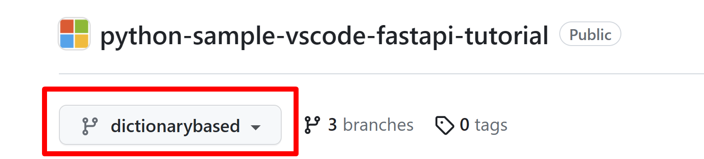

选择 **Code** > **Codespaces** > **Create Codespace on <dictionarybased>** 创建并打开 codespace。完成后直接跳到[替换数据库](#replace-the-database)。

### 在 VS Code 本地开发 {#locally-in-vs-code}

需要：

* [VS Code](https://code.visualstudio.com/)
* [Python 3](https://www.python.org/downloads/)
* [Python 扩展](https://marketplace.visualstudio.com/items?itemName=ms-python.python)

1. 创建项目文件夹并打开：

   ```bash
   mkdir grocery-list
   cd grocery-list
   code .
   ```

2. 使用 **Python: Create Environment** 创建虚拟环境（选择 Venv 和基础解释器），并自动选择。

   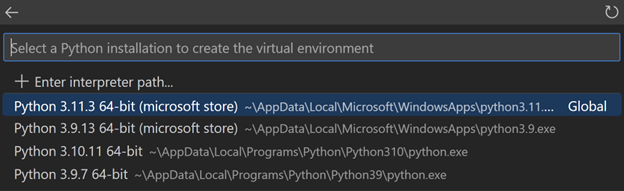

3. 创建 `requirements.txt`：

   ```text
   fastapi
   uvicorn[standard]
   ```

4. 使用 **Python: Create Environment** 时选择 `requirements.txt`，或运行：

   ```bash
   python -m pip install -r requirements.txt
   ```

   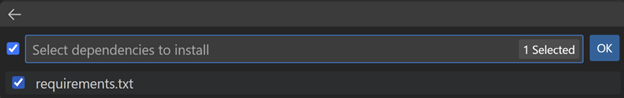

5. 状态栏显示所选环境：

   

## 开始编码 {#start-coding}

1. 创建 `main.py`：

   ```python
   from fastapi import FastAPI

   app = FastAPI()

   @app.get("/")
   def read_root():
       return {"Hello": "World"}
   ```

2. 在终端运行：

   ```bash
   uvicorn main:app --reload
   ```

3. `Ctrl + 单击` `http://127.0.0.1:8000`，浏览器显示 `{"Hello":"World"}`。访问 `http://127.0.0.1:8000/docs` 查看自动生成的交互式 API 文档。

   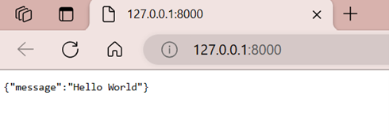

   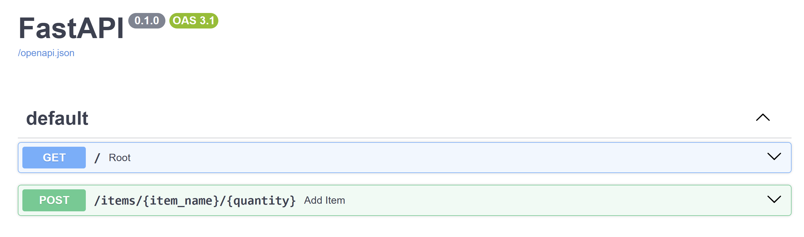

## 创建购物清单模型 {#create-a-model-for-grocery-list-items}

在 `main.py` 中添加：

```python
from pydantic import BaseModel

class ItemPayload(BaseModel):
    item_id: int | None = None
    item_name: str
    quantity: int
```

Pydantic 模型自动验证请求数据。Pylance 会基于类型提示提供 IntelliSense 和类型检查：

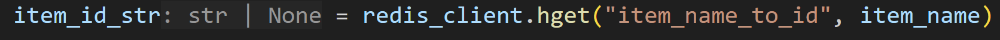

## 创建路由 {#create-routes}

将 `main.py` 替换为包含购物清单路由的代码：

```python
from fastapi import FastAPI, HTTPException
from pydantic import BaseModel

app = FastAPI()

grocery_list: dict[int, "ItemPayload"] = {}

class ItemPayload(BaseModel):
    item_id: int | None = None
    item_name: str
    quantity: int


@app.get("/")
def read_root():
    return {"Hello": "World"}


# 添加商品
@app.post("/items")
def create_item(item: ItemPayload) -> dict[str, ItemPayload]:
    if item.quantity <= 0:
        raise HTTPException(status_code=400, detail="Quantity must be greater than 0.")
    # 商品已存在时只增加数量
    items_ids: dict[str, int] = {
        item.item_name: item.item_id if item.item_id is not None else 0
        for item in grocery_list.values()
    }
    if item.item_name in items_ids.keys():
        item_id: int = items_ids[item.item_name]
        grocery_list[item_id].quantity += item.quantity
    else:
        item_id: int = max(grocery_list.keys()) + 1 if grocery_list else 0
        grocery_list[item_id] = ItemPayload(
            item_id=item_id, item_name=item.item_name, quantity=item.quantity
        )
    return {"item": grocery_list[item_id]}


# 按 ID 列出商品
@app.get("/items/{item_id}")
def list_item(item_id: int) -> dict[str, ItemPayload]:
    if item_id not in grocery_list:
        raise HTTPException(status_code=404, detail="Item not found.")
    return {"item": grocery_list[item_id]}


# 列出全部商品
@app.get("/items")
def list_items() -> dict[str, dict[int, ItemPayload]]:
    return {"items": grocery_list}


# 按 ID 删除商品
@app.delete("/items/{item_id}")
def delete_item(item_id: int) -> dict[str, str]:
    if item_id not in grocery_list:
        raise HTTPException(status_code=404, detail="Item not found.")
    del grocery_list[item_id]
    return {"result": "Item deleted."}


# 按 ID 移除一定数量
@app.delete("/items/{item_id}/{quantity}")
def remove_quantity(item_id: int, quantity: int) -> dict[str, str]:
    if item_id not in grocery_list:
        raise HTTPException(status_code=404, detail="Item not found.")
    if grocery_list[item_id].quantity <= quantity:
        del grocery_list[item_id]
        return {"result": "Item deleted."}
    else:
        grocery_list[item_id].quantity -= quantity
    return {"result": f"{quantity} items removed."}
```

保存后应用自动重载。打开 `/docs` 使用 **Try it out** 测试路由：

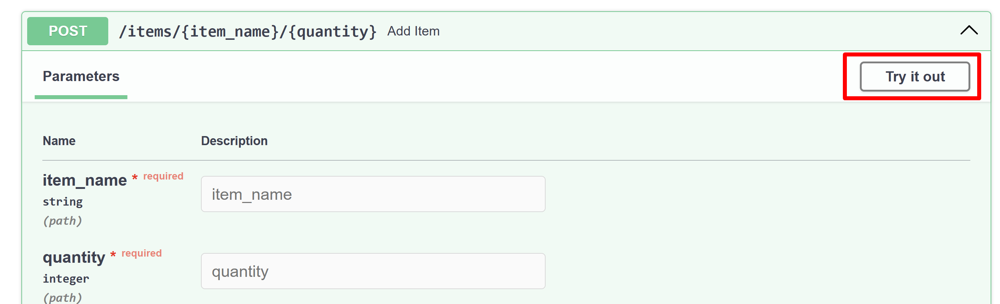

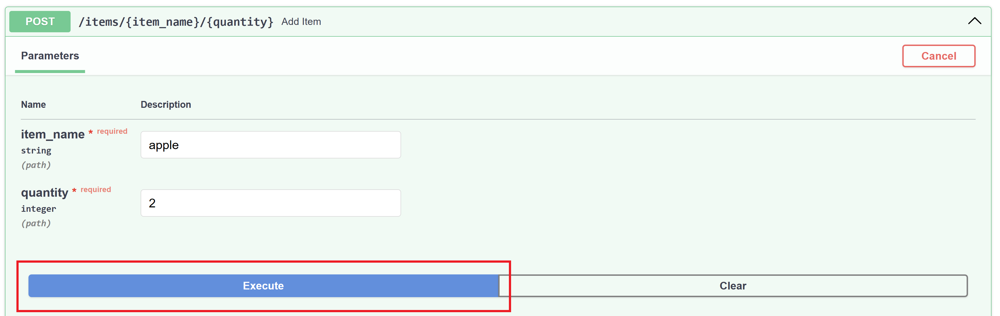

## 设置数据存储 {#set-up-the-data-storage}

当前数据保存在字典中，重启应用会丢失。可以使用 [Redis](https://redis.io) 持久化数据。

### 在 Windows 上设置 Docker 容器 {#setting-up-a-docker-container-on-windows}

使用 [Dev Containers](../../../remote/8.5-DevContainers/)扩展将项目和依赖放入容器。需要：

* [Docker Desktop](https://www.docker.com/products/docker-desktop)
* [Dev Containers 扩展](https://marketplace.visualstudio.com/items?itemName=ms-vscode-remote.remote-containers)

#### 创建 Dev Container 配置 {#create-the-dev-container-configuration}

1. 打开命令面板，运行 **Dev Containers: Add Dev Container Configuration Files...**
2. 选择 **Python 3** 和默认版本：

   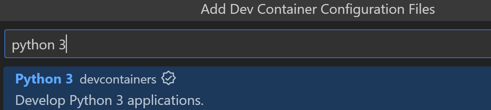

3. 选择 **Redis Server** 功能：

   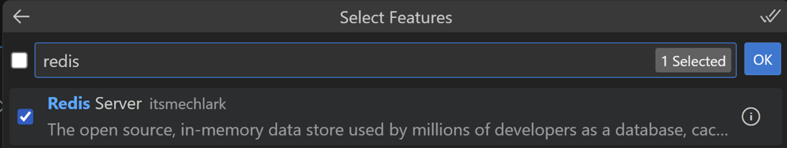

4. 重新打开容器后，状态栏显示 Dev Container 指示器：

   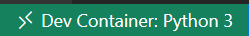

5. 在容器中选择 Python 解释器：

   

## 替换数据库 {#replace-the-database}

1. 在 `requirements.txt` 添加：

   ```text
   redis
   ```

2. 安装：

   ```bash
   python -m pip install -r requirements.txt
   ```

3. 在 `main.py` 中：

   ```python
   import redis
   from fastapi import FastAPI, HTTPException
   from pydantic import BaseModel

   app = FastAPI()
   r = redis.Redis(host="localhost", port=6379, db=0, decode_responses=True)
   ```

4. 将字典操作替换为 Redis 哈希操作。例如商品存储使用 `r.hset`、`r.hgetall`、`r.delete`。完整代码请参阅[示例仓库](https://github.com/microsoft/python-sample-vscode-fastapi-tutorial)。

5. Pylance 会提示 Redis 类型，可以使用 **快速修复** 添加类型提示：

   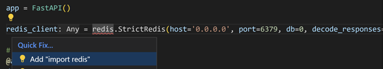

## 可选：设置数据库删除 {#optional-set-up-database-deletion}

可以在启动时清空 Redis 数据库（仅开发环境）：

```python
r.flushdb()
```

## 可选：创建 GPT Action {#optional-create-a-gpt-action}

FastAPI 自动生成的 OpenAPI schema 可以用于 ChatGPT GPT Action。启动应用后访问 `/openapi.json`，将该 schema 用于 GPT Action 配置。

## 后续步骤 {#next-steps}

完整示例代码位于 [python-sample-vscode-fastapi-tutorial](https://github.com/microsoft/python-sample-vscode-fastapi-tutorial)。

更多 FastAPI 内容请参阅[官方文档](https://fastapi.tiangolo.com/)。部署到生产请参阅[使用 Docker 容器将 Python 应用部署到 Azure App Service](https://learn.microsoft.com/azure/developer/python/tutorial-deploy-containers-01)。

相关 VS Code Python 文档：

* [编辑 Python 代码](10.5.4-Editing/)
* [管理 Python 环境](10.5.8-Environments/)
* [调试 Python](10.5.7-Debugging/)
* [测试](10.5.9-Testing/)
