+++
title = "10.5.13 Flask 教程"
date = 2026-11-06T07:53:25+08:00
weight = 13
type = "docs"
description = ""
isCJKLanguage = true
draft = false
+++


> 原文链接: [https://code.visualstudio.com/docs/python/tutorial-flask](https://code.visualstudio.com/docs/python/tutorial-flask)

# 10.5.13 Flask 教程

　　Flask 是轻量 Python Web 框架，提供 URL 路由和页面渲染基础。它被称为“微”框架，因为不直接提供表单验证、数据库抽象、身份验证等功能，这些由 Flask 扩展提供。安装 Flask 时默认包含 Jinja 模板引擎，通常视为 Flask 的一部分。

　　本教程创建包含三个页面并共享基础模板的简单 Flask 应用，使用 VS Code 终端、编辑器、调试器和代码片段。

完整示例代码位于 GitHub：[python-sample-vscode-flask-tutorial](https://github.com/microsoft/python-sample-vscode-flask-tutorial)。

## 前提条件 {#prerequisites}

1. 安装 [Python 扩展](https://marketplace.visualstudio.com/items?itemName=ms-python.python)。
2. 安装 Python 3：
   * 从 [python.org](https://www.python.org/downloads/)下载。
   * Linux 内置 Python 3 可用，但安装包需要运行 `sudo apt install python3-pip`。
   * macOS 使用 `brew install python3`。
   * 也可以使用 [Anaconda](https://www.anaconda.com/download/)。
3. Windows 上确保 Python 解释器在 PATH 中。可以运行 `path` 检查，必要时在 **编辑账户的环境变量** 中修改 **Path**。

## 创建项目环境 {#create-a-project-environment-for-the-flask-tutorial}

1. 创建文件夹 `hello_flask` 并在 VS Code 中打开。
2. 使用 **Python: Create Environment** 命令：
   1. 打开命令面板（`Ctrl + Shift + P`，macOS：`Cmd + Shift + P`）。
   2. 选择 **Python: Create Environment**。
   3. 选择 **Venv**。
   4. 选择基础解释器。

   VS Code 会创建 `.venv` 并选择它。

3. 安装 Flask。可以在 **环境管理器** 中右键 `.venv` 选择 **管理包** 安装，或在集成终端运行：

   ```bash
   python -m pip install flask
   ```

   状态栏应显示 **('.venv': venv)**。

   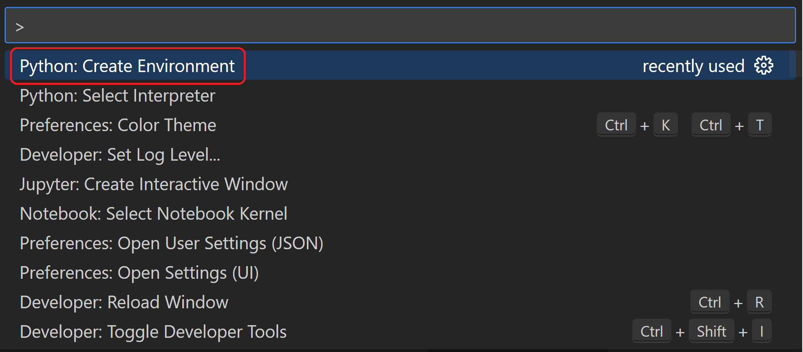

## 创建并运行最小 Flask 应用 {#create-and-run-a-minimal-flask-app}

1. 在项目文件夹创建 `app.py`：

   ```python
   from flask import Flask

   app = Flask(__name__)


   @app.route("/")
   def home():
       return "Hello, Flask!"
   ```

   > **提示**：可以为同一个函数添加多个 `@app.route` 装饰器，映射多个 URL。

2. 保存文件，在集成终端运行：

   ```bash
   python -m flask run
   ```

   Flask 开发服务器默认查找 `app.py`，输出类似：

   ```bash
   (.venv) D:\py\hello_flask>python -m flask run
    * Environment: production
      WARNING: Do not use the development server in a production environment.
      Use a production WSGI server instead.
    * Debug mode: off
    * Running on http://127.0.0.1:5000/ (Press CTRL+C to quit)
   ```

   出现找不到 Flask 模块时，请确认已在虚拟环境运行 `python -m pip install flask`。使用其他 IP 或端口：`--host=0.0.0.0 --port=80`。

3. `Ctrl + 单击`终端中的 `http://127.0.0.1:5000/` 打开浏览器：

   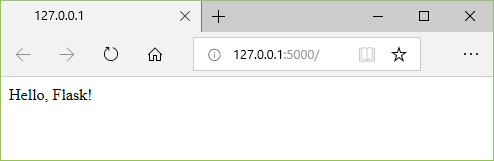

4. 访问页面时终端显示请求日志：

   ```bash
   127.0.0.1 - - [11/Jul/2018 08:40:15] "GET / HTTP/1.1" 200 -
   ```

5. 按 `Ctrl + C` 停止应用。

> **提示**：文件名不是 `app.py`（例如 `webapp.py`）时，需要设置环境变量 `FLASK_APP` 为文件名，Flask 会使用该值。详情请参阅 [Flask 命令行接口](https://flask.palletsprojects.com/en/1.1.x/cli/)。

## 在调试器中运行应用 {#run-the-app-in-the-debugger}

**开始前**：确保上一个应用已停止。否则端口仍被占用，新调试器不会收到请求，也不会命中断点。

1. 将 `app.py` 替换为：

   ```python
   import re
   from datetime import datetime

   from flask import Flask

   app = Flask(__name__)


   @app.route("/")
   def home():
       return "Hello, Flask!"


   @app.route("/hello/<name>")
   def hello_there(name):
       now = datetime.now()
       formatted_now = now.strftime("%A, %d %B, %Y at %X")

       # 使用正则表达式将 name 限制为字母。URL 参数可包含任意文本，
       # 因此只允许安全字符。
       match_object = re.match("[a-zA-Z]+", name)

       if match_object:
           clean_name = match_object.group(0)
       else:
           clean_name = "Friend"

       content = "Hello there, " + clean_name + "! It's " + formatted_now
       return content
   ```

   `/hello/<name>` 定义接受字符串变量 `name` 的端点。URL 路由区分大小写。

2. 在 `hello_there` 第一行 `now = datetime.now()` 设置断点（`F9` 或单击行号左侧）：

   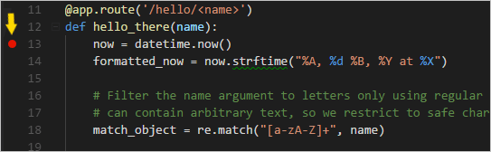

3. 切换到 **运行和调试** 视图，选择 **创建 launch.json 文件**，选择 **Flask** 调试配置：

   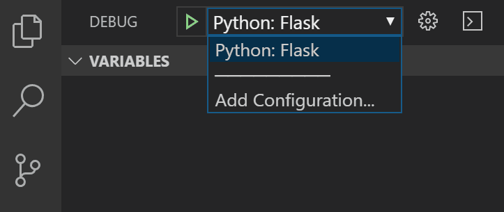

   VS Code 会创建类似配置：

   ```json
   {
       "name": "Python Debugger: Flask",
       "type": "debugpy",
       "request": "launch",
       "module": "flask",
       "env": {
           "FLASK_APP": "app.py"
       },
       "args": [
           "run",
           "--no-debugger"
       ],
       "jinja": true
   }
   ```

   `FLASK_APP` 只引用文件名，避免驱动器盘符错误。`jinja: true` 启用 Jinja 模板调试。

4. 按 `F5` 启动调试。状态栏变色，显示调试工具栏：

   

   

5. 浏览器访问 `http://127.0.0.1:5000/hello/VSCode`，程序在断点暂停：

   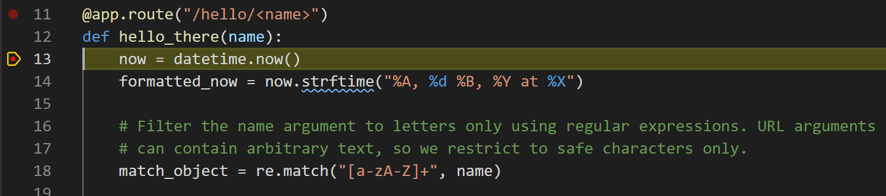

6. 使用 **单步跳过** 执行 `now = datetime.now()`。**变量** 面板显示 `now`、`name` 等：

   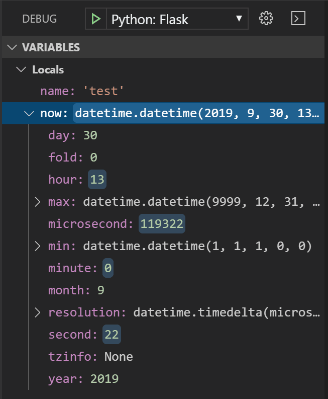

7. 选中 `now.strftime("%A, %d %B, %Y at %X")`，右键选择 **在调试控制台中求值**：

   ```bash
   now.strftime("%A, %d %B, %Y at %X")
   'Wednesday, 31 October, 2018 at 18:13:39'
   ```

   也可以在调试控制台 `>` 提示符尝试：

   ```bash
   now.strftime("%a, %d %B, %Y at %X")
   'Wed, 31 October, 2018 at 18:13:39'
   now.strftime("%a, %d %b, %Y at %X")
   'Wed, 31 Oct, 2018 at 18:13:39'
   now.strftime("%a, %d %b, %y at %X")
   'Wed, 31 Oct, 18 at 18:13:39'
   ```

8. 选择 **继续** 运行，浏览器显示结果：

   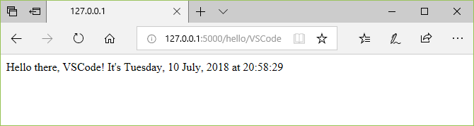

9. 修改日期格式，例如 `now.strftime("%a, %d %b, %y at %X")`，保存后 Flask 自动重载，刷新浏览器查看。完成后停止调试。

> **提示**：需要反复访问特定 URL 时，可以用 `print` 输出 URL，然后 `Ctrl + 单击`打开。

## 转到定义和速览定义 {#go-to-definition-and-peek-definition-commands}

* **转到定义**（`F12`）：从代码跳转到对象定义。例如右键 `Flask` 类选择 **转到定义**。
* **速览定义**（`Alt + F12`，macOS：`Option + F12`）：在编辑器中直接显示定义。按 `Escape` 或右上角 **x** 关闭。

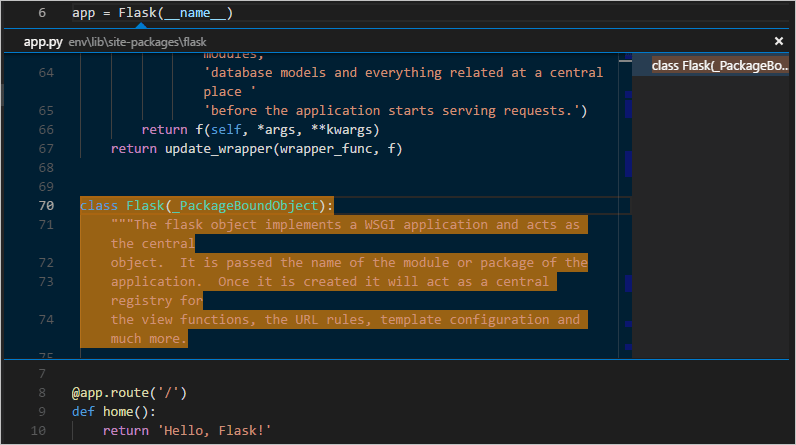

## 使用模板渲染页面 {#use-a-template-to-render-a-page}

　　直接在代码中生成 HTML 容易受到跨站脚本（XSS）攻击。应使用**模板**：代码只处理数据，模板只处理标记。Flask 默认模板引擎是 [Jinja](https://jinja.palletsprojects.com)，支持自动转义和模板继承。

1. 在 `hello_flask` 中创建 `templates` 文件夹。
2. 创建 `templates/hello_there.html`：

   ```html
   <!DOCTYPE html>
   <html>
       <head>
           <meta charset="utf-8" />
           <title>Hello, Flask</title>
       </head>
       <body>
           <strong>Hello there, {{ name }}!</strong> It's {{ date | date:"l, d F, Y" }} at {{ date | time:"H:i:s" }}
       </body>
   </html>
   ```

3. 在 `app.py` 顶部添加：

   ```python
   from flask import render_template
   ```

4. 修改 `hello_there`：

   ```python
   @app.route("/hello/<name>")
   def hello_there(name):
       return render_template(
           "hello_there.html",
           name=name,
           date=datetime.now()
       )
   ```

5. 运行并访问 `/hello/name`。访问包含 HTML 的名字时，Jinja 会自动转义。

## 提供静态文件 {#serve-static-files}

静态文件（CSS、JavaScript、图片）原样返回。Flask 默认从 `static` 文件夹提供，URL 路径为 `/static/<path>`。

### 在模板中引用静态文件 {#refer-to-static-files-in-a-template}

1. 创建 `static/site.css`：

   ```css
   .message {
       font-weight: 600;
       color: blue;
   }
   ```

2. 在 `templates/hello_there.html` 的 `<head>` 中添加：

   ```html
   <link rel="stylesheet" type="text/css" href="{{ url_for('static', filename='site.css') }}" />
   ```

3. 将 `<body>` 内容改为：

   ```html
   <span class="message">Hello, there {{ name }}!</span> It's {{ date | date:'l, d F, Y' }} at {{ date | time:'H:i:s' }}.
   ```

4. 运行并访问 `/hello/name`，消息应显示为蓝色。

### 从代码提供静态文件 {#serve-a-static-file-from-code}

可以使用 `send_from_directory` 或 `send_file` 返回静态文件。通常直接使用 `/static` 路径即可。

## 创建扩展基础模板的多个页面 {#create-multiple-templates-that-extend-a-base-template}

### 创建基础模板和样式 {#create-a-base-page-template-and-styles}

1. 创建 `templates/layout.html`：

   ```html
   <!DOCTYPE html>
   <html>
   <head>
       <meta charset="utf-8"/>
       <title></title>
       <link rel="stylesheet" type="text/css" href="{{ url_for('static', filename='site.css') }}"/>
   </head>

   <body>
   <div class="navbar">
       <a href="{{ url_for('home') }}" class="navbar-brand">Home</a>
       <a href="{{ url_for('about') }}" class="navbar-item">About</a>
       <a href="{{ url_for('contact') }}" class="navbar-item">Contact</a>
   </div>

   <div class="body-content">
       
       
       <hr/>
       <footer>
           <p>&copy; 2018</p>
       </footer>
   </div>
   </body>
   </html>
   ```

2. 在 `static/site.css` 添加：

   ```css
   .navbar {
       background-color: lightslategray;
       font-size: 1em;
       font-family: 'Trebuchet MS', 'Lucida Sans Unicode', 'Lucida Grande', 'Lucida Sans', Arial, sans-serif;
       color: white;
       padding: 8px 5px 8px 5px;
   }

   .navbar a {
       text-decoration: none;
       color: inherit;
   }

   .navbar-brand {
       font-size: 1.2em;
       font-weight: 600;
   }

   .navbar-item {
       font-variant: small-caps;
       margin-left: 30px;
   }

   .body-content {
       padding: 5px;
       font-family:'Segoe UI', Tahoma, Geneva, Verdana, sans-serif;
   }
   ```

### 创建代码片段 {#create-a-code-snippet}

1. **文件 > 首选项 > 用户代码片段**，选择 **html**。
2. 在 `html.json` 添加：

   ```json
   "Flask Tutorial: template extending layout.html": {
       "prefix": "flaskextlayout",
       "body": [
           "",
           "",
           "$0",
           "",
           "",
           ""
       ],
       "description": "Boilerplate template that extends layout.html"
   },
   ```

3. 保存。输入 `flaskext` 使用片段，或运行 **插入代码片段**。

### 使用代码片段添加页面 {#use-the-code-snippet-to-add-pages}

1. 创建 `templates/home.html`，输入 `flaskext` 选择片段：

   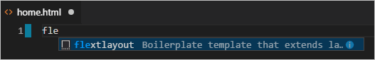

   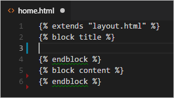

2. 在 title 块输入 `Home`，content 块输入 `<p>Home page for the Visual Studio Code Flask tutorial.</p>`，保存。
3. 创建 `about.html`，title `About us`，content `<p>About page for the Visual Studio Code Flask tutorial.</p>`。
4. 创建 `contact.html`，title `Contact us`，content `<p>Contact page for the Visual Studio Code Flask tutorial.</p>`。
5. 在 `app.py` 添加路由：

   ```python
   @app.route("/home")
   def home():
       return render_template("home.html")


   @app.route("/about")
   def about():
       return render_template("about.html")


   @app.route("/contact")
   def contact():
       return render_template("contact.html")
   ```

   注意 `home` 函数与原始 `/` 路由冲突时，请调整路由或函数名。

6. 也可以将 `/` 路由改为 `render_template("home.html")`：

   ```python
   @app.route("/")
   def home():
       return render_template("home.html")
   ```

### 运行应用 {#run-the-app}

保存并运行，浏览首页并在页面间导航，验证模板继承：

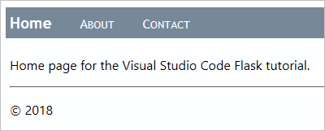

## 可选活动 {#optional-activities}

### 创建 requirements.txt {#create-a-requirementstxt-file-for-the-environment}

1. 使用 **Python: Select Interpreter** 选择环境，运行 **终端: 创建新终端**。
2. 运行 `pip freeze > requirements.txt`。

其他人或构建服务器只需运行 `pip install -r requirements.txt` 重建依赖。

### 重构项目以支持后续开发 {#refactor-the-project-to-support-further-development}

将单文件应用拆分为包结构：

```text
hello_flask/
    app.py
    hello/
        __init__.py
        routes.py
        templates/
        static/
```

在 `hello/__init__.py` 创建应用工厂：

```python
from flask import Flask

def create_app():
    app = Flask(__name__)
    from . import routes
    app.register_blueprint(routes.bp)
    return app
```

在 `hello/routes.py` 使用 Blueprint 定义路由。详情请参阅 [Flask 蓝图文档](https://flask.palletsprojects.com/blueprints/)。

### 使用容器工具创建 Flask 容器 {#create-a-container-for-a-flask-app-using-the-container-tools-extension}

[容器工具扩展](https://marketplace.visualstudio.com/items?itemName=ms-azuretools.vscode-containers)可以在 VS Code 中构建、管理和部署容器化应用。[Python 容器教程](https://code.visualstudio.com/docs/containers/quickstart-python)介绍如何创建 `Dockerfile`、构建运行 Flask 应用并在容器中调试。

## 后续步骤 {#next-steps}

完整示例代码位于 [python-sample-vscode-flask-tutorial](https://github.com/microsoft/python-sample-vscode-flask-tutorial)。

更多内容请参阅 [Flask 官方教程](https://flask.palletsprojects.com/tutorial)和 [Flask 扩展文档](https://flask.palletsprojects.com/extensions/)。

相关 VS Code Python 文档：

* [编辑 Python 代码](10.5.4-Editing/)
* [Lint](10.5.5-Linting/)
* [管理 Python 环境](10.5.8-Environments/)
* [调试 Python](10.5.7-Debugging/)
* [测试](10.5.9-Testing/)
