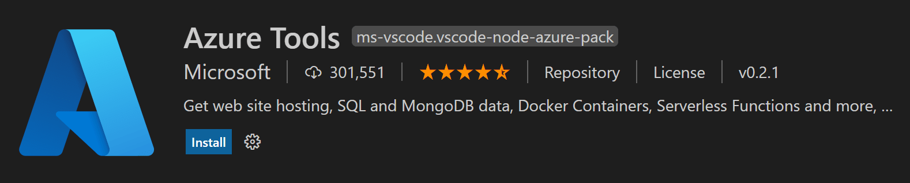

+++
title = "10.5.15 部署 Python 应用"
date = 2026-11-06T07:53:25+08:00
weight = 15
type = "docs"
description = ""
isCJKLanguage = true
draft = false
+++

> 原文链接: [https://code.visualstudio.com/docs/python/python-on-azure](https://code.visualstudio.com/docs/python/python-on-azure)

# 10.5.15 部署 Python 应用

　　适用于 VS Code 的 [Azure Tools](https://marketplace.visualstudio.com/items?itemName=ms-vscode.vscode-node-azure-pack)扩展让部署 Python 应用（包括容器）到 [Azure App Service](https://azure.microsoft.com/services/app-service)以及将无服务器代码部署到 [Azure Functions](https://azure.microsoft.com/services/functions)变得简单。

## 部署教程 {#deployment-tutorials}

以下 [Python Azure 开发者中心](https://learn.microsoft.com/azure/developer/python)教程介绍详细步骤：

| 教程 | 说明 | 相关工具 |
| --- | --- | --- |
| [将 Python Web 应用部署到 Azure App Service](https://learn.microsoft.com/azure/app-service/quickstart-python) | 部署简单 Web 应用 | [Django](https://www.djangoproject.com/)   [Flask](https://flask.palletsprojects.com/)   [Azure CLI](https://marketplace.visualstudio.com/items?itemName=ms-vscode.azurecli)   [Azure App Service](https://marketplace.visualstudio.com/items?itemName=ms-azuretools.vscode-azureappservice)   [Azure Tools](https://marketplace.visualstudio.com/items?itemName=ms-vscode.vscode-node-azure-pack) |
| [将带数据库的 Python Web 应用部署到 Azure App Service](https://learn.microsoft.com/azure/app-service/tutorial-python-postgresql-app) | 部署带 PostgreSQL 数据库的 Web 应用 | [Django](https://www.djangoproject.com/)   [Flask](https://flask.palletsprojects.com/)   [PostgreSQL](https://www.postgresql.org/download/)   [Azure App Service](https://marketplace.visualstudio.com/items?itemName=ms-azuretools.vscode-azureappservice)   [Azure Tools](https://marketplace.visualstudio.com/items?itemName=ms-vscode.vscode-node-azure-pack) |
| [将 Python 容器部署到 Azure App Service](https://learn.microsoft.com/azure/developer/python/tutorial-deploy-containers-01) | 部署容器 | [容器工具](https://marketplace.visualstudio.com/items?itemName=ms-azuretools.vscode-containers)   [Azure App Service](https://marketplace.visualstudio.com/items?itemName=ms-azuretools.vscode-azureappservice)   [Azure Tools](https://marketplace.visualstudio.com/items?itemName=ms-vscode.vscode-node-azure-pack) |
| [将 Python 部署到 Azure Functions](https://learn.microsoft.com/azure/azure-functions/create-first-function-vs-code-python) | 使用 Azure Functions 部署无服务器代码 | [Azure Functions Core Tools](https://learn.microsoft.com/en-us/azure/azure-functions/functions-run-local#install-the-azure-functions-core-tools)   [Azure Functions](https://marketplace.visualstudio.com/items?itemName=ms-azuretools.vscode-azurefunctions)   [Azure Tools](https://marketplace.visualstudio.com/items?itemName=ms-vscode.vscode-node-azure-pack) |
