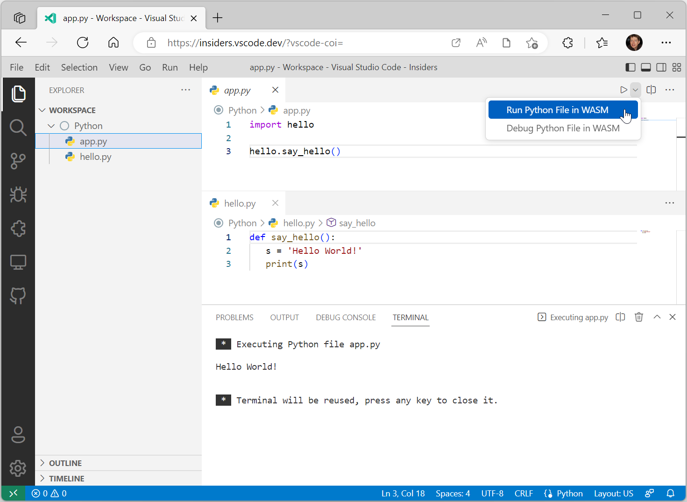
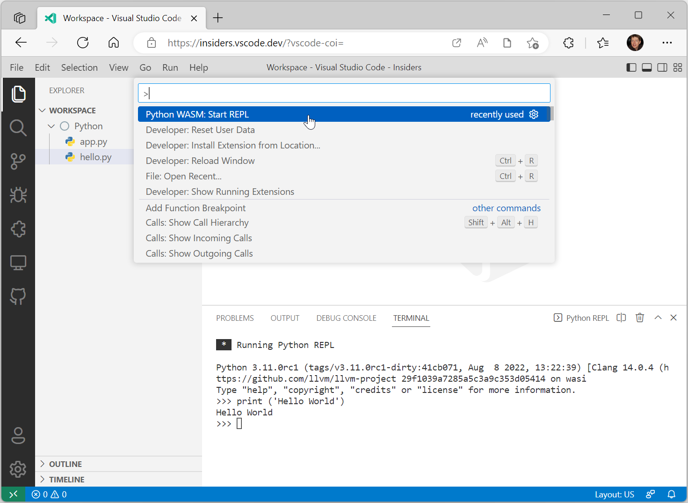
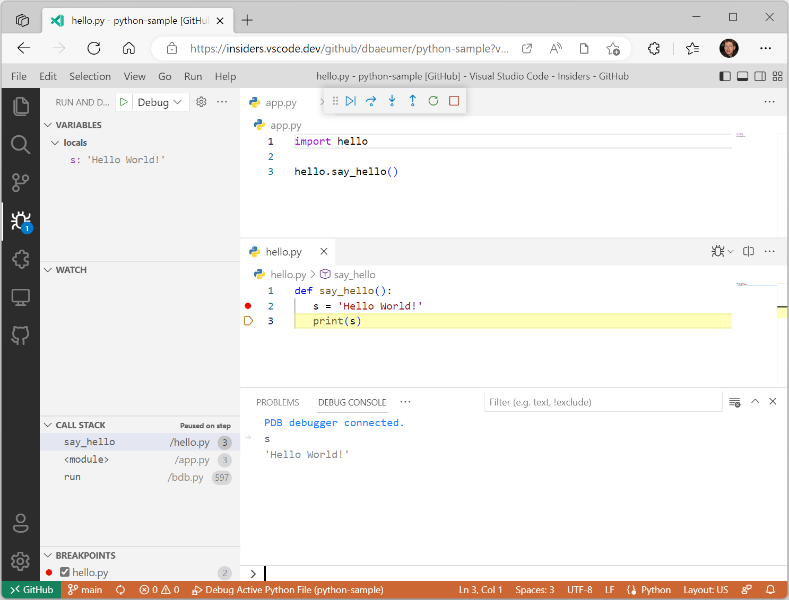

+++
title = "10.5.16 Web 中的 Python"
date = 2026-11-06T07:53:25+08:00
weight = 16
type = "docs"
description = ""
isCJKLanguage = true
draft = false
+++


> 原文链接: [https://code.visualstudio.com/docs/python/python-web](https://code.visualstudio.com/docs/python/python-web)

# 10.5.16 Web 中的 Python

　　我们很高兴宣布**实验性**支持在 Web 上运行 Python 代码。请从 Marketplace 安装最新预发布版 [Experimental - Python for the Web](https://marketplace.visualstudio.com/items?itemName=ms-vscode.vscode-python-web-wasm)扩展试用。该工作基于仍在开发中的 Python WASM 支持。工作原理和进展请参阅[将 Python 编译为 WebAssembly（WASM）](https://pythondev.readthedocs.io/wasm.html)。

## 前提条件 {#prerequisites}

使用该扩展需要：

* 安装 [GitHub Repositories](https://marketplace.visualstudio.com/items?itemName=GitHub.remotehub)扩展。
* 使用 GitHub 进行身份验证。
* 使用支持[跨源隔离](https://developer.chrome.com/docs/extensions/mv3/cross-origin-isolation/)的浏览器。扩展已在 Microsoft Edge 和 Google Chrome 测试。
* 使用 [VS Code for the Web](../../../remote/8.1-VSCodeForTheWeb/) 的 Insiders 版本（例如 `https://insiders.vscode.dev/`）。
* 源代码位于本地文件系统，或通过 GitHub Repositories 扩展访问的 GitHub 仓库。
* 启动 VS Code for the Web 时在 URL 末尾添加查询参数 `?vscode-coi=`。

## 运行 Hello World {#run-hello-world}

下图展示在浏览器中执行简单 Python 程序。程序包含本地文件系统中的 `app.py` 和 `hello.py` 两个文件。



## 启动 REPL {#start-a-repl}

扩展包含集成 Python REPL。运行 **Python WASM: Start REPL** 命令激活。



## 调试 {#debugging}

支持在 Web 上调试 Python 文件，使用与 VS Code 桌面版[调试](10.5.7-Debugging/)相同的 UI。当前支持：

* 设置断点
* 单步进入和跳出函数
* 跨模块调试
* 在调试控制台求值变量
* 在集成终端调试程序

下图展示活动调试会话，文件托管在此[示例仓库](https://github.com/dbaeumer/python-sample)的 GitHub 上。



## 创建自己的 Python 环境 {#create-your-own-python-environment}

扩展使用基于 [CPython WebAssembly 构建](https://github.com/tiran/cpython-wasm-test/releases)的预配置 Python 环境，构建版本为 `Python-3.11.0-wasm32-wasi-16.zip`。

可以按以下步骤创建自己的 Python 环境，包括包含源码 wheel 的 Python 包：

* 创建新的 GitHub 仓库。
* 从 [cpython-wasm-test/releases](https://github.com/tiran/cpython-wasm-test/releases) 下载 wasm-wasi-16 构建并解压到仓库根目录。
* 添加源码 wheel 包：
  * 在根目录创建 `site-packages` 文件夹。
  * 运行 `pip install my_package --target ./site-packages` 安装包。系统需要安装包含 pip 的 Python。
* 提交更改。
* 将 `python.wasm.runtime` 设置指向 GitHub 仓库，例如：

  ```json
  {
    "python.wasm.runtime": "https://github.com/dbaeumer/python-3.11.0"
  }
  ```

## 限制 {#limitations}

　　Web 中的 Python 不提供本地运行源代码的全部功能。Python 解释器主要限制：

* 不支持套接字。
* 不支持线程，因此不支持异步。
* 不支持 pip。
* 不支持本机 Python 模块。

## 致谢 {#acknowledgment}

　　感谢 Python 社区构建和维护 CPython 所需 WASM 文件。

## 反馈 {#feedback}

使用 Python for the Web 扩展遇到问题时，可以在 [vscode-python-web-wasm](https://github.com/microsoft/vscode-python-web-wasm) 仓库创建议题。
