+++
title = "10.5.2 Python 教程"
date = 2026-11-06T07:53:25+08:00
weight = 2
type = "docs"
description = ""
isCJKLanguage = true
draft = false
+++


> 原文链接: [https://code.visualstudio.com/docs/python/python-tutorial](https://code.visualstudio.com/docs/python/python-tutorial)

# 10.5.2 Python 教程

　　本教程学习如何在 VS Code 中使用 Python 3 创建、运行和调试“掷骰子”应用，使用虚拟环境、安装包等。使用 [Python 扩展](https://marketplace.visualstudio.com/items?itemName=ms-python.python)，可以将 VS Code 变成出色的轻量 Python 编辑器。

　　刚接触编程时，可以查看 [VS Code for Education - Python 入门](https://vscodeedu.com/courses/intro-to-python)课程。

要深入了解 Python 语言，可以在 VS Code 上下文中探索 python.org 列出的[编程教程](https://wiki.python.org/moin/BeginnersGuide/Programmers)。

数据科学教程请参阅[数据科学部分](https://code.visualstudio.com/docs/datascience/data-science-tutorial)。

## 前提条件 {#prerequisites}

完成本教程需要先设置 Python 开发环境：

* [Python 3](#install-a-python-interpreter)
* [VS Code](https://code.visualstudio.com/)
* [VS Code Python 扩展](https://marketplace.visualstudio.com/items?itemName=ms-python.python)（扩展安装详情请参阅[扩展 Marketplace](../../../editor/3.3-ConfigureTheEditor/3.3.6-Extensions/3.3.6.2-ExtensionMarketplace/)）

## 理解 Python 设置 {#understand-the-python-setup}

在 VS Code 中运行 Python 需要三个独立部分协同工作：

* **VS Code**：编写和组织代码的编辑器。
* **Python 扩展**：为 VS Code 添加 Python 语言支持，例如 IntelliSense、运行和调试。扩展本身不包含 Python。
* **Python 解释器**：实际运行 Python 代码的程序，需要单独安装。

VS Code 是工作区，Python 扩展将 VS Code 连接到 Python，解释器负责运行脚本。

## 安装 Python 解释器 {#install-a-python-interpreter}

除了 Python 扩展，还需要安装 Python 解释器。

### Windows {#windows}

从 [python.org 安装 Python](https://www.python.org/downloads/)。单击页面首个 **Download Python** 按钮下载最新版本。

> **注意**：没有管理员权限时，可以使用 Microsoft Store 安装[受支持的 Python 版本](https://apps.microsoft.com/store/search?publisher=Python%20Software%20Foundation)。

Windows 上使用 Python 的更多信息请参阅 [Python.org 的 Windows 指南](https://docs.python.org/3.9/using/windows.html)。

### macOS {#macos}

不支持 macOS 系统自带 Python。建议使用 [Homebrew](https://brew.sh/) 等包管理器。在终端运行 `brew install python3`。

> **注意**：请确保 VS Code 安装位置在 PATH 环境变量中。详情请参阅 [macOS 设置说明](../../../advanced-setup/9.3-macOS/)。

### Linux {#linux}

Linux 内置 Python 3 通常可用，但安装其他包需要用 [get-pip.py](https://pip.pypa.io/en/stable/installation/#get-pip-py) 安装 `pip`。

### 其他选项 {#other-options}

* **数据科学**：主要用 Python 做数据科学时，可以下载 [Anaconda](https://www.anaconda.com/download/)，其中包含 Python 解释器和许多数据科学库。
* **Windows Subsystem for Linux**：Windows 上需要 Linux 环境时，可以使用 WSL 并安装 [WSL 扩展](https://marketplace.visualstudio.com/items?itemName=ms-vscode-remote.remote-wsl)。详情请参阅[远程开发](../../../remote/)或[在 WSL 中工作](../../../remote/8.7-WSLTutorial/)教程。

> **注意**：验证 Python 安装：
>
> Linux/macOS：在终端运行 `python3 --version`
> Windows：在命令提示符运行 `py -3 --version`
>
> 也可以在 VS Code 集成终端运行 `py -0` 查看已安装版本，默认解释器用星号标记。

> **注意**：请在终端（shell）运行这些命令。安装 Python 时 VS Code 或终端已打开，请关闭并重新打开终端（或重启 VS Code），使其检测到新解释器。终端启动时读取系统配置，因此需要新终端才能找到 PATH 中的 Python。

## 在工作区文件夹中启动 VS Code {#start-vs-code-in-a-workspace-folder}

在文件夹中启动 VS Code 后，该文件夹成为“工作区”。

在命令提示符或终端创建空文件夹 `hello`，进入并从该文件夹（`.`）启动 VS Code：

```bash
mkdir hello
cd hello
code .
```

> **注意**：使用 Anaconda 发行版时，请使用 Anaconda 命令提示符。

也可以通过操作系统 UI 创建文件夹，然后使用 VS Code **文件 > 打开文件夹** 打开。

## 创建虚拟环境 {#create-a-virtual-environment}

Python 开发最佳实践是使用项目特定的 `virtual environment`。激活后安装的包与其他环境（包括全局解释器环境）隔离，减少包版本冲突问题。可以使用 **Python: Create Environment** 命令通过 Venv 或 Anaconda 创建非全局环境。

创建虚拟环境：

1. 打开命令面板（`Ctrl + Shift + P`）。
2. 搜索并选择 **Python: Create Environment**。
3. 选择 **Venv** 创建 venv 环境。
4. 选择用于环境的 Python 解释器。

选择后，通知会显示创建进度，工作区出现环境文件夹（`/.venv`）。

> **提示**：也可以使用 **Python** 侧边栏创建环境。展开 **环境管理器**，选择 **+** 按钮快速创建，使用合理默认值。

确保使用 **Python: Select Interpreter** 命令选择新环境。

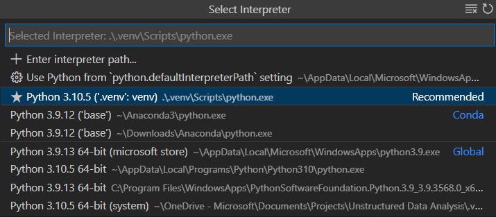

> **注意**：虚拟环境详情或创建错误请参阅[环境](10.5.8-Environments/#create-environments)。

## 创建 Python 源代码文件 {#create-a-python-source-code-file}

在文件资源管理器工具栏选择 `hello` 文件夹上的 **新建文件** 按钮：

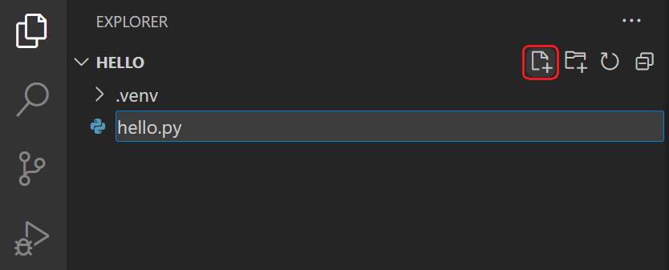

命名为 `hello.py`，VS Code 会自动在编辑器中打开：

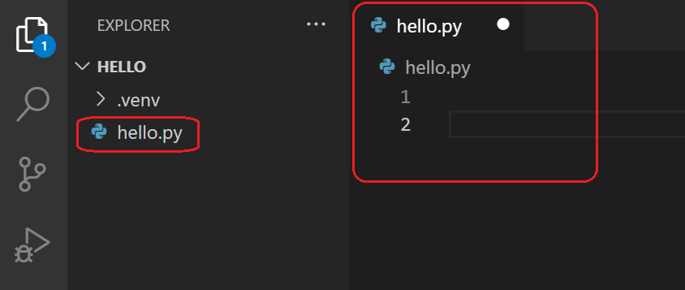

使用 `.py` 扩展名告诉 VS Code 将其解释为 Python 程序，用 Python 扩展和所选解释器分析内容。

> **注意**：文件资源管理器工具栏还可以创建文件夹整理代码。

在 `hello.py` 中输入：

```python
msg = "Roll a dice!"
print(msg)
```

输入 `print` 时会看到 [IntelliSense](../../../editor/3.2-WriteCode/3.2.2-IntelliSense/) 自动补全。

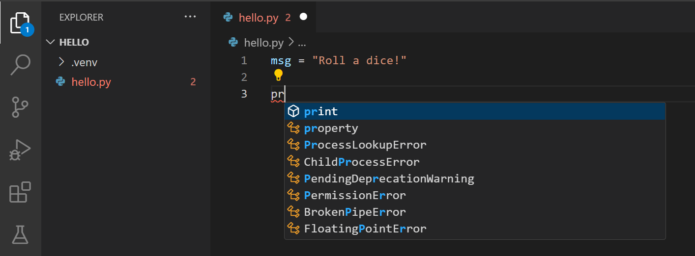

IntelliSense 对标准 Python 模块和已安装包都有效，也提供对象类型方法补全。例如 `msg` 是字符串，输入 `msg.` 时会提供字符串方法：

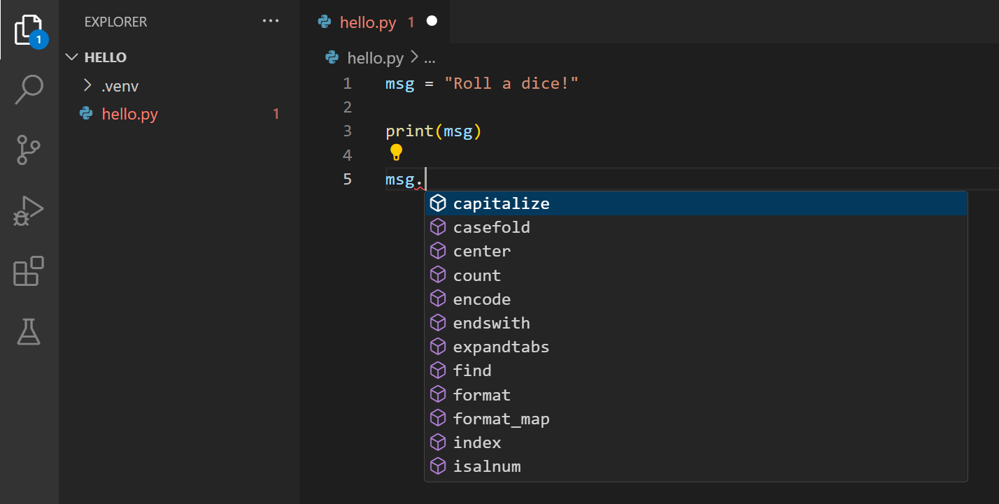

保存文件（`Ctrl + S`）后即可运行第一个 Python 文件。编辑、格式化和重构详情请参阅[编辑代码](10.5.4-Editing/)。Python 扩展也完整支持 [Lint](10.5.5-Linting/)。

## 运行 Python 代码 {#run-python-code}

单击编辑器右上角 **Run Python File** 播放按钮。

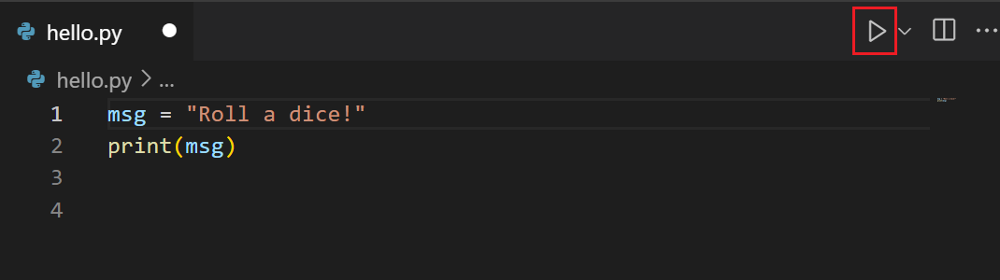

按钮会打开终端面板，自动激活 Python 解释器并运行 `python3 hello.py`（macOS/Linux）或 `python hello.py`（Windows）：

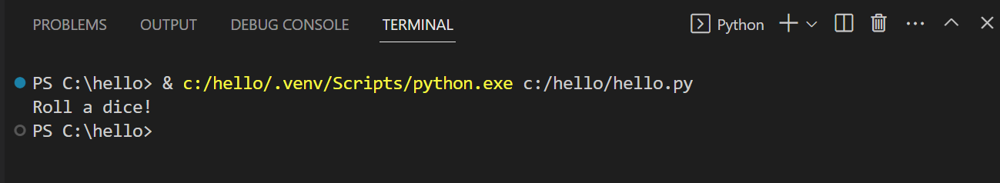

其他运行方式：

1. 在编辑器右键选择 **Run Python > Run Python File in Terminal**（自动保存文件）：

   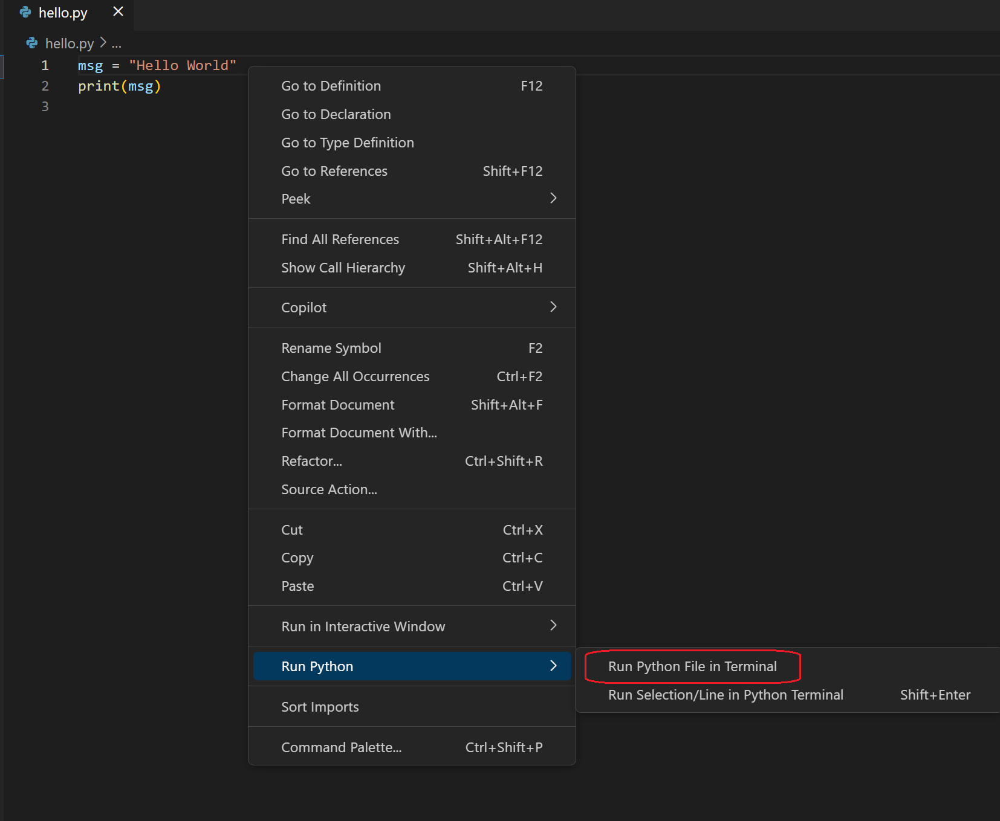

2. 选择一行或多行，按 `Shift + Enter` 或右键选择 **Run Python > Run Selection/Line in Python Terminal**。没有选择时，Smart Send 会将光标附近最小可运行代码块发送到终端。适合测试文件一部分。

   > **注意**：希望始终发送光标所在行时，可以在**用户**设置中设置 `python.REPL.enableREPLSmartSend: "false"` 关闭 Smart Send。

3. 从命令面板（`Ctrl + Shift + P`）选择 **Python: Start Terminal REPL**，为当前解释器打开 REPL 终端（`>>>`），逐行输入运行代码。

## 配置并运行调试器 {#configure-and-run-the-debugger}

调试支持由 [Python Debugger 扩展](https://marketplace.visualstudio.com/items?itemName=ms-python.debugpy)提供，随 Python 扩展自动安装。打开 **扩展** 视图（`Ctrl + Shift + X`）搜索 `@installed python debugger` 确认已安装。

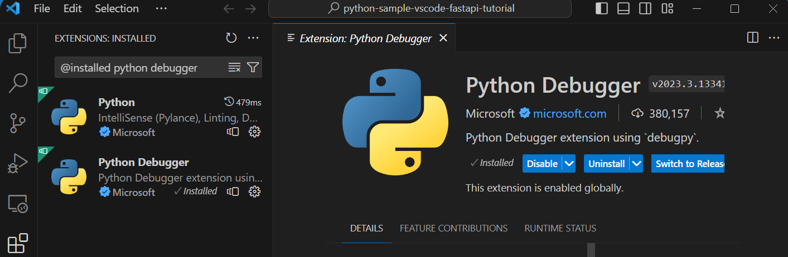

在 `hello.py` 第 2 行设置断点：将光标放在 `print` 调用上按 `F9`，或单击行号左侧装订线。装订线会出现红圈。

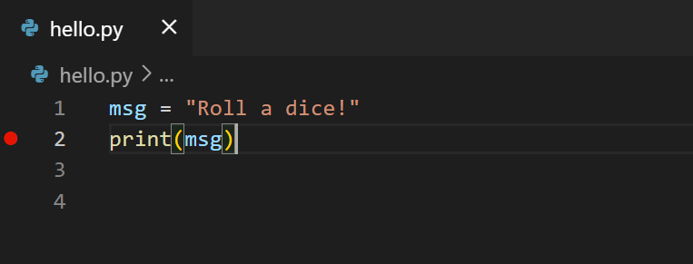

按 `F5` 初始化调试器。第一次调试该文件时，命令面板会打开配置菜单选择调试配置类型。

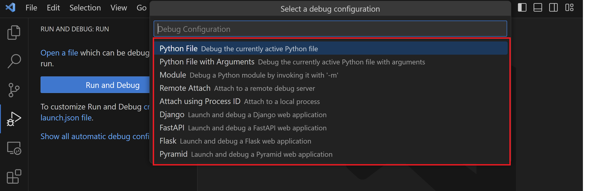

> **注意**：VS Code 使用 JSON 文件保存配置，`launch.json` 是调试配置的标准文件名。

选择 **Python File**，使用当前所选解释器运行编辑器中当前文件。

调试器启动并在第一行断点停止。当前行左边距显示黄色箭头。查看 **局部变量** 窗口，可以看到 `msg` 变量。

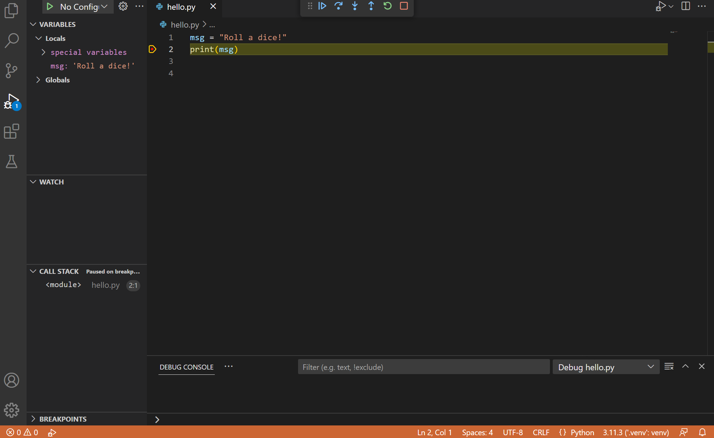

顶部调试工具栏按钮从左到右：继续（`F5`）、单步跳过（`F10`）、单步进入（`F11`）、单步跳出（`Shift + F11`）、重新启动（`Ctrl + Shift + F5`）、停止（`Shift + F5`）。


状态栏会变色（许多主题中为橙色）表示调试模式。右下角自动显示 **Python 调试控制台**，显示运行的命令和程序输出。

按调试工具栏继续（`F5`），程序运行到结束。

> **提示**：将鼠标悬停在变量上也可以查看调试信息。悬停 `msg` 会在变量上方显示字符串 `Roll a dice!`。

也可以在 **调试控制台** 中操作变量（看不到时，选择 VS Code 右下角 **调试控制台** 或从 `...` 菜单选择）。在控制台底部 `>` 提示符逐行输入：

```python
msg
msg.capitalize()
msg.split()
```

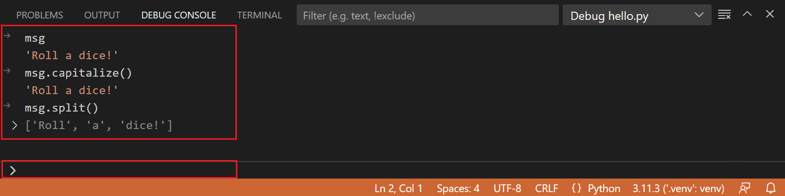

再次选择 **继续**（`F5`）运行到完成。切换回 **Python 调试控制台** 会看到“Roll a dice!”，程序完成后 VS Code 退出调试模式。

重新启动调试器会再次停在第一个断点。提前停止程序请使用红色方形停止按钮（`Shift + F5`）或 **运行 > 停止调试**。

完整说明请参阅[调试配置](10.5.7-Debugging/)。

> **提示：使用日志点代替 print 语句**：开发者常插入 `print` 语句快速查看变量。VS Code 中可以使用 **日志点**，它像断点一样记录消息到控制台但不暂停程序。详情请参阅[日志点](../../../debugging-and-testing/6.1-Debugging/#logpoints)。

## 安装和使用包 {#install-and-use-packages}

使用包扩展示例。Python 包通常来自 [PyPI](https://pypi.org/)，为程序提供额外功能。本示例使用 `numpy` 生成随机数。

返回 **资源管理器** 视图，打开 `hello.py`，粘贴：

```python
import numpy as np

msg = "Roll a dice!"
print(msg)

print(np.random.randint(1,9))
```

> **提示**：手动输入代码时，行末按 `Enter` 可能触发 `as` 关键字后的名称自动补全。可以先输入空格再按 `Enter`。

使用“Python: Current file”配置运行文件。应看到 **“ModuleNotFoundError: No module named 'numpy'”**，表示解释器中缺少所需包。使用 Anaconda 或已安装 numpy 时可能不会出现。

安装 `numpy`：

**选项 1：使用包管理 UI**

1. 打开 **Python** 侧边栏，展开 **环境管理器**。
2. 右键单击环境，选择 **管理包**。
3. 搜索 `numpy`，选择 **安装**。

**选项 2：使用终端**

从命令面板运行 **终端: 创建新终端**（`Ctrl + Shift + 反引号`），为所选解释器打开命令提示符，然后运行：

```bash
# 不要与 Anaconda 发行版一起使用，因为它们已包含 matplotlib。

# macOS
python3 -m pip install numpy

# Windows（可能需要提升权限）
python -m pip install numpy

# Linux（Debian）
apt-get install python3-tk
python3 -m pip install numpy
```

重新运行程序查看输出。

### 跨环境管理依赖 {#managing-dependencies-across-environments}

使用 `pip freeze > requirements.txt` 创建列出虚拟环境所有包的文件，可以在其他位置重建相同环境。

> **提示**：使用 **Python: Create Environment** 或环境管理器 **+** 按钮创建新环境时，扩展会自动检测并安装工作区 `requirements.txt` 或 `pyproject.toml` 中的依赖。

创建 `requirements.txt`：

1. 激活虚拟环境：

   ```bash
   source venv/bin/activate  # macOS/Linux
   ```

   ```powershell
   .\venv\Scripts\activate   # Windows
   ```

2. 生成文件：

   ```powershell
   pip freeze > requirements.txt
   ```

在其他环境安装依赖：

```powershell
pip install -r requirements.txt
```

## 后续步骤 {#next-steps}

使用流行 Python Web 框架：

* [在 VS Code 中使用 Django](10.5.11-DjangoTutorial/)
* [在 VS Code 中使用 Flask](10.5.13-FlaskTutorial/)
* [在 VS Code 中使用 FastAPI](10.5.12-FastAPITutorial/)

继续探索：

* [Python 配置文件模板](../../../editor/3.3-ConfigureTheEditor/3.3.8-Profiles/)
* [编辑代码](10.5.4-Editing/)
* [Lint](10.5.5-Linting/)
* [调试](10.5.7-Debugging/)
* [测试](10.5.9-Testing/)
* [设置参考](10.5.17-SettingsReference/)
* [将 Python 部署到 Azure App Service](https://learn.microsoft.com/azure/developer/python/tutorial-containerize-deploy-python-web-app-azure-01)
* [将 Python 部署到 Container Apps](https://learn.microsoft.com/azure/developer/python/tutorial-deploy-python-web-app-azure-container-apps-01)
