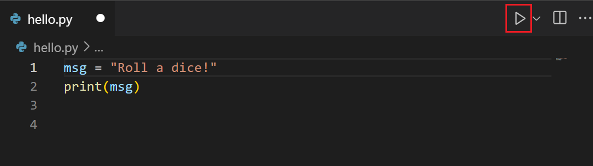
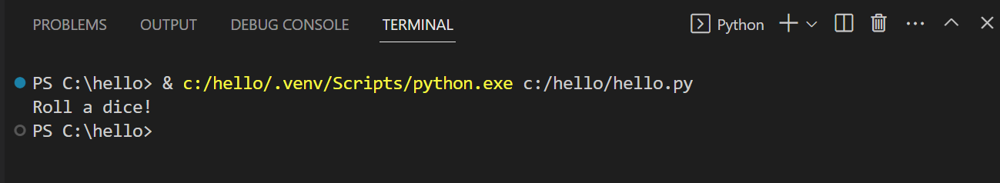
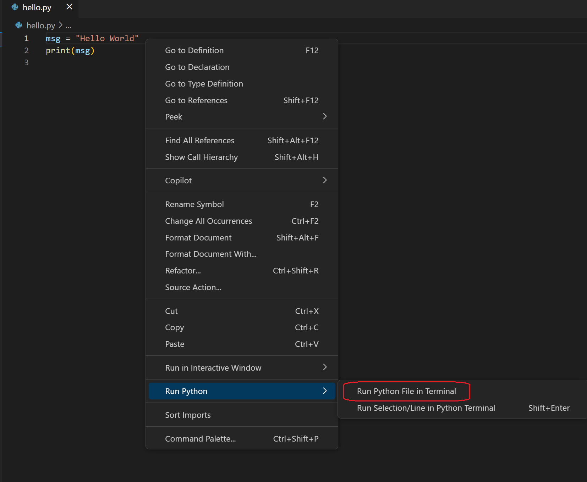

+++
title = "10.5.3 运行 Python 代码"
date = 2026-11-06T07:53:25+08:00
weight = 3
type = "docs"
description = ""
isCJKLanguage = true
draft = false
+++

> 原文链接: [https://code.visualstudio.com/docs/python/run](https://code.visualstudio.com/docs/python/run)

# 10.5.3 运行 Python 代码

　　无论是在 REPL 中试验少量 Python 代码，还是准备运行 Python 脚本，Python 扩展都提供多种运行方式。

## 交互式运行 Python 代码 {#interactively-running-python-code}

　　机器上安装的 Python 解释器提供交互式 REPL（读取-求值-打印循环），读取一段代码、求值并将结果打印到控制台。

安装解释器后，可以打开终端输入 `python`（Windows）或 `python3`（macOS/Linux）启动 Python REPL（`>>>`）。

VS Code 中还提供两种交互方式。

### 原生 REPL {#native-repl}

　　VS Code 的 Python 原生 REPL 基于经典 Python REPL，提供 IntelliSense 和语法高亮等额外功能。它仍遵循 Python 自带 REPL 的原则：历史执行顺序和内容不可变。

通过命令面板（`Ctrl + Shift + P`，macOS：`Cmd + Shift + P`）搜索 **Python: Start Native REPL** 打开。也可以在 `settings.json` 中设置 `"python.REPL.sendToNativeREPL": true`，通过 Smart Send（`Shift + Enter`）和 **Run Selection/Line in Python REPL** 将代码发送到原生 REPL。设为 `false` 可继续使用终端中的 Python REPL（`>>>`）。

<video src="https://code.visualstudio.com/assets/docs/python/shared/nativeREPL-demo.mp4" title="Python 原生 REPL。" autoplay loop controls muted></video>

### 终端 REPL {#terminal-repl}

　　也可以在 VS Code 内打开终端并激活 Python REPL。在命令面板搜索 **Python: Start Terminal REPL**，会为当前解释器打开终端。也可以转到 **终端 > 新建终端**，输入 `python` 或 `python3`。

　　通过[终端 Shell 集成](../../../terminal/5.4-ShellIntegration/)，终端支持运行最近命令、命令装饰器和改进的辅助功能。可以使用 `python.terminal.shellIntegration.enabled` 设置启用或禁用。

## 运行 Python 代码 {#run-python-code}

　　Python 扩展提供多种无需额外配置的运行方式。

1. 选择编辑器右上角的 **Run Python File in Terminal** 播放按钮。

    

    按钮会打开终端面板，自动激活 Python 解释器并运行脚本（例如 `python3 hello.py` 或 `python hello.py`）：

    

2. 在编辑器任意位置右键选择 **Run > Python File in Terminal**（自动保存文件）：

   

3. 选择一行或多行，按 `Shift + Enter`，或右键选择 **Run Selection/Line in Python Terminal**。适合测试文件的一部分。

4. 将光标放在代码行上按 `Shift + Enter` 激活 Smart Send。

### Smart Send {#smart-send}

　　Python 扩展默认启用 Smart Send（`Shift + Enter`）。它会查看光标位置代码，将最小可运行代码块发送到 Python REPL，并将光标移到下一行，便于高效运行代码。

Smart Send 不适用于不受支持的 Python 版本（例如 Python 2）或无效 Python 代码。只发送光标所在行时，请将 `python.REPL.enableREPLSmartSend` 设置为 `false`。

## 另请参阅 {#see-also}

* [调试](10.5.7-Debugging/)：学习在本地和远程调试 Python。
* [测试](10.5.9-Testing/)：配置测试环境并发现、运行和调试测试。
