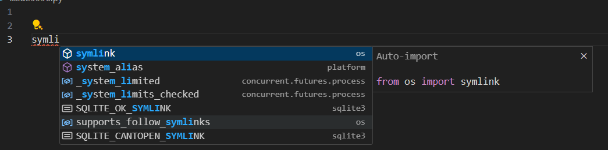
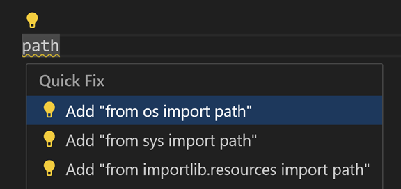

+++
title = "10.5.4 编辑 Python"
date = 2026-11-06T07:53:25+08:00
weight = 4
type = "docs"
description = ""
isCJKLanguage = true
draft = false
+++


> 原文链接: [https://code.visualstudio.com/docs/python/editing](https://code.visualstudio.com/docs/python/editing)

# 10.5.4 编辑 Python

　　VS Code 是强大的 Python 源代码编辑工具。编辑器包含多种提高编码效率的功能。通用编辑功能请参阅[基本编辑](../../../editor/3.2-WriteCode/3.2.1-BasicEditing/)和[代码导航](../../../editor/3.2-WriteCode/3.2.5-CodeNavigation/)。

本文介绍 [Python 扩展](https://marketplace.visualstudio.com/items?itemName=ms-python.python)提供的特定编辑功能，以及如何通过用户和工作区[设置](../../../editor/3.3-ConfigureTheEditor/3.3.4-Settings/)自定义。

## 自动补全和 IntelliSense {#autocomplete-and-intellisense}

　　IntelliSense 是与代码补全相关的编辑功能统称。输入 **print** 时，IntelliSense 会填充自动补全选项；输入变量 **greeting** 时也会提供选项。

<video src="https://code.visualstudio.com/assets/docs/python/editing/hello-world.mp4" title="IntelliSense Hello World 示例。" autoplay loop controls muted></video>

　　自动补全和 IntelliSense 适用于当前工作文件夹中的所有文件，也适用于安装在标准位置的 Python 包。

　　[Pylance](https://marketplace.visualstudio.com/items?itemName=ms-python.vscode-pylance)是 VS Code 默认 Python 语言服务器，随 Python 扩展安装，提供 IntelliSense 功能。

　　Pylance 基于 Microsoft [Pyright](https://github.com/microsoft/pyright) 静态类型检查工具，利用[类型存根](https://typing.readthedocs.io/en/latest/source/stubs.html)（`.pyi` 文件）和惰性类型推断提供高性能开发体验。

IntelliSense 详情请参阅 [IntelliSense](../../../editor/3.2-WriteCode/3.2.2-IntelliSense/)。

> **提示**：可以尝试 [IntelliCode 扩展](https://go.microsoft.com/fwlink/?linkid=2006060)，它为 Python IntelliSense 提供 AI 辅助能力，例如根据当前代码上下文推断最相关的自动补全。

### 自定义 IntelliSense 行为 {#customize-intellisense-behavior}

　　默认启用完整 IntelliSense 可能拖慢开发体验，因此 Python 扩展启用最小功能集，在保持性能的同时提高效率。可以通过多个设置自定义分析引擎行为。

### 启用自动导入 {#enable-auto-imports}

　　Pylance 为工作区模块和环境安装的包提供自动导入建议。输入时接受建议，自动导入会将相应 `import` 语句添加到文件。

在设置中将 `python.analysis.autoImportCompletions` 设为 `true` 启用自动导入。默认禁用。



### 为自定义包位置启用 IntelliSense {#enable-intellisense-for-custom-package-locations}

　　为安装在非标准位置的包启用 IntelliSense，请将这些位置添加到 `settings.json` 的 `python.analysis.extraPaths`（默认为空数组）。例如 Google App Engine 安装在自定义位置：

**Windows：**

```json
"python.analysis.extraPaths": [
    "C:/Program Files (x86)/Google/google_appengine",
    "C:/Program Files (x86)/Google/google_appengine/lib/flask-0.12"]
```

**macOS/Linux：**

```json
"python.analysis.extraPaths": [
    "~/.local/lib/Google/google_appengine",
    "~/.local/lib/Google/google_appengine/lib/flask-0.12" ]
```

　　完整 IntelliSense 控制列表请参阅 [代码分析设置](10.5.17-SettingsReference/#code-analysis-settings)和[自动补全设置](10.5.17-SettingsReference/#autocomplete-settings)。也可以自定义或完全禁用自动补全，详情请参阅[自定义 IntelliSense](../../../editor/3.2-WriteCode/3.2.2-IntelliSense/)。

## 使用 AI 增强补全 {#enhance-completions-with-ai}

　　GitHub Copilot 会在编辑器中输入时提供编码建议。也可以向 Copilot 询问与编码相关的问题，例如如何更好地编写代码、如何修复错误，或他人的代码如何工作。

　　请参阅 [VS Code 中的 AI](../../../ai-in-vs-code/)了解入门方法。

## 导航 {#navigation}

　　编辑时可以右键单击不同标识符使用便捷命令：

* **转到定义**（`F12`）：从代码跳转到对象定义，处理库时很有用。
* **速览定义**（`Alt + F12`）：在编辑器中直接显示定义，按 `Escape` 或右上角 **x** 关闭。
* **转到声明**：跳转到变量或其他对象的声明位置。
* **速览声明**：在编辑器中直接显示声明，按 `Escape` 或 **x** 关闭。

## 快速修复 {#quick-fixes}

### 添加导入 {#add-import}

　　使用 Pylance 时，添加导入快速修复可以快速补全环境中已安装模块的 `import` 语句。输入包名时会出现代码操作自动补全源代码行。将鼠标悬停在带波浪线的文本上，选择代码操作灯泡，然后从潜在导入列表选择。



　　该代码操作还识别常见 Python 包缩写：`numpy` 为 np、`tensorflow` 为 tf、`pandas` 为 pd、`matplotlib.pyplot` 为 plt、`matplotlib` 为 mpl、`math` 为 m、`scipi.io` 为 spio、`scipy` 为 sp、`panel` 为 pn、`holoviews` 为 hv。

<video src="https://code.visualstudio.com/assets/docs/python/editing/packageAbbreviations.mp4" title="常见包缩写。" autoplay loop controls muted></video>

　　导入建议列表显示前 3 个高置信度选项，优先级为：最近使用导入、同一模块符号、标准库符号、用户模块符号、第三方包符号，最后按模块和符号名排序。

### 搜索更多导入匹配 {#search-for-additional-import-matches}

　　默认只显示 3 个高置信度导入。找不到所需项时，可以使用 Pylance 的 **搜索更多导入匹配** 快速修复。它会显示快速选择菜单，可以搜索与缺失导入符号前缀匹配的选项。

<video src="https://code.visualstudio.com/assets/docs/python/editing/search-imports-code-action.mp4" title="搜索更多导入匹配。" autoplay loop controls muted></video>

### 更改拼写 {#change-spelling}

　　Pylance 在未解析变量或缺失导入可能由拼写错误引起时显示 **更改拼写** 快速修复，根据工作区中最近匹配建议正确拼写。

<video src="https://code.visualstudio.com/assets/docs/python/editing/change-spelling-code-action.mp4" title="拼写错误导致缺失导入时的更改拼写代码操作。" autoplay loop controls muted></video>

> **注意**：用户符号的快速修复只会从定义它们的文件建议导入，不支持从导入这些符号的其他文件建议。来自已安装包的符号（通常位于环境的 `site-packages` 文件夹），只会从包根文件夹（例如 `__init__.py`）中定义的符号建议。可以通过 `python.analysis.packageIndexDepths` 为特定包自定义，但可能影响 Pylance 性能。

## 重构 {#refactorings}

　　Python 扩展通过 Pylance 添加以下重构：**提取变量**、**提取方法**、**重命名模块**、**移动符号**、**实现所有继承的抽象类**。也支持实现额外重构（例如 **排序导入**）的扩展。

### 提取变量 {#extract-variable}

　　提取当前作用域中选中文本的所有相似出现，并用新变量替换。选择要提取的代码行，然后选择旁边的灯泡。

<video src="https://code.visualstudio.com/assets/docs/python/editing/refactorExtractVar.mp4" title="重构变量。" autoplay loop controls muted></video>

### 提取方法 {#extract-method}

　　提取当前作用域中选中表达式或代码块的所有相似出现，并用方法调用替换。选择要提取的代码行，然后选择旁边的灯泡。

<video src="https://code.visualstudio.com/assets/docs/python/editing/refactorExtractMethod.mp4" title="将代码重构为方法。" autoplay loop controls muted></video>

### 重命名模块 {#rename-module}

　　Python 文件/模块重命名后，Pylance 可以找到所有可能需要更新的实例并预览所有更改。可以在 **重构预览** 中按行或文件切换复选框选择要更新的引用，然后选择 **应用重构** 或 **放弃重构**。

<video src="https://code.visualstudio.com/assets/docs/python/editing/refactorRenameModule.mp4" title="重命名模块。" autoplay loop controls muted></video>

### 移动符号 {#move-symbol}

　　Pylance 提供两个代码操作简化将符号移动到不同文件：

* **将符号移动到...**：显示文件选择器选择目标文件。
* **将符号移动到新文件**：在源文件同一目录创建以符号命名的新文件。

　　将鼠标悬停在符号上，选择操作旁的灯泡，或右键选择 **重构...**。

<video src="https://code.visualstudio.com/assets/docs/python/editing/move-symbol.mp4" title="移动符号重构选项。" autoplay loop controls muted></video>

### 实现所有继承的抽象类 {#implement-all-inherited-abstract-classes}

　　Python 抽象类作为其他类的“蓝图”，通过清晰结构和子类要求帮助构建模块化可复用代码。可以通过继承 `abc` 模块的 `ABC` 类并使用 `@abstractmethod` 装饰器定义抽象方法。

　　Pylance 提供代码操作简化这些类的创建。定义继承抽象类的新类时，可以使用 **实现所有继承的抽象类** 自动实现父类的所有抽象方法和属性。

<video src="https://code.visualstudio.com/assets/docs/python/editing/implement-inherited-abstract-classes.mp4" title="实现继承的抽象类。" autoplay loop controls muted></video>

### 排序导入 {#sort-imports}

　　Python 扩展支持 [isort](https://marketplace.visualstudio.com/items?itemName=ms-python.isort)和 [Ruff](https://marketplace.visualstudio.com/items?itemName=charliermarsh.ruff) 等实现 **排序导入** 的扩展。该命令将同一模块的特定导入合并为单个 `import` 语句，并按字母顺序组织。

安装支持排序导入的扩展后，打开命令面板（`Ctrl + Shift + P`）运行 **组织导入**。

> **提示**：可以为 `editor.action.organizeImports` 命令分配快捷键。

<video src="https://code.visualstudio.com/assets/docs/python/editing/sortImports.mp4" title="排序导入语句。" autoplay loop controls muted></video>

## 故障排除 {#troubleshooting}

| 问题 | 原因 | 解决方案 |
| --- | --- | ---|
| Pylance 添加导入时只提供顶级符号选项。 | 默认只索引顶级模块（depth=1），例如可能建议 `import matplotlib`，但默认不显示 `import matplotlib.pyplot`。 | 通过 `python.analysis.packageIndexDepths` 增加索引深度。请参阅[代码分析设置](10.5.17-SettingsReference/#code-analysis-settings)。 |
| Pylance 没有自动添加缺失导入。 | 自动导入补全设置可能已禁用。 | 检查[启用自动导入](#enable-auto-imports)。 |
| 自动导入已启用，但 Pylance 未自动导入工作区其他文件中的符号。 | 用户定义符号只有在编辑器已打开文件中使用过才会自动导入，否则只能通过添加导入快速修复。 | 使用添加导入快速修复，或先打开相关文件。 |
| Pylance 在大型工作区中变慢或占用过多内存。 | Pylance 会分析工作区中的所有文件。 | 将可排除的子文件夹路径添加到 `python.analysis.exclude`，或设置 `python.analysis.indexing` 为 `false` 禁用索引器（会影响补全和自动导入）。 |
| 无法在 Python 项目中安装自定义模块。 | 模块位于非标准位置（未通过 pip 安装）。 | 将位置添加到 `python.autoComplete.extraPaths` 并重启 VS Code。 |

### Pylance 诊断 {#pylance-diagnostics}

　　Pylance 默认在问题面板中提供 Python 文件诊断。以下是最常见诊断及修复方法。

#### importResolveSourceFailure

　　Pylance 能找到导入包的类型存根，但找不到包本身。可能包未安装在所选 Python 环境中。

**修复：**

* 包安装在另一个解释器或内核中时，请[选择正确解释器](10.5.8-Environments/#select-an-environment)。
* 包未安装时，在已激活终端运行 `python -m pip install {package_name}`。

#### importResolveFailure

　　Pylance 找不到导入的包或模块及类型存根。

**修复：**

* 导入模块时，确认它存在于工作区或 `python.autoComplete.extraPaths` 包含的位置。
* 包未安装时，运行 `python -m pip install {package_name}`。
* 包安装在另一个解释器或内核中时，[选择正确解释器](10.5.8-Environments/#select-an-environment)。
* 使用可编辑安装和导入钩子时，考虑改用只包含文件路径的 `.pth` 文件。详情请参阅 [Pyright 文档](https://microsoft.github.io/pyright/#/import-resolution?id=editable-installs)。

#### importCycleDetected

　　Pylance 检测到两个或多个模块之间的循环依赖。请调整 `import` 语句顺序打破循环。

Pylance 诊断严重性可以通过 `python.analysis.diagnosticSeverityOverrides` 自定义。详情请参阅[设置参考](10.5.17-SettingsReference/)。

## 后续步骤 {#next-steps}

* [Lint](10.5.5-Linting/)：启用、配置和应用各种 Python linter。
* [调试](10.5.7-Debugging/)：学习在本地和远程调试 Python。
* [测试](10.5.9-Testing/)：配置测试环境并发现、运行和调试测试。
* [基本编辑](../../../editor/3.2-WriteCode/3.2.1-BasicEditing/)：了解 VS Code 编辑器。
* [代码导航](../../../editor/3.2-WriteCode/3.2.5-CodeNavigation/)：快速浏览源代码。
* [IntelliSense](../../../editor/3.2-WriteCode/3.2.2-IntelliSense/)：了解 IntelliSense 功能。
* [Jupyter 支持](https://code.visualstudio.com/docs/datascience/jupyter-notebooks)：开始使用 Jupyter Notebook。
