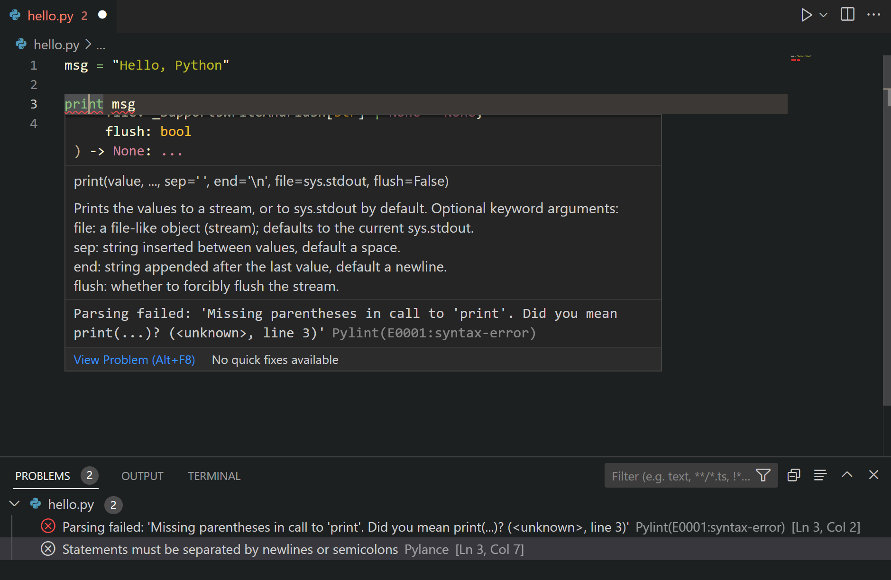

+++
title = "10.5.5 Python Lint"
date = 2026-11-06T07:53:25+08:00
weight = 5
type = "docs"
description = ""
isCJKLanguage = true
draft = false
+++

> 原文链接: [https://code.visualstudio.com/docs/python/linting](https://code.visualstudio.com/docs/python/linting)

# 10.5.5 Python Lint

　　Lint 会高亮 Python 源代码中的语义和风格问题，帮助发现细微编程错误或可能导致错误的编码实践。例如可以检测未定义变量、调用未定义函数、缺失括号，甚至重新定义内置类型或函数。Lint 与[格式化](10.5.6-Formatting/)不同：Lint 分析代码如何运行并检测错误，格式化只调整代码外观。

> **注意**：Python 扩展的语言服务器默认启用语法错误检测。语言服务器配置请参阅[语言服务器设置](10.5.17-SettingsReference/#python-language-server-settings)。本文介绍如何启用额外代码检测（包括风格检查）。

## 选择 linter {#choose-a-linter}

在 [Marketplace](https://marketplace.visualstudio.com/vscode)搜索所需的 linter 扩展。可以同时使用多个 linter。

Microsoft 发布的 Python lint 扩展：

| Linter | 扩展 |
| ------ | ---- |
| Pylint | [ms-python.pylint](https://marketplace.visualstudio.com/items?itemName=ms-python.pylint) |
| flake8 | [ms-python.flake8](https://marketplace.visualstudio.com/items?itemName=ms-python.flake8) |
| mypy | [ms-python.mypy-type-checker](https://marketplace.visualstudio.com/items?itemName=ms-python.mypy-type-checker) |

社区 lint 扩展：

| Linter | 扩展 |
| ------ | ---- |
| Ruff | [charliermarsh.ruff](https://marketplace.visualstudio.com/items?itemName=charliermarsh.ruff) |
| mypy | [matangover.mypy](https://marketplace.visualstudio.com/items?itemName=matangover.mypy) |

> **注意**：Marketplace 中找不到所需 linter 时，可以通过扩展添加支持。可以使用 [Python 扩展模板](https://code.visualstudio.com/api/advanced-topics/python-extension-template)将新的 Python 工具集成到 VS Code。

## 常规设置 {#general-settings}

各 linter 扩展支持的设置有详细说明，请参阅其 README。大多数 linter 扩展支持：

| 设置 | 默认值 | 说明 |
| ---- | ------ | ---- |
| `args` | `[]` | 传递给 linter 的参数。**注意**：官方支持的 linter 对单个打开文件运行，请确保配置适用于该场景。 |
| `importStrategy` | `useBundled` | `useBundled` 使用扩展自带工具版本；`fromEnvironment` 先从所选 Python 环境加载，找不到时回退到自带版本。 |
| `path` | `""` | linter 二进制文件路径。**注意**：此选项可能拖慢格式化。 |
| `interpreter` | `[]` | 设置为 Python 可执行文件路径时，扩展用它启动 lint 服务器及其子进程。 |
| `showNotifications` | `off` | 控制扩展通知时机，支持 `off`、`always`、`onError`、`onWarning`。 |

## 禁用 Lint {#disable-linting}

安装 linter 后默认启用。可以按工作区[禁用扩展](../../../editor/3.3-ConfigureTheEditor/3.3.6-Extensions/3.3.6.2-ExtensionMarketplace/)。

## 运行 Lint {#run-linting}

打开或保存 Python 文件时自动运行 Lint。错误和警告显示在打开文件的 **问题** 面板（`Ctrl + Shift + M`）中，也会在编辑器中高亮。悬停在带下划线的问题上显示详情：

## 代码操作 {#code-actions}

某些 linter 提供[代码操作](../../../editor/3.2-WriteCode/3.2.6-Refactoring/)，帮助解决问题。请参阅 linter 扩展 **功能贡献** 部分。

## 日志 {#logging}

在 **输出** 面板（`Ctrl + Shift + U`）下拉列表选择 `<linter name>` 查看日志。

可以通过命令面板（`Ctrl + Shift + P`）运行 **Developer: Set Log Level** 命令更改日志级别。在 **扩展日志** 组选择扩展，然后选择日志级别。

## 严重性 {#severity}

Linter 按预定义严重性报告问题，可以通过 `severity` 设置更改。支持值和级别请参阅各 linter 扩展 README。

## Lint 故障排除 {#troubleshooting-linting}

| 问题 | 原因 | 解决方案 |
| --- | --- | --- |
| Linter 扩展没有报告任何问题。 | 工作区未选择 Python。 | 查看 linter 日志及使用的 Python 环境路径。未选择 Python 时，从命令面板运行 **Python: Select Interpreter** 选择现有解释器，也可以选择状态栏中的 Python 版本。 |
| 显示“You have deprecated linting or formatting settings”通知。 | `python.linting` 或 `python.formatting` 等设置已不再受 Python 扩展支持，lint 和格式化已迁移到工具扩展。 | 打开命令面板运行 **Preferences: Open User Settings (JSON)**，检查用户设置；不在其中时运行 **Preferences: Open Workspace Settings (JSON)**。删除已弃用设置。 **注意**：使用[远程开发扩展包](../../../remote/)时，也可以通过 **Preferences: Open Remote Settings (JSON)** 检查远程设置。 |
| 已安装 linter 扩展但 Lint 不工作。 | Python 版本不受支持、linter 配置错误等。 | 查看 linter 扩展输出通道（命令面板运行 **Output: Focus on Output**，选择扩展通道）了解失败原因。 |

## 后续步骤 {#next-steps}

* [格式化](10.5.6-Formatting/)：了解如何格式化 Python 代码。
* [调试](10.5.7-Debugging/)：学习在本地和远程调试 Python。
* [测试](10.5.9-Testing/)：配置测试环境并发现、运行和调试测试。
* [基本编辑](../../../editor/3.2-WriteCode/3.2.1-BasicEditing/)：了解 VS Code 编辑器。
* [Python 扩展模板](https://code.visualstudio.com/api/advanced-topics/python-extension-template)：创建扩展集成喜欢的 linter。
