+++
title = "10.5.7 调试 Python"
date = 2026-11-06T07:53:25+08:00
weight = 7
type = "docs"
description = ""
isCJKLanguage = true
draft = false
+++


> 原文链接: [https://code.visualstudio.com/docs/python/debugging](https://code.visualstudio.com/docs/python/debugging)

# 10.5.7 调试 Python

　　Python 扩展通过 [Python Debugger 扩展](https://marketplace.visualstudio.com/items?itemName=ms-python.debugpy)支持多种 Python 应用调试。基础调试演练请参阅[教程 - 配置并运行调试器](10.5.2-Tutorial/#configure-and-run-the-debugger)和 [Flask 教程](10.5.13-FlaskTutorial/)。通用调试功能（变量检查、断点等）请参阅 [VS Code 调试](../../../debugging-and-testing/6.1-Debugging/)。

本文主要介绍 Python 特定调试*配置*，包括特定应用类型和远程调试步骤。

## Python Debugger 扩展 {#python-debugger-extension}

　　[Python Debugger 扩展](https://marketplace.visualstudio.com/items?itemName=ms-python.debugpy)随 Python 扩展自动安装，通过 [debugpy](https://pypi.org/project/debugpy/)为脚本、Web 应用、远程进程等提供调试功能。

打开 **扩展** 视图（`Ctrl + Shift + X`，macOS：`Cmd + Shift + X`）搜索 `@installed python debugger` 验证安装。

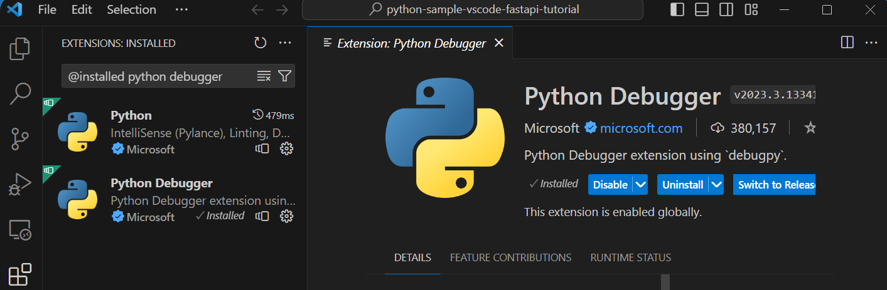

支持的 Python 版本请参阅扩展 [README](https://github.com/microsoft/vscode-python-debugger/blob/main/README.md)。

## 初始化配置 {#initialize-configurations}

　　配置驱动 VS Code 调试会话行为，定义在工作区 `.vscode` 文件夹的 `launch.json` 中。

> **注意**：要更改调试配置，代码必须存储在文件夹中。

在侧边栏选择 **运行** 视图：

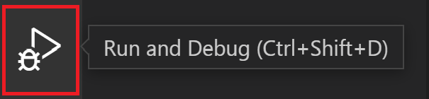

没有配置时会看到 **运行和调试** 按钮和创建 `launch.json` 的链接：

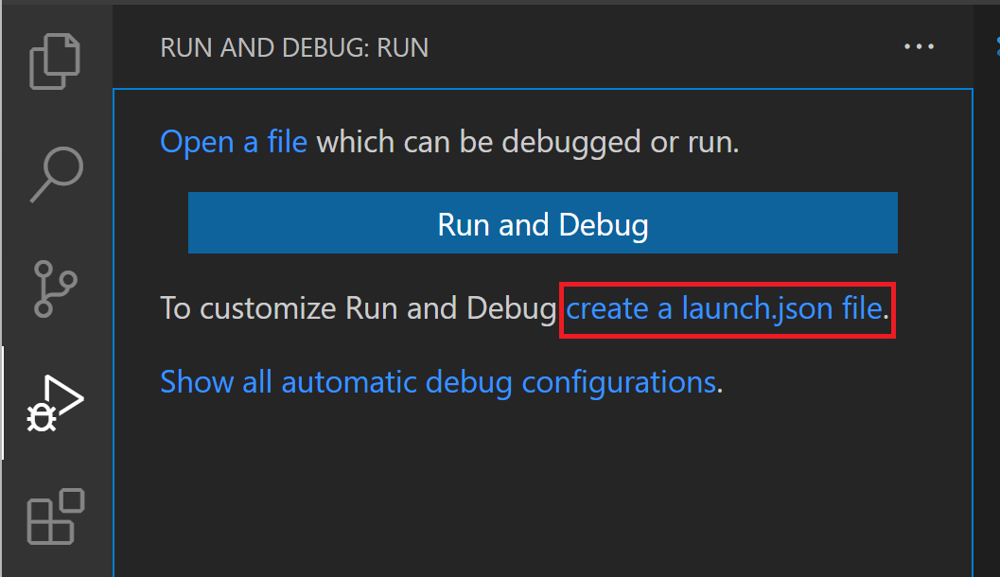

生成 Python 配置：

1. 选择 **创建 launch.json 文件** 链接，或使用 **运行** > **打开配置** 菜单命令。
2. 从调试器列表选择 **Python Debugger**。
3. 命令面板打开配置菜单选择调试配置类型。调试单个 Python 脚本请选择 **Python File**。

    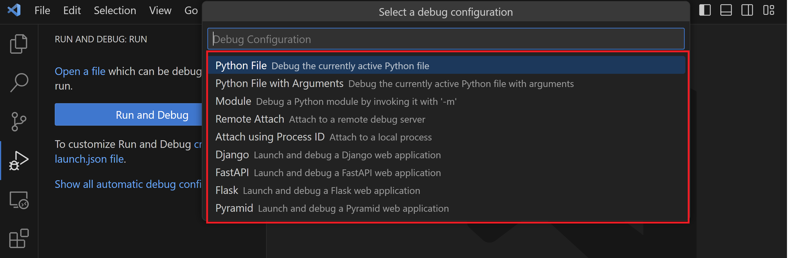

    > **注意**：没有配置时通过调试面板、`F5` 或 **运行 > 启动调试** 开始调试也会打开配置菜单，但不会创建 `launch.json`。

4. 扩展创建并打开包含预定义配置的 `launch.json`。可以修改配置（例如添加参数）或添加自定义配置。

   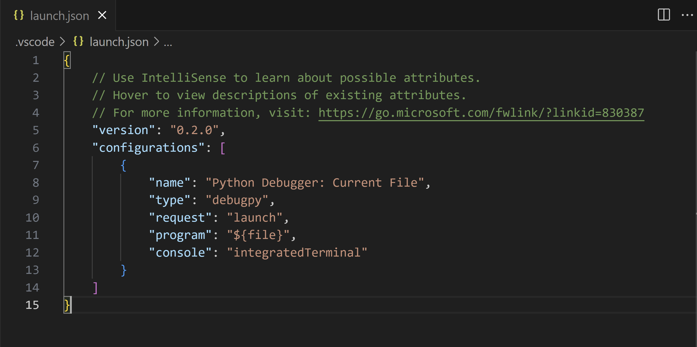

配置属性详情请参阅[设置配置选项](#set-configuration-options)，其他配置请参阅[调试特定应用类型](#debugging-specific-app-types)。

## 其他配置 {#additional-configurations}

　　默认只显示最常见配置。可以使用 `launch.json` 编辑器中的 **添加配置** 命令选择其他配置。命令会提示所有可用配置（确保选择 **Python**）：

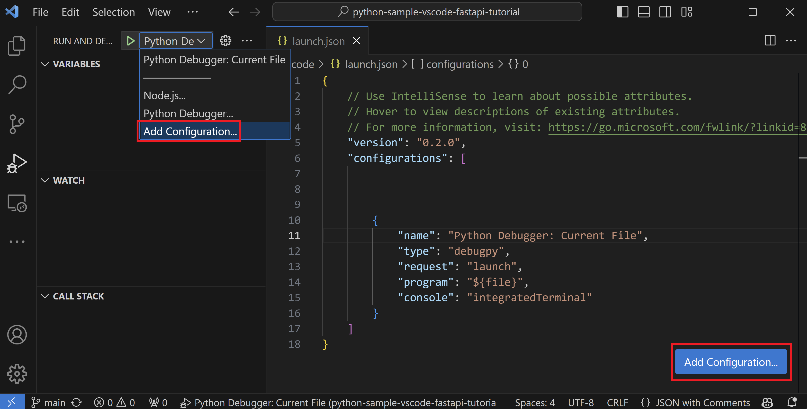

选择 **Attach using Process ID** 会得到：

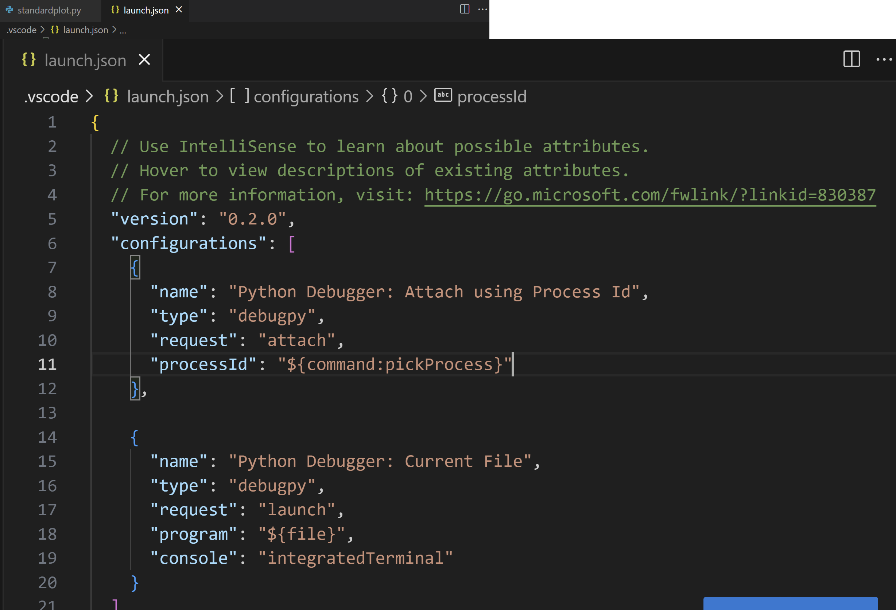

调试时状态栏显示当前配置和调试解释器。选择配置可以切换：


　　默认使用工作区所选解释器。要为调试使用不同解释器，请在 `launch.json` 中设置 `python` 属性，或使用状态栏 Python 解释器指示器。

## 基本调试 {#basic-debugging}

只调试 Python 脚本时，选择编辑器运行按钮旁的下拉箭头，选择 **Python Debugger: Debug Python File**。

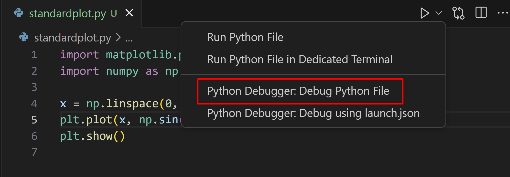

调试 Flask、Django 或 FastAPI Web 应用时，Python Debugger 扩展会在 **运行和调试** 视图的 **显示所有自动调试配置** 下根据项目结构动态创建配置。

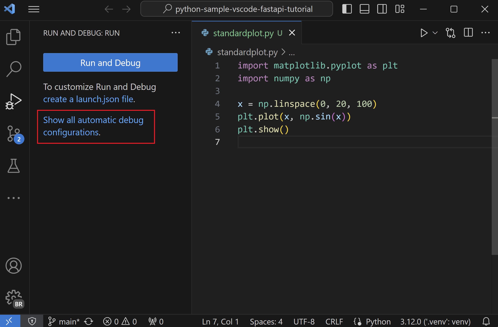

调试其他应用时，可以在 **运行** 视图单击 **运行和调试** 按钮：

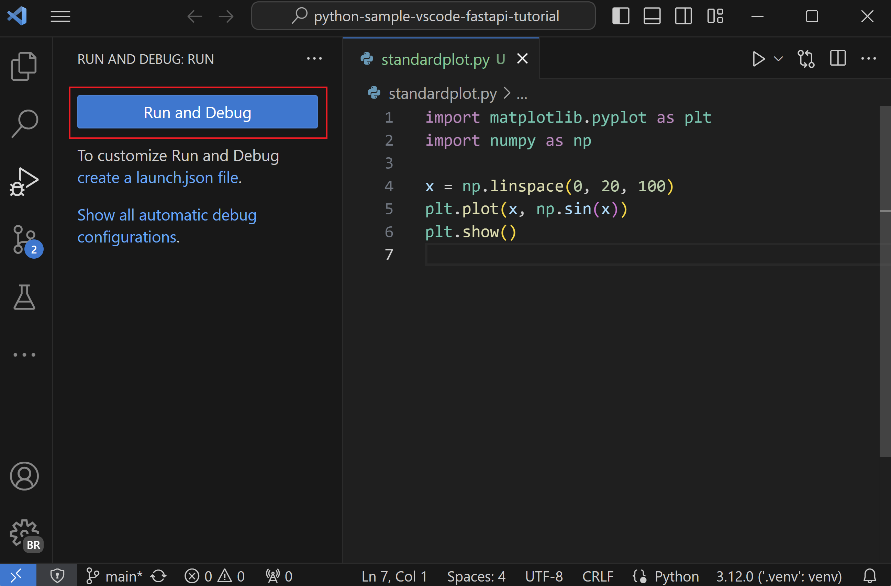

没有配置时会显示调试选项列表。常见选项是 **Python File**（运行当前文件）或 **Attach using Process ID**（附加到运行中进程）。

添加配置后，可以从下拉列表选择并使用 **开始调试** 按钮（`F5`）启动。

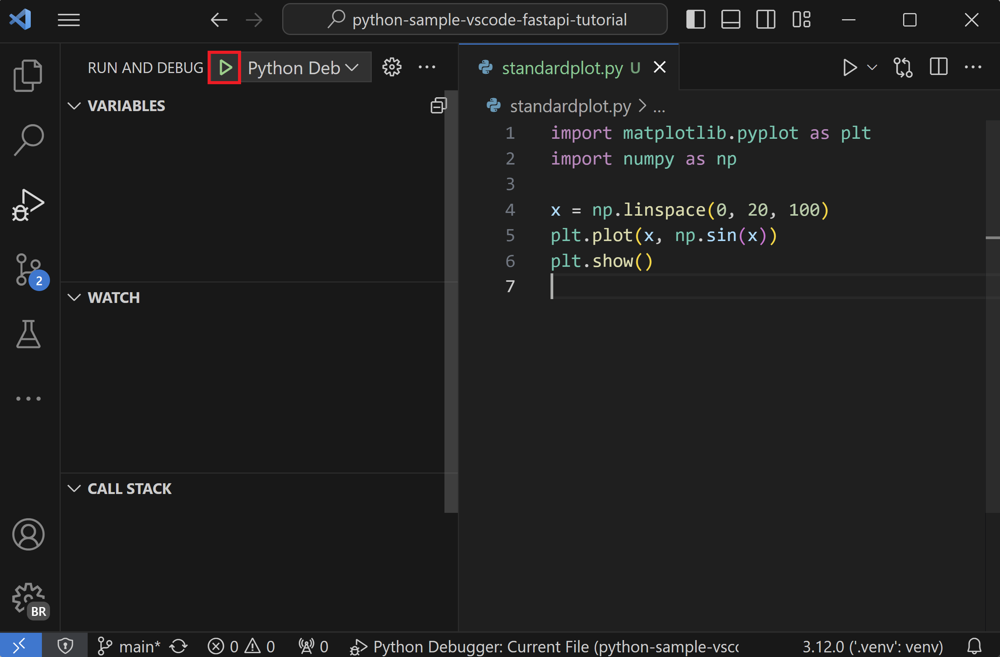

## 命令行调试 {#command-line-debugging}

　　Python 环境安装 `debugpy` 后也可以从命令行运行调试器。

### 安装 debugpy {#install-debugpy}

```bash
python -m pip install --upgrade debugpy
```

> **提示**：建议使用虚拟环境。可以在命令面板运行 **Python: Create Environment** 创建。

### 命令行语法 {#command-line-syntax}

```bash
python -m debugpy
    --listen | --connect
    [<host>:]<port>
    [--wait-for-client]
    [--configure-<name> <value>]...
    [--log-to <path>] [--log-to-stderr]
    <filename> | -m <module> | -c <code> | --pid <pid>
    [<arg>]...
```

### 示例 {#example}

```bash
python -m debugpy --listen 5678 ./myscript.py
```

对应的附加配置：

```json
{
    "name": "Python Debugger: Attach",
    "type": "debugpy",
    "request": "attach",
    "connect": {
        "host": "localhost",
        "port": 5678
    }
}
```

> **注意**：`--listen` 的主机可选，默认 `127.0.0.1`。

远程或 Docker 中调试时，在远程机器/容器指定主机：

```bash
python -m debugpy --listen 0.0.0.0:5678 ./myscript.py
```

```json
{
    "name": "Attach",
    "type": "debugpy",
    "request": "attach",
    "connect": {
       "host": "remote-machine-name", // 替换为远程机器名称
       "port": 5678
    }
}
```

> **注意**：指定 `127.0.0.1` 或 `localhost` 以外的主机会开放端口供任何机器访问，存在安全风险。远程调试时应使用 SSH 隧道等安全措施。

### 命令行选项 {#command-line-options}

| 标志 | 选项 | 说明 |
| --- | --- | --- |
| `--listen` 或 `--connect` | `[<host>:]<port>` | **必需**。指定调试适配器服务器等待连接（`--listen`）或连接客户端（`--connect`）的主机和端口。默认主机 `localhost (127.0.0.1)`。 |
| `--wait-for-client` | 无 | **可选**。在调试服务器连接前不运行代码，可从第一行开始调试。 |
| `--log-to` | `<path>` | **可选**。保存日志的现有目录。 |
| `--log-to-stderr` | 无 | **可选**。将日志直接写入 stderr。 |
| `--pid` | `<pid>` | **可选**。将调试服务器注入已运行进程。 |
| `--configure-<name>` | `<value>` | **可选**。设置客户端连接前调试服务器必须知道的属性。`attach` 配置必须用这种方式设置，例如 `--configure-subProcess false`。 |

> **注意**：`[<arg>]` 可以向启动的应用传递命令行参数。

## 通过网络连接附加调试 {#debugging-by-attaching-over-a-network-connection}

### 本地脚本调试 {#local-script-debugging}

　　需要调试由其他进程本地调用的 Python 脚本时，请在脚本启动后附加调试器：

1. 在 VS Code 中打开脚本所在文件夹/工作区，必要时创建 `launch.json`。
2. 在脚本中添加：

    ```python
    import debugpy

    # 5678 是 VS Code 调试配置的默认附加端口。未指定主机和端口时，主机默认为 127.0.0.1
    debugpy.listen(5678)
    print("Waiting for debugger attach")
    debugpy.wait_for_client()
    debugpy.breakpoint()
    print('break on this line')
    ```

3. 使用 **终端: 创建新终端** 打开脚本环境的终端。
4. [安装 debugpy](#install-debugpy)。
5. 启动脚本，例如 `python3 myscript.py`。应看到“Waiting for debugger attach”，脚本在 `wait_for_client()` 暂停。
6. 切换到 **运行和调试** 视图（`Ctrl + Shift + D`，macOS：`Cmd + Shift + D`），选择配置并启动调试器。
7. 调试器会停在 `debugpy.breakpoint()`，之后可以正常调试或通过 UI 设置其他断点。

### 使用 SSH 远程调试 {#remote-script-debugging-with-ssh}

　　远程调试允许在 VS Code 本地单步调试远程计算机上运行的程序。远程计算机不必安装 VS Code。建议使用 SSH 等安全连接。

> **注意**：Windows 上可能需要安装 [Windows 10 OpenSSH](https://learn.microsoft.com/windows-server/administration/openssh/openssh_install_firstuse) 获得 `ssh` 命令。

**远程计算机：**

1. 在 `/etc/ssh/sshd_config`（Windows 为 `%programfiles(x86)%/openssh/etc`）中启用端口转发：

    ```
    AllowTcpForwarding yes
    ```

2. 修改后重启 SSH 服务器：Linux/macOS 运行 `sudo service ssh restart`；Windows 在 `services.msc` 中重启 OpenSSH/`sshd`。

**本地计算机：**

1. 创建 SSH 隧道：`ssh -2 -L sourceport:localhost:destinationport -i identityfile user@remoteaddress`。例如 `ssh -2 -L 5678:localhost:5678 -i identityfile user@1.2.3.4`。
2. 确认 SSH 会话出现提示符。
3. 在 `launch.json` 创建远程调试配置，端口匹配 `ssh` 命令，主机设为 `localhost`：

    ```json
    {
        "name": "Python Debugger: Attach",
        "type": "debugpy",
        "request": "attach",
        "port": 5678,
        "host": "localhost",
        "pathMappings": [
            {
                "localRoot": "${workspaceFolder}", // 映射 C:\Users\user1\project1
                "remoteRoot": "."                  // 映射当前工作目录 ~/project1
            }
        ]
    }
    ```

**开始调试：**

1. 两台计算机准备相同源代码。
2. 两台计算机[安装 debugpy](#install-debugpy)。
3. 远程计算机选择一种方式启动：
   * 在源代码中添加 `debugpy.listen(('1.2.3.4', 5678))` 和 `debugpy.wait_for_client()`，使用远程私有 IP，然后正常运行程序。
   * 通过 debugpy 启动：`python3 -m debugpy --listen 1.2.3.4:5678 --wait-for-client -m myproject`。
4. 本地计算机，仅在修改了远程源代码时，在本地代码中添加相同的注释副本，使两边逐行匹配。
5. 本地切换到 **运行和调试**，选择 **Python Debugger: Attach**。
6. 在本地代码设置断点并启动调试。VS Code 会停在本地断点，可以单步、检查变量。在 **调试控制台** 输入的表达式也在远程运行。
7. `print` 等 stdout 输出在两边显示；matplotlib 图形等输出只在远程显示。

远程调试工具栏中，断开按钮（`Shift + F5`）停止调试器并让远程程序继续运行；重新启动按钮（`Ctrl + Shift + F5`，macOS：`Cmd + Shift + F5`）只重启本地调试器，不重启远程程序。

## 设置配置选项 {#set-configuration-options}

首次创建 `launch.json` 时有两种标准配置，分别在集成终端或外部终端运行当前文件：

```json
{
    "configurations": [
        {
            "name": "Python Debugger: Current File (Integrated Terminal)",
            "type": "debugpy",
            "request": "launch",
            "program": "${file}",
            "console": "integratedTerminal"
        },
        {
            "name": "Python Debugger: Current File (External Terminal)",
            "type": "debugpy",
            "request": "launch",
            "program": "${file}",
            "console": "externalTerminal"
        }
    ]
}
```

### `name` {#name}

调试配置名称，显示在 VS Code 下拉列表。

### `type` {#type}

调试器类型，Python 代码请保持 `debugpy`。

### `request` {#request}

启动模式：

* `launch`：在 `program` 指定文件启动调试器。
* `attach`：附加到已运行进程。请参阅[远程调试](#remote-script-debugging-with-ssh)。

### `program` {#program}

Python 程序入口模块（启动文件）的完整路径。`${file}` 使用当前活动文件。指定启动文件可以始终使用相同入口点：

```json
"program": "/Users/Me/Projects/MyProject/src/event_handlers/__init__.py",
```

也可以使用相对于工作区根的路径：

```json
"program": "${workspaceFolder}/src/event_handlers/__init__.py",
```

### `module` {#module}

指定要调试的模块名称，类似命令行 `-m` 参数。

### `python` {#python}

用于调试的 Python 解释器完整路径。未指定时使用工作区所选解释器，等同于 `${command:python.interpreterPath}`。也可以使用平台环境变量保存解释器路径。需要向解释器传递参数时使用 `pythonArgs`。

### `pythonArgs` {#pythonargs}

传递给 Python 解释器的参数，例如 `"pythonArgs": ["<arg 1>", "<arg 2>"]`。

### `args` {#args}

传递给 Python 程序的参数。空格分隔的每个参数应作为字符串元素：

```json
"args": ["--quiet", "--norepeat", "--port", "1593"],
```

希望每次调试都输入不同参数时，可以设置 `"args": "${command:pickArgs}"`。注意 `"${command:pickArgs}"` 和 `["${command:pickArgs}"]` 解析不同：作为数组时所有参数作为一个字符串传递。

### `stopOnEntry` {#stoponentry}

设为 `true` 时在程序第一行中断。省略或 `false` 时运行到第一个断点。

### `console` {#console}

程序输出显示位置：

| 值 | 输出位置 |
| --- | --- |
| `"internalConsole"` | VS Code 调试控制台。`redirectOutput` 为 False 时不显示输出。 |
| `"integratedTerminal"`（默认） | VS Code 集成终端。`redirectOutput` 为 True 时也显示在调试控制台。 |
| `"externalTerminal"` | 独立控制台窗口。`redirectOutput` 为 True 时也显示在调试控制台。 |

### `purpose` {#purpose}

配置 **运行** 按钮用途。设为 `debug-test` 表示调试测试时使用；设为 `debug-in-terminal` 表示仅使用编辑器右上角 **Run Python File** 按钮时使用。`purpose` 不能用于通过 `F5` 或 **运行 > 启动调试** 启动调试器。

### `autoReload` {#autoreload}

调试器命中断点后代码更改时自动重新加载调试器：

```json
{
   "name": "Python Debugger: Current File",
   "type": "debugpy",
   "request": "launch",
   "program": "${file}",
   "console": "integratedTerminal",
   "autoReload": {
      "enable": true
 }
}
```

> **注意**：重新加载时导入代码可能再次执行。建议模块只包含导入、常量和定义，将逻辑放入函数，或使用 `if __name__=="__main__"` 检查。

### `subProcess` {#subprocess}

是否启用子进程调试，默认 `false`。请参阅[多目标调试](../../../debugging-and-testing/6.1-Debugging/)。

### `cwd` {#cwd}

调试器当前工作目录，即代码相对路径的基准。省略时默认 `${workspaceFolder}`。

例如工作区有 `py_code/app.py` 和 `data/salaries.csv`：

| cwd | 数据文件相对路径 |
| --- | --- |
| 省略或 `${workspaceFolder}` | `data/salaries.csv` |
| `${workspaceFolder}/py_code` | `../data/salaries.csv` |
| `${workspaceFolder}/data` | `salaries.csv` |

### `redirectOutput` {#redirectoutput}

设为 `true`（internalConsole 默认）时将所有程序输出打印到调试输出窗口。设为 `false`（integratedTerminal 和 externalTerminal 默认）时不显示。使用集成或外部终端时通常禁用，避免重复输出。

### `justMyCode` {#justmycode}

省略或 `true`（默认）时只调试用户代码。设为 `false` 也调试标准库函数。

### `django` {#django}

设为 `true` 时启用 Django Web 框架特定调试功能。

### `sudo` {#sudo}

设为 `true` 并与 `"console": "externalTerminal"` 一起使用时，可以调试需要提权的应用。外部控制台用于输入密码。

### `pyramid` {#pyramid}

设为 `true` 时确保使用必要的 `pserve` 命令启动 Pyramid 应用。

### `env` {#env}

为调试器进程设置额外环境变量，值必须是字符串。调试器始终继承系统环境变量。

### `envFile` {#envfile}

包含环境变量定义的文件路径。请参阅 [.env 文件支持](10.5.8-Environments/#env-file-support)。

### `gevent` {#gevent}

设为 `true` 时调试 [gevent monkey-patch 代码](https://www.gevent.org/intro.html)。

### `jinja` {#jinja}

设为 `true` 时启用 [Jinja](https://jinja.palletsprojects.com)模板框架特定调试功能。

## 断点和日志点 {#breakpoints-and-logpoints}

　　Python Debugger 扩展支持[断点](../../../debugging-and-testing/6.1-Debugging/)和[日志点](../../../debugging-and-testing/6.1-Debugging/)。

### 条件断点 {#conditional-breakpoints}

断点可以根据表达式、命中次数或组合触发。支持整数命中次数以及 `==`、`>`、`>=`、`<`、`<=`、`%` 后跟整数。例如设置 `>5` 在第 5 次后触发。

### 在代码中调用断点 {#invoking-a-breakpoint-in-code}

在 Python 代码中可以调用 `debugpy.breakpoint()` 在调试会话中暂停。

### 断点验证 {#breakpoint-validation}

　　扩展会自动检测设置在不可执行行（例如 `pass` 或跨行语句中间）的断点，并将其移到最近的有效行。

## 调试特定应用类型 {#debugging-specific-app-types}

配置下拉列表提供不同应用类型选项：

| 配置 | 说明 |
| --- | --- |
| Attach | 请参阅[远程调试](#debugging-by-attaching-over-a-network-connection)。 |
| Django | 设置 `"program": "${workspaceFolder}/manage.py"`、`"args": ["runserver"]`，并添加 `"django": true` 调试模板。 |
| Flask | 请参阅 [Flask 调试](#flask-debugging)。 |
| Gevent | 在标准集成终端配置中添加 `"gevent": true`。 |
| Pyramid | 移除 `program`，添加 `"args": ["${workspaceFolder}/development.ini"]`、`"jinja": true` 和 `"pyramid": true`。 |

需要管理员权限的应用请使用 `"console": "externalTerminal"` 和 `"sudo": "True"`。

### Flask 调试 {#flask-debugging}

```json
{
    "name": "Python Debugger: Flask",
    "type": "debugpy",
    "request": "launch",
    "module": "flask",
    "env": {
        "FLASK_APP": "app.py"
    },
    "args": [
        "run",
        "--no-debugger"
    ],
    "jinja": true
},
```

　　此配置指定 `FLASK_APP` 和 `run --no-debugger`，使用 `module` 而不是 `program`。`FLASK_APP` 应只引用文件名，避免“Cannot import module C”等驱动器盘符错误。`jinja: true` 启用 Flask 默认 Jinja 模板调试。

开发模式配置：

```json
{
    "name": "Python Debugger: Flask (development mode)",
    "type": "debugpy",
    "request": "launch",
    "module": "flask",
    "env": {
        "FLASK_APP": "app.py",
        "FLASK_ENV": "development"
    },
    "args": [
        "run"
    ],
    "jinja": true
},
```

## 故障排除 {#troubleshooting}

* 确认 **扩展** 视图搜索 `@installed python debugger` 已安装并启用 Python Debugger。
* Python 可执行文件路径错误：运行 **Python: Select Interpreter** 检查当前解释器路径。

  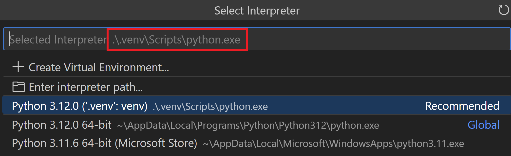

* `launch.json` 中 `"type"` 仍为已弃用的 `"python"`：改为 `"debugpy"`。
* 监视窗口有无效表达式：清空监视窗口并重启调试器。
* 使用本机线程 API（例如 Win32 `CreateThread`）的多线程应用，请在要调试的文件顶部添加：

    ```python
    import debugpy
    debugpy.debug_this_thread()
    ```

* Linux 上附加到进程超时，可以临时运行：

    ```bash
    echo 0 | sudo tee /proc/sys/kernel/yama/ptrace_scope
    ```

## 后续步骤 {#next-steps}

* [Python 环境](10.5.8-Environments/)：控制编辑和调试使用的解释器。
* [测试](10.5.9-Testing/)：配置测试环境并发现、运行和调试测试。
* [设置参考](10.5.17-SettingsReference/)：探索 Python 相关设置。
* [通用调试](../../../debugging-and-testing/6.1-Debugging/)：了解 VS Code 调试功能。
