+++
title = "10.5.8 Python 环境"
date = 2026-11-06T07:53:25+08:00
weight = 8
type = "docs"
description = ""
isCJKLanguage = true
draft = false
+++


> 原文链接: [https://code.visualstudio.com/docs/python/environments](https://code.visualstudio.com/docs/python/environments)

# 10.5.8 Python 环境

　　Python Environments 扩展将环境和包管理带入 VS Code UI。无论使用 `venv`、`uv`、`conda`、`pyenv`、`poetry` 还是 `pipenv`，都提供创建环境、安装包和切换解释器的统一界面。

核心功能：

* 创建、删除和切换环境
* 安装和管理包
* 在终端中激活 Python
* 为特定文件或文件夹分配环境（称为“Python 项目”）

　　该扩展与 [Python 扩展](https://marketplace.visualstudio.com/items?itemName=ms-python.python)配合工作，无需设置。

## 快速开始 {#quick-start}

**大多数用户无需配置。** 扩展会自动发现 Python 环境并在运行代码时使用。

基本设置（例如整个工作区一个环境）：

1. 打开 Python 文件。
2. 查看状态栏中的活动环境。
3. 切换环境时选择状态栏环境控件。

**需要创建环境？** 打开 Python 侧边栏，展开 **环境管理器**，选择 **+** 按钮，扩展会引导完成步骤。

## 用户界面组件 {#user-interface-components}

### 环境发现 {#environment-discovery}

自动发现以下环境管理器：

| 管理器 | 搜索位置 |
| ------ | -------- |
| venv | 工作区文件夹（可通过 `workspaceSearchPaths` 配置） |
| 系统 Python | PATH、`/usr/bin`、`/usr/local/bin`、Windows 注册表、python.org 安装 |
| Conda | 运行 `conda info --envs` 查找配置的环境目录 |
| Pyenv | `$PYENV_ROOT/versions` 或 `~/.pyenv/versions` |
| Poetry | 项目 `.venv` 文件夹和 `~/.cache/pypoetry/virtualenvs` |
| Pipenv | `~/.local/share/virtualenvs`（Linux/macOS）或 `%USERPROFILE%\.virtualenvs`（Windows） |

　　扩展激活时自动运行发现。它使用 Python Environment Tool（PET）Rust 二进制扫描系统环境，通过 PATH 查找 `conda`、`pyenv`、`poetry` 等可执行文件和已知安装位置，再搜索各管理器管理的环境。

手动刷新：

1. 打开命令面板（`Ctrl + Shift + P`，macOS：`Cmd + Shift + P`）。
2. 运行 **Python Environments: Refresh All Environment Managers**。

也可以单击 **环境管理器** 视图标题中的刷新图标。

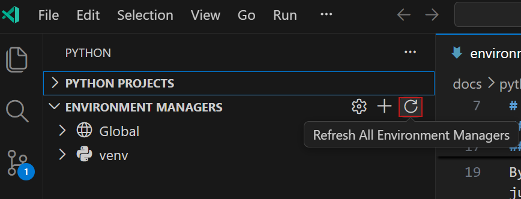

_选择刷新图标重新扫描环境。_

### 查看发现的环境 {#view-discovered-environments}

发现的环境显示在两处：

* **环境管理器视图**：Python 侧边栏中按管理器类型分组（venv、Conda 等）。
* **环境选择**：为项目选择解释器时，所有发现的环境出现在统一列表。

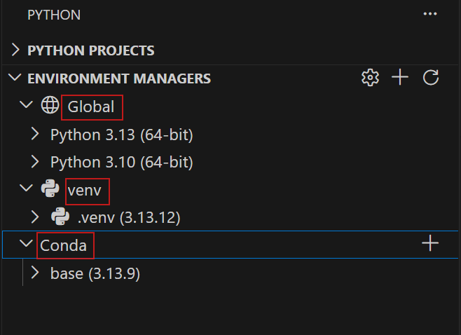

_环境管理器视图按类型分组环境。_

> **提示**：可以将环境标记为收藏，使其在选择器中优先显示。

### 配置搜索路径 {#configure-search-paths}

　　环境位于自定义位置时，可以配置搜索路径。在 **环境管理器** 视图标题选择齿轮图标，或使用 `python-envs.workspaceSearchPaths` 设置。

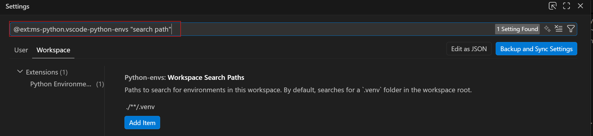

搜索路径可以是绝对路径、相对路径或 glob 模式。添加到搜索路径的文件夹会递归扫描 Python 环境。

### 选择环境 {#select-an-environment}

选择环境：

1. 打开命令面板，运行 **Python: Select Interpreter**。
2. 从发现的环境列表选择，或选择 **输入解释器路径...** 手动指定。

也可以选择状态栏中的 Python 版本。

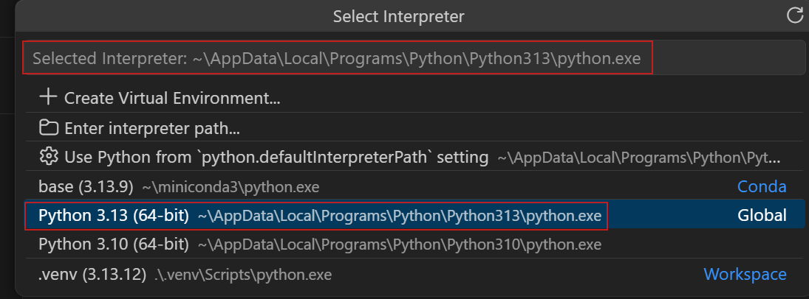

### 环境发现故障排除 {#troubleshoot-environment-discovery}

环境未显示时：

* 运行 **Python Environments: Refresh All Environment Managers**。
* 检查 `python-envs.workspaceSearchPaths` 是否包含环境位置。
* 确认环境管理器（conda、pyenv 等）在 PATH 中。
* 打开 **输出** 面板，选择 **Python Environments** 通道查看详细日志。使用 `python-envs.logLevel` 设置提高日志级别。

  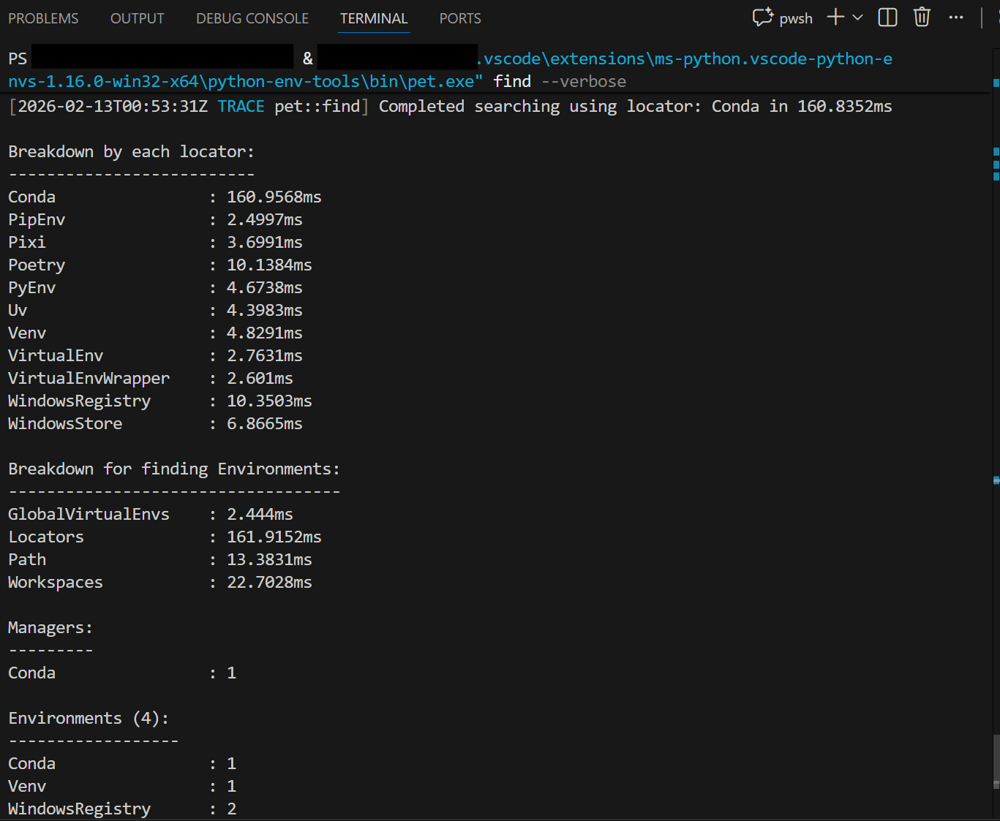

## 创建、删除和管理环境 {#create-delete-and-manage-environments}

### 创建环境 {#create-environments}

创建环境：

1. 在 **环境管理器** 视图中选择 **+**。
2. 选择环境类型（venv、Conda 等）。
3. 选择基础解释器。
4. 选择环境位置和名称。

扩展会创建环境并可自动安装项目依赖。自定义创建流程中可以选择要安装的包：

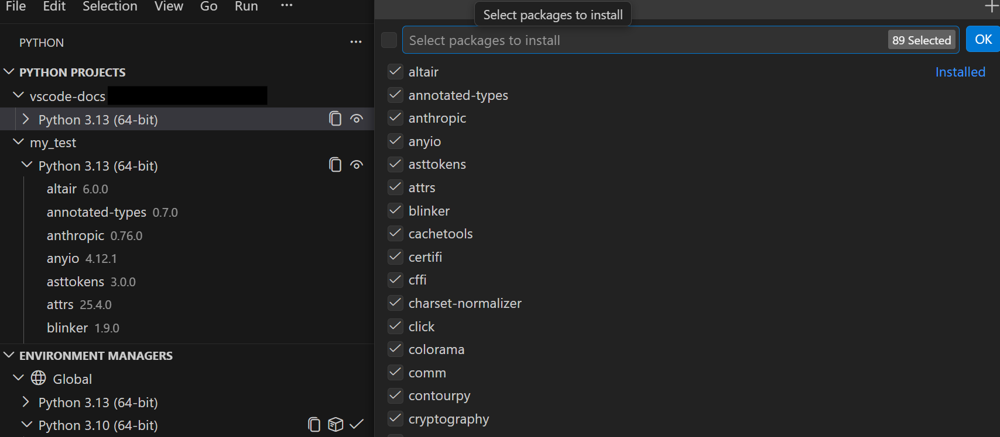

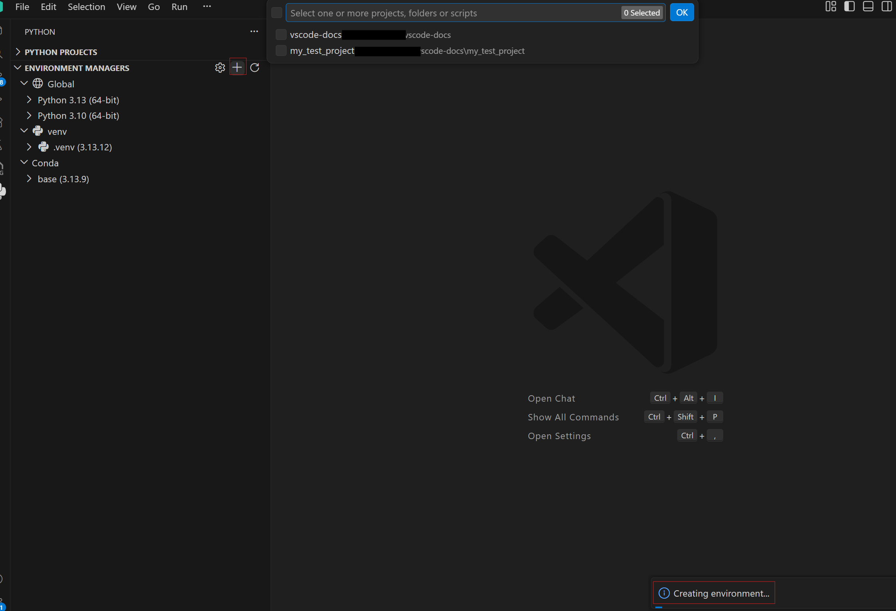

也可以从命令面板运行 **Python Envs: Create Environment**。

支持的环境管理器取决于系统安装。常见选项：

* **Venv**：Python 标准库虚拟环境。
* **Conda**：需要安装 Conda。
* **Pyenv**：需要安装 Pyenv。
* **Poetry**：需要安装 Poetry。
* **Pipenv**：需要安装 Pipenv。
* **uv**：需要安装 uv，创建速度快。

### 删除环境 {#delete-environments}

在 **环境管理器** 视图中右键单击环境，选择 **删除环境**。删除会移除环境文件夹及其安装的包，不可恢复。

### 终端中的 Python {#python-in-terminals}

打开新终端时，扩展会激活为工作区或项目选择的环境。终端提示符通常显示环境名称。可以使用 **Python Envs: Create Terminal** 命令创建已激活环境的终端。

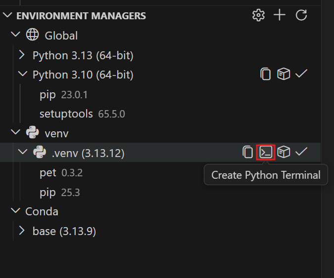

## Python 项目 {#python-projects}

### 为什么使用项目 {#why-use-projects}

　　monorepo 或包含多个子项目的工作区中，不同文件夹可能需要不同环境。Python 项目将文件/文件夹映射到特定环境，运行和调试时使用正确解释器。

### 添加项目 {#add-a-project}

将文件夹或文件视为独立项目：

1. 在资源管理器中右键单击。
2. 选择 **添加为 Python 项目**。

也可以在 **Python 项目** 视图选择 **+**，然后选择：

* **添加现有项**：手动选择文件/文件夹。
* **自动查找**：发现包含 `pyproject.toml` 或 `setup.py` 的文件夹。

> **提示**：添加项目时，其文件夹会自动加入环境搜索路径。项目文件夹内的环境（例如 `my-project/.venv`）会自动发现，无需更新 `workspaceSearchPaths`。

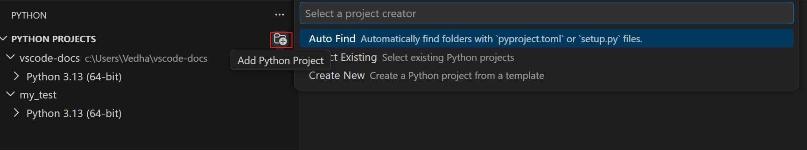

_添加现有文件夹或自动发现项目。_

### 分配环境 {#assign-an-environment}

文件夹成为项目后，分配环境：

1. 在 **Python 项目** 视图中单击项目下显示的环境（或“无环境”）。
2. 从发现的环境选择。

运行或调试该项目文件时使用所选环境。

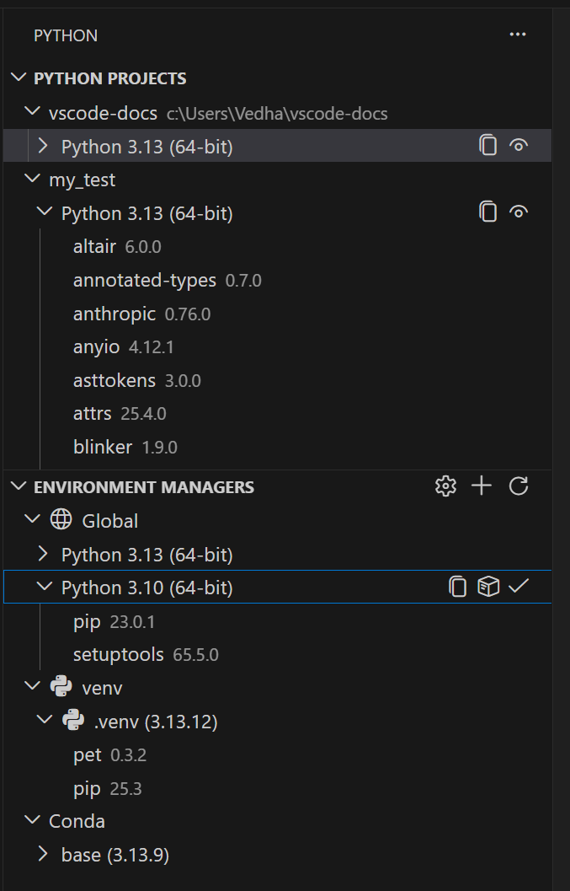

_单击环境进行更改。_

### 设置存储方式 {#how-settings-are-stored}

为项目分配环境时，扩展写入工作区设置 `.vscode/settings.json`：

```json
{
  "python-envs.pythonProjects": [
    {
      "path": "backend",
      "envManager": "ms-python.python:venv"
    },
    {
      "path": "ml-service",
      "envManager": "ms-python.python:conda"
    }
  ]
}
```

设置存储的是**环境管理器**，而不是硬编码解释器路径。扩展单独记住所选具体环境，并在运行时解析。这使设置可共享：

* **没有机器特定路径**：队友不需要 `/Users/yourname/.venv`。
* **跨系统可移植**：适用于 macOS、Windows 和 Linux。
* **环境重建后仍有效**：删除并重建 `.venv` 后仍可使用。

与队友共享：

1. 提交 `.vscode/settings.json`。
2. 队友克隆并打开工作区。
3. 他们创建自己的环境（快速创建很适合）。
4. 扩展自动使用每个项目配置的管理器。

> **注意**：环境*文件夹*（例如 `.venv`）仍需在每台机器创建。只共享配置，不共享环境本身。

### 删除项目 {#remove-a-project}

在 **Python 项目** 视图中右键单击项目，选择 **删除 Python 项目**。这只会移除映射，不会删除文件。

### 从模板创建项目 {#create-a-project-from-a-template}

要搭建具有正确结构的新项目，请从命令面板运行 **Python Envs: Create New Project from Template**，选择：

* **Package**：创建包含 `pyproject.toml`、包目录和测试的文件夹。
* **Script**：创建包含内联依赖元数据的单个 `.py` 文件（PEP 723）。

详情请参阅 [Python 项目指南](https://github.com/microsoft/vscode-python-environments/wiki/Python-Projects-Explained)。

## 包管理 {#package-management}

　　无需打开终端即可在 VS Code 中安装和卸载 Python 包。

### 安装包 {#install-packages}

1. 在 **环境管理器** 视图中找到环境。
2. 右键单击，选择 **管理包**。
3. 搜索并选择要安装的包。

也可以从命令面板运行 **Python Envs: Manage Packages**。

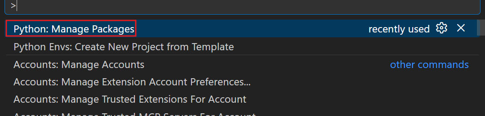

_直接在 VS Code 中搜索和安装包。_

**从 requirements 文件安装**：可以从 `requirements.txt`、`pyproject.toml` 或 `environment.yml` 安装。提示时选择文件，扩展会安装所有列出的依赖。

### 卸载包 {#uninstall-packages}

1. 在 **环境管理器** 视图中展开环境，查看已安装包。
2. 右键单击包，选择 **卸载包**。

### 各环境的包管理器 {#package-managers-by-environment}

扩展根据环境类型自动使用合适的包管理器：

| 环境 | 包管理器 |
| --- | --- |
| venv、系统 Python | pip |
| Conda | conda / pip |
| Poetry | poetry |
| Pipenv | pipenv |
| uv | uv pip |

### 使用 uv 加快安装 {#faster-installation-with-uv}

　　uv 是快速 Python 包安装器。安装 uv 并创建 uv 环境后，扩展会优先使用 uv 安装包，显著加快依赖安装。

## 设置和配置 {#settings-and-configuration}

### 解释器选择优先级 {#interpreter-selection-priority}

按以下优先级选择解释器：

1. 项目特定环境（`python-envs.pythonProjects`）。
2. 工作区默认环境。
3. 用户设置中的 `python.defaultInterpreterPath`。
4. 自动发现的全局解释器。

### 设置写入时机 {#when-settings-are-written}

选择环境时，扩展可能写入：

* **工作区设置**：为工作区或项目分配环境。
* **用户设置**：设置全局默认解释器。

### Python Environments 设置 {#python-environments-settings}

| 设置 | 说明 |
| --- | --- |
| `python-envs.defaultEnvManager` | 新环境默认管理器。 |
| `python-envs.workspaceSearchPaths` | 额外环境搜索路径。 |
| `python-envs.pythonProjects` | 项目到环境管理器的映射。 |
| `python-envs.logLevel` | 扩展日志级别。 |
| `python-envs.terminal.autoActivationType` | 终端自动激活方式。 |

### 终端设置 {#terminal-settings}

| 设置 | 说明 |
| --- | --- |
| `python-envs.terminal.autoActivationType` | `command`、`shellStartup` 或 `off`。 |
| `python.terminal.activateEnvironment` | 是否在新终端激活环境。 |
| `python.terminal.activateEnvInCurrentTerminal` | 是否在当前终端激活环境。 |

### .env 文件支持 {#env-file-support}

　　Python 扩展支持从 `.env` 文件加载环境变量。在 `launch.json` 或 `settings.json` 中设置 `envFile` 指向文件。

### 旧版设置 {#legacy-settings}

`python.pythonPath` 已弃用，请改用 `python.defaultInterpreterPath` 或环境选择器。`python.venvPath` 等旧设置仍可能被部分工具读取，但建议使用新环境管理器。

### 设置作用域参考 {#settings-scope-reference}

* 用户设置：全局默认值。
* 工作区设置：团队共享项目配置。
* 工作区文件夹设置：多根工作区中特定文件夹。

## 可扩展性 {#extensibility}

　　其他扩展可以通过 Python Environments API 查询和选择环境。详情请参阅 [Python Environments 扩展文档](https://github.com/microsoft/vscode-python-environments)。

## 已知限制 {#known-limitations}

### Pylance 和多项目工作区 {#pylance-and-multi-project-workspaces}

　　Pylance 和 Jupyter 当前每个工作区使用单个解释器，而不是每个项目环境。需要为不同文件夹使用不同解释器时，请将它们添加为[多根工作区](../../../editor/3.2-WriteCode/3.2.8-Workspaces/3.2.8.2-MultiRootWorkspaces/)中的工作区文件夹，因为 Pylance 会按工作区文件夹独立运行。

### Jupyter 笔记本 {#jupyter-notebooks}

　　Jupyter 笔记本不使用 Python Environments API 发现环境，而依赖旧版 Python 扩展 API。因此笔记本内核选择可能显示与 **环境管理器** 视图不同的环境。

## 后续步骤 {#next-steps}

* [Python 教程](10.5.2-Tutorial/)：在 VS Code 中开始 Python。
* [调试](10.5.7-Debugging/)：学习调试 Python 代码。
* [测试](10.5.9-Testing/)：配置并运行 Python 项目测试。
* [设置参考](10.5.17-SettingsReference/)：探索所有 Python 扩展设置。
