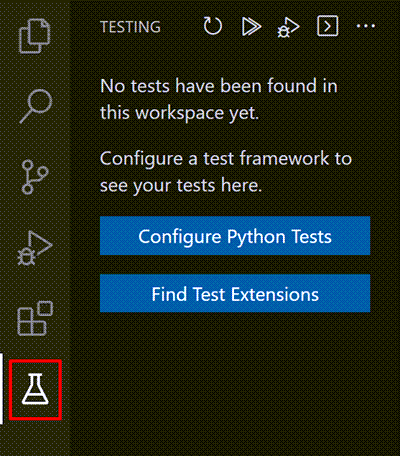
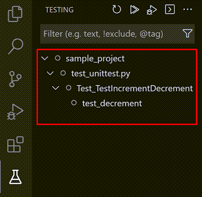
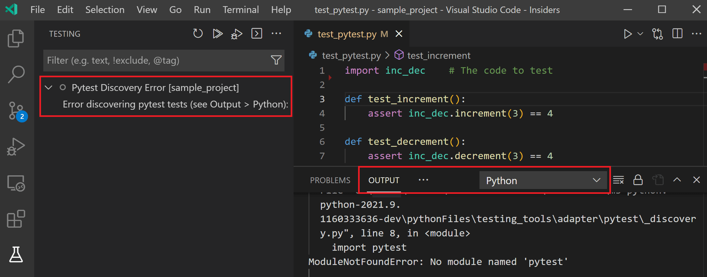
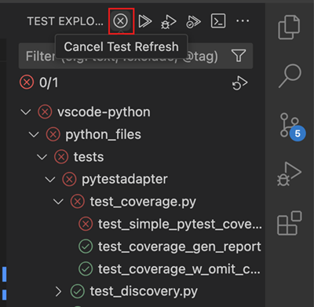
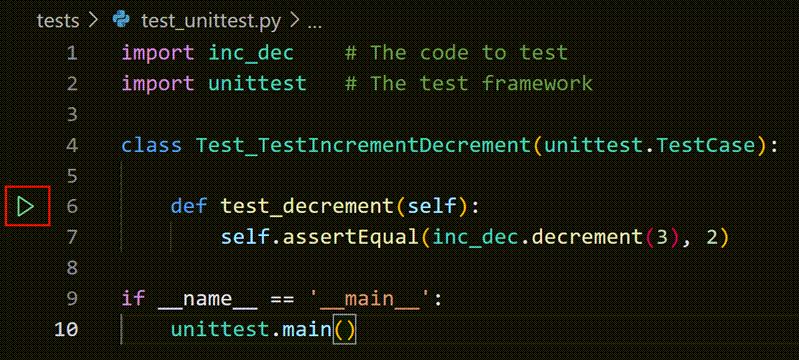
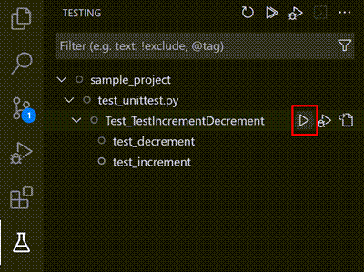
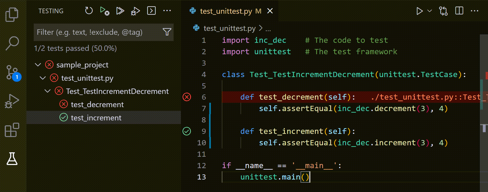
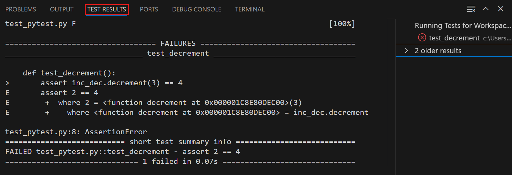

+++
title = "10.5.9 测试 Python"
date = 2026-11-06T07:53:25+08:00
weight = 9
type = "docs"
description = ""
isCJKLanguage = true
draft = false
+++

> 原文链接: [https://code.visualstudio.com/docs/python/testing](https://code.visualstudio.com/docs/python/testing)

# 10.5.9 测试 Python

　　Python 扩展支持使用 unittest 和 pytest 进行单元测试，提供测试发现、运行、调试和覆盖率。

## 配置测试 {#configure-tests}

　　打开测试视图（活动栏试管图标）并选择 **配置 Python 测试**，或从命令面板运行 **Python: Configure Tests**。

选择测试框架（`unittest` 或 `pytest`），然后选择测试所在目录。

## 测试发现 {#test-discovery}

　　配置框架后扩展会扫描工作区中的测试。测试视图按文件、类和测试方法组织。

* 修改测试文件时会自动重新发现。
* 可以使用测试视图标题中的刷新按钮手动重新发现。
* 发现失败时视图显示错误，选择错误查看输出。

发现过程中可以单击 **取消** 按钮取消，该按钮会在发现期间替换 **刷新** 按钮：

## 运行测试 {#run-tests}

　　测试视图提供多种运行方式：

* 标题栏 **运行所有测试** 运行全部测试。
* 测试条目旁的播放按钮运行单个测试。
* 右键单击文件、类或测试运行或调试。
* 编辑器中的 CodeLens 也可以在测试函数上运行和调试。

  
* 测试资源管理器标题的 **运行当前文件中的测试** 运行活动文件测试。
* 选择文件、类或单个测试，再选择条目旁的播放按钮，可以只运行该范围的测试：

  

　　运行测试时，测试视图显示进度和结果，编辑器装订线显示通过/失败状态。测试结果面板显示输出、错误和耗时。

### 筛选和分组 {#filter-and-group}

测试视图搜索框可以按名称筛选。`@failed`、`@passed`、`@skipped` 等筛选器只显示相应测试。

## 带覆盖率运行测试 {#run-tests-with-coverage}

　　安装 [coverage.py](https://coverage.readthedocs.io/)（pytest 使用 `pytest-cov`）后，可以选择 **运行带覆盖率的测试**。扩展会在测试视图显示覆盖率摘要，并在编辑器中标记已执行和未执行行。

<video src="https://code.visualstudio.com/assets/docs/python/testing/python-coverage.mp4" title="Python 测试覆盖率。" autoplay loop controls muted></video>

## 调试测试 {#debug-tests}

　　在测试视图中右键单击测试，选择 **调试测试**；或单击测试旁的调试按钮。也可以使用编辑器测试函数上方的 **调试测试** CodeLens。

调试会话使用测试配置，在断点处暂停，可以检查变量和单步执行。详情请参阅[调试 Python](10.5.7-Debugging/)。

## 并行运行测试 {#run-tests-in-parallel}

　　pytest 可以通过 `pytest-xdist` 并行运行测试。安装后，在测试配置的 `args` 中添加 `-n auto` 或指定进程数。

## Django 单元测试 {#django-unit-tests}

　　Django 测试使用 `django.test` 框架，通过 unittest 运行。将测试框架设置为 `unittest`，并设置 `python.testing.unittestArgs` 的 `-p` 模式为 `test*.py` 等，同时设置 `DJANGO_SETTINGS_MODULE` 环境变量。

如果测试需要数据库，请确保测试配置使用测试数据库。

### 故障排除 {#troubleshooting}

* 测试未发现：检查测试文件命名、目录和 `unittestArgs`/`pytestArgs`。
* 导入错误：确认测试使用了正确的环境（状态栏解释器）。
* Django 设置错误：确认 `DJANGO_SETTINGS_MODULE` 指向项目设置。
* 查看 **Python** 输出通道中的测试日志。

## 测试命令 {#test-commands}

命令面板提供：

* **Python: Configure Tests**
* **Python: Discover Tests**
* **Python: Run All Tests**
* **Python: Debug All Tests**
* **Python: Run Current File Tests**
* **Python: Debug Current File Tests**
* **Python: Show Test Output**

## 测试配置设置 {#test-configuration-settings}

### 常规 UI 设置 {#general-ui-settings}

| 设置 | 默认值 | 说明 |
| --- | --- | --- |
| `python.testing.autoTestDiscoverOnSaveEnabled` | `true` | 保存时自动发现测试。 |
| `python.testing.cwd` | `null` | 测试运行工作目录，默认工作区根。 |
| `python.testing.debugPort` | `3000` | 调试测试端口。 |

### 常规 Python 设置 {#general-python-settings}

| 设置 | 默认值 | 说明 |
| --- | --- | --- |
| `python.testing.pytestEnabled` | `false` | 启用 pytest。 |
| `python.testing.unittestEnabled` | `false` | 启用 unittest。 |

### unittest 配置 {#unittest-configuration-settings}

| 设置 | 默认值 | 说明 |
| --- | --- | --- |
| `python.testing.unittestArgs` | `["-v","-s",".","-p","test*.py"]` | 传给 unittest 的参数。 |
| `python.testing.unittestEnabled` | `false` | 启用 unittest。 |

### pytest 配置 {#pytest-configuration-settings}

| 设置 | 默认值 | 说明 |
| --- | --- | --- |
| `python.testing.pytestArgs` | `[]` | 传给 pytest 的参数。 |
| `python.testing.pytestEnabled` | `false` | 启用 pytest。 |
| `python.testing.pytestPath` | `"pytest"` | pytest 可执行文件路径。 |

### IntelliSense 设置 {#intellisense-settings}

| 设置 | 说明 |
| --- | --- |
| `python.testing.promptToConfigure` | 打开包含测试的文件时提示配置。 |
| `python.testing.autoTestDiscoverOnSaveEnabled` | 保存时自动发现。 |

## 另请参阅 {#see-also}

* [调试 Python](10.5.7-Debugging/)
* [Python 环境](10.5.8-Environments/)
* [设置参考](10.5.17-SettingsReference/)
* [测试视图](../../../debugging-and-testing/6.4-Testing/)
