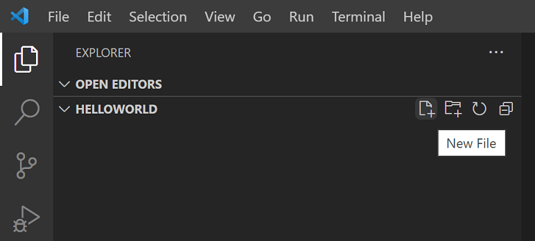
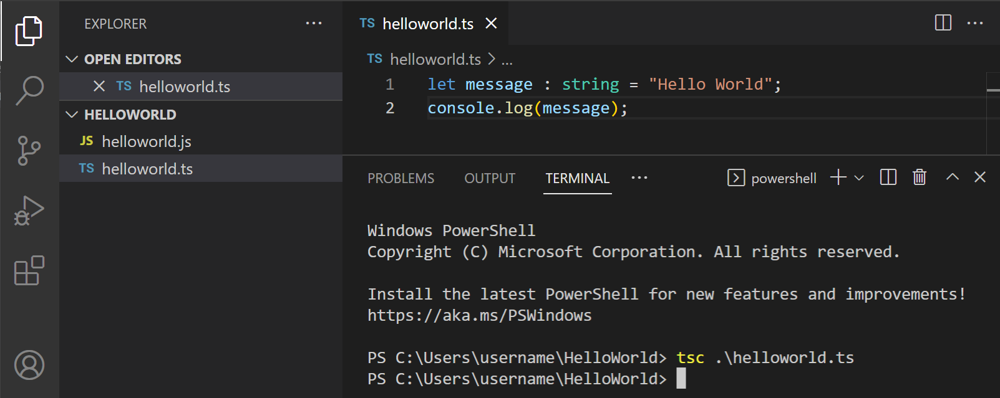
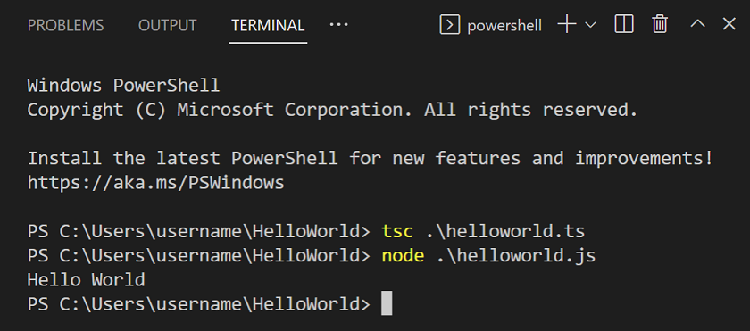
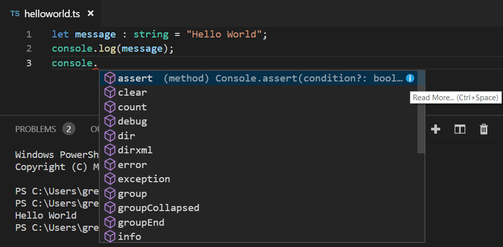
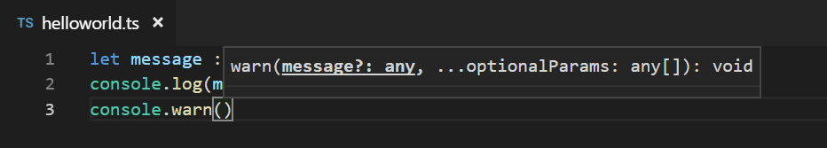
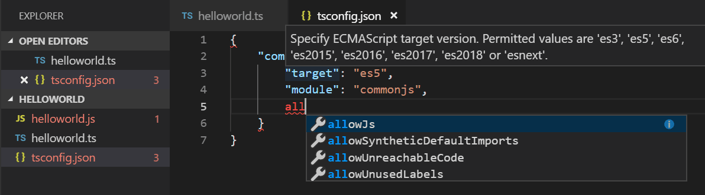
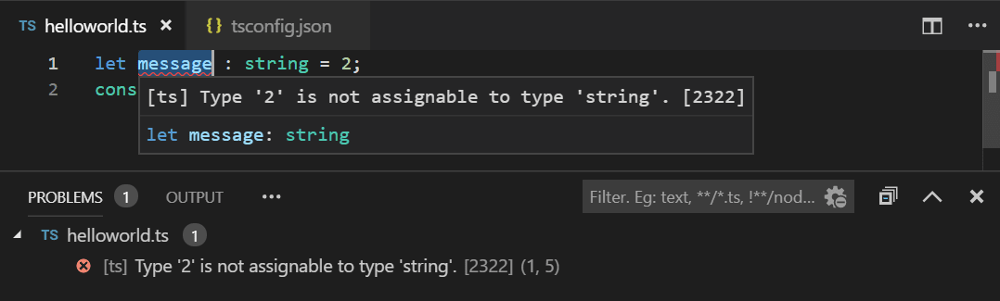
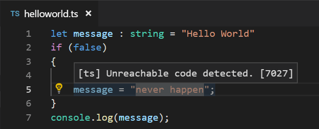
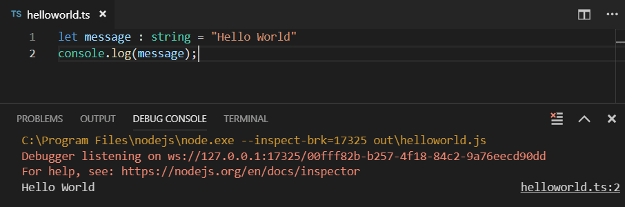
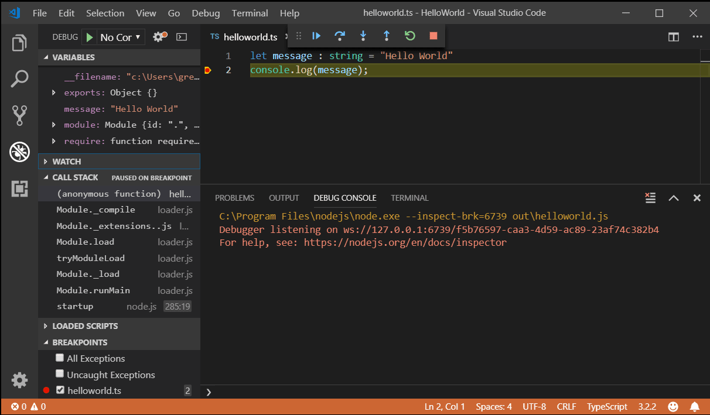

+++
title = "10.4.1 TypeScript 教程"
date = 2026-11-06T07:53:25+08:00
weight = 1
type = "docs"
description = ""
isCJKLanguage = true
draft = false
+++


> 原文链接: [https://code.visualstudio.com/docs/typescript/typescript-tutorial](https://code.visualstudio.com/docs/typescript/typescript-tutorial)

# 10.4.1 TypeScript 教程

　　[TypeScript](https://www.typescriptlang.org)是编译为普通 JavaScript 的带类型 JavaScript 超集。它提供类、模块和接口，帮助构建健壮的组件。

## 安装 TypeScript 编译器 {#install-the-typescript-compiler}

　　VS Code 包含 TypeScript 语言支持，但不包含 TypeScript 编译器 `tsc`。需要全局或在工作区安装 TypeScript 编译器，才能将 TypeScript 源代码转译为 JavaScript（`tsc helloworld.ts`）。

安装 TypeScript 最简单的方法是通过 npm（[Node.js 包管理器](https://www.npmjs.com/)）。已安装 npm 时，可以在计算机上全局（`-g`）安装：

```bash
npm install -g typescript
```

可以通过检查版本测试安装：

```bash
tsc --version
```

## Hello World {#hello-world}

从一个简单的 Hello World Node.js 示例开始。创建新文件夹 `HelloWorld` 并启动 VS Code：

```bash
mkdir HelloWorld
cd HelloWorld
code .
```

在文件资源管理器中创建新文件 `helloworld.ts`。



添加以下 TypeScript 代码。注意 TypeScript 关键字 `let` 和 `string` 类型声明：

```typescript
let message : string = "Hello World";
console.log(message);
```

要编译 TypeScript 代码，可以打开[集成终端](../../../terminal/5.2-TerminalBasics/)（`Ctrl + 反引号`）并输入 `tsc helloworld.ts`。这会编译并创建新的 `helloworld.js` JavaScript 文件。



已安装 Node.js 时，可以运行 `node helloworld.js`。



打开 `helloworld.js` 会看到它与 `helloworld.ts` 差别不大：类型信息已移除，`let` 变成了 `var`。

```javascript
var message = "Hello World";
console.log(message);
```

## IntelliSense {#intellisense}

　　在 VS Code 中可以看到语法高亮和括号匹配等语言功能。在编辑器中输入时，可能注意到 IntelliSense，即 VS Code 和 TypeScript 语言服务器提供的智能代码补全和建议。下面可以看到 `console` 的方法：



选择方法后会获得参数帮助，也可以随时查看悬停信息。



## tsconfig.json {#tsconfigjson}

　　到目前为止，本教程一直依赖 TypeScript 编译器的默认行为编译源代码。可以通过添加 `tsconfig.json` 文件修改 TypeScript 编译器选项，定义 TypeScript [项目设置](https://www.typescriptlang.org/docs/handbook/tsconfig-json.html)，例如[编译器选项](https://www.typescriptlang.org/docs/handbook/compiler-options.html)和应包含的文件。

**重要**：要在本教程后续部分使用 `tsconfig.json`，请在不带输入文件的情况下调用 `tsc`。TypeScript 编译器会知道从 `tsconfig.json` 读取项目设置和编译器选项。

添加简单的 `tsconfig.json`，将选项设置为编译到 ES5 并使用 **CommonJS** [模块](https://wiki.commonjs.org/wiki/Modules/1.0)：

```json
{
    "compilerOptions": {
        "target": "ES5",
        "module": "CommonJS"
    }
}
```

编辑 `tsconfig.json` 时，IntelliSense（`Ctrl + Space`）会提供帮助。



　　默认情况下，未包含 `files` 属性时 TypeScript 会包含当前文件夹及子文件夹中的所有 `.ts` 文件，因此无需显式列出 `helloworld.ts`。

### 更改生成输出 {#change-the-build-output}

　　生成的 JavaScript 文件与 TypeScript 源文件在同一文件夹中，大型项目很快会变得杂乱，因此可以使用 `outDir` 属性指定编译器输出目录：

```json
{
    "compilerOptions": {
        "target": "ES5",
        "module": "CommonJS",
        "outDir": "out"
    }
}
```

删除 `helloworld.js`，运行不带选项的 `tsc`。会看到 `helloworld.js` 现在放在 `out` 目录中。

TypeScript 语言服务的其他功能以及如何使用任务直接从 VS Code 运行生成，请参阅[转译 TypeScript](10.4.2-Transpiling/)。

## 错误检查 {#error-checking}

　　TypeScript 通过强类型检查帮助避免常见编程错误。例如，将数字赋给 `message` 时，TypeScript 编译器会报 **'error TS2322: Type '2' is not assignable to type 'string'**。在 VS Code 编辑器中（红色波浪线和悬停信息）以及问题面板（`Ctrl + Shift + M`，macOS：`Cmd + Shift + M`）中都能看到类型检查错误。`[ts]` 前缀表示错误来自 TypeScript 语言服务。



## 快速修复 {#quick-fixes}

　　TypeScript 语言服务有强大的诊断功能，可以发现常见编码问题。例如，它可以分析源代码并检测不可达代码，在编辑器中以淡化方式显示。将鼠标悬停在该行源代码上会看到解释，将光标放在该行会获得快速修复灯泡。



单击灯泡或按 `Ctrl + .`（macOS：`Cmd + .`） 打开快速修复菜单，可以选择 **移除不可达代码** 修复。

此外，**Code Action Widget: Include Nearby Quick Fixes**（`editor.codeActionWidget.includeNearbyQuickFixes`）默认启用，会从 `Ctrl + .`（macOS：`Cmd + .`）（命令 ID `editor.action.quickFix`）激活行中最近的快速修复，无论光标在该行什么位置。

该命令会高亮将通过快速修复重构或修复的源代码。普通代码操作和非修复重构仍可在光标位置激活。

## 调试 {#debugging}

　　VS Code 内置 TypeScript 调试支持。为支持 TypeScript 与执行的 JavaScript 代码联合调试，VS Code 依赖 [source map](https://firefox-source-docs.mozilla.org/devtools-user/debugger/how_to/use_a_source_map/index.html) 在原始 TypeScript 源代码和运行的 JavaScript 之间映射。可以在 `tsconfig.json` 中设置 `"sourceMap": true` 在生成时创建 source map：

```json
{
    "compilerOptions": {
        "target": "ES5",
        "module": "CommonJS",
        "outDir": "out",
        "sourceMap": true
    }
}
```

运行 `tsc` 重新生成，`out` 目录中 `helloworld.js` 旁应出现 `helloworld.js.map`。

在编辑器中打开 `helloworld.ts`，按 `F5`。安装了其他调试器扩展时，需要从下拉列表选择 **Node.js**。

调试器会启动会话、运行代码，并在调试控制台面板显示“Hello World”消息。



在 `helloworld.ts` 中单击编辑器左侧装订线设置断点。断点设置成功会显示红圈。再次按 `F5`。命中断点时代码执行停止，可以在 **运行和调试** 视图（`Ctrl + Shift + D`，macOS：`Cmd + Shift + D`）中查看变量值和调用堆栈等调试信息。



VS Code 对 TypeScript 的内置调试支持以及如何为项目场景配置调试器，请参阅[调试 TypeScript](10.4.5-Debugging/)。

## 后续步骤 {#next-steps}

　　本教程快速介绍了如何使用 VS Code 进行 TypeScript 开发。继续了解 VS Code 对 TypeScript 的编译和调试支持：

* [转译 TypeScript](10.4.2-Transpiling/)：使用 VS Code 强大的任务系统编译 TypeScript。
* [编辑 TypeScript](10.4.3-Editing/)：TypeScript 特定编辑功能。
* [重构 TypeScript](10.4.4-Refactoring/)：TypeScript 语言服务的有用重构。
* [调试 TypeScript](10.4.5-Debugging/)：为 TypeScript 项目配置调试器。

## 常见问题 {#common-questions}

### 无法启动程序，因为找不到对应的 JavaScript {#cannot-launch-program-because-corresponding-javascript-cannot-be-found}

　　很可能未在 `tsconfig.json` 中设置 `"sourceMap": true`，VS Code Node.js 调试器无法将 TypeScript 源代码映射到运行的 JavaScript。请开启 source map 并重新生成项目。
