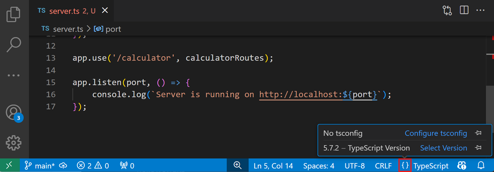
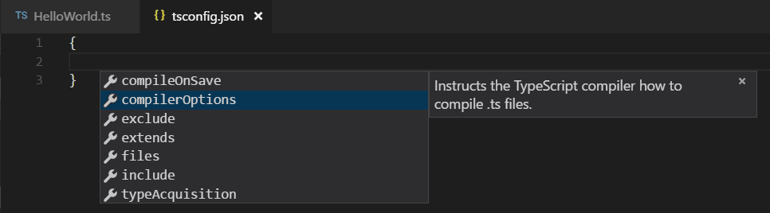
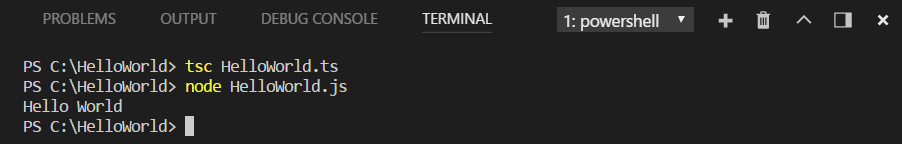
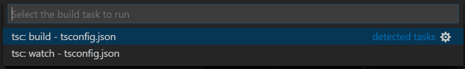
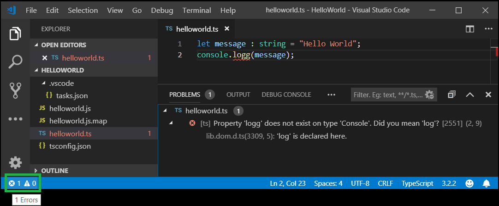
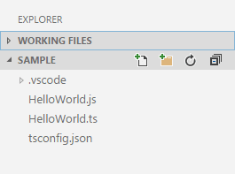
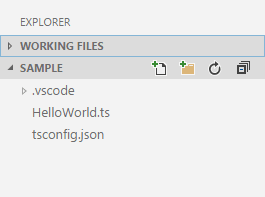
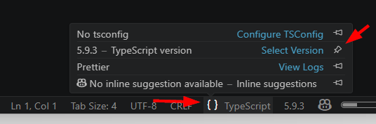
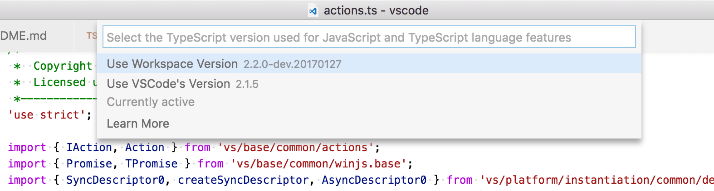

+++
title = "10.4.2 转译 TypeScript"
date = 2026-11-06T07:53:25+08:00
weight = 2
type = "docs"
description = ""
isCJKLanguage = true
draft = false
+++


> 原文链接: [https://code.visualstudio.com/docs/typescript/typescript-transpiling](https://code.visualstudio.com/docs/typescript/typescript-transpiling)

# 10.4.2 转译 TypeScript

　　[TypeScript](https://www.typescriptlang.org)是转译为普通 JavaScript 的带类型 JavaScript 超集。它提供类、模块和接口，帮助构建健壮的组件。

## 安装 TypeScript 编译器 {#install-the-typescript-compiler}

　　VS Code 包含 TypeScript 语言支持，但不包含 TypeScript 编译器 `tsc`。需要全局或在工作区安装 TypeScript 编译器，才能将 TypeScript 源代码转译为 JavaScript（`tsc HelloWorld.ts`）。

安装 TypeScript 最简单的方法是通过 npm（[Node.js 包管理器](https://www.npmjs.com/)）。已安装 npm 时，可以全局（`-g`）安装：

```bash
npm install -g typescript
```

可以通过检查版本或帮助测试安装：

```bash
tsc --version
tsc --help
```

另一种选择是在项目中本地安装编译器（`npm install --save-dev typescript`），好处是避免与可能存在的其他 TypeScript 项目交互。

### 编译器与语言服务 {#compiler-versus-language-service}

　　请记住，VS Code 的 TypeScript 语言服务独立于已安装的 TypeScript 编译器。打开 TypeScript 文件时，可以在状态栏语言项中看到 VS Code 的 TypeScript 版本。



> **提示**：可以使用*固定*图标将 TypeScript 版本固定到状态栏。

本文稍后会讨论如何[更改](#using-newer-typescript-versions) VS Code 使用的 TypeScript 语言服务版本。

## tsconfig.json {#tsconfigjson}

　　任何新 TypeScript 项目的第一步通常是添加 `tsconfig.json` 文件。它定义 TypeScript [项目设置](https://www.typescriptlang.org/docs/handbook/tsconfig-json.html)，例如编译器选项和应包含的文件。请打开源代码文件夹，添加名为 `tsconfig.json` 的新文件。在该文件中，IntelliSense（`Ctrl + Space`）会提供帮助。



以下简单 `tsconfig.json` 用于 ES5、**CommonJS** [模块](https://wiki.commonjs.org/wiki/Modules/1.0)和 source map：

```json
{
    "compilerOptions": {
        "target": "ES5",
        "module": "CommonJS",
        "sourceMap": true
    }
}
```

　　现在创建项目中的 `.ts` 文件时，我们会提供丰富编辑体验和语法验证。

## 将 TypeScript 转译为 JavaScript {#transpile-typescript-into-javascript}

　　VS Code 通过集成[任务运行器](../../../debugging-and-testing/6.3-Tasks/)与 `tsc` 集成，可以将 `.ts` 文件转译为 `.js` 文件。使用 VS Code 任务的另一个好处是可以在[问题](../../../editor/3.2-WriteCode/3.2.5-CodeNavigation/#errors-and-warnings)面板中看到集成的错误和警告检测。下面转译一个简单 TypeScript Hello World 程序。

### 第 1 步：创建简单 TS 文件 {#step-1-create-a-simple-ts-file}

在空文件夹中打开 VS Code，创建 `helloworld.ts` 并放入：

```typescript
let message : string = "Hello World";
console.log(message);
```

要测试 TypeScript 编译器 `tsc` 安装正确且 Hello World 可运行，请打开终端输入 `tsc helloworld.ts`。可以直接使用 VS Code 中的集成终端（`Ctrl + 反引号`）。

现在应看到转译后的 `helloworld.js`，安装 [Node.js](https://nodejs.org) 后可以输入 `node helloworld.js` 运行。



### 第 2 步：运行 TypeScript 生成 {#step-2-run-the-typescript-build}

从全局 **终端** 菜单执行 **运行生成任务**（`Ctrl + Shift + B`）。如果之前创建了 `tsconfig.json`，会显示选择器：



选择 **tsc: build** 条目，会在工作区生成 `HelloWorld.js` 和 `HelloWorld.js.map`。

选择 **tsc: watch** 时，TypeScript 编译器会监视 TypeScript 文件更改，并在每次更改时运行转译器。

底层运行 TypeScript 编译器的命令是：`tsc -p .`

### 第 3 步：将 TypeScript 生成设为默认 {#step-3-make-the-typescript-build-the-default}

　　也可以将 TypeScript 生成任务设为默认生成任务，使 **运行生成任务**（`Ctrl + Shift + B`）直接执行。从全局 **终端** 菜单选择 **配置默认生成任务**，从可用任务中选择 TypeScript **tsc: build**，会在 `.vscode` 文件夹生成：

```ts
{
    // 有关 tasks.json 格式的文档，请参阅 https://go.microsoft.com/fwlink/?LinkId=733558
    "version": "2.0.0",
    "tasks": [
        {
            "type": "typescript",
            "tsconfig": "tsconfig.json",
            "problemMatcher": [
                "$tsc"
            ],
            "group": {
                "kind": "build",
                "isDefault": true
            }
        }
    ]
}
```

　　任务有一个 `group` JSON 对象，将 `kind` 设为 `build` 并设为默认。现在选择 **运行生成任务** 或按 `Ctrl + Shift + B` 时不会再提示选择任务，编译会直接开始。

> **提示**：也可以使用 VS Code 的运行/调试功能运行程序。在 VS Code 中运行和调试 Node.js 应用的详情请参阅 [Node.js 教程](https://code.visualstudio.com/docs/nodejs/nodejs-tutorial#debug-your-express-app)。

### 第 4 步：检查生成问题 {#step-4-reviewing-build-issues}

　　VS Code 任务系统还可以通过[问题匹配器](../../../debugging-and-testing/6.3-Tasks/#defining-a-problem-matcher)检测生成问题。问题匹配器根据特定构建工具解析输出，提供集成问题显示和导航。VS Code 自带许多问题匹配器，`tasks.json` 中的 `$tsc` 是 TypeScript 编译器输出的问题匹配器。

例如 TypeScript 文件有简单错误（`console.log` 中多了 'g'），`tsc` 可能输出：

    HelloWorld.ts(3,17): error TS2339: Property 'logg' does not exist on type 'Console'.

这会显示在终端面板（`Ctrl + 反引号`）中，并在终端视图下拉列表选择 **Tasks - build tsconfig.json**。

可以在状态栏看到错误和警告数量。单击错误和警告图标获取问题列表并导航。



也可以使用键盘 `Ctrl + Shift + M` 打开列表。

> **提示**：任务对许多操作提供丰富支持。配置详情请参阅[任务](../../../debugging-and-testing/6.3-Tasks/)主题。

## JavaScript source map 支持 {#javascript-source-map-support}

　　TypeScript 调试支持 JavaScript source map。要为 TypeScript 文件生成 source map，请使用 `--sourcemap` 选项编译，或在 `tsconfig.json` 中将 `sourceMap` 属性设为 `true`。

也支持内联 source map（内容作为 data URL 存储，而不是单独文件），但尚不支持内联 source。

## 生成文件的输出位置 {#output-location-for-generated-files}

　　生成的 JavaScript 与 TypeScript 源文件在同一文件夹中，大型项目很快会杂乱。可以使用 `outDir` 属性指定编译器输出目录：

```json
{
    "compilerOptions": {
        "target": "ES5",
        "module": "CommonJS",
        "outDir": "out"
    }
}
```

## 隐藏派生的 JavaScript 文件 {#hiding-derived-javascript-files}

　　使用 TypeScript 时，通常不想在文件资源管理器或搜索结果中看到生成的 JavaScript。VS Code 通过 `files.exclude` [工作区设置](../../../editor/3.3-ConfigureTheEditor/3.3.4-Settings/)提供筛选功能，可以轻松创建表达式隐藏派生文件：

`**/*.js: { "when": "$(basename).ts" }`

　　此模式匹配任何 JavaScript 文件（`**/*.js`），但仅当存在同名同级 TypeScript 文件时。编译到同一位置时，文件资源管理器不再显示派生的 JavaScript。

 

在工作区根目录 `.vscode` 文件夹的 `settings.json` 中添加带筛选器的 `files.exclude` 设置。可以从命令面板（`Ctrl + Shift + P`）的 **Preferences: Open Workspace Settings (JSON)** 命令打开工作区 `settings.json`。

要排除由 `.ts` 和 `.tsx` 源文件生成的 JavaScript：

```json
"files.exclude": {
    "**/*.js": { "when": "$(basename).ts" },
    "**/**.js": { "when": "$(basename).tsx" }
}
```

　　这是一个小技巧。搜索 [glob 模式](https://code.visualstudio.com/docs/editor/glob-patterns)用作键。上述设置使用两个不同 glob 模式提供两个唯一键，但搜索仍会匹配相同文件。

## 使用较新的 TypeScript 版本 {#using-newer-typescript-versions}

　　VS Code 自带较新的稳定 TypeScript 语言服务版本，默认用它提供 IntelliSense。工作区 TypeScript 版本独立于编译 `*.ts` 文件所用的 TypeScript 版本。大多数情况下可以直接使用 VS Code 内置 TypeScript 版本提供 IntelliSense，但有时可能需要更改 VS Code 用于 IntelliSense 的 TypeScript 版本。

原因包括：

* 通过切换到 TypeScript 夜间构建（`typescript@next`）试用最新 TypeScript 功能。
* 确保 IntelliSense 使用的 TypeScript 版本与编译代码所用版本一致。

活动 TypeScript 版本及安装位置可以显示在状态栏。选择语言栏状态项（`{ }`），然后选择 TypeScript 版本的固定图标，使其在状态栏中保持可见。



如果想更改工作区默认 TypeScript 版本，有几个选项：

### 使用工作区 TypeScript 版本 {#using-the-workspace-version-of-typescript}

　　工作区有特定 TypeScript 版本时，可以打开 TypeScript 或 JavaScript 文件，单击状态栏中的 TypeScript 版本号，在工作区 TypeScript 版本和 VS Code 默认版本之间切换。会出现消息框询问 VS Code 应使用哪个 TypeScript 版本：



　　可以用它在 VS Code 自带 TypeScript 版本和工作区 TypeScript 版本之间切换。也可以使用 **TypeScript: Select TypeScript Version** 命令触发版本选择器。

　　VS Code 会自动检测工作区根目录 `node_modules` 下安装的 TypeScript 版本。也可以通过用户或工作区[设置](../../../editor/3.3-ConfigureTheEditor/3.3.4-Settings/)中的 `js/ts.tsdk.path` 显式告诉 VS Code 使用哪个 TypeScript 版本。该设置应指向包含 TypeScript `tsserver.js` 文件的目录。可以使用 `npm list -g typescript` 查找 TypeScript 安装位置，`tsserver.js` 通常在 `lib` 文件夹中。

例如：

```json
{
   "js/ts.tsdk.path": "/usr/local/lib/node_modules/typescript/lib"
}
```

> **提示**：要获取特定 TypeScript 版本，请在 npm install 时指定 `@version`。例如 TypeScript 3.6.0 使用 `npm install --save-dev typescript@3.6.0`。预览下一版本请运行 `npm install --save-dev typescript@next`。

　　注意这些示例中 `js/ts.tsdk.path` 指向 `typescript` 内的 `lib` 目录，但 `typescript` 目录必须是包含 TypeScript `package.json` 文件的完整安装。

也可以在工作区添加 `js/ts.tsdk.path` 设置，指向 `tsserver.js` 文件目录，告诉 VS Code 使用特定 TypeScript 版本：

```json
{
   "js/ts.tsdk.path": "./node_modules/typescript/lib"
}
```

　　`js/ts.tsdk.path` 工作区设置只告诉 VS Code 存在工作区 TypeScript 版本。要实际开始使用工作区版本提供 IntelliSense，必须运行 **TypeScript: Select TypeScript Version** 命令并选择工作区版本。

### 使用 TypeScript 夜间构建 {#using-typescript-nightly-builds}

　　在 VS Code 中试用最新 TypeScript 功能的最简单方法是安装 [JavaScript and TypeScript Nightly 扩展](https://marketplace.visualstudio.com/items?itemName=ms-vscode.vscode-typescript-next)。

该扩展会用最新 TypeScript 夜间构建自动替换 VS Code 内置 TypeScript 版本。如果已通过 **TypeScript: Select TypeScript Version** 配置 TypeScript 版本，请确保[切回 VS Code 的 TypeScript 版本](#using-the-workspace-version-of-typescript)。

## TypeScript 和 JavaScript 混合项目 {#mixed-typescript-and-javascript-projects}

　　可以创建 TypeScript 和 JavaScript 混合项目。要在 TypeScript 项目中启用 JavaScript，请在 `tsconfig.json` 中将 `allowJs` 属性设为 `true`。

> **提示**：`tsc` 编译器不会自动检测 `jsconfig.json` 文件。请使用 `–p` 参数让 `tsc` 使用 `jsconfig.json`，例如 `tsc -p jsconfig.json`。

## 处理大型项目 {#working-with-large-projects}

　　代码库有数百或数千个 TypeScript 文件时，可以采取以下步骤改善 VS Code 编辑体验和命令行编译时间。

### 确保 tsconfig 只包含关心的文件 {#make-sure-your-tsconfig-only-includes-files-you-care-about}

在项目 `tsconfig.json` 中使用 `include` 或 `files`，确保项目只包含应属于项目的文件。

配置 `tsconfig.json` 的[更多信息](https://github.com/microsoft/TypeScript/wiki/Performance#configuring-tsconfigjson-or-jsconfigjson)。

### 使用项目引用拆分项目 {#break-up-your-project-using-project-references}

　　与其将源代码组织为单个大型项目，不如使用[项目引用](https://www.typescriptlang.org/docs/handbook/project-references.html)拆分为较小项目以提高性能。这使 TypeScript 一次只加载代码库的子集，而不是加载全部。

项目引用用法和最佳实践请参阅 [TypeScript 文档](https://www.typescriptlang.org/docs/handbook/project-references.html)。

## 后续步骤 {#next-steps}

继续阅读：

* [编辑 TypeScript](10.4.3-Editing/)：TypeScript 特定编辑功能。
* [重构 TypeScript](10.4.4-Refactoring/)：TypeScript 语言服务的有用重构。
* [调试 TypeScript](10.4.5-Debugging/)：为 TypeScript 项目配置调试器。

## 常见问题 {#common-questions}

### 如何解决 TypeScript “Cannot compile external module”错误？ {#how-do-i-resolve-a-typescript-cannot-compile-external-module-error}

　　在项目根文件夹创建 `tsconfig.json` 即可解决。该文件可以控制 VS Code 如何编译 TypeScript 代码。详情请参阅 [tsconfig.json 概述](https://www.typescriptlang.org/docs/handbook/tsconfig-json.html)。

### 为什么 VS Code 与编译 TypeScript 项目时的错误和警告不同？ {#why-do-i-get-different-errors-and-warnings-with-vs-code-than-when-i-compile-my-typescript-project}

　　VS Code 自带较新的稳定 TypeScript 语言服务版本，可能与计算机全局或工作区本地安装的 TypeScript 版本不同。因此编译器输出和活动 TypeScript 语言服务检测的错误可能存在差异。安装匹配版本详情请参阅[使用较新的 TypeScript 版本](#using-newer-typescript-versions)。

### 可以使用 VS 2022 自带的 TypeScript 版本吗？ {#can-i-use-the-version-of-typescript-that-ships-with-vs-2022}

　　不可以。Visual Studio 2019 和 2022 自带的 TypeScript 语言服务与 VS Code 不兼容。需要从 [npm](https://www.npmjs.com/package/typescript)安装单独的 TypeScript 版本。

### 为什么有些错误报告为警告？ {#why-are-some-errors-reported-as-warnings}

　　默认情况下，VS Code TypeScript 将代码风格问题显示为警告而不是错误，适用于：

* 变量已声明但从未使用
* 属性已声明但从未读取其值
* 检测到不可达代码
* 未使用标签
* switch 中 case 穿透
* 并非所有代码路径都返回值

　　将它们视为警告与其他工具（例如 TSLint）一致。从命令行运行 `tsc` 时，它们仍会显示为错误。

可以在用户[设置](../../../editor/3.3-ConfigureTheEditor/3.3.4-Settings/)中设置 `"js/ts.reportStyleChecksAsWarnings": false` 禁用此行为。
