+++
title = "10.4.3 编辑 TypeScript"
date = 2026-11-06T07:53:25+08:00
weight = 3
type = "docs"
description = ""
isCJKLanguage = true
draft = false
+++

> 原文链接: [https://code.visualstudio.com/docs/typescript/typescript-editing](https://code.visualstudio.com/docs/typescript/typescript-editing)

# 10.4.3 编辑 TypeScript

　　VS Code 为 [TypeScript](https://www.typescriptlang.org)提供出色的编辑支持。本文深入介绍 VS Code 内置的编辑和编程语言功能。通用编辑功能（例如快捷键、多光标、搜索、查找替换）请参阅[基本编辑](../../../editor/3.2-WriteCode/3.2.1-BasicEditing/)。

## IntelliSense {#intellisense}

　　IntelliSense 显示智能代码补全、悬停信息和签名帮助，帮助你更快、更正确地编写代码。

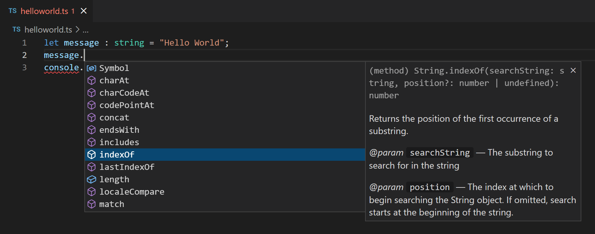

　　VS Code 为单个 TypeScript 文件以及 TypeScript `tsconfig.json` 项目提供 IntelliSense。

### 悬停信息 {#hover-information}

将鼠标悬停在 TypeScript 符号上，可以快速查看其类型信息和相关文档：

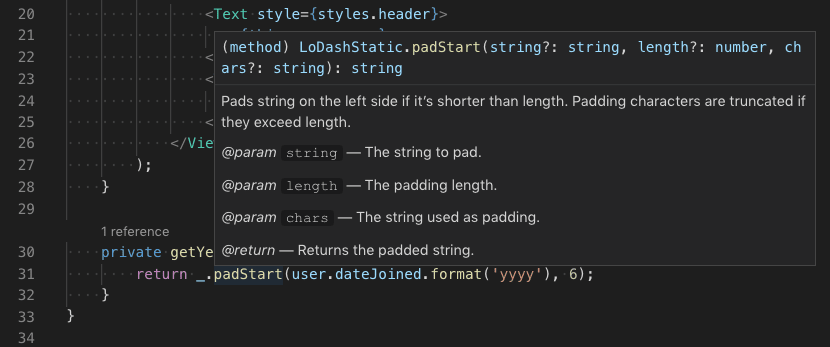

也可以使用 `Ctrl + K Ctrl + I`（macOS：`Cmd + K Cmd + I`） 快捷键在当前光标位置显示悬停信息。

### 签名帮助 {#signature-help}

　　编写 TypeScript 函数调用时，VS Code 显示函数签名信息，并高亮当前正在填写的参数：

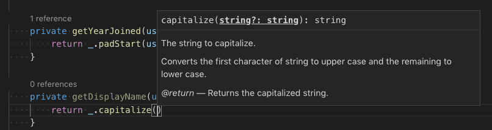

　　在函数调用中输入 `(` 或 `,` 时会自动显示签名帮助。按 `Ctrl + Shift + Space`（macOS：`Cmd + Shift + Space`） 手动触发。

## 代码片段 {#snippets}

　　VS Code 包含基本 TypeScript [代码片段](../../../editor/3.2-WriteCode/3.2.7-Snippets/)，输入时会显示建议：

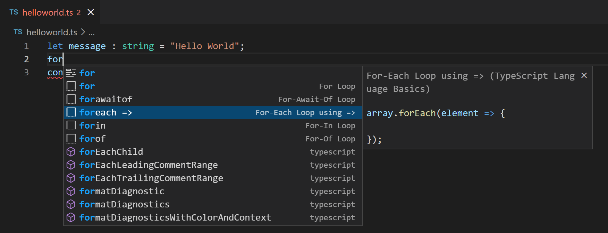

可以安装扩展获取额外代码片段，或为 TypeScript 定义自己的代码片段。详情请参阅[用户定义代码片段](../../../editor/3.2-WriteCode/3.2.7-Snippets/)。

> **提示**：可以在[设置](../../../editor/3.3-ConfigureTheEditor/3.3.4-Settings/)文件中将 `editor.snippetSuggestions` 设置为 `"none"` 禁用代码片段。希望看到代码片段时，可以指定其相对建议的顺序：顶部（`"top"`）、底部（`"bottom"`）或按字母顺序内联（`"inline"`）。默认 `"inline"`。

## 内联提示 {#inlay-hints}

　　内联提示为源代码添加额外内联信息，帮助理解代码作用。

**参数名称内联提示** 显示函数调用中的参数名称：

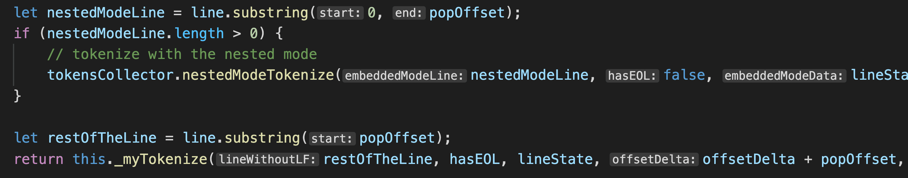

　　这有助于一眼理解每个参数的含义，对带布尔标志或容易混淆参数的函数尤其有用。

要启用参数名称提示，请设置 `js/ts.inlayHints.parameterNames.enabled`。可能值：

* `none`：禁用参数内联提示。
* `literals`：仅为字面量（字符串、数字、布尔值）显示提示。
* `all`：为所有参数显示提示。

**变量类型内联提示** 显示没有显式类型注解的变量类型。

设置：`js/ts.inlayHints.variableTypes.enabled`

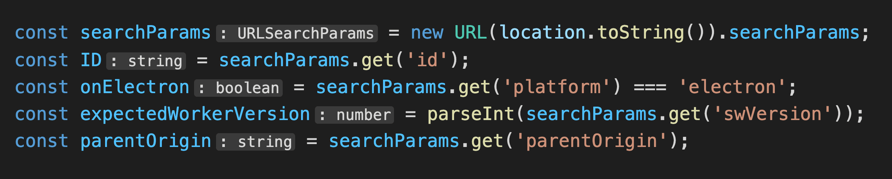

**属性类型内联提示** 显示没有显式类型注解的类属性类型。

设置：`js/ts.inlayHints.propertyDeclarationTypes.enabled`

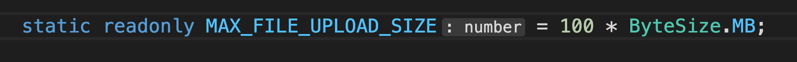

**参数类型提示** 显示隐式类型参数的类型。

设置：`js/ts.inlayHints.parameterTypes.enabled`

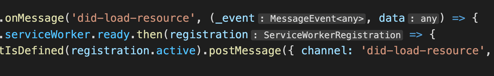

**返回类型内联提示** 显示没有显式类型注解的函数的返回类型。

设置：`js/ts.inlayHints.functionLikeReturnTypes.enabled`

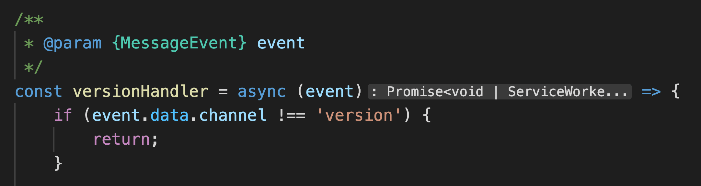

## 引用 CodeLens {#references-codelens}

　　TypeScript 引用 CodeLens 显示类、接口、方法、属性和导出对象的内联引用计数：

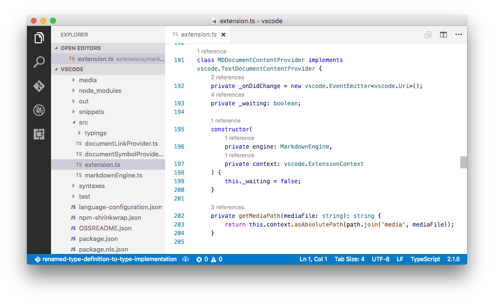

可以在用户设置文件中设置 `"js/ts.referencesCodeLens.enabled": true` 启用。

单击引用计数可以快速浏览引用列表：

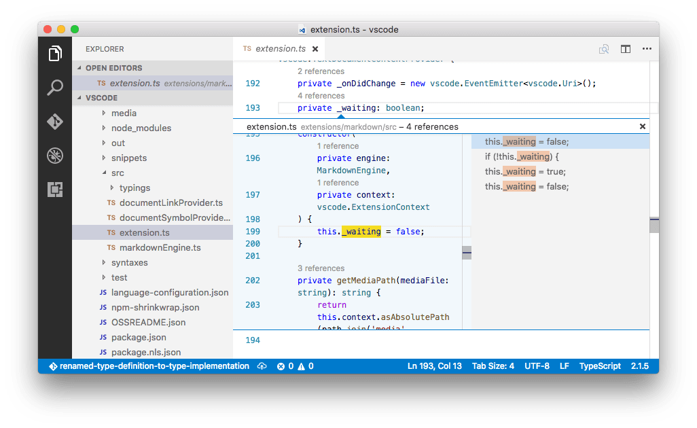

## 实现 CodeLens {#implementations-codelens}

　　TypeScript 实现 CodeLens 显示接口的实现者数量：

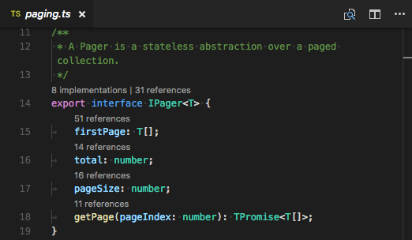

可以设置 `"js/ts.implementationsCodeLens.enabled": true` 启用。

与引用 CodeLens 一样，单击实现数量可以快速浏览所有实现列表。

## 自动导入 {#auto-imports}

　　自动导入通过帮助查找可用符号并自动添加导入来加快编码。

开始输入即可看到当前项目所有可用 TypeScript 符号的[建议](#intellisense)。

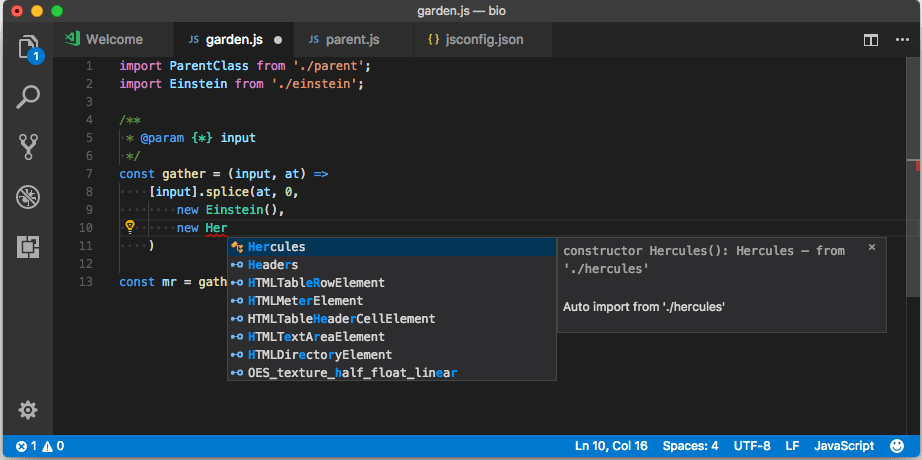

从其他文件或模块选择建议时，VS Code 会自动添加导入。以下示例中，VS Code 在文件顶部添加 `Hercules` 的导入：

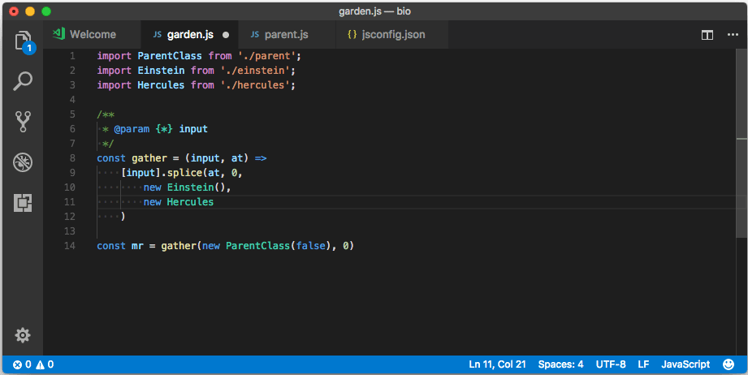

可以设置 `"js/ts.suggest.autoImports": false` 禁用自动导入。

### 粘贴时添加导入 {#add-imports-on-paste}

　　在编辑器之间复制粘贴代码时，VS Code 可以在粘贴时自动添加导入。粘贴包含未定义符号的代码时，会显示粘贴控件，可以选择作为纯文本粘贴或添加导入。

<video src="https://code.visualstudio.com/assets/docs/typescript/editing/jsts-update-imports-paste.mp4" title="从一个编辑器复制代码到另一个编辑器，粘贴控件在粘贴时添加导入。" autoplay loop controls muted></video>

此功能默认启用，可以通过 `js/ts.updateImportsOnPaste.enabled` 设置禁用。

要默认粘贴并添加导入而不显示粘贴控件，请配置 `editor.pasteAs.preferences`，包含 `text.updateImports.jsts` 或 `text.updateImports`。

## JSX 和自动闭合标签 {#jsx-and-auto-closing-tags}

　　VS Code 的 TypeScript 功能也适用于 [JSX](https://reactjs.org/docs/introducing-jsx.html)。要在 TypeScript 中使用 JSX，请使用 `*.tsx` 扩展名而不是普通 `*.ts`：

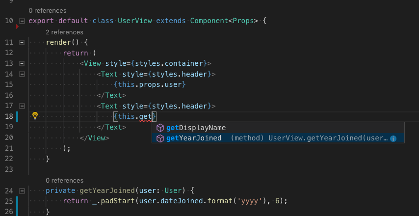

　　VS Code 还包含 JSX 特定功能，例如 TypeScript 中 JSX 标签自动闭合：

<video src="https://code.visualstudio.com/assets/docs/typescript/editing/jsx-tag-complete.mp4" placeholder="./images/jsx-tag-complete.png" autoplay loop controls muted>
    抱歉，浏览器不支持 HTML5 视频。
</video>

将 `js/ts.autoClosingTags.enabled` 设置为 `false` 可以禁用 JSX 标签闭合。

## JSDoc 支持 {#jsdoc-support}

　　VS Code 的 TypeScript IntelliSense 理解许多标准 [JSDoc](https://jsdoc.app) 注释，并在[建议](#intellisense)、[悬停信息](#hover-information)和[签名帮助](#signature-help)中显示类型信息和文档。

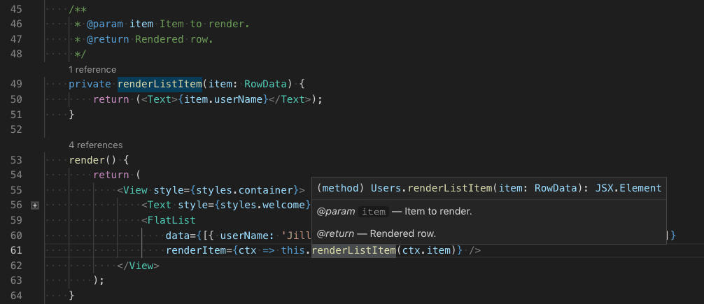

　　请记住，为 TypeScript 代码使用 JSDoc 时不应包含类型注解。TypeScript 编译器只使用 TypeScript 类型注解，忽略 JSDoc 中的类型。

<video src="https://code.visualstudio.com/assets/docs/typescript/editing/jsdoc-autofill.mp4" placeholder="./images/jsdoc-autofill-placeholder.png" autoplay loop controls muted>
    抱歉，浏览器不支持 HTML5 视频。
</video>

要在 TypeScript 中禁用 JSDoc 注释建议，请设置 `"js/ts.suggest.completeJSDocs": false`。

## 代码导航 {#code-navigation}

　　代码导航可以快速浏览 TypeScript 项目。

* **转到定义**（`F12`）：转到符号定义的源代码。
* **速览定义**（`Alt + F12`，macOS：`Option + F12`）：打开速览窗口显示符号定义。
* **转到引用**（`Shift + F12`）：显示符号的所有引用。
* **转到类型定义**：转到定义符号的类型。对于类实例，会显示类本身，而不是实例定义位置。
* **转到实现**（`Ctrl + F12`，macOS：`Cmd + F12`）：转到接口或抽象方法的实现。

可以使用 **命令面板**（`Ctrl + Shift + P`，macOS：`Cmd + Shift + P`）中的 **转到符号** 命令进行符号搜索：

* **转到文件中的符号**（`Ctrl + Shift + O`，macOS：`Cmd + Shift + O`）
* **转到工作区中的符号**（`Ctrl + T`，macOS：`Cmd + T`）

## 格式化 {#formatting}

　　VS Code 包含 TypeScript 格式化程序，提供合理默认值的基本代码格式化。

使用 `js/ts.format.*` [设置](../../../editor/3.3-ConfigureTheEditor/3.3.4-Settings/)配置内置格式化程序，例如让大括号单独占一行。如果内置格式化程序妨碍工作，可以将 `js/ts.format.enable` 设置为 `false` 禁用。

需要更专门的代码格式样式时，请尝试从 Marketplace 安装格式化扩展。

## 语法高亮和语义高亮 {#syntax-highlighting-and-semantic-highlighting}

　　除了语法高亮，TypeScript 和 JavaScript 还提供语义高亮。

　　语法高亮根据词法规则为文本着色。语义高亮根据语言服务解析的符号信息丰富语法着色。

　　语义高亮是否可见取决于当前颜色主题。每个主题可以[配置](../../../editor/3.3-ConfigureTheEditor/3.3.7-Themes/)是否显示语义高亮以及如何设置语义标记样式。

　　语义高亮启用且颜色主题定义了相应样式规则时，可以看到不同颜色和样式。

语义高亮可以根据以下内容改变颜色：

* 符号的解析类型：命名空间、变量、属性、类、接口、类型参数。
* 变量/属性是只读（const）还是可修改。
* 变量/属性类型是否可调用（函数类型）。

## 后续步骤 {#next-steps}

继续阅读：

* [重构 TypeScript](10.4.4-Refactoring/)：了解 TypeScript 可用的有用重构。
* [调试 TypeScript](10.4.5-Debugging/)：为 TypeScript 项目配置调试器。
