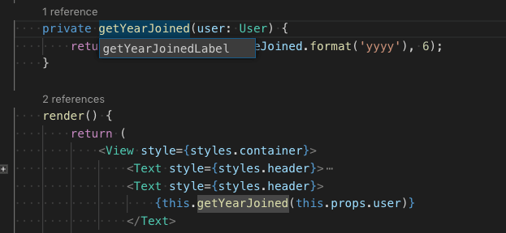
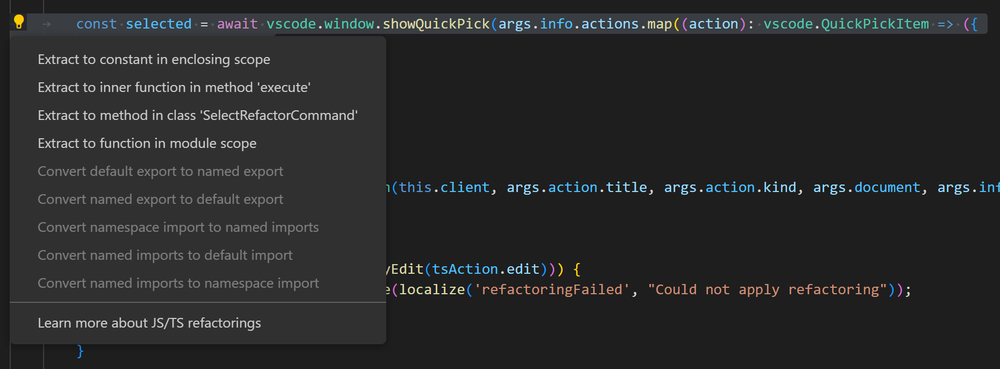
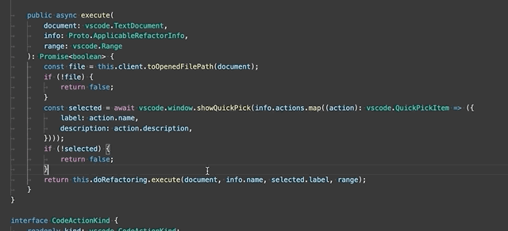
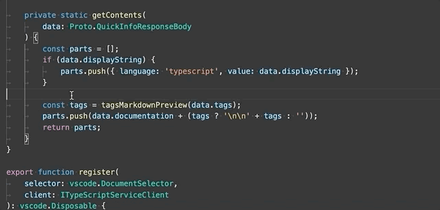
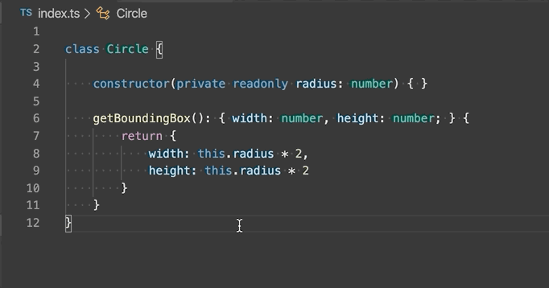
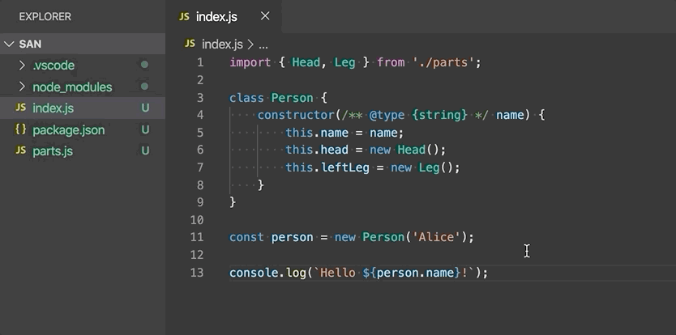
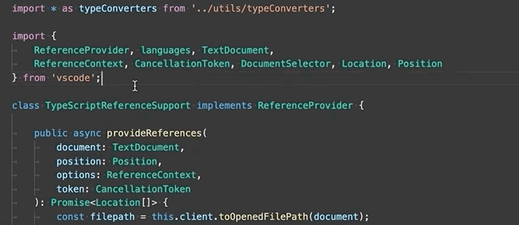
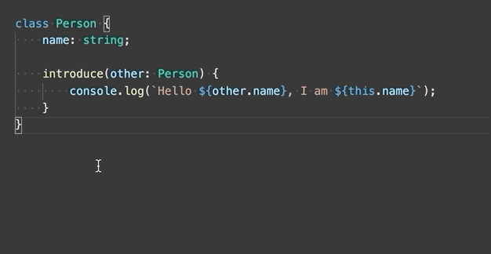
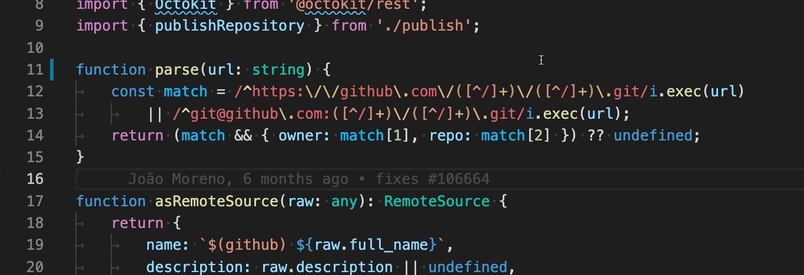
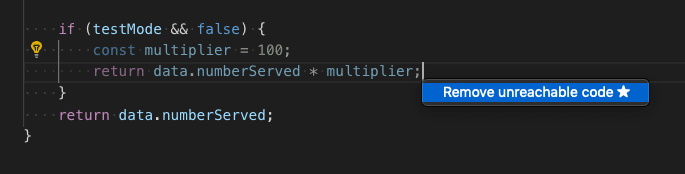

+++
title = "10.4.4 重构 TypeScript"
date = 2026-11-06T07:53:25+08:00
weight = 4
type = "docs"
description = ""
isCJKLanguage = true
draft = false
+++


> 原文链接: [https://code.visualstudio.com/docs/typescript/typescript-refactoring](https://code.visualstudio.com/docs/typescript/typescript-refactoring)

# 10.4.4 重构 TypeScript

　　[源代码重构](https://en.wikipedia.org/wiki/Code_refactoring)可以在不改变运行时行为的情况下调整代码结构，提高项目质量和可维护性。VS Code 支持[提取方法](https://refactoring.com/catalog/extractMethod.html)和[提取变量](https://refactoring.com/catalog/extractVariable.html)等重构操作。

　　VS Code 通过 [TypeScript](https://www.typescriptlang.org/) 语言服务内置 TypeScript 重构支持，本主题演示这些重构功能。

## 重命名 {#rename}

　　最简单的重构之一是重命名方法或变量。按 `F2` 可以跨 TypeScript 项目重命名光标下的符号：



## 重构 {#refactoring}

　　要查看可用 TypeScript 重构，请将光标放在源代码区域，右键打开编辑器上下文菜单并选择 **重构**，或直接按 `Ctrl + Shift + R`。



重构详情以及如何为单个重构配置快捷键，请参阅[重构](../../../editor/3.2-WriteCode/3.2.6-Refactoring/)。

可用 TypeScript 重构包括：

* **提取为方法或函数**：将选中的语句或表达式提取为文件中的新方法或新函数。

   

   选择 **提取为方法** 或 **提取为函数** 重构后，输入提取方法/函数的名称。

* **提取为常量**：将选中的表达式提取为文件中的新常量。

   

* **将类型提取为接口或类型别名**：将选中的复杂类型提取为接口或类型别名。

   

* **移到新文件**：将文件顶层作用域中的一个或多个类、函数、常量或接口移到新文件。新文件名根据所选符号名称推断。

   

* **在命名导入和命名空间导入之间转换**：在命名导入（`import { Name } from './foo'`）和命名空间导入（`import * as foo from './foo'`）之间转换。

   

* **在默认导出和命名导出之间转换**：从使用 `export default` 转换为命名导出（`export const Foo = ...`），或反向转换。

* **将参数转换为解构对象**：将接受大量参数的函数重写为接受单个参数对象。

* **生成 get 和 set 访问器**：为所选类属性生成 getter 和 setter，实现封装。

   

* **推断函数返回类型**：为函数添加显式返回类型注解。

    

* **为箭头函数添加/移除大括号**：将单行箭头函数转换为多行，或反向转换。

## 快速修复 {#quick-fixes}

　　快速修复是解决简单编码错误的建议编辑，例如：

* 为成员访问添加缺失的 `this`。
* 修复拼写错误的属性名。
* 移除不可达代码或未使用导入。
* 声明变量。

　　将光标移到 TypeScript 错误上时，VS Code 显示灯泡，表示有可用快速修复。单击灯泡或按 `Ctrl + .`（macOS：`Cmd + .`） 显示可用快速修复和[重构](#refactoring)列表。

此外，**Code Action Widget: Include Nearby Quick Fixes**（`editor.codeActionWidget.includeNearbyQuickFixes`）默认启用，会从 `Ctrl + .`（macOS：`Cmd + .`）（命令 ID `editor.action.quickFix`）激活行中最近的快速修复，无论光标在该行什么位置。

该命令会高亮将通过快速修复重构或修复的源代码。普通代码操作和非修复重构仍可在光标位置激活。

## 未使用变量和不可达代码 {#unused-variables-and-unreachable-code}

　　未使用的 TypeScript 代码（例如始终为 true 的 `if` 语句的 `else` 块，或未引用的导入）在编辑器中会淡化显示：



　　将光标放在未使用代码上并触发快速修复命令（`Ctrl + .`，macOS：`Cmd + .`）或单击灯泡，可以快速移除。

要禁用未使用代码淡化，请将 `editor.showUnused` 设置为 `false`。也可以仅在 TypeScript 中禁用：

```json
"[typescript]": {
    "editor.showUnused":  false
},
"[typescriptreact]": {
    "editor.showUnused":  false
},
```

## 组织导入 {#organize-imports}

　　**组织导入** 源代码操作会对 TypeScript 文件中的导入排序，并移除未使用导入：

<video src="https://code.visualstudio.com/assets/docs/typescript/refactoring/organize-imports.mp4" placeholder="./images/organize-imports-placeholder.png" autoplay loop controls muted>
    抱歉，浏览器不支持 HTML5 视频。
</video>

可以从 **源操作** 上下文菜单或使用 `Shift + Alt + O`（macOS：`Shift + Option + O`） 快捷键运行 **组织导入**。

也可以通过以下设置在保存 TypeScript 文件时自动组织导入：

```json
"editor.codeActionsOnSave": {
    "source.organizeImports": "explicit"
}
```

## 文件移动时更新导入 {#update-imports-on-file-move}

　　移动或重命名被 TypeScript 项目中其他文件导入的文件时，VS Code 可以自动更新引用该文件的所有导入路径。

　　`js/ts.updateImportsOnFileMove.enabled` 设置控制此行为。有效值：

* `"prompt"`：默认。每次文件移动时询问是否更新路径。
* `"always"`：始终自动更新路径。
* `"never"`：不自动更新路径，也不提示。

## 保存时的代码操作 {#code-actions-on-save}

　　`editor.codeActionsOnSave` 设置可以配置保存文件时运行的一组代码操作。例如，保存时组织导入：

```json
// 显式保存时运行 fixAll 源操作。自动保存（窗口或焦点变化）时运行 organizeImports 源操作。
"editor.codeActionsOnSave": {
    "source.fixAll": "explicit",
    "source.organizeImports": "always",
}
```

目前支持以下枚举：

* `explicit`（默认）：显式保存时触发代码操作。与 `true` 相同。
* `always`：显式保存以及窗口或焦点变化自动保存时触发代码操作。
* `never`：保存时从不触发代码操作。与 `false` 相同。

也可以将 `editor.codeActionsOnSave` 设置为按顺序执行的代码操作数组。

部分源操作：

* `"organizeImports"`：保存时组织导入。
* `"fixAll"`：保存时自动修复，一轮计算所有可能的修复（包括 ESLint 在内的所有提供程序）。
* `"fixAll.eslint"`：仅对 ESLint 自动修复。
* `"addMissingImports"`：保存时添加所有缺失导入。

更多信息请参阅 [TypeScript 教程](10.4.1-Tutorial/)。

## 代码建议 {#code-suggestions}

　　VS Code 会自动建议一些常见代码简化，例如将 promise 上的 `.then` 调用链转换为使用 `async` 和 `await`：

<video src="https://code.visualstudio.com/assets/docs/typescript/refactoring/code-suggestions-convert-async.mp4" placeholder="./images/code-suggestions-convert-async-placeholder.png" autoplay loop controls muted>
    抱歉，浏览器不支持 HTML5 视频。
</video>

将 `js/ts.suggestionActions.enabled` 设置为 `false` 可以禁用建议。

## 后续步骤 {#next-steps}

继续阅读：

* [编辑 TypeScript](10.4.3-Editing/)：了解 VS Code 的 TypeScript 编辑功能。
* [调试 TypeScript](10.4.5-Debugging/)：为 TypeScript 项目配置调试器。
