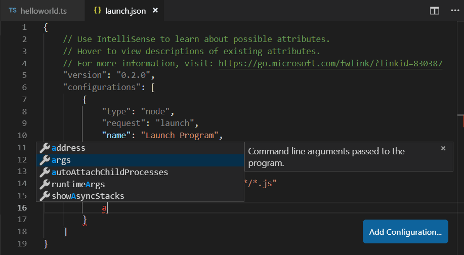
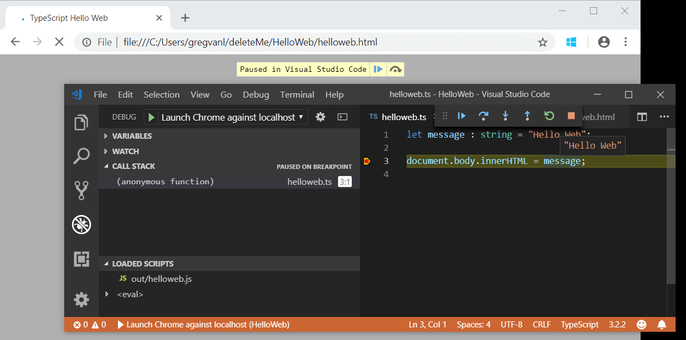

+++
title = "10.4.5 调试 TypeScript"
date = 2026-11-06T07:53:25+08:00
weight = 5
type = "docs"
description = ""
isCJKLanguage = true
draft = false
+++


> 原文链接: [https://code.visualstudio.com/docs/typescript/typescript-debugging](https://code.visualstudio.com/docs/typescript/typescript-debugging)

# 10.4.5 调试 TypeScript

　　VS Code 通过内置 [Node.js 调试器](https://code.visualstudio.com/docs/nodejs/nodejs-debugging)和 [Edge 与 Chrome 调试器](https://code.visualstudio.com/docs/nodejs/browser-debugging)支持 TypeScript 调试。

## JavaScript source map 支持 {#javascript-source-map-support}

　　TypeScript 调试支持 JavaScript source map。要为 TypeScript 文件生成 source map，请使用 `--sourcemap` 选项编译，或在 `tsconfig.json` 中将 `sourceMap` 属性设为 `true`。

也支持内联 source map（内容作为 data URL 存储，而不是单独文件），但尚不支持内联 source。

source map 的简单示例请参阅 [TypeScript 教程](10.4.1-Tutorial/)，其中使用以下 `tsconfig.json` 和 VS Code 默认 Node.js 调试配置调试简单的“Hello World”Node.js 应用。

```json
{
    "compilerOptions": {
        "target": "ES5",
        "module": "CommonJS",
        "outDir": "out",
        "sourceMap": true
    }
}
```

更高级的调试场景可以创建自己的调试配置 `launch.json`。要查看默认配置，请转到 **运行和调试** 视图（`Ctrl + Shift + D`），选择 **创建 launch.json 文件** 链接。

这会在 `.vscode` 文件夹创建 `launch.json`，其中包含项目中检测到的默认值：

```json
{
    // 使用 IntelliSense 了解可能属性。
    // 悬停查看现有属性说明。
    // 更多信息请访问 https://go.microsoft.com/fwlink/?linkid=830387
    "version": "0.2.0",
    "configurations": [
        {
            "type": "node",
            "request": "launch",
            "name": "Launch Program",
            "program": "${workspaceFolder}/helloworld.ts",
            "preLaunchTask": "tsc: build - tsconfig.json",
            "outFiles": [
                "${workspaceFolder}/out/**/*.js"
            ]
        }
    ]
}
```

　　VS Code 已确定要启动的程序 `helloworld.ts`，将生成包含为 `preLaunchTask`，并告诉调试器在哪里查找生成的 JavaScript 文件。

　　`launch.json` 有完整 IntelliSense，提供建议和信息帮助了解其他调试配置选项。也可以使用右下角 **添加配置** 按钮向 `launch.json` 添加新调试配置。



示例和更多说明请参阅 [Node.js 调试](https://code.visualstudio.com/docs/nodejs/nodejs-debugging)。

## 映射输出位置 {#mapping-the-output-location}

　　生成的（转译后的）JavaScript 文件不在源文件旁边时，可以在启动配置中设置 `outFiles` 属性，帮助 VS Code 调试器定位它们。在原始源代码中设置断点时，VS Code 会搜索 `outFiles` 中 glob 模式指定的文件来查找生成的源代码。

## 客户端调试 {#client-side-debugging}

　　TypeScript 不仅适合 Node.js 应用，也适合编写客户端代码，可以使用[内置 Edge 和 Chrome 调试器](https://code.visualstudio.com/docs/nodejs/browser-debugging)调试客户端源代码。

创建一个简单 Web 应用演示客户端调试。

创建新文件夹 `HelloWeb`，添加三个文件 `helloweb.ts`、`helloweb.html` 和 `tsconfig.json`：

helloweb.ts

```typescript
let message : string = "Hello Web";
document.body.innerHTML = message;
```

helloweb.html

```html
<!DOCTYPE html>
<html>
    <head><title>TypeScript Hello Web</title></head>
    <body>
        <script src="out/helloweb.js"></script>
    </body>
</html>
```

tsconfig.json

```json
{
    "compilerOptions": {
        "target": "ES5",
        "module": "CommonJS",
        "outDir": "out",
        "sourceMap": true
    }
}
```

运行 `tsc` 生成应用，然后在浏览器中打开 `helloweb.html` 测试（可以在文件资源管理器中右键单击 `helloweb.html` 选择 **复制路径** 粘贴到浏览器）。

在运行和调试视图（`Ctrl + Shift + D`）中，选择 **创建 launch.json 文件** 创建 `launch.json`，调试器选择 **Web App (Edge)**，或根据需要选择 **Web App (Chrome)**。

更新 `launch.json`，指定 `helloweb.html` 的本地文件 URL：

```json
{
    "version": "0.2.0",
    "configurations": [
        {
            "type": "msedge",
            "request": "launch",
            "name": "Launch Edge against localhost",
            "url": "file:///C:/Users/username/HelloWeb/helloweb.html",
            "webRoot": "${workspaceFolder}"
        }
    ]
}
```

　　**运行和调试** 视图配置下拉列表现在会显示新配置 **Launch Edge against localhost**。运行该配置会启动浏览器并打开网页。在编辑器中打开 `helloweb.ts`，单击左侧装订线添加断点（显示红圈）。按 `F5` 启动调试会话，浏览器会启动并在 `helloweb.ts` 中命中断点。



## 常见问题 {#common-questions}

### 无法启动程序，因为找不到对应的 JavaScript {#cannot-launch-program-because-corresponding-javascript-cannot-be-found}

　　很可能未在 `tsconfig.json` 中设置 `"sourceMap": true`，或未在 `launch.json` 中设置 `outFiles`，VS Code Node.js 调试器无法将 TypeScript 源代码映射到运行的 JavaScript。请开启 source map 并重新生成项目。
