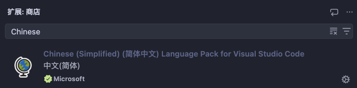
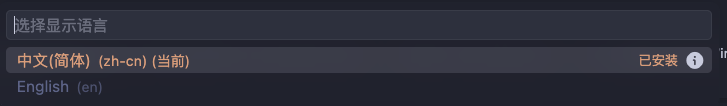

+++
title = "个人笔记"
date = 2026-11-06T18:54:58+08:00
weight = 1
type = "docs"
description = ""
isCJKLanguage = true
draft = false

+++

# 设置

## 安装UI 语言

​	在扩展市场搜索`Chinese`

## 切换UI 语言

​	按 `Ctrl + Shift + P`（macOS：`Cmd + Shift + P`） 打开**命令面板**，输入`display`筛选并显示 `Configure Display Language`命令。

​	选择另一种语言以更改显示语言。

​	

## 用户和工作区的设置的区别

​	`工作区 settings.json` 里面没有写这个键 = 不覆盖，直接继承上一级（用户设置）。

​	故，平常使用时，只设置`用户`的设置就可以！

​	但，并非所有用户设置都可用作工作区设置。例如，与更新和安全相关的应用程序级设置不能被工作区设置覆盖。

​	打开命令面板，输入：`Preferences:Open User Settings(JSON)` 可以查看到`用户`的`settings.json`。

​	打开命令面板，输入：`Preferences:Open Workspace Settings(JSON)` 可以查看到`工作区`的`settings.json`。

> 注意：
>
> ​	VS Code 会在更改设置时直接应用。可以通过设置左侧的彩色条识别已修改设置，类似编辑器中的已修改行。

## 自动保存

​	进入设置，输入：`files.autoSave`

​	选择：`afterDelay`,   默认延迟为 1000毫秒， 即 1秒。

​	Controls auto save of editors that have unsaved changes.

​	控制具有未保存更改的编辑器的 自动保存。

## 新开标签

​	点击资源管理器中的文件名时，是【替换当前标签】还是【新开标签】？

​	进入设置，输入：`workbench.editor.enablePreview`

​	**去掉勾选**！

Controls whether preview mode is used when editors open. There is a maximum of one preview mode editor per editor group. This editor displays its filename in italics on its tab or title label and in the Open Editors view. Its contents will be replaced by the next editor opened in preview mode. Making a change in a preview mode editor will persist it, as will a double-click on its label, or the 'Keep Open' option in its label context menu. Opening a file from Explorer with a double-click persists its editor immediately.

​	控制在编辑器打开时是否使用预览模式。每个编辑器组最多只能有一个预览模式编辑景。此编辑景在其选项卡或标题标签和”打开编辑器“视图中以斜体显示其文件名。其内容将替换为在预览模式下打开的下一个编辑器。在预览模式编辑器中进行更改将保留它，就像双击其标签或其标签上下文菜单中的“保持打开“选项一样。通过双击从资源管理景打开文件会立即保留其编辑器。

Controls whether editors remain in preview when a code navigation is started from them. Preview editors do not stay open, and are reused until explicitly set to be kept open (via double-click or editing). This value is ignored when Workbench › Editor: Show Tabs is not set to multiple.

​	控制当从编辑器开始进行代码导航时，编辑器是否保持为预览状态。预览编辑器不会保持打开状态，在将其显式设置为保持打开（通过双击或编辑）前将会重用。如果未将 `Workbench> Editor:Show Tabs` 设置为 `multiple`，则会忽略此值。

Controls whether editors opened from Quick Open show as preview editors. Preview editors do not stay open, and are reused until explicitly set to be kept open (via double-click or editing). When enabled, hold Ctrl before selection to open an editor as a non-preview. This value is ignored when Workbench › Editor: Show Tabs is not set to multiple.

​	控制通过 `Quick Open` 打开的编辑器是否显示为预览编辑器。预览编辑器不会保持打开状态，在将其显式设置为保持打开（通过双击或编辑）前将会重用。启用后，在选择前按住 `Ctrl`可在非预览模式下打开编辑器。如果未将 `Workbench，Editor: Show Tabs `设置为 `multiple`，则会忽略此值。

## 紧凑标签

​	进入设置，输入：`window.density.editorTabHeight`

​	选择：`compact`

​	

​	控制编辑器选项卡的高度。当 Workbench, Editor: Show Tabs 未设置为 multiple时，也适用于标题控件栏。

## 隐藏编辑器标签icon

​	去掉icon可以在一行上显示更多打开的文件名。

​	进入设置，输入：`workbench.editor.showIncons`

​	**去掉勾选**！

Controls whether opened editors should show with an icon or not. This requires a file icon theme to be enabled as well.

​	控制打开的编辑器是否应该显示图标。这还需要启用文件图标主题。

## 设置编辑区字体和字号

# 常用快捷键

## 打开命令面板

​	`Ctrl + Shift + P`，macOS：`Cmd + Shift + P`。

## 选中文本内查找

​	默认情况下，查找操作在整个文件中运行。要将搜索限制为选中文本，请选择查找控件中的 **在选择中查找** 图标，或按 `Ctrl + F`（macOS：`Cmd + F`） 后按 `Alt + L`（macOS：`Cmd + Option + L`）。

## 查找换行

​	可以通过将文本粘贴到查找和替换输入框来搜索多行文本。按 `Ctrl + Enter` 在输入框中插入新行。

## 跨文件搜索

​	VS Code 可以快速搜索当前打开文件夹中的所有文件。按 `Ctrl + Shift + F`（macOS：`Cmd + Shift + F`） 并输入搜索词。搜索结果按包含搜索词的文件分组，显示每个文件的命中数和位置。展开文件查看其中所有命中的预览。单击命中项在编辑器中查看。
