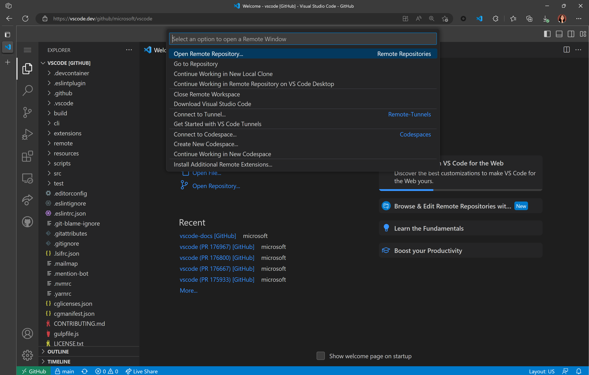
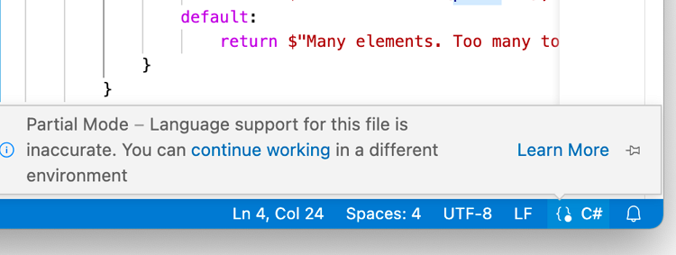
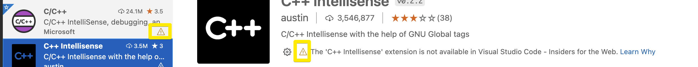
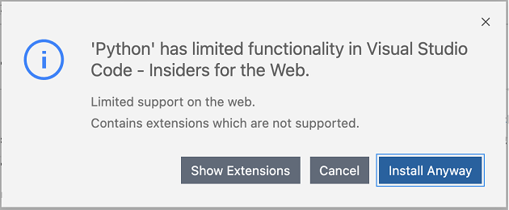
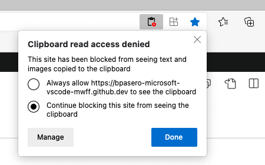

+++
title = "8.1 VS Code for the Web"
date = 2026-11-06T07:53:25+08:00
weight = 1
type = "docs"
description = ""
isCJKLanguage = true
draft = false
+++


> 原文链接: [https://code.visualstudio.com/docs/remote/vscode-web](https://code.visualstudio.com/docs/remote/vscode-web)

# 8.1 VS Code for the Web

　　Visual Studio Code for the Web 提供免费、无需安装的 Microsoft VS Code 体验，完全在浏览器中运行，让你能够快速、安全地浏览源代码仓库并进行轻量级代码更改。要开始使用，请在浏览器中访问 [https://vscode.dev](https://vscode.dev)。

　　VS Code for the Web 具有许多你喜欢的桌面版功能，包括浏览和编辑时的搜索与语法突出显示，以及用于处理代码库和进行简单编辑的扩展支持。除了打开 GitHub、Azure Repos 等源代码管理提供程序中的仓库、fork 和拉取请求，你还可以处理存储在本地计算机上的代码。

　　VS Code for the Web 完全在 Web 浏览器中运行，因此与桌面体验相比存在一些限制，详见[下文](#limitations)。

[youtube 2sdXMJZKLJE.jpg](./images/youtube-2sdXMJZKLJE.jpg)](https://www.youtube.com/watch?v=2sdXMJZKLJE)

## 与 VS Code 桌面版的关系 {#relationship-to-vs-code-desktop}

　　VS Code for the Web 提供基于浏览器的体验，用于导航文件和仓库以及提交轻量级代码更改。但是，如果你需要访问运行时来运行、构建或调试代码，需要使用终端等平台功能，或运行 Web 不支持的扩展，建议将工作转移到桌面应用程序、[GitHub Codespaces](https://github.com/features/codespaces)，或使用 [Remote - Tunnels](#use-your-own-compute-instance-with-remote-tunnels)获得 VS Code 的完整功能。此外，桌面版允许你使用不受浏览器限制的完整键盘快捷键。

　　准备好切换时，可以通过几次单击[“升级”](#continue-working-in-a-different-environment)到完整的 VS Code 体验。也可以选择齿轮图标，然后选择 **切换到 Insiders 版本...**，或直接访问 [https://insiders.vscode.dev](https://insiders.vscode.dev)，在 Stable 和 Insiders 版本之间切换。

## 打开项目 {#opening-a-project}

　　访问 [https://vscode.dev](https://vscode.dev) 后，可以创建新的本地文件或项目、处理现有的本地项目，或访问托管在其他位置（例如 GitHub 和 Azure Repos）的源代码仓库。

　　你可以像在桌面环境中一样，通过命令面板（`F1`）中的 **文件** > **新建文件** 在 Web 中创建新的本地文件。

## GitHub 仓库 {#github-repos}

　　可以直接通过 URL 在 VS Code for the Web 中打开 GitHub 仓库，格式为：`https://vscode.dev/github/<organization>/<repo>`。以 [VS Code 仓库](https://github.com/microsoft/vscode)为例：`https://vscode.dev/github/microsoft/vscode`。

　　此体验通过自定义 `vscode.dev/github` URL 提供，由 [GitHub Repositories](https://marketplace.visualstudio.com/items?itemName=GitHub.remotehub) 扩展（属于更广泛的 [Remote Repositories](https://marketplace.visualstudio.com/items?itemName=ms-vscode.remote-repositories) 扩展）提供支持。

　　GitHub Repositories 允许你在编辑器中远程浏览和编辑仓库，而无需将代码拉取到本地计算机。更多信息请参阅 [4.7 在 GitHub 上协作](../../source-control/4.7-CollaborateOnGitHub/#github-repositories-extension)指南。

> **注意**：[GitHub Repositories](https://marketplace.visualstudio.com/items?itemName=GitHub.remotehub) 扩展也可在桌面版中运行，提供快速的仓库浏览和编辑。安装扩展后，可以使用 **GitHub Repositories: Open Repository...** 命令打开仓库。

　　安装适用于 Chrome 和 Edge 的 `vscode.dev` [扩展](https://chrome.google.com/webstore/detail/vs-code/kobakmhnkfaghloikphojodjebdelppk)后，还可以通过浏览器搜索栏（地址栏）打开 GitHub 仓库。输入 `code` 激活地址栏，然后输入仓库名称。建议来自浏览器搜索历史，如果所需的仓库没有出现，也可以输入完全限定的 `<owner>/<repo>` 名称，例如 `microsoft/vscode`。


　　如果你已经在 [https://vscode.dev](https://vscode.dev) 中，也可以通过 [Remote Repositories](https://marketplace.visualstudio.com/items?itemName=ms-vscode.remote-repositories) 扩展命令导航到不同仓库。选择状态栏左下角的远程指示器，然后选择 **Open Remote Repository...** 命令。



## Azure Repos {#azure-repos}

　　你可以像打开 GitHub 仓库一样，在 VS Code for the Web 中打开 Azure Repos。访问格式为 `https://vscode.dev/azurerepos/<organization>/<project>/<repo>` 的 URL 后，可以阅读、搜索仓库中的文件，并将更改提交到 Azure Repos。你可以获取、拉取和同步更改，并查看分支。

　　在 Azure Repos URL 前加上 `vscode.dev`，即可在 VS Code for the Web 中打开任何 Azure Repos 仓库、分支或标签。或者，在 Azure DevOps 仓库或拉取请求页面上按 `.`，在 VS Code for the Web 中打开它。

## 更多自定义 URL {#more-custom-urls}

　　与桌面版一样，你可以通过丰富的扩展生态系统自定义 VS Code for the Web，支持几乎所有后端、语言和服务。`vscode.dev` 包含提供常见体验快捷方式的 URL。

| 服务 | URL 结构 | 文档 |
| --- | --- | --- |
| GitHub | `/github/<org>/<repo>` | [上文更多信息](#github-repos) |
| Azure Repos | `/azurerepos/<org>/<project>/<repo>` | [上文更多信息](#azure-repos) |
| Visual Studio Live Share | `/editor/liveshare/<sessionId>` | [下文更多信息](#visual-studio-live-share) |
| Visual Studio Marketplace | `/editor/marketplace/<marketplacePublisher>`<br>`/<extensionId>/<extensionVersion>` | [示例路由](https://insiders.vscode.dev/editor/marketplace/Brigit/devcontainer-image-convert/0.0.1)用于编辑[此扩展](https://marketplace.visualstudio.com/items?itemName=Brigit.devcontainer-image-convert) |
| Power Pages | `/power/pages` | [Power Pages 文档](https://learn.microsoft.com/power-pages/configure/visual-studio-code-editor) |
| 配置文件 | `/editor/profile/github/<GUID>` | [3.3.8 配置文件](../../editor/3.3-ConfigureTheEditor/3.3.8-Profiles/#save-as-a-github-gist) |
| 主题 | `/editor/theme/<extensionId>` | [下文更多信息](#themes) |
| MakeCode | `/edu/makecode` | [MakeCode 文档](https://arcade.makecode.com/vscode) |
| VS Code for Education | `/edu` | [VS Code for Education 主页](https://vscodeedu.com/) |
| Azure 机器学习（AML） | `/+ms-toolsai.vscode-ai-remote-web` | [AML 文档](https://learn.microsoft.com/azure/machine-learning/how-to-launch-vs-code-remote?view=azureml-api-2&tabs=vscode-web) |
| Azure | `/azure` | [适用于 Azure 的 VS Code](https://code.visualstudio.com/docs/azure/vscodeforweb) |

　　请注意，某些 URL 必须以特定方式输入（例如 `vscode.dev/editor/liveshare` 需要活动的 Live Share 会话）。具体访问和使用信息请参阅各服务的文档。

### 主题 {#themes}

　　你可以通过 URL 架构 `https://vscode.dev/editor/theme/<extensionId>` 在 VS Code for the Web 中分享和体验颜色主题。例如，访问 [https://vscode.dev/editor/theme/sdras.night-owl](https://vscode.dev/editor/theme/sdras.night-owl) 即可体验 [Night Owl 主题](https://marketplace.visualstudio.com/items?itemName=sdras.night-owl)，无需下载和安装。

> 注意：颜色主题 URL 架构适用于完全声明式（不含代码）的主题。

　　一个扩展可以定义多个主题。可以使用架构 `/editor/theme/<extensionId>/<themeName>`。如果未指定 `themeName`，VS Code for the Web 将使用第一个主题。

　　作为主题作者，可以在扩展 readme 中添加以下徽章，让用户在 VS Code for the Web 中轻松试用主题（将 `<extensionId>` 替换为主题扩展的唯一标识符）：

```markdown
[](https://vscode.dev/editor/theme/<extensionId>)
```

### Visual Studio Live Share {#visual-studio-live-share}

　　[Live Share](https://marketplace.visualstudio.com/items?itemName=MS-vsliveshare.vsliveshare) 访客会话可通过 `https://vscode.dev/editor/liveshare` URL 在浏览器中使用。`sessionId` 会传递给扩展，使加入会话变得无缝。

## 在其他环境中继续工作 {#continue-working-in-a-different-environment}

　　在某些情况下，你需要访问能够运行代码的其他环境。可以切换到支持本地文件系统以及完整语言和开发工具的开发环境中处理仓库。GitHub Repositories 扩展可以轻松地将仓库克隆到本地、在桌面版中重新打开，或为当前仓库创建 GitHub codespace（如果安装了 GitHub Codespaces 扩展并有权限创建 codespace）。为此，请使用命令面板（`F1`）中的 **Continue Working On...** 命令，或单击状态栏中的远程指示器。

## 保存和共享工作 {#saving-and-sharing-work}

　　在 Web 中处理本地文件时，如果启用了[3.2.1 基本编辑](../../editor/3.2-WriteCode/3.2.1-BasicEditing/#save--auto-save)，工作会自动保存。也可以像桌面版一样手动保存（例如 **文件** > **保存**）。

　　处理远程仓库时，工作会保存在浏览器的本地存储中，直到提交。如果使用 GitHub Repositories 打开仓库或拉取请求，可以在源代码管理视图中推送更改以保存新工作。

　　也可以通过[继续工作](#continue-working-in-a-different-environment)在其他环境中继续。首次在有未提交更改时使用 **Continue Working On**，可以选择使用**云端更改**将编辑带到所选开发环境，云端更改会使用 VS Code 服务存储待处理更改。更多信息请参阅 [4.7 在 GitHub 上协作](../../source-control/4.7-CollaborateOnGitHub/#continue-working-on)文档。

## 使用 Remote Tunnels 和自己的计算实例 {#use-your-own-compute-instance-with-remote-tunnels}

　　你可以使用 [Remote - Tunnels](https://marketplace.visualstudio.com/items?itemName=ms-vscode.remote-server) 扩展，在 VS Code for the Web 中针对另一台机器进行开发。该扩展允许你通过安全隧道连接到远程计算机（例如台式电脑或虚拟机），然后从任何位置安全连接，无需 SSH。这样可以将自己的计算资源带到 vscode.dev，支持在浏览器中运行代码等场景。更多信息请参阅 [8.4 使用远程隧道开发](../8.4-Tunnels/)。

## 安全探索 {#safe-exploration}

　　VS Code for the Web 完全在 Web 浏览器的沙盒中运行，提供非常有限的执行环境。访问远程仓库中的代码时，Web 编辑器不会“克隆”仓库，而是直接从浏览器调用服务 API 加载代码，这进一步减少了克隆不受信任仓库时的攻击面。处理本地文件时，VS Code for the Web 通过浏览器的文件系统访问 API 加载文件，限制浏览器可以访问的范围。

## 随处运行 {#run-anywhere}

　　与 [8.8 GitHub Codespaces](../8.8-GitHubCodespaces/) 类似，VS Code for the Web 可以在平板电脑（例如 iPad）上运行。

## 语言支持 {#language-support}

　　Web 上的语言支持在代码编辑、导航和浏览方面更为细致。桌面体验通常由需要文件系统、运行时和计算环境的语言服务和编译器提供支持。在浏览器中，这些体验由在浏览器中运行的语言服务提供，支持源代码分词和语法着色、补全以及许多单文件操作。

* **良好**：对于大多数编程语言，VS Code for the Web 提供代码语法着色、基于文本的补全和括号对着色。通过 [anycode 扩展](https://marketplace.visualstudio.com/items?itemName=ms-vscode.anycode)使用 [Tree-sitter](https://tree-sitter.github.io/tree-sitter) 语法树，我们还能为 C/C++、C#、Java、PHP、Rust 和 Go 等流行语言提供**大纲/转到符号**和**符号搜索**等额外体验。
* **更好**：TypeScript、JavaScript 和 Python 体验由在浏览器中原生运行的语言服务提供。除了“良好”体验外，还可以获得丰富的单文件补全、语义突出显示、语法错误等。
* **最佳**：对于 JSON、HTML、CSS、LESS 等许多“Web”语言，vscode.dev 中的编码体验几乎与桌面版相同（包括 Markdown 预览！）。

　　可以通过状态栏中的语言状态指示器确定当前文件的语言支持级别。



## 限制 {#limitations}

　　由于 VS Code for the Web 完全在浏览器中运行，某些体验自然比桌面应用受到更多限制。例如，终端和调试器不可用，因为在浏览器沙盒中无法编译、运行和调试 Rust 或 Go 应用程序。

### 扩展 {#extensions}

　　只有一部分扩展可以在浏览器中运行。可以在扩展视图中安装 Web 扩展，无法安装的扩展会显示警告图标和**了解原因**链接。我们预计会支持更多扩展。



　　安装扩展后，它会保存在浏览器的本地存储中。启用[3.3.5 设置同步](../../editor/3.3-ConfigureTheEditor/3.3.5-SettingsSync/)后，可以确保扩展在不同 VS Code 实例（包括不同浏览器甚至桌面版）之间同步。

　　当扩展包包含无法在浏览器沙盒中运行的扩展时，会显示一条信息消息，并提供查看包中所含扩展的选项。



　　扩展在浏览器沙盒中运行时受到更多限制。纯声明式扩展（例如大多数主题、代码片段或语法）可以不加修改地运行，并可在 VS Code for the Web 中使用。运行代码的扩展需要更新以支持浏览器沙盒。扩展作者可以在 [Web 扩展作者指南](https://code.visualstudio.com/api/extension-guides/web-extensions)中了解更多信息。

　　还有一些扩展在浏览器中仅获得部分支持。例如，语言扩展仅支持单个文件或当前打开的文件。

### 文件系统 API {#file-system-api}

　　Edge 和 Chrome 现在支持 [File System API](https://developer.mozilla.org/docs/Web/API/File_System_Access_API)，允许网页访问本地文件系统。如果你的浏览器不支持该 API，则无法在本地打开文件夹，但可以打开文件。

### 浏览器支持 {#browser-support}

　　你可以在最新版本的 Chrome、Edge、Firefox 和 Safari 中使用 VS Code for the Web。旧版本可能无法使用，我们只保证支持最新版本。

> **提示**：检查兼容浏览器版本的一种方法是查看当前用于测试 VS Code 的 [Playwright](https://playwright.dev/) 版本，并查看其支持的浏览器版本。可以在 VS Code 仓库 [package.json](https://github.com/microsoft/vscode/blob/main/package.json) 的 `devDependencies/@playwright/test` 中找到当前使用的 Playwright 版本。

　　Webview 在 Firefox 和 Safari 中可能显示不同或出现意外行为。可以在 VS Code GitHub 仓库中查看与特定浏览器相关的问题，例如 [Safari 标签](https://github.com/microsoft/vscode/labels/safari)和 [Firefox 标签](https://github.com/microsoft/vscode/labels/firefox)。

### 移动设备支持 {#mobile-support}

　　可以在移动设备上使用 VS Code for the Web，但较小的屏幕可能存在某些限制。

### 键盘快捷键 {#keyboard-shortcuts}

　　某些键盘快捷键在 Web 中的工作方式可能不同。

| 问题 | 原因 |
|-|-|
| `Ctrl + Shift + P` 在 Firefox 中无法启动命令面板。 | 该快捷键在 Firefox 中已被保留。可以改用 `F1` 启动命令面板。 |
| 新建文件的 `Ctrl + N` 在 Web 中不起作用。 | 它会打开新窗口。可以改用 `Ctrl + Alt + N`（macOS 上为 `Cmd + Alt + N`）。 |
| 关闭编辑器的 `Ctrl + W` 在 Web 中不起作用。 | 它会关闭浏览器中的当前选项卡。可以改用 `Ctrl + Shift + Alt + N`（macOS 上为 `Cmd + Shift + Alt + N`）。 |
| `Ctrl + Shift + B` 不会切换浏览器的收藏夹栏。 | VS Code for the Web 会覆盖此快捷键，并重定向到命令面板中的“生成”菜单。 |
| `Alt + ←` 和 `Alt + →` 应在编辑器内导航，但可能错误触发选项卡历史导航。 | 如果焦点在编辑器外，这些快捷键会触发选项卡历史导航。 |

## 其他浏览器设置 {#additional-browser-setup}

### 打开新选项卡和窗口 {#opening-new-tabs-and-windows}

　　在某些情况下，你可能需要在 VS Code for the Web 中打开新选项卡或窗口。读取剪贴板时，VS Code 可能会请求访问权限。根据浏览器不同，授予剪贴板访问权限或允许弹出窗口的方式也不同：

* Chrome、Edge、Firefox：在浏览器设置中搜索“站点权限”，或在地址栏右侧查找相应选项。
* Safari：前往 **偏好设置...** > **网站** > **弹出式窗口** > 正在访问的域（例如 `vscode.dev`），然后从下拉列表中选择 **允许**。


