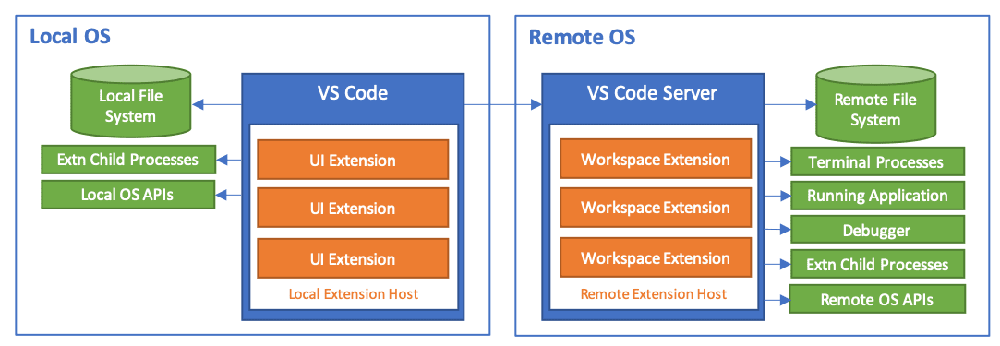
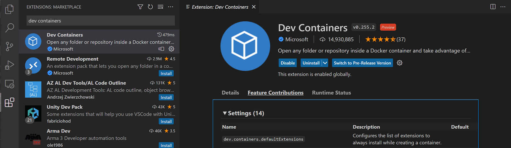

+++
title = "8.12 常见问题"
date = 2026-11-06T07:53:25+08:00
weight = 12
type = "docs"
description = ""
isCJKLanguage = true
draft = false
+++

> 原文链接: [https://code.visualstudio.com/docs/remote/faq](https://code.visualstudio.com/docs/remote/faq)

# 8.12 常见问题

　　本文涵盖 **Visual Studio Code 远程开发**各个扩展的常见问题。有关设置和使用各项功能的更多详细信息，请参阅 [8.2 使用 SSH 远程开发](../8.2-SSH/)、[8.5 开发容器](../8.5-DevContainers/)和 [8.6 在 WSL 中开发](../8.6-WSL/)文章，或尝试入门[8.3 SSH 远程开发教程](../8.3-SSHTutorial/)。

　　有关 GitHub Codespaces 的问题，请参阅 [GitHub Codespaces 文档](https://docs.github.com/github/developing-online-with-codespaces)。

## 常规 {#general}

### 什么是 VS Code 远程开发？ {#what-is-vs-code-remote-development}

　　[远程开发扩展包](https://aka.ms/vscode-remote/download/extension)允许你在容器、远程计算机（通过 SSH）或 Windows Subsystem for Linux 中打开任何文件夹，并利用 VS Code 的完整功能。这意味着无论代码位于何处或托管在哪里，VS Code 都能提供本地品质的开发体验，包括完整的 IntelliSense（补全）、调试等。

### 与本地编辑相比，远程开发有哪些优势？ {#what-advantages-does-vs-code-remote-development-provide-over-local-editing}

* 可以在与本地不同的操作系统上编辑、构建或调试。
* 可以在与目标部署环境匹配的环境中开发。
* 可以使用比本地计算机更大或更专用的硬件进行开发。
* 可以编辑存储在另一个位置的代码，例如云中或客户现场。
* 隔离开发环境，避免冲突、提高安全性并加快上手速度。

　　与使用网络共享或同步文件相比，远程开发的性能显著更好，并且能更好地控制开发环境和工具。

### 远程开发扩展与 GitHub Codespaces 有什么关系？ {#how-do-the-remote-development-extensions-relate-to-github-codespaces}

　　[GitHub Codespaces](https://github.com/features/codespaces) 是一项提供托管云开发环境的服务，可从 VS Code 和基于浏览器的编辑器访问。该服务还允许 VS Code 和浏览器编辑器访问自托管环境，无需 SSH 服务器甚至直接网络路由。远程开发扩展和 Codespaces 扩展共享技术和功能，但远程开发扩展单独发布，可以独立于 GitHub Codespaces 运行。

### 远程开发扩展如何工作？ {#how-do-the-remote-development-extensions-work}

　　远程开发通过将某些命令的执行移动到“远程服务器”，让你的本地 VS Code 安装与其他计算机（虚拟或物理）上的源代码和运行时环境透明交互。连接到远程终结点时，VS Code 会快速安装 **VS Code Server**，它可以托管直接与远程工作区、计算机和文件系统交互的扩展。

### 远程开发扩展如何保护远程计算机、VM 或容器的访问？ {#how-do-the-remote-development-extensions-secure-access-to-a-remote-machine-vm-or-container}

　　远程开发使用现有且成熟的传输方式（例如 [Secure Shell](https://en.wikipedia.org/wiki/Secure_Shell)）来验证和保护流量。除了这些安全传输使用的端口外，无需公开打开其他端口。注入的 VS Code Server 以你登录计算机时使用的同一用户运行，确保不会未经许可授予 VS Code 及其扩展不当的提升权限。服务器由 VS Code 启动和停止，不会连接到任何用户或全局登录/启动脚本。

### VS Code Server 可以单独安装或使用吗？ {#can-vs-code-server-be-installed-or-used-on-its-own}

　　不可以。VS Code Server 是远程开发扩展的组件，由 VS Code 客户端管理。连接到终结点时，VS Code 会自动安装和更新它；如果单独安装，它可能很快过时。它不适合也不[许可](#license-and-privacy)供其他客户端使用。

### VS Code Server 的连接要求是什么？ {#what-are-the-connectivity-requirements-for-vs-code-server}

　　安装 VS Code Server 需要本地计算机能够通过 HTTPS（端口 443）出站连接到：

- `update.code.visualstudio.com`
- `vscode.download.prss.microsoft.com`

　　默认情况下，Remote - SSH 会尝试在远程主机上下载，失败后回退到本地下载并传输。Dev Containers 扩展始终在本地下载并传输到容器中。如果使用扩展面板或 `devcontainer.json` 安装扩展，本地计算机和 VS Code Server 还需要访问：

- `marketplace.visualstudio.com`
- `*.gallerycdn.vsassets.io`（Azure CDN）

　　服务器与客户端之间的其他通信通过 SSH 隧道、Docker 的 `docker exec` 通道或 WSL 的随机本地端口完成。

### 使用 Remote 扩展时，为什么在 Container Tools 扩展中看不到本地容器？ {#why-cant-i-see-my-local-containers-in-the-container-tools-extension-when-using-the-remote-extensions}

　　默认情况下，Container Tools 扩展会远程运行，因此连接到远程 SSH 主机、容器或 WSL 时可能不显示本地容器。可以打开新的本地窗口；安装 Dev Containers 扩展并使用远程资源管理器；在 WSL 中使用 Docker Technical Preview；在开发容器中转发 Docker 套接字并安装 Docker CLI；或使用 `extensionKind` 强制扩展以 `ui` 运行（会阻止某些命令）。

### 远程开发需要在主机上安装哪些 Linux 软件包或库？ {#what-linux-packages-or-libraries-need-to-be-installed-on-a-host-to-use-remote-development}

　　远程开发需要内核 >= 4.18、glibc >= 2.28、libstdc++ >= 3.4.25。较新的基于 x86_64 glibc 的发行版支持最好，具体要求因发行版而异。开发容器和 WSL 扩展支持基于 musl 的 Alpine Linux，Remote - SSH 支持 ARMv7l（AArch32）/ARMv8l（AArch64）。但某些扩展的本机依赖可能导致它们在非 x86_64 glibc 发行版上无法工作。

### 可以在较旧的 Linux 发行版上运行 VS Code Server 吗？ {#can-i-run-vs-code-server-on-older-linux-distributions}

　　从 VS Code 1.99（2025 年 3 月）开始，预构建服务器仅兼容基于 glibc 2.28 或更高版本的 Linux 发行版，例如 Debian 10、RHEL 8 或 Ubuntu 20.04。如果提供具有所需库版本的 sysroot，Remote - SSH 仍允许连接到不受支持的操作系统，但这只是技术变通方法，并非官方支持场景。需要设置 `VSCODE_SERVER_CUSTOM_GLIBC_LINKER`、`VSCODE_SERVER_CUSTOM_GLIBC_PATH` 和 `VSCODE_SERVER_PATCHELF_PATH` 环境变量。

### 可以在 32 位 ARM Linux 主机上运行 VS Code Server 吗？ {#can-i-run-vs-code-server-on-32-bit-arm-linux-hosts}

　　VS Code 1.122 是最后一个支持在 32 位 ARM Linux 主机上运行预构建服务器的版本。从 1.123 开始，远程开发需要使用受支持的 x86_64 或 ARM64 Linux 主机。

### 可以安装单个扩展而不是扩展包吗？ {#can-i-install-individual-extensions-instead-of-the-extension-pack}

　　可以。可以从 Marketplace 或 VS Code 扩展视图安装 [Remote - SSH](https://aka.ms/vscode-remote/download/ssh)、[Dev Containers](https://aka.ms/vscode-remote/download/containers) 和 [WSL](https://aka.ms/vscode-remote/download/wsl)。

## 如何查看和配置扩展设置？ {#how-can-i-review-and-configure-extension-settings}

　　与 VS Code 其他部分一样，可以通过设置自定义每个远程开发扩展。以 Dev Containers 为例，在扩展视图中打开扩展，导航到 **功能贡献**，可以查看所有 Dev Containers 设置。

## WSL {#wsl}

### 与仅将 WSL 用作终端相比，该扩展有什么优势？ {#what-is-the-advantage-of-the-extension-over-using-wsl-as-the-terminal}

　　可以将 WSL 视为运行在 Windows 上的 Linux 机器，可以在其中安装 Linux 专用框架/工具（例如 Python、Go、Rust），而不会影响 Windows 设置。使用 VS Code 和 WSL 扩展，可以在 WSL 中安装的内容上下文中开发，与 Windows 上安装的内容隔离。如果仅在 Windows 上运行 VS Code，要获得智能补全、调试、转到定义等功能，也必须在 Windows 上安装相同的工具链。WSL 扩展让 VS Code 的一部分在 WSL 中运行，而 Windows 上的 UI 与 WSL 中的 VS Code Server 通信，从而让语言功能直接针对 WSL 中的内容工作。

## 扩展作者 {#extensions-authors}

### 作为扩展作者，我需要做什么？ {#as-an-extension-author-what-do-i-need-to-do}

　　VS Code 扩展 API 抽象了本地/远程细节，因此大多数扩展无需修改即可工作。建议测试扩展（特别是在容器中），确保无需更新。详见[支持远程开发](https://code.visualstudio.com/api/advanced-topics/remote-extensions)。

### 用户在远程连接时，扩展可以访问本地资源或 API 吗？ {#can-an-extension-access-local-resources-or-apis-when-a-user-is-connected-remotely}

　　可以。远程运行的工作区扩展可以通过扩展 API 访问客户端资源，但受客户端能力和权限限制。例如，它可以使用客户端剪贴板并提供 UI。其 Node.js 代码和子进程仍在远程运行。

## 许可和隐私 {#license-and-privacy}

### 位置 {#location}

* [Remote-SSH 许可证](https://marketplace.visualstudio.com/items/ms-vscode-remote.remote-ssh/license)
* [WSL 许可证](https://marketplace.visualstudio.com/items/ms-vscode-remote.remote-wsl/license)
* [Dev Containers 许可证](https://marketplace.visualstudio.com/items/ms-vscode-remote.remote-containers/license)

### 为什么远程开发扩展或其组件不是开源的？ {#why-arent-the-remote-development-extensions-or-their-components-open-source}

　　远程开发扩展及相关组件使用[开放的规划、问题和功能请求流程](https://aka.ms/vscode-remote/feedback)，但目前不是开源的。这些扩展共享的源代码也用于 GitHub Codespaces 等完全托管的远程开发服务及其相关扩展。

### 远程开发扩展的连接位置有任何限制吗？ {#are-there-any-restrictions-on-where-the-remote-development-extensions-can-connect}

　　你可以自由地将扩展用于个人或企业用途，连接到你自己的物理机、虚拟机或容器。这些环境可以位于本地部署、私有云或数据中心、Azure 或其他托管提供商。但不能在这些扩展或其相关组件之上构建公共产品或服务。

### 可以使用远程开发扩展构建自己的产品或服务吗？ {#can-i-use-the-vs-code-remote-development-extensions-to-build-my-own-product-or-service}

　　可以将扩展与自己的内部或私有服务一起使用。但不能在远程开发扩展或其相关组件（例如 VS Code Server）之上构建公共或商业服务，也不能创建扩展或操纵远程开发扩展的其他扩展。

### 可以重新打包或在公共服务中复用 VS Code Server 吗？ {#can-i-repackage-or-reuse-vs-code-server-in-my-own-public-service-offering}

　　不可以。许可证规定不得将软件作为独立或集成产品提供，或与你的应用程序结合供他人使用，这意味着不能基于 VS Code Server 构建公共产品或服务。

### 对扩展的使用有疑问，可以向谁咨询？ {#i-have-a-question-about-whether-i-can-use-the-extensions-for-x-who-can-i-ask}

　　请提交[问题](https://github.com/microsoft/vscode-remote-release/issues)。

### GDPR 与 VS Code 远程开发 {#gdpr-and-vs-code-remote-development}

　　远程开发扩展遵循与 VS Code 相同的 GDPR 政策。详见[通用常见问题](https://code.visualstudio.com/docs/supporting/faq#gdpr-and-vs-code)。

## 问题或反馈 {#questions-or-feedback}

* 请参阅[8.11 提示和技巧](../8.11-TipsAndTricks/)。
* 在 [Stack Overflow](https://stackoverflow.com/questions/tagged/vscode-remote) 上搜索。
* 添加[功能请求](https://aka.ms/vscode-remote/feature-requests)或[报告问题](https://aka.ms/vscode-remote/issues/new)。
