+++
title = "8.2 使用 SSH 远程开发"
date = 2026-11-06T07:53:25+08:00
weight = 2
type = "docs"
description = ""
isCJKLanguage = true
draft = false
+++


> 原文链接: [https://code.visualstudio.com/docs/remote/ssh](https://code.visualstudio.com/docs/remote/ssh)

# 8.2 使用 SSH 远程开发

　　**Visual Studio Code Remote - SSH** 扩展允许你在任何运行 SSH 服务器的远程计算机、虚拟机或容器上打开远程文件夹，并充分利用 VS Code 的功能。连接到服务器后，你可以与远程文件系统中的任何文件和文件夹交互。

　　无需将源代码放在本地计算机上，因为该扩展会直接在远程计算机上运行命令和其他扩展。扩展会在远程操作系统上安装 VS Code Server，该服务器独立于远程操作系统上现有的任何 VS Code 安装。

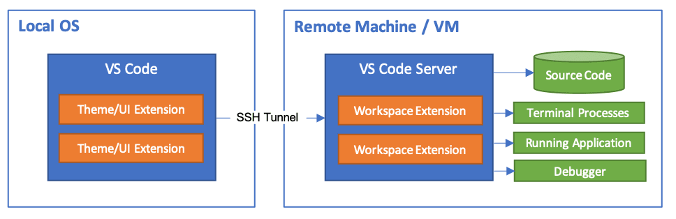

　　这让 VS Code 能够**无论代码托管在哪里**，都提供**本地品质的开发体验**，包括完整的 IntelliSense（补全）、代码导航和调试。

## 入门 {#getting-started}

> **注意**：阅读本主题后，可以通过入门 [8.3 SSH 远程开发教程](../8.3-SSHTutorial/)开始实践。

### 系统要求 {#system-requirements}

　　**本地**：必须安装受支持的[8.11 提示和技巧](../8.11-TipsAndTricks/#installing-a-supported-ssh-client)。

　　**远程 SSH 主机**：在以下系统上运行 [8.11 提示和技巧](../8.11-TipsAndTricks/#installing-a-supported-ssh-server)：

- x86_64 Debian 8+、Ubuntu 16.04+、CentOS / RHEL 7+。
- ARMv7l（AArch32）Raspberry Pi OS Stretch/9+（32 位）。
- ARMv8l（AArch64）Ubuntu 18.04+（64 位）。
- Windows 10 / Server 2016/2019（1803+），使用[官方 OpenSSH Server](https://learn.microsoft.com/windows-server/administration/openssh/openssh_install_firstuse)。
- macOS 10.14+（Mojave）SSH 主机，并[启用远程登录](https://support.apple.com/guide/mac-help/allow-a-remote-computer-to-access-your-mac-mchlp1066/mac)。
- 远程主机需要 1 GB RAM，建议至少 2 GB RAM 和双核 CPU。

　　其他基于 `glibc` 的 x86_64、ARMv7l（AArch32）和 ARMv8l（AArch64）Linux 发行版只要具备所需前提条件，也应可以工作。请参阅[8.10 Linux 前提条件](../8.10-LinuxPrerequisites/)。虽然支持 ARMv7l 和 ARMv8l，但安装在这些设备上的某些扩展可能因使用 x86 本机代码而无法工作。

### 安装 {#installation}

1. 如果尚未安装，请安装[8.11 提示和技巧](../8.11-TipsAndTricks/#installing-a-supported-ssh-client)。

2. 安装 [Visual Studio Code](https://code.visualstudio.com/) 或 [VS Code Insiders](https://code.visualstudio.com/insiders/)。

3. 安装 [Remote-SSH 扩展](https://marketplace.visualstudio.com/items?itemName=ms-vscode-remote.remote-ssh)。如果计划使用其他远程扩展，可以安装[远程开发扩展包](https://aka.ms/vscode-remote/download/extension)。

### 设置 SSH 主机 {#ssh-host-setup}

1. 如果尚未设置 SSH 主机，请按照 [8.11 提示和技巧](../8.11-TipsAndTricks/#installing-a-supported-ssh-server)、[Windows 10 / Server（1803+）](https://learn.microsoft.com/windows-server/administration/openssh/openssh_install_firstuse)或 [macOS](https://support.apple.com/guide/mac-help/allow-a-remote-computer-to-access-your-mac-mchlp1066/mac) SSH 主机说明操作，或在 Azure 上创建[虚拟机](https://learn.microsoft.com/azure/virtual-machines/linux/quick-create-portal)。

2. **可选**：如果 Linux 或 macOS SSH 主机将同时被多个用户访问，请考虑在 VS Code [3.3.4 设置](../../editor/3.3-ConfigureTheEditor/3.3.4-Settings/)中启用 **Remote.SSH: Remote Server Listen On Socket**，以提高安全性。

    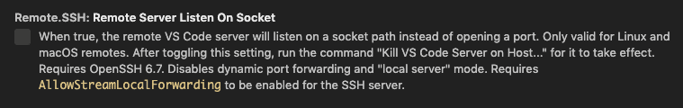

3. **可选**：虽然支持基于密码的身份验证，但建议为主机设置**基于密钥的身份验证**。详见[8.11 提示和技巧](../8.11-TipsAndTricks/#configuring-key-based-authentication)。

### 连接到远程主机 {#connect-to-a-remote-host}

1. 从终端 / PowerShell 窗口运行以下命令，确认可以连接到 SSH 主机（适当替换 `user@hostname`）：

    ```bash
    ssh user@hostname
    # 或者在 Windows 上使用域 / AAD 账户时
    ssh user@domain@hostname
    ```

2. 在 VS Code 中，从命令面板（`F1`、`Ctrl + Shift + P`）选择 **Remote-SSH: Connect to Host...**，使用与第 1 步相同的 `user@hostname`。

    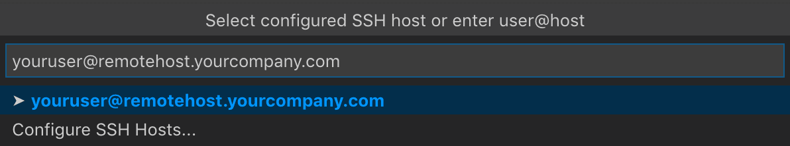

3. 如果 VS Code 无法自动检测服务器类型，系统会要求你手动选择。选择后，平台会存储在 VS Code 设置的 `remote.SSH.remotePlatform` 属性中，你可以随时更改。

    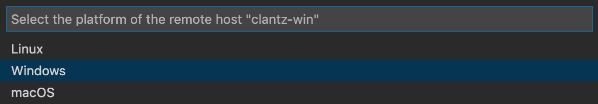

4. 片刻后，VS Code 会连接到 SSH 服务器并完成自身设置。你可以通过进度通知了解状态，并在 `Remote - SSH` 输出通道中查看详细日志。

    > **提示**：连接挂起或失败？请参阅[8.11 提示和技巧](../8.11-TipsAndTricks/#troubleshooting-hanging-or-failing-connections)。如果看到 SSH 文件权限错误，请参阅[8.11 提示和技巧](../8.11-TipsAndTricks/#fixing-ssh-file-permission-errors)。

5. 连接后会进入一个空窗口。状态栏会显示你连接的主机。

    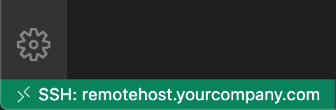

    单击状态栏项可查看远程命令列表。

6. 然后可以像在本地一样，通过 **文件 > 打开...** 或 **文件 > 打开工作区...** 打开远程计算机上的任何文件夹或工作区。

    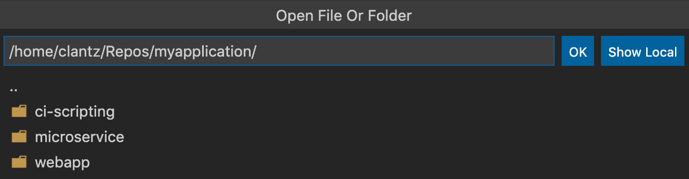

　　从这里开始，[安装所需扩展](#managing-extensions)并开始编辑。

> **注意**：在 ARMv7l / ARMv8l `glibc` SSH 主机上，某些扩展可能因扩展内的 x86 编译本机代码而无法工作。

### 在容器中打开远程 SSH 主机上的文件夹 {#open-a-folder-on-a-remote-ssh-host-in-a-container}

　　如果使用 Linux 或 macOS SSH 主机，可以结合 Remote - SSH 和 [8.5 开发容器](../8.5-DevContainers/) 扩展，在容器内打开远程主机上的文件夹。你甚至不需要在本地安装 Docker 客户端。

1. 按照[8.5 开发容器](../8.5-DevContainers/)步骤，在远程主机上安装 Docker，并在本地安装 VS Code 和 Dev Containers 扩展。
2. **可选**：为服务器设置 SSH [8.11 提示和技巧](../8.11-TipsAndTricks/#configuring-key-based-authentication)，避免多次输入密码。
3. 按照 Remote - SSH 的[快速开始](#connect-to-a-remote-host)连接到主机并打开文件夹。
4. 从命令面板（`F1`、`Ctrl + Shift + P`）使用 **Dev Containers: Reopen in Container** 命令。

　　其余 [8.5 开发容器](../8.5-DevContainers/)步骤同样适用。

### 断开与远程主机的连接 {#disconnect-from-a-remote-host}

　　完成远程主机上的文件编辑后，选择 **文件 > 关闭远程连接** 断开连接。默认配置没有为此命令提供键盘快捷键。也可以直接退出 VS Code 关闭远程连接。

### 记住主机和高级设置 {#remember-hosts-and-advanced-settings}

　　如果经常使用一组主机，或需要使用附加选项连接主机，可以将它们添加到遵循 [SSH 配置文件格式](https://man7.org/linux/man-pages/man5/ssh_config.5.html)的本地文件中。扩展可以引导你添加主机，无需手动编辑文件。

　　从命令面板（`F1`、`Ctrl + Shift + P`）选择 **Remote-SSH: Add New SSH Host...**，或单击活动栏中 SSH **远程资源管理器** 的 **Add New** 图标。

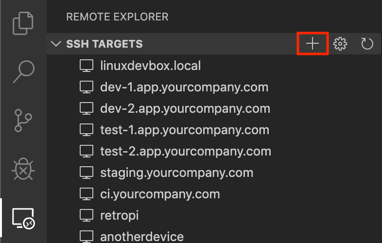

　　然后输入 SSH 连接信息，可以输入主机名，也可以输入完整的 `ssh` 命令：

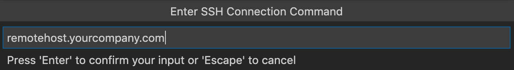

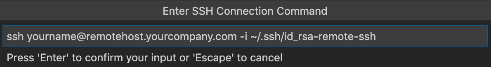

　　最后，选择要使用的配置文件。如果希望使用列表之外的其他配置文件，可以在用户 `settings.json` 中设置 `"remote.SSH.configFile"`。例如，输入 `ssh -i ~/.ssh/id_rsa-remote-ssh yourname@remotehost.yourcompany.com` 会生成以下条目：

```ssh-config
Host remotehost.yourcompany.com
    User yourname
    HostName another-host-fqdn-or-ip-goes-here
    IdentityFile ~/.ssh/id_rsa-remote-ssh
```

　　此后，选择 **Remote-SSH: Connect to Host...** 或查看 **远程资源管理器** 的 **SSH 目标** 部分时，主机会出现在列表中。

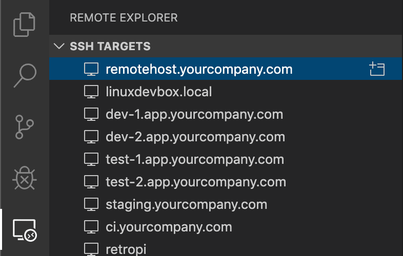

　　**远程资源管理器**允许在远程主机上打开新的空窗口，或直接打开之前打开过的文件夹。展开主机，单击文件夹旁的 **打开文件夹** 图标。

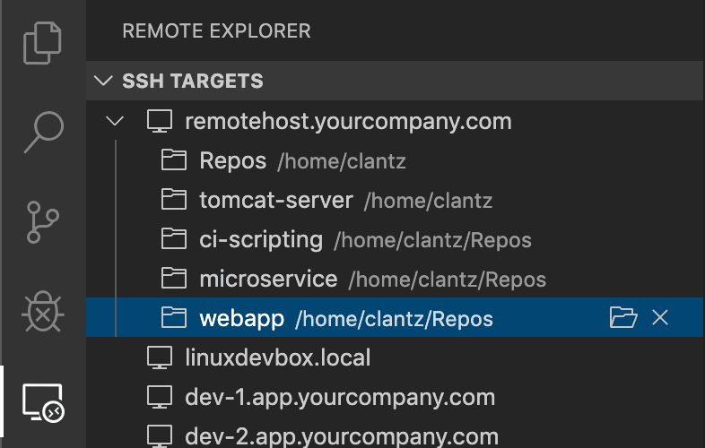

## 管理扩展 {#managing-extensions}

　　VS Code 在本地 UI/客户端侧或远程 SSH 主机上运行扩展。影响 VS Code UI 的扩展（例如主题和代码片段）安装在本地，大多数扩展则驻留在 SSH 主机上。从扩展视图安装扩展时，它会自动安装到正确位置。安装后，可以通过类别分组判断扩展的安装位置：

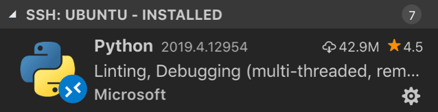

　　以及 **本地 - 已安装** 类别：

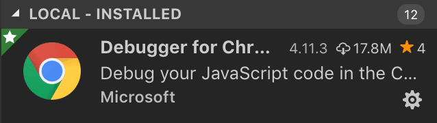

> **注意**：如果你是扩展作者，发现扩展工作不正常或安装位置错误，请参阅[支持远程开发](https://code.visualstudio.com/api/advanced-topics/remote-extensions)。

　　需要远程运行的本地扩展会在 **本地 - 已安装** 类别中显示为灰色并禁用。选择 **安装** 将其安装到远程主机。

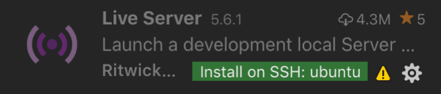

　　也可以转到扩展视图，在 **本地 - 已安装** 标题栏右侧使用云按钮，选择 **Install Local Extensions in SSH: {Hostname}**，然后从下拉列表中选择要在 SSH 主机上安装的本地扩展。

### “始终安装”扩展 {#always-installed-extensions}

　　如果希望任何 SSH 主机上始终安装某些扩展，可以在 `settings.json` 中使用 `remote.SSH.defaultExtensions` 属性指定。例如，安装 GitLens 和 Resource Monitor：

```json
"remote.SSH.defaultExtensions": [
    "eamodio.gitlens",
    "mutantdino.resourcemonitor"
]
```

### 高级：强制扩展在本地/远程运行 {#advanced-forcing-an-extension-to-run-locally-remotely}

　　扩展通常针对本地或远程之一设计和测试。如果扩展支持，可以在 `settings.json` 中强制它在特定位置运行：

```json
"remote.extensionKind": {
    "ms-azuretools.vscode-containers": [ "ui" ],
    "ms-vscode-remote.remote-ssh-edit": [ "workspace" ]
}
```

　　`"ui"` 会强制扩展在本地 UI/客户端侧运行。除非扩展文档另有说明，否则通常只应用于测试，因为它**可能破坏扩展**。

## 转发端口/创建 SSH 隧道 {#forwarding-a-port-creating-ssh-tunnel}

　　有时需要访问远程计算机上未公开暴露的端口。可以使用 [SSH 隧道](https://www.ssh.com/ssh/tunneling/example)将所需远程端口转发到本地计算机。

### 临时转发端口 {#temporarily-forwarding-a-port}

　　连接到主机后，要从命令面板选择 **Forward a Port**，或在**端口视图**中选择 **Add Port** 按钮。可以在底部面板中看到端口视图，或运行 **Ports: Focus on Ports View** 命令。

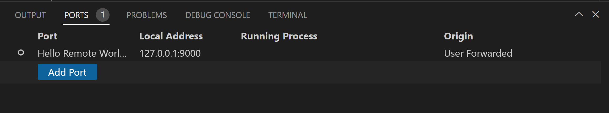

　　输入要转发的端口，并可以为其命名。

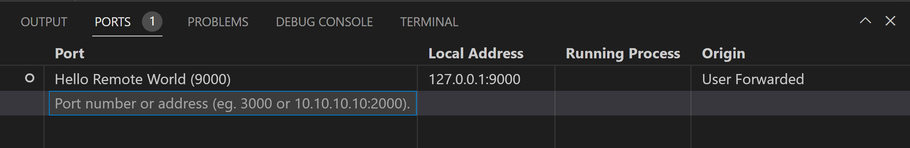

　　通知会告知用于访问远程端口的 localhost 端口。例如，转发监听 3000 端口的 HTTP 服务器时，由于 3000 已被占用，它可能映射到 localhost 的 4123 端口，可使用 `http://localhost:4123` 连接。相同信息也可在远程资源管理器的 **转发端口** 部分找到。

　　如果希望 VS Code 记住已转发的端口，请在设置编辑器中勾选 **Remote: Restore Forwarded Ports**，或在 `settings.json` 中设置 `"remote.restoreForwardedPorts": true`。

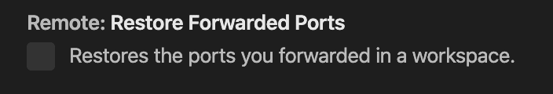

#### 更改隧道本地端口 {#change-local-port-on-tunnel}

　　要使用与远程服务器不同的本地端口，可以在 **转发端口** 面板中修改。右键单击隧道，选择 **更改本地地址端口**。

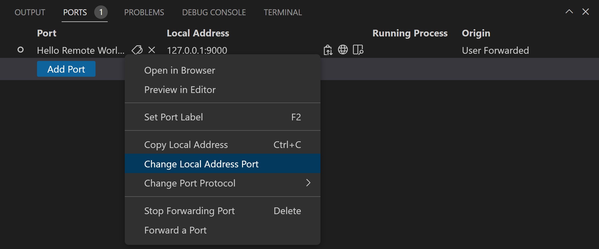

### 始终转发端口 {#always-forwarding-a-port}

　　对于**始终要转发**的端口，可以在用于[记住主机和高级设置](#remember-hosts-and-advanced-settings)的同一 SSH 配置文件中使用 `LocalForward` 指令：

```ssh-config
Host remote-linux-machine
    User myuser
    HostName remote-linux-machine.mydomain
    LocalForward 127.0.0.1:3000 127.0.0.1:3000
    LocalForward 127.0.0.1:27017 127.0.0.1:27017
```

## 在远程主机上打开终端 {#opening-a-terminal-on-a-remote-host}

　　连接后，在 VS Code 中打开的任何终端窗口（**终端 > 新建终端**）都会自动在远程主机上运行，而不是本地。你也可以在同一终端窗口中使用 `code` 命令行在远程主机上打开新文件或文件夹。输入 `code --help` 查看所有可用选项。

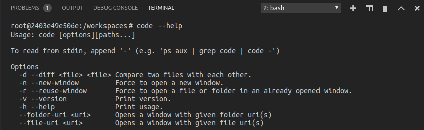

## 在 SSH 主机上调试 {#debugging-on-the-ssh-host}

　　连接到远程主机后，可以像本地运行应用程序一样使用 VS Code 调试器。例如，在 `launch.json` 中选择启动配置并开始调试（`F5`），应用程序会在远程主机上启动并附加调试器。有关配置调试的详细信息，请参阅[6.1 调试代码](../../debugging-and-testing/6.1-Debugging/)。

## SSH 主机特定设置 {#ssh-host-specific-settings}

　　连接到 SSH 主机时，本地用户设置也会被复用。要区分主机设置，可以在连接后从命令面板运行 **Preferences: Open Remote Settings**，或在设置编辑器中选择 **远程** 选项卡。这些设置会覆盖用户设置，而工作区设置会覆盖远程和用户设置。

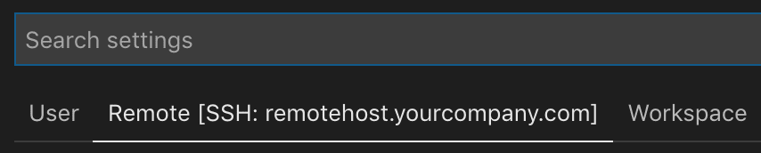

## 使用本地工具 {#working-with-local-tools}

　　Remote - SSH 扩展不直接支持同步源代码或在远程主机内容上使用本地工具。可以使用两种常见方式：

1. [8.11 提示和技巧](../8.11-TipsAndTricks/#using-sshfs-to-access-files-on-your-remote-host)。
2. [8.11 提示和技巧](../8.11-TipsAndTricks/#using-rsync-to-maintain-a-local-copy-of-your-source-code)。

　　SSHFS 最方便，无需同步，但性能明显低于通过 VS Code 工作，适合单文件编辑和上传/下载内容。如果需要批量读写许多文件（例如本地源代码管理工具），`rsync` 更合适。

## 已知限制 {#known-limitations}

### Remote - SSH 限制 {#remote-ssh-limitations}

- 建议使用基于密钥的身份验证。[8.11 提示和技巧](../8.11-TipsAndTricks/#enabling-alternate-ssh-authentication-methods)输入的密码和其他令牌不会被保存。
- 不支持 Alpine Linux 和非基于 glibc 的 Linux SSH 主机。
- 较旧（社区支持）的 Linux 发行版需要变通方法安装[8.10 Linux 前提条件](../8.10-LinuxPrerequisites/)。
- Windows 上不支持 PuTTY。
- 如果使用 SSH 克隆 Git 仓库且 SSH 密钥有密码短语，VS Code 的拉取和同步功能在远程运行时可能挂起。请使用无密码短语的 SSH 密钥、使用 HTTPS 克隆，或在命令行运行 `git push`。
- 与 SSH 相关的活动问题列表请参阅[此处](https://aka.ms/vscode-remote/ssh/issues)。

### Container Tools 扩展限制 {#container-tools-extension-limitations}

　　如果从 WSL、Remote - Tunnels 或 Remote - SSH 窗口使用 Container Tools 或 Kubernetes 扩展，在容器资源管理器或 Kubernetes 视图中使用 **Attach Visual Studio Code** 上下文菜单操作时，会再次要求从可用容器中选择。

### 扩展限制 {#extension-limitations}

　　许多扩展无需修改即可在远程 SSH 主机上工作，但某些功能可能需要更改。如果遇到扩展问题，请参阅[8.11 提示和技巧](../8.11-TipsAndTricks/)，并在报告问题时告知扩展作者。安装在不支持 ARM 的设备上的某些扩展可能因本机模块或运行时只支持 x86_64 而无法工作。

## 常见问题 {#common-questions}

### 如何设置 SSH 客户端？ {#how-do-i-set-up-an-ssh-client-on}

　　请参阅[8.11 提示和技巧](../8.11-TipsAndTricks/#installing-a-supported-ssh-client)。

### 如何设置 SSH 服务器？ {#how-do-i-set-up-an-ssh-server-on}

　　请参阅[8.11 提示和技巧](../8.11-TipsAndTricks/#installing-a-supported-ssh-server)。

### 可以使用密码等其他身份验证机制登录 SSH 服务器吗？ {#can-i-sign-in-to-my-ssh-server-with-anotheradditional-authentication-mechanism-like-a-password}

　　可以，系统会自动提示输入令牌或密码。但是密码不会被保存，因此使用[8.11 提示和技巧](../8.11-TipsAndTricks/#configuring-key-based-authentication)通常更方便。

### 如何修复“bad permissions”SSH 错误？ {#how-do-i-fix-ssh-errors-about-bad-permissions}

　　请参阅[8.11 提示和技巧](../8.11-TipsAndTricks/#fixing-ssh-file-permission-errors)。

### 远程 SSH 主机需要安装哪些 Linux 软件包/库？ {#what-linux-packages-libraries-need-to-be-installed-on-remote-ssh-hosts}

　　大多数 Linux 发行版不需要额外的依赖安装步骤。SSH Linux 主机需要安装 Bash（`/bin/bash`）、`tar` 以及 `curl` 或 `wget`。远程开发还要求内核 >= 3.10、glibc >= 2.17、libstdc++ >= 3.4.18。目前只支持基于 glibc 的发行版，因此不支持 Alpine Linux。详见 [8.10 Linux 前提条件](../8.10-LinuxPrerequisites/)。

### VS Code Server 在远程计算机/VM 上运行时的连接要求是什么？ {#what-are-the-connectivity-requirements-for-the-vs-code-server-when-it-is-running-on-a-remote-machine-vm}

　　安装 VS Code Server 需要本地计算机能够通过 HTTPS（端口 443）出站连接到：

- `update.code.visualstudio.com`
- `vscode.download.prss.microsoft.com`

　　默认情况下，Remote - SSH 会尝试在远程主机上下载，失败后回退到本地下载并传输。可以使用 `remote.SSH.localServerDownload` 设置更改此行为。

　　如果使用扩展面板安装扩展，本地计算机和 VS Code Server 需要 HTTPS 出站访问：

- `marketplace.visualstudio.com`
- `*.gallerycdn.vsassets.io`（Azure CDN）

　　某些扩展（如 C#）会从 `download.microsoft.com` 或 `download.visualstudio.microsoft.com` 下载次要依赖。服务器和客户端之间的其他通信都通过经过身份验证的安全 SSH 隧道完成。

### 可以在位于远程 SSH 主机上的源代码上使用本地工具吗？ {#can-i-use-local-tools-on-source-code-sitting-on-the-remote-ssh-host}

　　可以。通常通过 [8.11 提示和技巧](../8.11-TipsAndTricks/#using-sshfs-to-access-files-on-your-remote-host) 或 [8.11 提示和技巧](../8.11-TipsAndTricks/#using-rsync-to-maintain-a-local-copy-of-your-source-code) 在本地获取文件副本。SSHFS 挂载适合编辑单个文件或浏览源代码树，不需要同步步骤，但不适合批量管理文件的工具；在这种情况下 `rsync` 更合适。

### 只有远程主机的 SFTP/FTP 文件系统访问权限（无 shell 访问权限）时可以使用 VS Code 吗？ {#can-i-use-vs-code-when-i-only-have-sftpfptp-filesystem-access-to-my-remote-host-no-shell-access}

　　VS Code 远程开发并非为此用例设计，因为它无法发挥性能和用户体验优势。通常可以将 [SFTP](https://marketplace.visualstudio.com/items?itemName=liximomo.sftp) 等扩展与 [2.1.1 查找指南](../../ai-in-vs-code/getting-started/2.1.1-FindAGuide/)、[2.1.1 查找指南](../../ai-in-vs-code/getting-started/2.1.1-FindAGuide/)、[C#](https://marketplace.visualstudio.com/items?itemName=ms-dotnettools.csharp) 或其他远程调试功能结合使用。

### 作为扩展作者，我需要做什么？ {#as-an-extension-author-what-do-i-need-to-do}

　　VS Code 扩展 API 抽象了本地/远程细节，因此大多数扩展无需修改即可工作。但是，由于扩展可以使用任何 Node 模块或运行时，某些情况下可能需要调整。建议测试扩展以确保无需更新。详见[支持远程开发](https://code.visualstudio.com/api/advanced-topics/remote-extensions)。

### 问题或反馈 {#questions-or-feedback}

- 请参阅[8.11 提示和技巧](../8.11-TipsAndTricks/#ssh-tips)或[8.12 常见问题](../8.12-FAQ/)。
- 在 [Stack Overflow](https://stackoverflow.com/questions/tagged/vscode-remote) 上搜索。
- 添加[功能请求](https://aka.ms/vscode-remote/feature-requests)或[报告问题](https://aka.ms/vscode-remote/issues/new)。
- 为[文档](https://github.com/microsoft/vscode-docs)或 [VS Code 本身](https://github.com/microsoft/vscode)贡献力量。
- 请参阅 [CONTRIBUTING](https://aka.ms/vscode-remote/contributing) 指南。
