+++
title = "8.3 SSH 远程开发教程"
date = 2026-11-06T07:53:25+08:00
weight = 3
type = "docs"
description = ""
isCJKLanguage = true
draft = false
+++


> 原文链接: [https://code.visualstudio.com/docs/remote/ssh-tutorial](https://code.visualstudio.com/docs/remote/ssh-tutorial)

# 8.3 SSH 远程开发教程

　　本教程将指导你使用 Visual Studio Code 的 [Remote - SSH](https://marketplace.visualstudio.com/items?itemName=ms-vscode-remote.remote-ssh) 扩展在 Azure 上创建并连接虚拟机（VM）。你将创建一个 Node.js Express Web 应用，演示如何像源代码在本地一样，在远程计算机上使用 VS Code 编辑和调试。

> **注意**：只要所选 Linux 发行版满足[8.10 Linux 前提条件](../8.10-LinuxPrerequisites/#local-linux-prerequisites)，Linux VM 可以托管在任何地方，包括本地主机、本地部署、Azure 或其他云中。

## 前提条件 {#prerequisites}

1. 安装[8.11 提示和技巧](../8.11-TipsAndTricks/#installing-a-supported-ssh-client)（不支持 PuTTY）。
2. 安装 [Visual Studio Code](https://code.visualstudio.com)。
3. 拥有 Azure 订阅（如果没有，请在开始前创建[免费账户](https://azure.microsoft.com/free/?WT.mc_id=A261C142F)）。

### 安装扩展 {#install-the-extension}

　　Remote - SSH 扩展用于连接到 SSH 主机。安装扩展后，状态栏最左侧会出现一个新项。

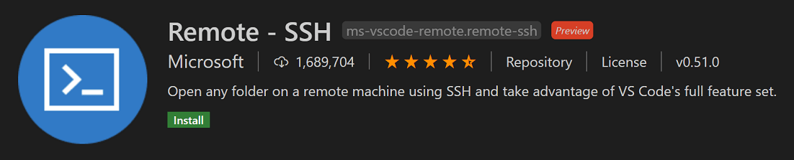

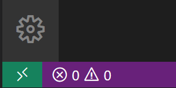

　　远程状态栏项可以快速显示 VS Code 运行在哪个上下文（本地或远程），单击它会打开 Remote - SSH 命令。

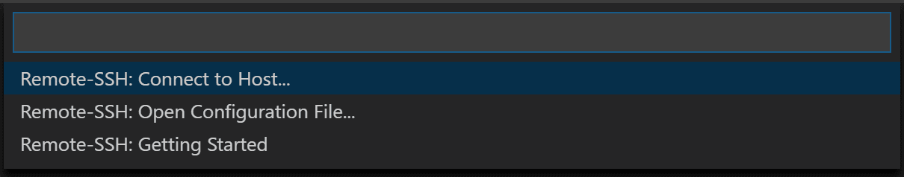

## 创建虚拟机 {#create-a-virtual-machine}

　　如果没有现成的 Linux 虚拟机，可以通过 [Azure 门户](https://portal.azure.com)创建新的 VM。在 Azure 门户中搜索“虚拟机”，选择 **添加**，选择 Azure 订阅并创建新的资源组。

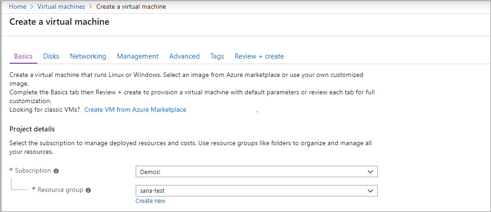

　　指定 VM 的名称、大小和基础映像。本示例选择 Ubuntu Server 18.04 LTS，也可以选择其他 Linux 发行版的近期版本，并查看 VS Code [8.11 提示和技巧](../8.11-TipsAndTricks/#installing-a-supported-ssh-server)。

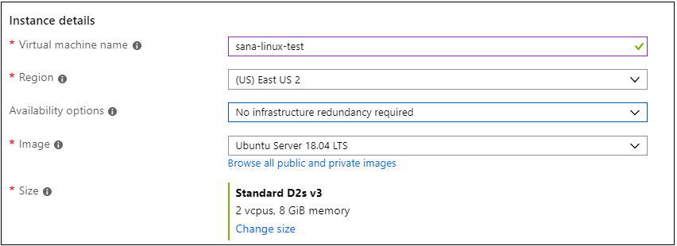

## 设置 SSH {#set-up-ssh}

　　可以通过 SSH 公钥/私钥对或用户名和密码进行身份验证。推荐使用基于密钥的身份验证（如果使用用户名/密码，扩展会多次要求输入凭据）。如果在 Windows 上已使用 PuTTYGen 创建密钥，可以[8.11 提示和技巧](../8.11-TipsAndTricks/#reusing-a-key-generated-in-puttygen)。

### 创建 SSH 密钥 {#create-an-ssh-key}

　　如果没有 SSH 密钥对，请打开 bash shell 或命令行并输入：

```bash
ssh-keygen -t ed25519
```

　　按 `Enter` 将密钥保存到默认位置（用户目录下名为 `.ssh` 的文件夹）。

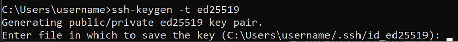

　　系统会提示输入安全密码短语，可以将其留空。现在应该有一个包含新 SSH 公钥的 `id_ed25519.pub` 文件。

> **注意**：如果使用的旧系统不支持 Ed25519 算法，可以改用 RSA：`ssh-keygen -t rsa -b 4096`。

## 将 SSH 密钥添加到 VM {#add-ssh-key-to-your-vm}

　　在 **SSH 公钥源** 下拉列表中选择 **使用现有公钥**，将刚生成的公钥粘贴到 **SSH 公钥** 中。复制 `id_ed25519.pub` 的全部内容。在 **选择入站端口** 下拉列表中选择 **SSH (22)**，允许 VM 接受入站 SSH 流量。

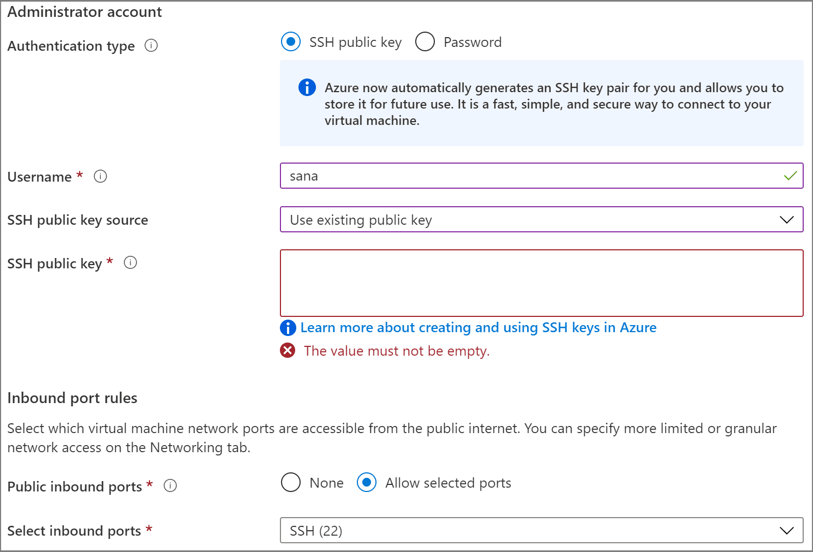

### 自动关机 {#auto-shutdown}

　　Azure VM 的一项实用功能是自动关机。在 **管理** 选项卡中，可以设置每天关闭 VM 的时间。

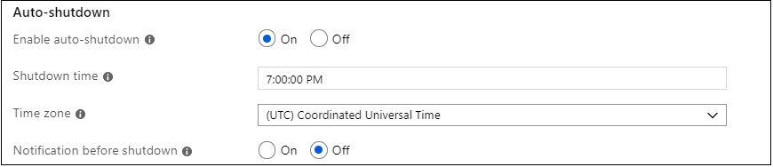

　　选择 **查看 + 创建**，然后选择 **创建**，Azure 将部署 VM。部署完成后（可能需要几分钟），转到虚拟机的资源视图。

## 使用 SSH 连接 {#connect-using-ssh}

　　状态栏左下角的指示器显示 VS Code 运行在本地还是远程。单击该指示器可打开远程扩展命令列表。

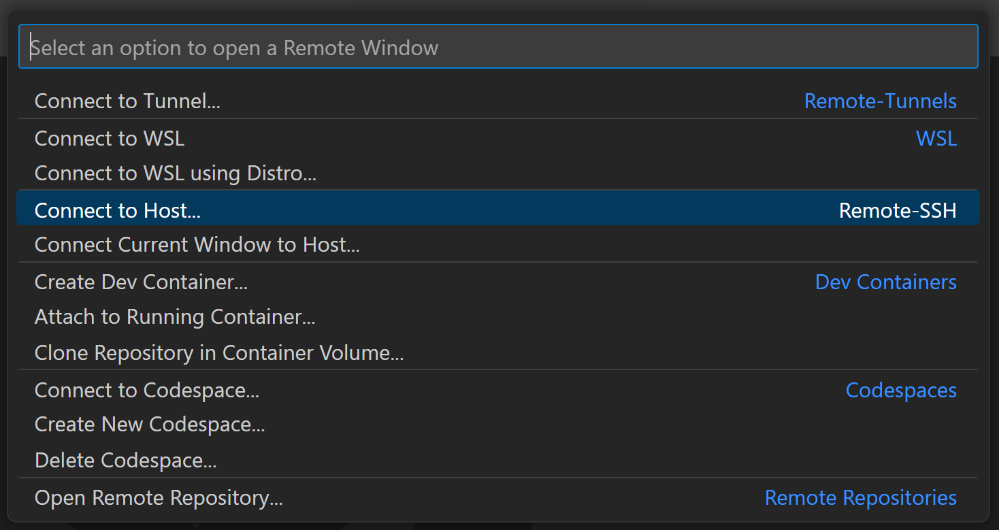

　　在 **Remote-SSH** 部分选择 **Connect to Host...**，然后以 `user@hostname` 格式输入 VM 的连接信息。`user` 是添加 SSH 公钥时设置的用户名。`hostname` 可以从 Azure 门户 VM 的 **概述** 窗格中复制 **公共 IP 地址**。

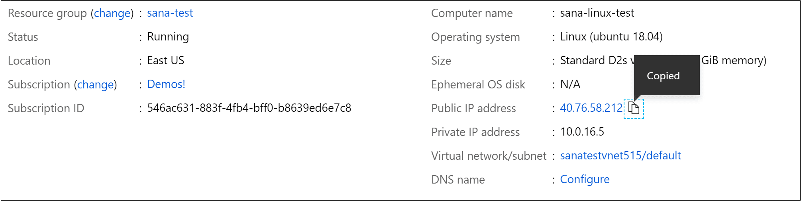

　　在 Remote - SSH 中连接之前，可以使用 `ssh user@hostname` 命令验证能否连接。

> 注意：如果遇到错误 `ssh: connect to host <host ip> port 22: Connection timed out`，可能需要从 VM 的“网络”选项卡中删除 NRMS-Rule-106。

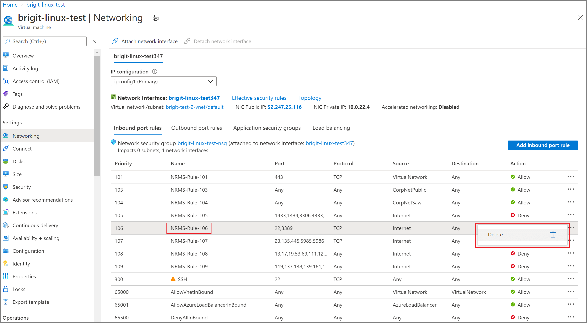

　　在连接信息文本框中设置用户名和主机名。

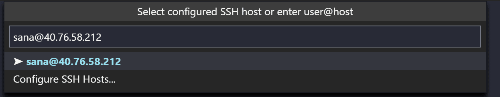

　　VS Code 会打开新窗口，并显示 VS Code Server 正在 SSH 主机上初始化。安装完成后，VS Code Server 可以运行扩展并与本地 VS Code 实例通信。

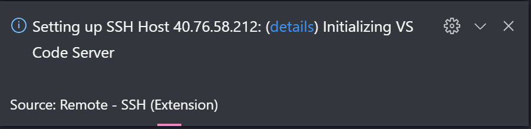

　　状态栏指示器会显示 VM 的主机名。Remote - SSH 扩展还会在活动栏中添加新图标，单击可打开远程资源管理器。从下拉列表中选择 **SSH 目标**，可以配置 SSH 连接并保存常用主机。

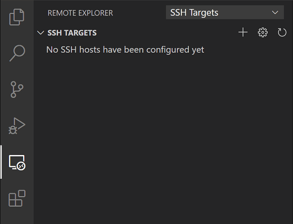

　　连接后，可以与远程计算机上的文件交互并打开文件夹。打开集成终端（`Ctrl + 反引号`），即使你在 Windows 上，也会进入 bash shell。

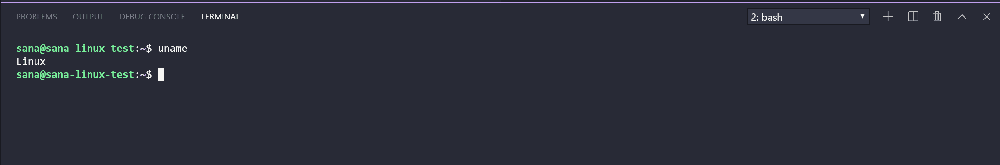

　　可以使用 bash shell 浏览 VM 文件系统，也可以通过 **文件** > **打开文件夹** 浏览并打开远程主目录中的文件夹。

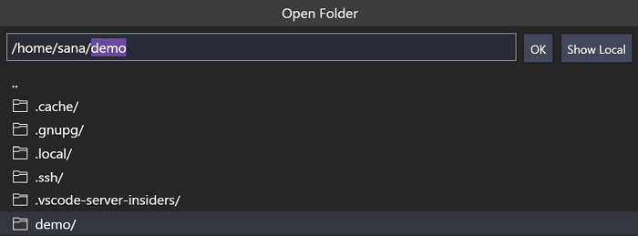

## 创建 Node.js 应用 {#create-your-nodejs-application}

### 安装 Node.js 和 npm {#install-nodejs-and-npm}

　　在集成终端（`Ctrl + 反引号`）中更新 Linux VM 中的软件包，然后安装 Node.js（包含 npm）：

```bash
sudo apt-get update
curl -sL https://deb.nodesource.com/setup_lts.x | sudo -E bash -
sudo apt-get install -y nodejs
```

　　运行以下命令验证安装：

```bash
node --version
npm --version
```

### 安装 Express 生成器 {#install-the-express-generator}

　　[Express](https://www.expressjs.com) 是用于构建和运行 Node.js 应用程序的流行框架。可以使用 [Express Generator](https://expressjs.com/en/starter/generator.html) 工具创建新的 Express 应用：

```bash
sudo npm install -g express-generator
```

　　`-g` 开关会在计算机上全局安装 Express Generator，以便从任何位置运行。

### 创建新应用 {#create-a-new-application}

　　运行以下命令创建一个名为 `myExpressApp` 的新 Express 应用：

```bash
express myExpressApp --view pug
```

　　`--view pug` 参数告诉生成器使用 [pug](https://pugjs.org/api/getting-started.html) 模板引擎。安装所有依赖项：

```bash
cd myExpressApp
npm install
```

### 运行应用 {#run-the-application}

　　使用 `npm start` 启动服务器：

```bash
npm start
```

　　Express 应用默认运行在 [http://localhost:3000](http://localhost:3000)。由于 Web 应用运行在虚拟机上，本地浏览器暂时无法访问。

### 端口转发 {#port-forwarding}

　　要在本地浏览 Web 应用，可以使用[8.2 使用 SSH 远程开发](../8.2-SSH/#temporarily-forwarding-a-port)功能。应用仍在运行时，打开 SSH 资源管理器并找到 **转发的端口** 视图，单击 **转发端口** 链接并转发 3000 端口：

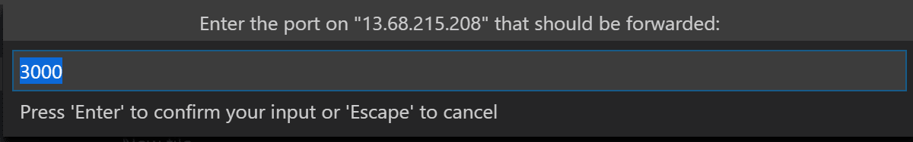

　　将连接命名为“browser”：

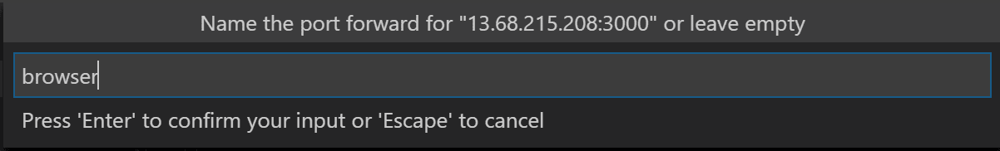

　　服务器会将 3000 端口上的流量转发到本地。访问 [http://localhost:3000](http://localhost:3000) 即可看到运行中的 Web 应用。

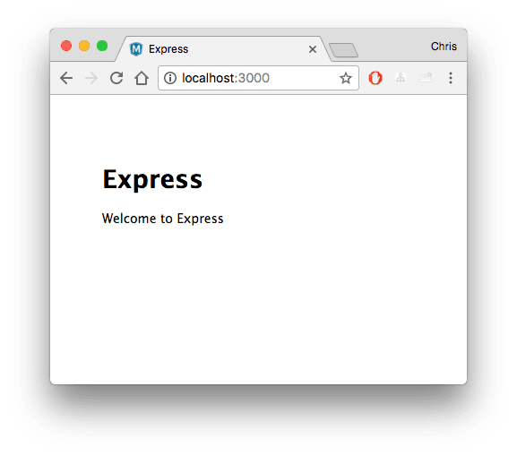

## 编辑和调试 {#edit-and-debug}

　　在 VS Code 文件资源管理器（`Ctrl + Shift + E`，macOS：`Cmd + Shift + E`）中打开 `myExpressApp` 文件夹，双击 `app.js` 文件。

### IntelliSense {#intellisense}

　　JavaScript 文件具有语法突出显示和带悬停信息的 IntelliSense，就像源代码在本地一样。开始输入时，会获得对象方法和属性的智能补全。

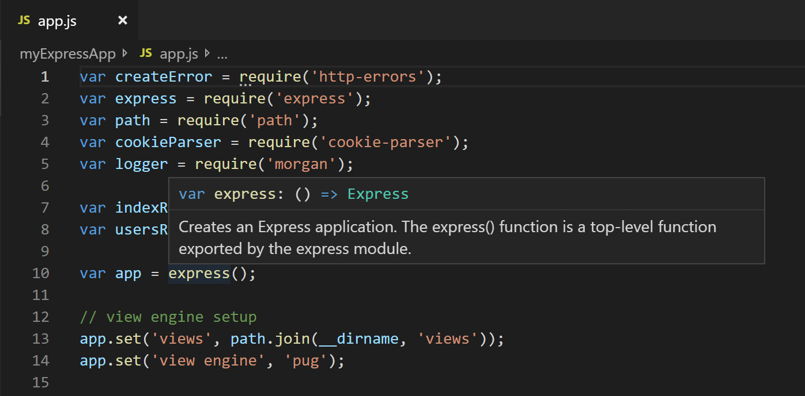

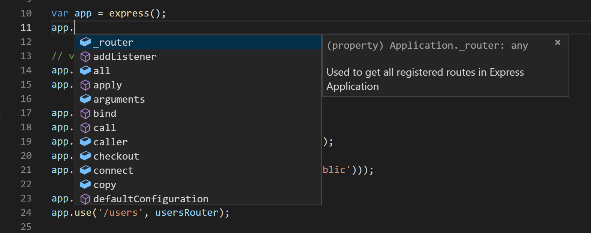

### 调试 {#debugging}

　　在 `app.js` 第 10 行的行号左侧边距中单击，或将光标放在该行按 `F9`，设置断点。断点显示为红色圆圈。

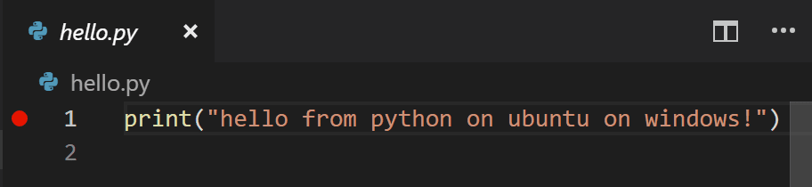

　　按 `F5` 运行应用程序。如果询问如何运行，请选择 **Node.js**。应用启动后会命中断点，可以检查变量、创建监视并导航调用堆栈。

　　按 `F10` 单步执行，再次按 `F5` 完成调试会话。

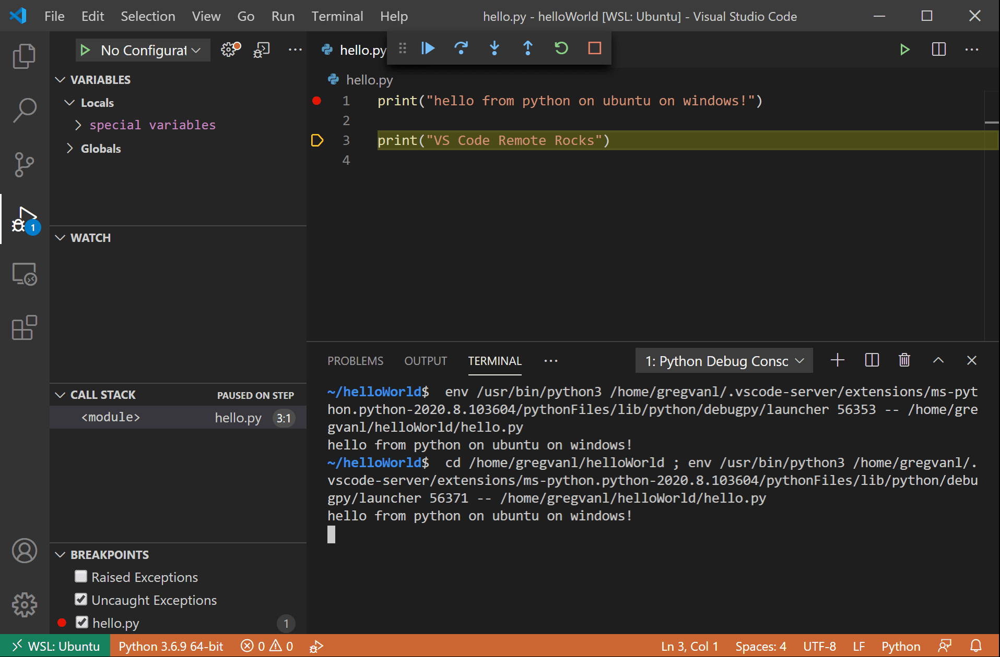

### 结束 SSH 连接 {#ending-your-ssh-connection}

　　通过 **文件** > **关闭远程连接** 结束 SSH 会话并返回本地 VS Code。

### 恭喜 {#congratulations}

　　你已成功完成本教程！接下来可以查看其他远程开发扩展：[WSL](https://marketplace.visualstudio.com/items?itemName=ms-vscode-remote.remote-wsl) 和 [Dev Containers](https://marketplace.visualstudio.com/items?itemName=ms-vscode-remote.remote-containers)，或安装[远程开发](https://marketplace.visualstudio.com/items?itemName=ms-vscode-remote.vscode-remote-extensionpack)扩展包。
