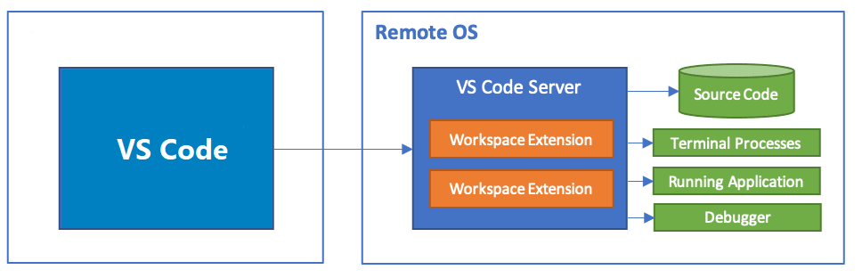
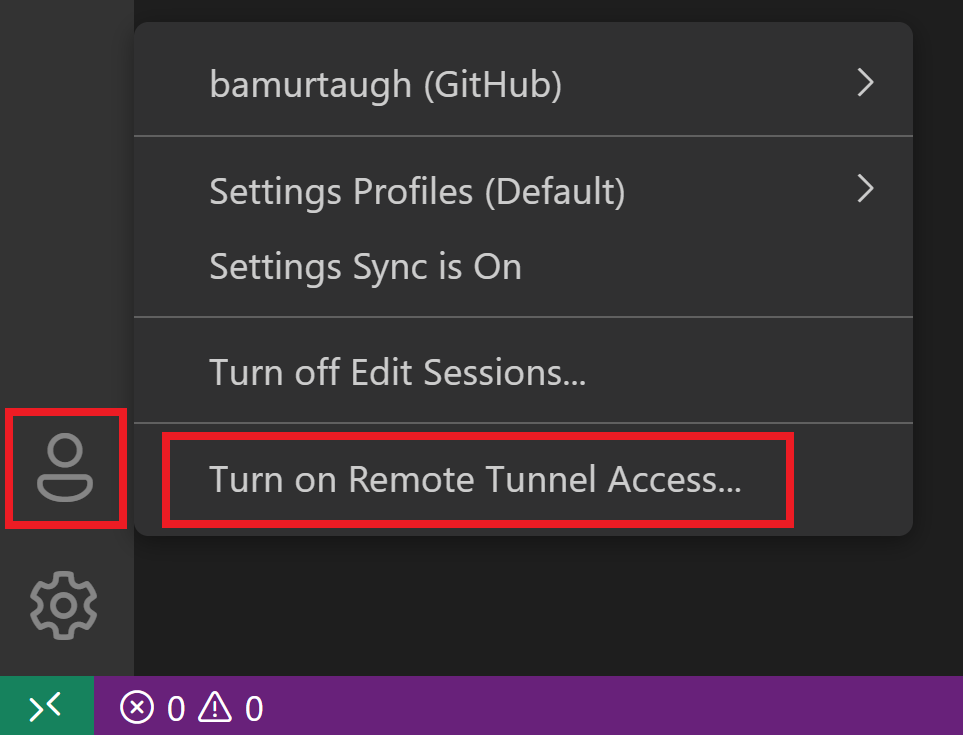
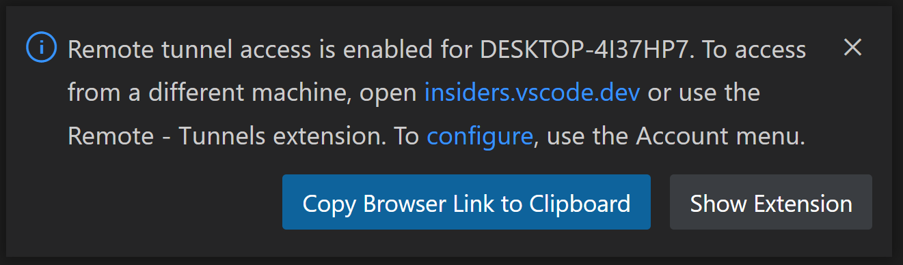
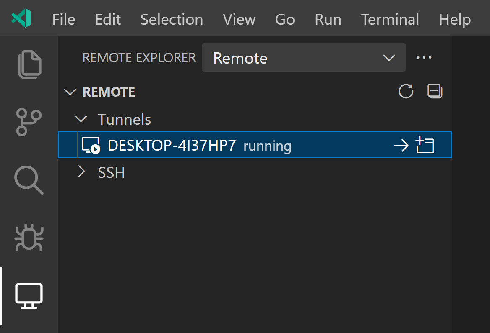
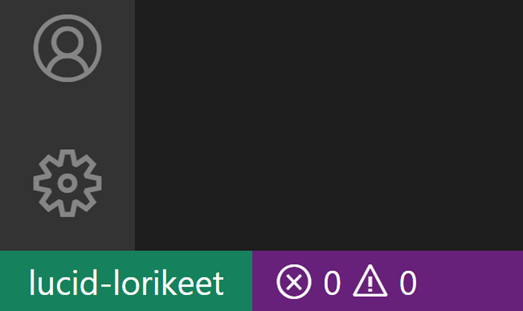

+++
title = "8.4 使用远程隧道开发"
date = 2026-11-06T07:53:25+08:00
weight = 4
type = "docs"
description = ""
isCJKLanguage = true
draft = false
+++


> 原文链接: [https://code.visualstudio.com/docs/remote/tunnels](https://code.visualstudio.com/docs/remote/tunnels)

# 8.4 使用远程隧道开发

　　Visual Studio Code [Remote - Tunnels](https://marketplace.visualstudio.com/items?itemName=ms-vscode.remote-server) 扩展允许你通过安全隧道连接到远程计算机，例如台式电脑或虚拟机（VM）。你可以从任何位置的 VS Code 客户端连接到该计算机，无需 SSH。

　　隧道通过 [Microsoft dev tunnels](https://learn.microsoft.com/azure/developer/dev-tunnels/overview) 在不同网络之间安全地传输数据。这可以消除将源代码放在 VS Code 客户端计算机上的需要，因为扩展会直接在远程计算机上运行命令和其他扩展。扩展会在远程操作系统上安装 VS Code Server，该服务器独立于远程操作系统上现有的任何 VS Code 安装。



　　VS Code 可以**无论代码托管在哪里**，都提供**本地品质的开发体验**，包括完整的 IntelliSense（补全）、代码导航和调试。

[youtube SyLHXdXhE1U.jpg](./images/youtube-SyLHXdXhE1U.jpg)](https://www.youtube.com/watch?v=SyLHXdXhE1U)

## 入门 {#getting-started}

　　使用隧道有两条路径：

* 运行 `code` [3.3.10 命令行界面](../../editor/3.3-ConfigureTheEditor/3.3.10-CommandLineInterface/#create-remote-tunnel)的 `tunnel` 命令。
* 通过 VS Code 桌面版 UI 启用隧道。

　　两种路径提供相同的隧道功能，你可以选择最适合的工具。如果无法在远程计算机上安装完整的 VS Code 桌面版，CLI 是很好的选择。如果你已经在 VS Code 中工作并希望为当前计算机启用隧道，桌面版 UI 更方便。

## 使用 `code` CLI {#using-the-code-cli}

1. 在要通过 VS Code 客户端连接的远程计算机上安装 `code` CLI。CLI 会建立 VS Code 客户端与远程计算机之间的隧道。CLI 已自动内置于 VS Code 桌面版，无需额外设置。

    也可以通过下载页面上的[独立安装](https://code.visualstudio.com/#alt-downloads)获取 CLI，它与桌面版安装分开。还可以在远程计算机的终端中安装并解压 CLI，这在远程设备没有 UI 时特别有用：

    ```bash
    curl -Lk 'https://code.visualstudio.com/sha/download?build=stable&os=cli-alpine-x64' --output vscode_cli.tar.gz

    tar -xf vscode_cli.tar.gz
    ```

    > **注意**：如果使用独立安装或终端安装，以下命令应以 `./code` 而不是 `code` 开头。

2. 使用 `tunnel` 命令创建安全隧道：

    ```bash
    code tunnel
    ```

    此命令会在此计算机上下载并启动 VS Code Server，然后创建到它的隧道。

    > **注意**：首次在计算机上启动隧道时，系统会提示你接受服务器许可条款。也可以在命令行传递 `--accept-server-license-terms` 以避免提示。

3. CLI 会输出与此远程计算机关联的 vscode.dev URL，例如 `https://vscode.dev/tunnel/<machine_name>/<folder_name>`。你可以在所选客户端中打开此 URL。

4. 首次在此客户端上打开 vscode.dev URL 时，系统会提示你在 `https://github.com/login/oauth/authorize...` URL 登录 GitHub 账户。这会向隧道服务验证你的身份，确保你有权访问正确的远程计算机。

## 使用 VS Code UI {#using-the-vs-code-ui}

1. 在要启用隧道访问的远程计算机上打开 VS Code。

2. 在 VS Code 账户菜单中选择 **打开远程隧道访问**。也可以在 VS Code 中打开命令面板（`F1`），运行 **Remote Tunnels: Turn on Remote Tunnel Access...**。

    

3. 系统会提示你登录 GitHub。登录后，当前计算机会启动隧道，你可以远程连接到该计算机。

    

4. 在所选客户端中，打开通知中的 vscode.dev 链接即可开始编码！

> **注意**：只有 VS Code 在该远程计算机上保持运行时，才能通过隧道访问它。退出 VS Code 后，在你再次启动 VS Code 或运行 `code tunnel` CLI 命令之前，无法通过隧道连接。

## Remote Tunnels 扩展 {#remote-tunnels-extension}

　　通过 `code` CLI 或 VS Code UI 打开的 vscode.dev 实例预装了 Remote - Tunnels 扩展。如果你已经在 VS Code（桌面版或 Web）中工作，并希望连接到远程隧道，可以直接安装并使用 [Remote - Tunnels](https://marketplace.visualstudio.com/items?itemName=ms-vscode.remote-server) 扩展。安装后，打开命令面板（`F1`），运行 **Remote Tunnels: Connect to Tunnel**。你可以连接到任何具有活动隧道的远程计算机。

　　也可以在远程资源管理器中查看远程计算机，通过 **Remote Explorer: Focus on Remote View** 命令聚焦该视图：



　　与其他远程开发扩展一样，远程计算机的名称会显示在左下角的绿色远程指示器中。单击该指示器也可以浏览 Remote Tunnels 命令，以及关闭远程连接或安装 VS Code 桌面版的选项。



### 在容器中打开 Remote Tunnels 主机上的文件夹 {#open-a-folder-on-a-remote-tunnels-host-in-a-container}

　　你可以结合 Remote - Tunnels 和 [8.5 开发容器](../8.5-DevContainers/) 扩展，在容器中打开远程主机上的文件夹，甚至不需要在本地安装 Docker 客户端。

1. 按照安装步骤，在远程主机上安装 Docker，并在本地安装 VS Code 和 Dev Containers 扩展。
2. 按照 Remote - Tunnels 的[入门](#getting-started)说明设置隧道、连接并打开文件夹。
3. 从命令面板（`F1`、`Ctrl + Shift + P`（macOS：`Cmd + Shift + P`））使用 **Dev Containers: Reopen in Container** 命令。

## 常见问题 {#common-questions}

### Remote Tunnels、VS Code Server 和远程开发之间是什么关系？ {#what-is-the-relationship-between-the-remote-tunnels-vs-code-server-and-remote-development}

　　VS Code [8](./)允许你将容器、远程计算机或 Windows Subsystem for Linux（WSL）用作功能完备的开发环境。远程开发通过将某些命令的执行移动到“远程服务器”（VS Code Server），让你本地的 VS Code 安装能够透明地与其他计算机上的源代码和运行时环境交互。连接到远程终结点时，VS Code 会快速安装 VS Code Server，它可以托管直接与远程工作区、计算机和文件系统交互的扩展。

　　VS Code Server 后端组件已作为可自行运行的服务发布，而不仅仅由远程开发扩展安装和管理。访问 VS Code Server 涉及几个组件：

* **VS Code Server**：使 VS Code 远程体验成为可能的后端服务器。
* **Remote - Tunnels 扩展**：帮助连接到运行服务器实例的远程计算机。

### 作为扩展作者，我需要做什么？ {#as-an-extension-author-what-do-i-need-to-do}

　　VS Code 扩展 API 抽象了本地/远程细节，因此大多数扩展无需修改即可工作。但是，由于扩展可以使用任何 Node 模块或运行时，某些情况下可能需要调整。建议测试扩展以确保无需更新。详见[支持远程开发](https://code.visualstudio.com/api/advanced-topics/remote-extensions)。

### 多个用户或客户端可以同时访问同一个远程实例吗？ {#can-multiple-users-or-clients-access-the-same-remote-instance-simultaneously}

　　不可以。服务器实例设计为一次只能由一个用户或客户端访问。

### 如何移除隧道或计算机？ {#how-do-i-remove-a-tunnel-or-machine}

　　如果要停止通过 CLI 运行的隧道，可以使用 `Ctrl + C` 结束活动隧道。如果通过 VS Code UI 启用了隧道，可以运行 **Remote Tunnels: Turn off Remote Tunnel Access...** 命令。可以在该计算机上运行 `code tunnel unregister` 移除计算机与隧道的关联，也可以在远程资源管理器中右键单击该计算机并选择 **unregister**。

### 隧道如何保证安全？ {#how-are-tunnels-secured}

　　托管和连接隧道都需要两端使用相同的 GitHub 或 Microsoft 账户进行身份验证。VS Code 会与 Azure 中托管的服务建立出站连接，通常不需要更改防火墙，也不会设置任何网络侦听器。从远程 VS Code 实例连接后，会通过隧道创建 SSH 连接以提供端到端加密。当前首选加密算法为 AES 256 CTR 模式，实现代码[开源](https://github.com/microsoft/dev-tunnels)。

### 隧道服务有使用限制吗？ {#are-there-usage-limits-for-the-tunneling-service}

　　为防止滥用底层隧道服务，隧道数量和带宽等资源存在使用限制。例如，目前每个账户可以注册 10 个隧道；如果已注册 10 个隧道并创建新隧道，CLI 会随机选择一个未使用的隧道并删除它。此限制可能会更改。

### 可以在组织中配置策略吗？ {#can-i-configure-policies-across-my-organization}

　　如果组织希望控制端口转发访问，可以允许或拒绝访问域 `global.rel.tunnels.api.visualstudio.com`。对于 Windows 设备，还可以配置并部署开发隧道的组策略设置。详见 [dev tunnels 文档](https://learn.microsoft.com/azure/developer/dev-tunnels/policies)。

### 如何确保隧道保持运行？ {#how-can-i-ensure-i-keep-my-tunnel-running}

* 使用 `service` 命令作为服务运行：`code tunnel service install` 和 `code tunnel service uninstall`。
* 使用 `no-sleep` 选项 `code tunnel --no-sleep` 防止远程计算机进入睡眠状态。

　　可以通过 `code tunnel --help` 浏览所有 CLI 命令和选项。

### 使用隧道时可以使用其他远程开发扩展或开发容器吗？ {#can-i-use-other-remote-development-extensions-or-a-dev-container-while-im-tunneling}

　　可以。目前可以通过 Remote - Tunnels 连接到 [8.6 在 WSL 中开发](../8.6-WSL/) 和[8.5 开发容器](../8.5-DevContainers/)。
