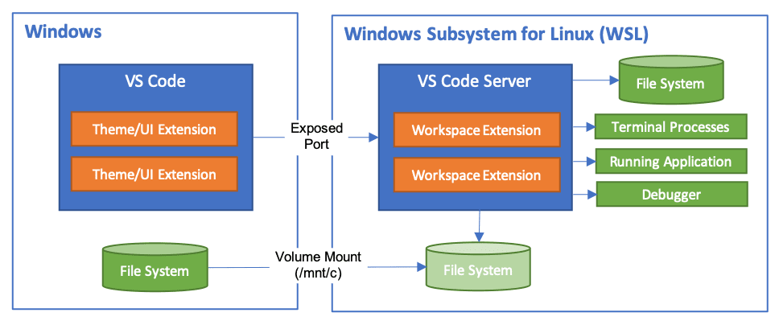
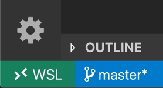
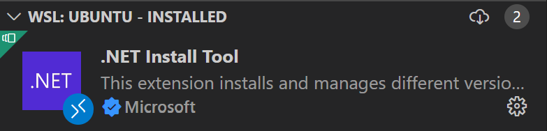
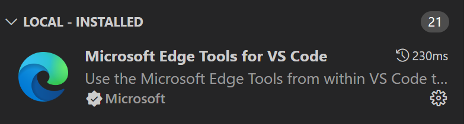
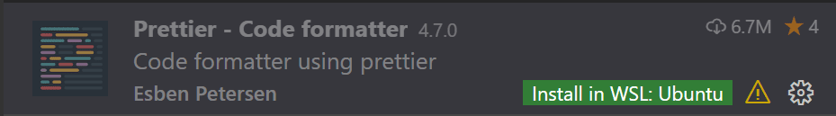
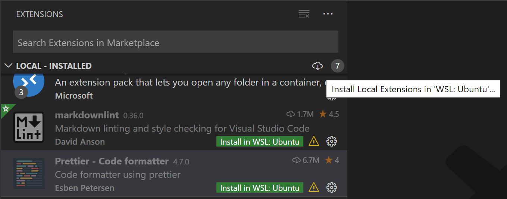
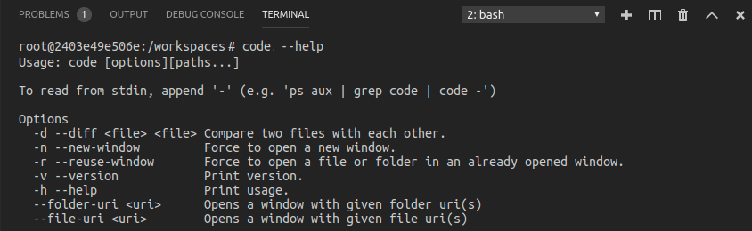
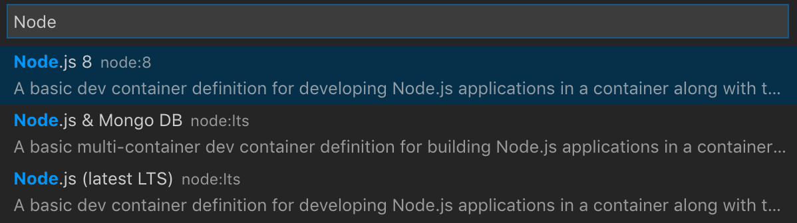
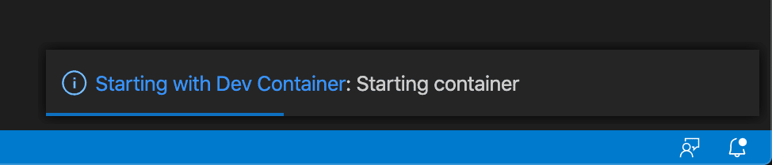

+++
title = "8.6 在 WSL 中开发"
date = 2026-11-06T07:53:25+08:00
weight = 6
type = "docs"
description = ""
isCJKLanguage = true
draft = false
+++


> 原文链接: [https://code.visualstudio.com/docs/remote/wsl](https://code.visualstudio.com/docs/remote/wsl)

# 8.6 在 WSL 中开发

　　**Visual Studio Code WSL** 扩展允许你直接在 VS Code 中使用 [Windows Subsystem for Linux（WSL）](https://learn.microsoft.com/windows/wsl)作为全职开发环境。你可以在基于 Linux 的环境中开发，使用 Linux 专用的工具链和实用程序，并在 Windows 中运行和调试基于 Linux 的应用程序。

　　扩展会直接在 WSL 中运行命令和其他扩展，因此你可以编辑位于 WSL 或已挂载 Windows 文件系统（例如 `/mnt/c`）中的文件，而无需担心路径、二进制兼容性或其他跨操作系统问题。扩展会在 WSL 内安装 VS Code Server，该服务器独立于 WSL 中现有的任何 VS Code 安装。



　　这让 VS Code 能够**无论代码托管在哪里**，都提供**本地品质的开发体验**，包括完整的 IntelliSense（补全）、代码导航和调试。

## 入门 {#getting-started}

> **注意**：阅读本主题后，可以通过入门 [8.7 WSL 远程开发教程](../8.7-WSLTutorial/)开始实践。

### 安装 {#installation}

1. 安装 [Windows Subsystem for Linux](https://learn.microsoft.com/windows/wsl/install) 以及首选的 Linux 发行版。

    > **注意**：WSL 1 对某些类型的开发存在[已知限制](#known-limitations)。此外，安装在 Alpine Linux 中的扩展可能因扩展内本机源代码的 `glibc` 依赖而无法工作。详见[8.10 Linux 前提条件](../8.10-LinuxPrerequisites/)。

2. 在 **Windows** 侧（而不是 WSL 中）安装 [Visual Studio Code](https://code.visualstudio.com/)。

    > **注意**：安装时如果提示**选择附加任务**，请务必勾选 **添加到 PATH**，以便使用 `code` 命令在 WSL 中打开文件夹。

3. 安装 [WSL 扩展](https://marketplace.visualstudio.com/items?itemName=ms-vscode-remote.remote-wsl)。如果计划使用其他远程扩展，可以安装[远程开发扩展包](https://aka.ms/vscode-remote/download/extension)。

### 打开远程文件夹或工作区 {#open-a-remote-folder-or-workspace}

#### 从 WSL 终端打开 {#from-the-wsl-terminal}

1. 打开 **WSL 终端窗口**（使用开始菜单项，或在命令提示符/PowerShell 中输入 `wsl`）。

2. 导航到要在 VS Code 中打开的文件夹（包括但不限于 `/mnt/c` 等 Windows 文件系统挂载点）。

3. 在终端中输入 **`code .`**。首次执行时，VS Code 会获取在 WSL 中运行所需的组件，这只需很短时间且仅需一次。

    > **注意**：如果此命令不起作用，可能需要重新启动终端，或者安装 VS Code 时没有将其添加到 PATH。

4. 片刻后会出现新的 VS Code 窗口，并显示正在 WSL 中打开文件夹的通知。

    

5. 完成后，左下角会显示 WSL 指示器，你可以像平常一样使用 VS Code。在此窗口中执行的所有 VS Code 操作都会在 WSL 环境中运行，包括编辑、文件操作、调试和使用终端等。

    

#### 从 VS Code 打开 {#from-vs-code}

1. 启动 VS Code。
2. 按 `F1`，选择 **WSL: Connect to WSL** 连接默认发行版，或选择 **WSL: Connect to WSL using Distro** 连接特定发行版。
3. 使用文件菜单打开文件夹。

　　如果已经打开文件夹，也可以使用 **WSL: Reopen Folder in WSL** 命令，系统会提示选择发行版。如果在 WSL 窗口中并想在本地窗口打开当前输入，请使用 **WSL: Reopen in Windows**。

#### 从 Windows 命令提示符打开 {#from-the-windows-command-prompt}

　　要通过 Windows 提示符打开 WSL 窗口，请使用 `--remote` 命令行参数：

`code --remote wsl+<distro name> <path in WSL>`

　　例如：`code --remote wsl+Ubuntu /home/jim/projects/c`

　　系统会猜测输入路径是文件还是文件夹。如果路径有文件扩展名，则视为文件。要强制打开文件夹，请在路径后添加斜杠，或使用：

`code --folder-uri vscode-remote://wsl+Ubuntu/home/ubuntu/folder.with.dot`

　　要强制打开文件，请添加 `--goto`，或使用：

`code --file-uri vscode-remote://wsl+Ubuntu/home/ubuntu/fileWithoutExtension`

## 使用 Git {#working-with-git}

　　如果在 WSL 和 Windows 中处理同一个仓库，请确保设置一致的行尾符。详见[8.11 提示和技巧](../8.11-TipsAndTricks/#resolving-git-line-ending-issues-in-wsl-resulting-in-many-modified-files)。也可以配置 WSL 使用 Windows Git 凭据管理器来避免输入密码，详见[8.11 提示和技巧](../8.11-TipsAndTricks/#sharing-git-credentials-between-windows-and-wsl)。

## 管理扩展 {#managing-extensions}

　　VS Code 在本地 UI/客户端侧或 WSL 中运行扩展。影响 VS Code UI 的扩展（例如主题和代码片段）安装在本地，大多数扩展则驻留在 WSL 中。从扩展视图安装扩展时，它会自动安装到正确位置。安装后，可以通过类别分组判断安装位置，包括 **本地 - 已安装** 类别和 WSL 类别。





　　需要远程运行的本地扩展会在 **本地 - 已安装** 类别中显示为灰色并禁用。选择 **安装** 将其安装到远程主机。



　　也可以转到扩展视图，在 **本地 - 已安装** 标题栏右侧使用云按钮，选择 **Install Local Extensions in WSL: {Name}**，然后从下拉列表中选择要安装到 WSL 实例的本地扩展。



## 在 WSL 中打开终端 {#opening-a-terminal-in-wsl}

　　在 WSL 中打开文件夹后，在 VS Code 中打开的任何终端窗口（**终端 > 新建终端**）都会自动在 WSL 中运行。你也可以在同一终端窗口中使用 `code` 命令在 WSL 中打开新文件或文件夹。输入 `code --help` 查看可用选项。



### 通过现有 SSH 连接使用 WSL {#using-wsl-over-an-existing-ssh-connection}

　　可以通过 Remote - SSH 连接到远程 Windows 机器上的 WSL 发行版，而无需在 WSL 内设置 SSH 服务器。

　　开始前，请确保远程 Windows 机器上安装了 WSL 和目标 Linux 发行版，并且本地安装了 WSL 扩展和 Remote - SSH 扩展。

1. 使用 Remote - SSH 连接到远程 Windows 机器，而不是直接连接到 WSL 发行版。
2. 在 SSH 连接的窗口中打开命令面板（`Ctrl + Shift + P`），运行 **WSL: Connect to WSL using Distro...**。
3. 选择远程 Windows 机器上的目标 WSL 发行版。

## 在 WSL 中调试 {#debugging-in-wsl}

　　在 WSL 中打开文件夹后，可以像本地运行应用程序一样使用 VS Code 调试器。例如，在 `launch.json` 中选择启动配置并开始调试（`F5`），应用程序会在远程主机上启动并附加调试器。详见[6.1 调试代码](../../debugging-and-testing/6.1-Debugging/)。

## WSL 特定设置 {#wsl-specific-settings}

　　在 WSL 中打开文件夹时，本地用户设置也会被复用。要区分设置，可以在连接后从命令面板（`F1`）运行 **Preferences: Open Remote Settings**，或在设置编辑器中选择 **远程** 选项卡。这些设置会覆盖本地设置。

## 高级：环境设置脚本 {#advanced-environment-setup-script}

　　在 WSL 中启动 VS Code 远程时，不会运行 shell 启动脚本，以避免为 shell 调整的启动脚本引发问题。如果要运行其他命令或修改环境，可以在设置脚本 `~/.vscode-server/server-env-setup`（Insiders：`~/.vscode-server-insiders/server-env-setup`）中完成。如果该脚本存在，会在启动服务器之前处理。

　　脚本必须是有效的 Bourne shell 脚本。无效脚本会阻止服务器启动；如果出现这种情况，请使用普通 WSL shell 删除或重命名设置脚本。检查 WSL 日志（**WSL: Show Log**）以查看输出和错误。

## 高级：在容器中打开 WSL 2 文件夹 {#advanced-opening-a-wsl-2-folder-in-a-container}

　　如果使用 WSL 2 和 [Docker Desktop 的 WSL 2 后端](https://docs.docker.com/docker-for-windows/wsl-tech-preview/)，可以使用 [8.5 开发容器](../8.5-DevContainers/) 扩展处理 WSL 内的源代码。

1. 安装并设置 Docker Desktop 的 WSL 2 支持。在 **设置 > 资源 > WSL 集成** 中启用与所用 WSL 发行版的 Docker 集成。
2. 安装 Dev Containers 扩展和 WSL 扩展。
3. 像平常一样[在 WSL 中打开源代码文件夹](#open-a-remote-folder-or-workspace)。
4. 在命令面板（`F1`）中选择 **Dev Containers: Reopen in Container**。
5. 如果文件夹中没有 `.devcontainer/devcontainer.json`，系统会要求从可筛选列表或现有 Dockerfile/Docker Compose 文件中选择起点。

    

6. VS Code 窗口会重新加载并开始构建开发容器，进度通知会显示状态。

    

7. 构建完成后，VS Code 会自动连接到容器，你可以在容器内处理源代码。

## 已知限制 {#known-limitations}

　　本节列出 WSL 的常见问题，并非完整列表。与 WSL 相关的活动问题请参阅[此处](https://aka.ms/vscode-remote/wsl/issues)。

### 在 WSL 1 中重命名文件夹时出现 EACCES: permission denied {#i-see-eacces-permission-denied-error-trying-to-rename-a-folder-in-the-open-workspace-in-wsl-1}

　　这是 WSL 文件系统实现的已知问题（[Microsoft/WSL#3395](https://github.com/microsoft/WSL/issues/3395)、[Microsoft/WSL#1956](https://github.com/microsoft/WSL/issues/1956)），由 VS Code 启用的文件监视程序引起，只会在 WSL 2 中修复。可以通过将 `remote.WSL.fileWatcher.polling` 设置为 true 来避免，但轮询文件监视会对大型工作区产生性能影响。对于大型工作区，可以增加轮询间隔 `remote.WSL.fileWatcher.pollingInterval`，并控制监视的文件夹 `files.watcherExclude`。WSL 2 没有此文件监视问题。

### WSL 1 中的 Golang {#golang-in-wsl-1}

| 问题 | 现有问题 |
|---|---|
| Delve 调试器在 WSL 下不工作 | [go-delve/delve#810](https://github.com/go-delve/delve/issues/810)、[Microsoft/vscode-go#926](https://github.com/microsoft/vscode-go/issues/926) |

### WSL 1 中的 Node.js {#nodejs-in-wsl-1}

| 问题 | 现有问题 |
|---|---|
| NodeJS 错误：spawn EACCES（多种变体） | [Microsoft/WSL#3886](https://github.com/microsoft/WSL/issues/3886) |
| Webpack HMR 不工作 | [Microsoft/WSL#2709](https://github.com/microsoft/WSL/issues/2709) |
| 仅在 WSL 上通过 node 使用 Firebase 慢得无法使用 | [Microsoft/WSL#2657](https://github.com/microsoft/WSL/issues/2657) |

### Git 限制 {#git-limitations}

　　如果使用 SSH 克隆 Git 仓库且 SSH 密钥有密码短语，VS Code 的拉取和同步功能在远程运行时可能挂起。请使用无密码短语的 SSH 密钥、使用 HTTPS 克隆，或在命令行运行 `git push`。

### Container Tools 扩展限制 {#container-tools-extension-limitations}

　　如果 Container Tools 扩展已在本地安装，则必须先卸载它，才能安装到远程 SSH 主机。此问题将在未来的 VS Code 版本中解决。

### 扩展限制 {#extension-limitations}

　　许多扩展无需修改即可在 WSL 中工作。如果遇到扩展问题，请参阅[8.11 提示和技巧](../8.11-TipsAndTricks/)，并在报告问题时告知扩展作者。使用基于 Alpine Linux 的发行版时，某些扩展可能因扩展内本机代码的 `glibc` 依赖而无法工作。

## 常见问题 {#common-questions}

### 为什么要求我更改默认发行版？ {#why-am-i-asked-to-change-the-default-distro}

　　在 Windows 10 2019 年 5 月更新（版本 1903）之前的 WSL 上使用 **WSL: Connect to WSL using Distro** 时，系统会要求切换**默认发行版**，因为 WSL 命令还不支持 `-d` 选项。可以随时使用 [wslconfig.exe](https://learn.microsoft.com/windows/wsl/wsl-config) 手动切换默认发行版：

```bat
wslconfig /setdefault Ubuntu
```

　　运行以下命令可以查看已安装的发行版：

```bat
wslconfig /l
```

### 我看到缺少库或依赖项的错误 {#im-seeing-an-error-about-a-missing-library-or-dependency}

　　某些扩展依赖特定 WSL Linux 发行版默认安装中不存在的库。可以使用发行版的包管理器添加库。对于 Ubuntu 和 Debian，运行 `sudo apt-get install <package>`。

### WSL 扩展的连接要求是什么？ {#what-are-the-connectivity-requirements-for-the-wsl-extension}

　　WSL 扩展和 VS Code Server 需要出站 HTTPS（端口 443）连接到：

- `update.code.visualstudio.com`
- `vscode.download.prss.microsoft.com`
- `marketplace.visualstudio.com`
- `*.gallerycdn.vsassets.io`（Azure CDN）

　　某些扩展（如 C#）会从 `download.microsoft.com` 或 `download.visualstudio.microsoft.com` 下载次要依赖。服务器与客户端之间的其他通信通过随机本地 TCP 端口完成。

### 我在代理后面，遇到连接问题 {#im-behind-a-proxy-and-have-connectivity-issues}

　　代理设置可能在 Windows 或 WSL 侧缺失。从 VS Code 打开远程窗口时，WSL 扩展会尝试在 Windows 侧下载 VS Code Server，因此使用 Windows 侧代理配置。从 WSL 终端启动远程 VS Code 时，下载使用 WSL 发行版中的 `wget`，可在 wget 代理设置或服务器设置脚本中配置代理。服务器运行后，将使用 **远程** 选项卡上的代理设置。

### 远程安装的扩展无法连接到 Internet {#extensions-fail-to-connect-to-the-internet-when-installed-remotely}

　　远程扩展使用的本地代理配置在远程环境中可能无效。解决方法：在远程环境中打开设置并选择 **远程** 选项卡；禁用 **Http: Use Local Proxy Configuration**（`http.useLocalProxyConfiguration`）；确保远程环境可以访问 Internet，如有需要，在 **远程** 设置中配置 **Http: Proxy**（`http.proxy`），或在启动远程服务器的环境中设置 `HTTP_PROXY` 或 `HTTPS_PROXY`。更改环境变量后请重新启动远程服务器。

### 可以强制扩展在本地/远程运行吗？ {#can-i-force-an-extension-to-run-locally-remotely}

　　如果扩展支持，可以在 `settings.json` 中强制其在特定位置运行：

```json
"remote.extensionKind": {
    "ms-azuretools.vscode-containers": [ "ui" ],
    "ms-vscode-remote.remote-ssh-edit": [ "workspace" ]
}
```

　　`"ui"` 会强制扩展在本地 UI/客户端侧运行。除非扩展文档另有说明，否则通常只用于测试，因为它**可能破坏扩展**。

### 作为扩展作者，我需要做什么？ {#as-an-extension-author-what-do-i-need-to-do}

　　VS Code 扩展 API 抽象了本地/远程细节，因此大多数扩展无需修改即可工作。建议测试扩展以确保无需更新。详见[支持远程开发](https://code.visualstudio.com/api/advanced-topics/remote-extensions)。

## 问题或反馈 {#questions-or-feedback}

- 请参阅[8.11 提示和技巧](../8.11-TipsAndTricks/#wsl-tips)或[8.12 常见问题](../8.12-FAQ/)。
- 在 [Stack Overflow](https://stackoverflow.com/questions/tagged/vscode-remote) 上搜索。
- 添加[功能请求](https://aka.ms/vscode-remote/feature-requests)或[报告问题](https://aka.ms/vscode-remote/issues/new)。
- 为[文档](https://github.com/microsoft/vscode-docs)或 [VS Code 本身](https://github.com/microsoft/vscode)贡献力量。
