+++
title = "8.7 WSL 远程开发教程"
date = 2026-11-06T07:53:25+08:00
weight = 7
type = "docs"
description = ""
isCJKLanguage = true
draft = false
+++


> 原文链接: [https://code.visualstudio.com/docs/remote/wsl-tutorial](https://code.visualstudio.com/docs/remote/wsl-tutorial)

# 8.7 WSL 远程开发教程

　　本教程将指导你启用 [Windows Subsystem for Linux](https://learn.microsoft.com/windows/wsl/install)（WSL），并使用 [WSL](https://marketplace.visualstudio.com/items?itemName=ms-vscode-remote.remote-wsl) 扩展在 WSL 中运行 Visual Studio Code。

## 前提条件 {#prerequisites}

　　你需要安装 [Visual Studio Code](https://code.visualstudio.com/)。

### 安装扩展 {#install-the-extension}

　　WSL 扩展让你可以在 Windows Subsystem for Linux 中运行 VS Code。安装扩展后，状态栏最左侧会出现一个新项。

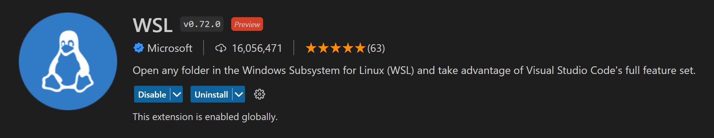

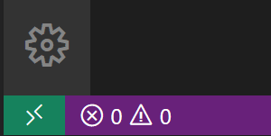

　　远程状态栏项可以快速显示 VS Code 运行在哪个上下文（本地或远程），单击它会打开 WSL 扩展命令。

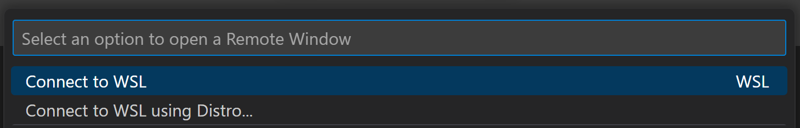

## 启用 WSL {#enable-wsl}

　　Windows Subsystem for Linux 是 Windows 10 的可选功能，可以通过 Windows 功能对话框或 PowerShell 启用。

### Windows 功能对话框 {#windows-features-dialog}

　　在 Windows 搜索栏中输入“features”，打开 **启用或关闭 Windows 功能** 对话框。向下滚动并勾选 **Windows Subsystem for Linux**。

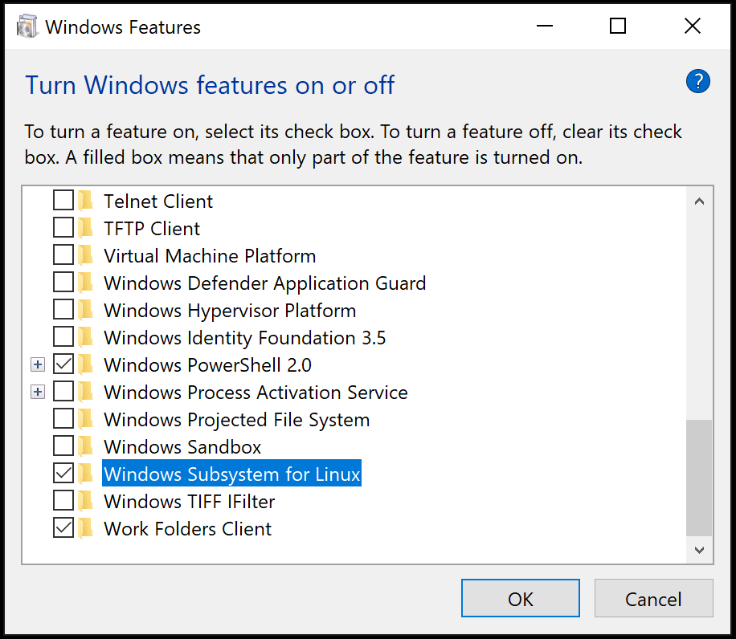

　　选择 **确定**，系统会提示重新启动 Windows。

### PowerShell {#powershell}

　　以管理员身份打开 PowerShell 并输入：

```powershell
Enable-WindowsOptionalFeature -Online -FeatureName Microsoft-Windows-Subsystem-Linux
```

　　命令运行后，系统会提示重新启动 Windows。

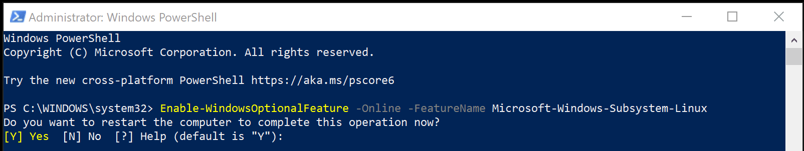

### 检查 WSL {#check-wsl}

　　重新启动 Windows 后，打开命令提示符并输入 `wsl`，确认 WSL 已启用。

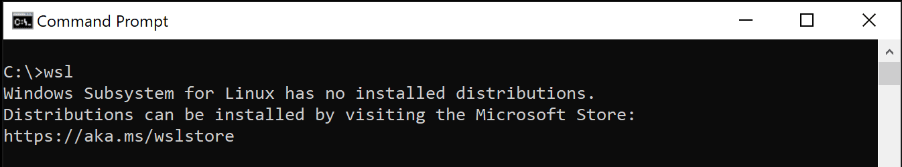

　　WSL 已启用，但尚未安装 Linux 发行版。

## 安装 Linux 发行版 {#install-a-linux-distro}

　　从 Microsoft Store 安装适用于 WSL 的 Linux 发行版。可以使用商店应用，或在 Windows 搜索栏中搜索 Linux 发行版。选择要安装的发行版（例如 Ubuntu），按照提示选择 **安装**，完成后选择 **启动**。这会打开 Linux 终端并完成安装。你需要创建用户 ID 和密码，因为正在设置完整的 Linux 实例。

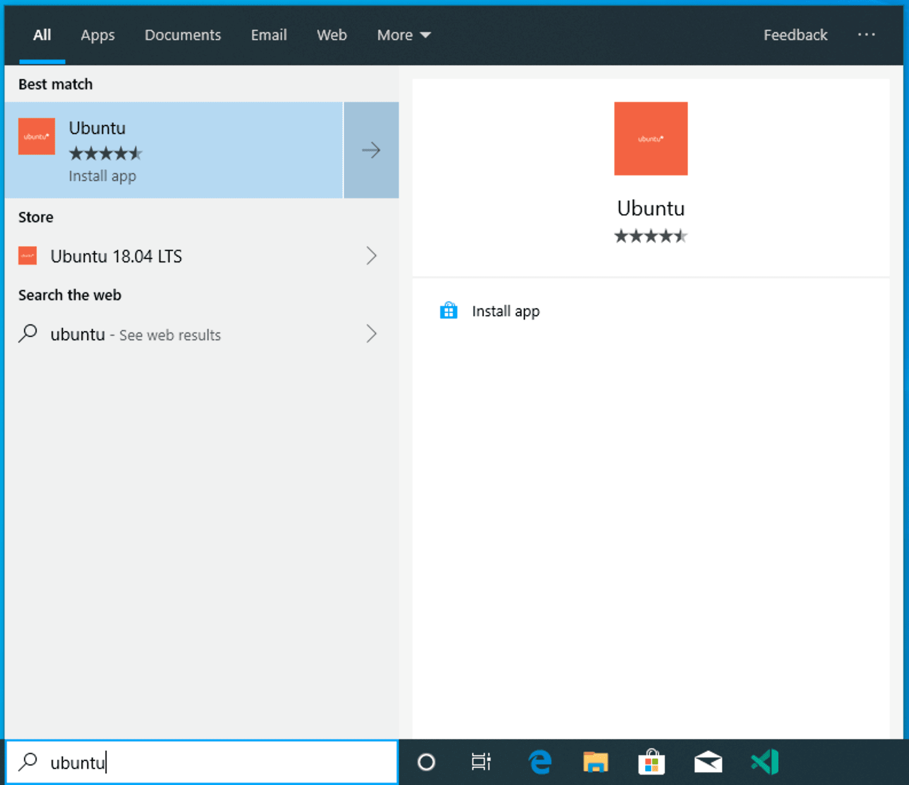

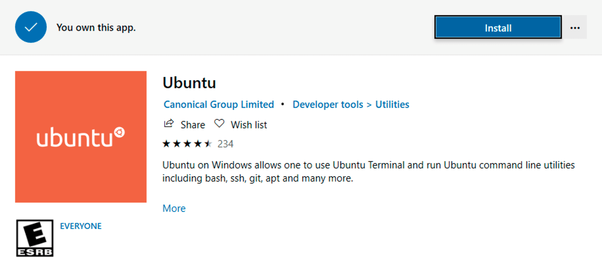

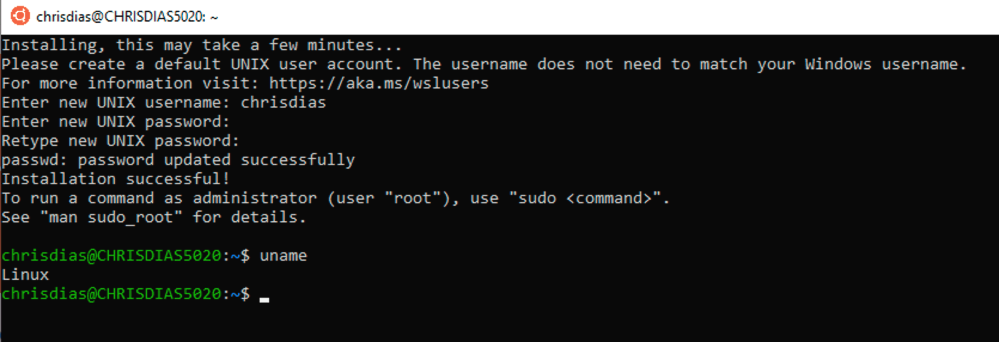

## Python 开发 {#python-development}

　　如果尚未安装 Python，请运行以下命令在 Linux 安装中安装 Python3 和 Python 包管理器 pip：

```bash
sudo apt update
sudo apt install python3 python3-pip
```

　　运行以下命令验证：

```bash
python3 --version
```

　　创建一个名为 `helloWorld` 的文件夹，并添加一个打印消息的 Python 文件：

```bash
mkdir helloWorld && cd helloWorld
echo 'print("hello from python on ubuntu on windows!")' >> hello.py
python3 hello.py
```

　　在远程 Linux 环境中，开发工具和体验相当有限。可以在终端中运行 Vim 编辑文件，也可以通过 `\\wsl$` 挂载在 Windows 侧编辑源文件：

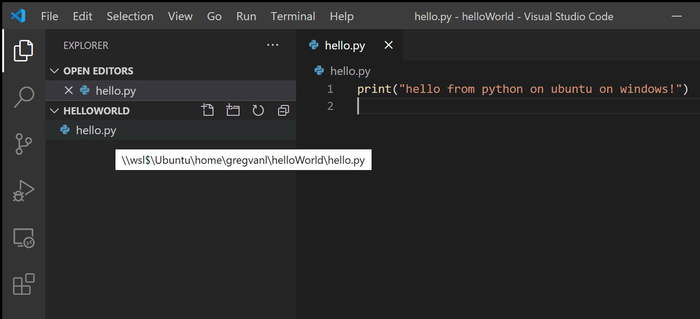

　　问题在于 Python 运行时、pip 或 conda 软件包并未安装在 Windows 上。如果只希望编辑文件而不运行 Python，这种方式可以使用；但如果要在 Windows 侧运行或调试这些文件，就必须在 Windows 上安装相同的 Python 开发环境，这违背了使用隔离 Linux 实例的初衷。

## 在 WSL 中运行 {#run-in-wsl}

　　在 WSL 终端中确保位于 `helloWorld` 文件夹，输入 `code .` 启动 VS Code。`.` 参数告诉 VS Code 打开当前文件夹。如果使用 Insiders 版本，请改用 `code-insiders .`。

> **注意**：如果此命令不起作用，可能需要重新启动终端，或者安装 VS Code 时没有将其添加到 PATH。

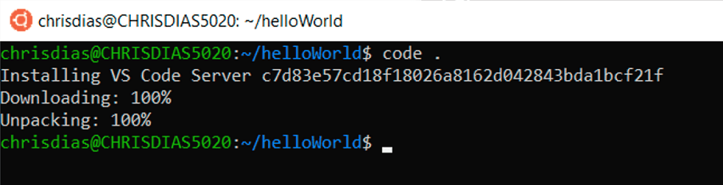

　　首先会看到“正在安装 VS Code Server”的消息。VS Code 会在 Linux 侧安装一个小型服务器，桌面版 VS Code 随后与其通信。该服务器会在 WSL 中安装并托管扩展，使其在 WSL 中安装的工具和框架上下文中运行。接下来，VS Code 会启动并打开 `helloWorld` 文件夹。可能会看到正在连接 WSL 的通知，并提示允许访问基于 Node.js 的服务器。

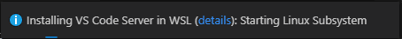

　　将鼠标悬停在 `hello.py` 上时，会看到正确的 Linux 路径。

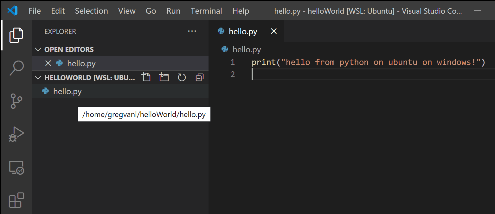

### 集成终端 {#integrated-terminal}

　　运行 **终端** > **新建终端**（`Ctrl + 反引号`）打开新的终端实例。你会在 WSL 中启动新的 bash shell 实例，而 VS Code 本身仍运行在 Windows 上。

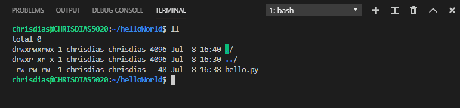

**提示**：状态栏左下角会显示你已连接到 **WSL: Ubuntu** 实例。

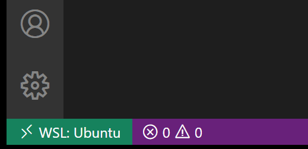

## 编辑和调试 {#edit-and-debug}

### 安装 Python 扩展（及其他工具） {#installing-the-python-extension-and-additional-tools}

　　单击 `hello.py` 打开编辑。系统会推荐安装 [Microsoft Python](https://marketplace.visualstudio.com/items?itemName=ms-python.python) 扩展，它提供丰富的编辑和调试体验。选择 **安装**，如有提示请重新加载。

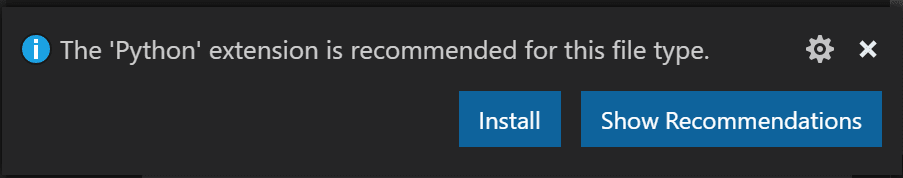

　　打开扩展视图（`Ctrl + Shift + X`），可以看到 **WSL: Ubuntu – 已安装** 部分，其中列出了安装在 WSL 侧的扩展。

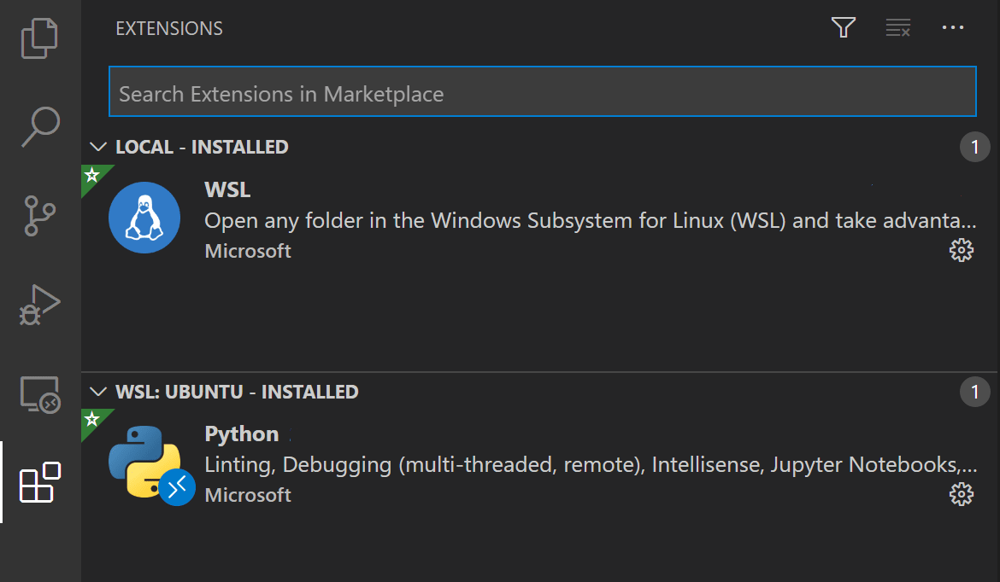

　　重新加载后，系统会提示未安装 pylint linter。选择 **安装**。

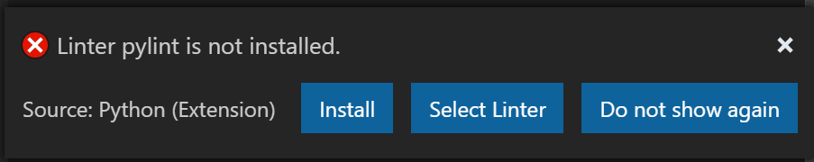

　　现在编辑代码时，可以获得丰富的着色和补全。

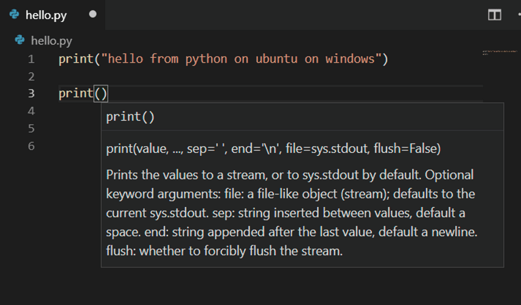

　　保存文件（`Ctrl + S`）后，文件会显示 lint 错误和警告。

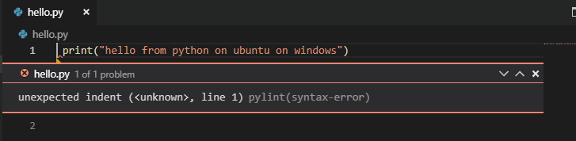

### 调试 {#debugging}

　　在 `hello.py` 第 1 行的行号左侧边距中单击，或将光标放在该行按 `F9` 设置断点。

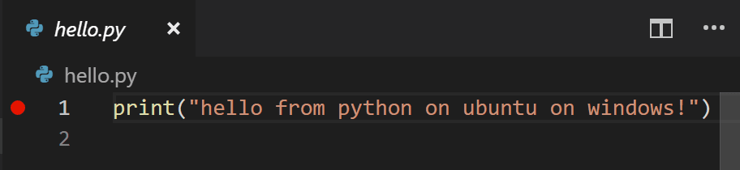

　　按 `F5` 运行应用程序。系统会询问如何运行，由于这是一个简单文件，请选择 **Python File**。

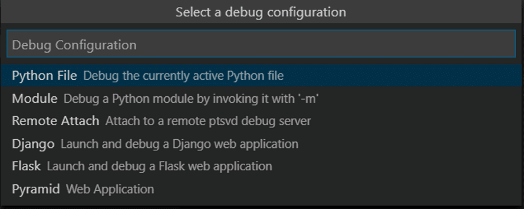

　　应用启动后会命中断点，可以检查变量、创建监视并导航调用堆栈。按 `F10` 单步执行，调试控制台中会显示 print 语句的输出。

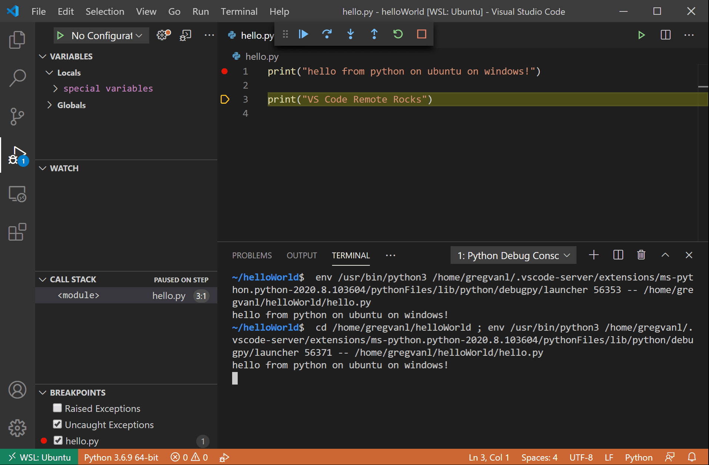

　　使用安装在 WSL 中的 Linux 实例，你可以获得完整的 VS Code 开发体验。

　　如果要在 WSL 中打开另一个文件夹，请从 **文件** 菜单中选择 **打开文件夹**。你会看到 Linux 文件系统的最小文件/文件夹导航器，而不是 Windows 文件系统。要切换回 Windows，请选择 **显示本地**，会打开标准的 Windows 文件打开对话框。

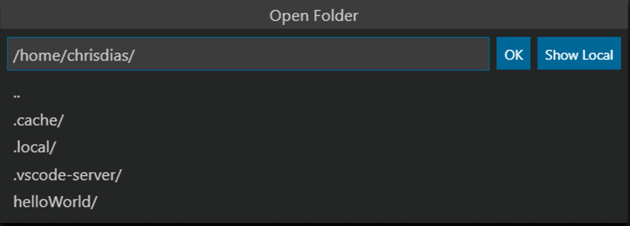

### 结束 WSL 连接 {#ending-your-wsl-connection}

　　通过 **文件** > **关闭远程连接** 结束 WSL 会话并返回本地 VS Code。

### 恭喜 {#congratulations}

　　你已成功完成本教程！接下来可以查看其他远程开发扩展：[Remote - SSH](https://marketplace.visualstudio.com/items?itemName=ms-vscode-remote.remote-ssh) 和 [Dev Containers](https://marketplace.visualstudio.com/items?itemName=ms-vscode-remote.remote-containers)，或安装[远程开发](https://marketplace.visualstudio.com/items?itemName=ms-vscode-remote.vscode-remote-extensionpack)扩展包。
