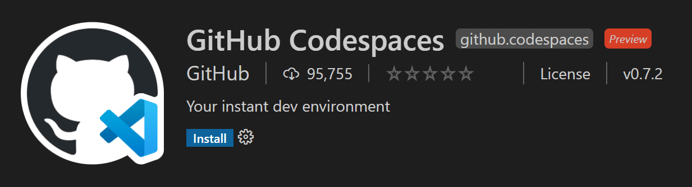
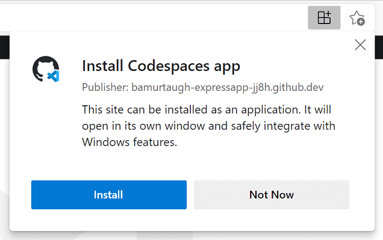
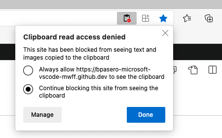
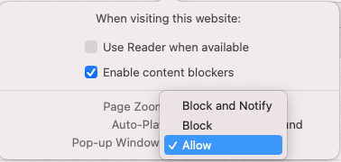

+++
title = "8.8 GitHub Codespaces"
date = 2026-11-06T07:53:25+08:00
weight = 8
type = "docs"
description = ""
isCJKLanguage = true
draft = false
+++

> 原文链接: [https://code.visualstudio.com/docs/remote/codespaces](https://code.visualstudio.com/docs/remote/codespaces)

# 8.8 GitHub Codespaces

　　[GitHub Codespaces](https://github.com/features/codespaces) 为任何活动提供云驱动的开发环境，无论是长期项目还是审查拉取请求这类短期任务。你可以在 VS Code 或基于浏览器的编辑器中使用这些环境。

## 环境 {#environments}

　　环境是 GitHub Codespaces 的“后端”部分，所有与软件开发相关的计算都在这里进行：编译、调试、还原等。需要处理新项目、开始新任务或审查 PR 时，只需启动云托管环境，GitHub Codespaces 会负责正确配置源代码、运行时、编译器、调试器、编辑器、自定义 dotfile 配置、相关编辑器扩展等。

## 自定义 {#customization}

　　GitHub Codespaces 可以按项目完全自定义。在项目仓库中包含 `devcontainer.json` 文件即可，类似于 VS Code [8.5 开发容器](../8.5-DevContainers/)。自定义示例包括：

* 设置要使用的基于 Linux 的操作系统。
* 自动安装各种工具、运行时和框架。
* 转发常用端口。
* 设置环境变量。
* 配置编辑器设置并安装首选扩展。

　　请参阅[配置 Codespaces](https://docs.github.com/github/developing-online-with-codespaces/configuring-codespaces-for-your-project) 文档，了解 codespace 特定的 `devcontainer.json` 设置。

## 每用户 dotfile 配置 {#dotfile-per-user-configuration}

　　dotfile 是文件名以点（`.`）开头的文件，通常包含应用程序配置信息，可以控制终端、编辑器、源代码管理和其他工具的行为，例如 `.bashrc`、`.gitignore` 和 `.editorconfig`。创建 codespace 时，可以指定包含 dotfile 的 GitHub 仓库、文件的目标位置以及安装命令。请参阅[个性化 Codespaces](https://docs.github.com/github/developing-online-with-codespaces/personalizing-codespaces-for-your-account) 文档。

## 入门 {#getting-started}

* [VS Code 中的 Codespaces](https://docs.github.com/github/developing-online-with-codespaces/using-codespaces-in-visual-studio-code)：使用 [GitHub Codespaces](https://marketplace.visualstudio.com/items?itemName=GitHub.codespaces) 扩展连接环境。
* [浏览器中的 Codespaces](https://docs.github.com/github/developing-online-with-codespaces/creating-a-codespace)：通过基于浏览器的编辑器连接 codespace。

## 扩展作者 {#extension-authors}

　　VS Code 扩展 API 隐藏了远程运行的大多数实现细节，因此许多扩展无需修改即可在 GitHub Codespaces 中工作。建议在 codespace 中测试扩展。详见[支持远程开发和 GitHub Codespaces](https://code.visualstudio.com/api/advanced-topics/remote-extensions)。

## 基于浏览器的编辑器 {#browser-based-editor}

　　你还可以获得完全在浏览器中运行的免费轻量级 VS Code 体验。基于 Web 的编辑器可以安全快速地浏览 GitHub 源代码仓库并进行轻量级代码更改。可以打开任何仓库、fork 或拉取请求，并具有搜索和语法突出显示等许多 VS Code 功能。如果要运行或调试代码，可以切换到云托管环境或 VS Code 桌面版。

　　在 github.com 上打开仓库并按 `.`（句点键），或将仓库 URL 中的 `github.com` 改为 `github.dev`（`github.dev/org/repo`），即可访问此编辑器。

　　限制：如果浏览器处于无痕模式或启用了广告拦截器，可能无法使用基于 Web 的编辑器。

> **注意**：此编辑器目前处于技术预览阶段。你可以在 [https://github.co/browser-editor-feedback](https://github.co/browser-editor-feedback) 提供反馈。

## 已知限制和适配 {#known-limitations-and-adaptations}

　　在 Codespaces 中工作时，尤其是通过 Web 使用 VS Code 时，存在一些限制。对于若干问题（特别是键盘快捷键或桌面版有替代方案的问题），可以将 Codespace 安装为[渐进式 Web 应用](https://learn.microsoft.com/microsoft-edge/progressive-web-apps-chromium)（PWA）。

| 问题 | 原因 | 替代方案 |
|-|-|-|
| Firefox 中 `Ctrl + Shift + P`（macOS：`Cmd + Shift + P`） 无法启动命令面板。 | 该快捷键在 Firefox 中已被保留。 | 使用 `F1` 启动命令面板。 |
| Web 中某些调试默认快捷键不同。 | 浏览器可能已为这些快捷键注册操作。 | 使用调整后的默认值：所有浏览器中单步跳过为 `Alt + F10`（而不是 `F10`）；Windows 浏览器中单步进入为 `Alt + F11`（而不是 `F11`）。 |
| macOS 上 Web 或桌面版的 `F11` 调试不工作。 | 已知限制，与浏览器无关。 | 在系统偏好设置中关闭 `F11` 显示桌面。 |
| Web 中 `Ctrl + N`（macOS：`Cmd + N`） 新建文件不工作。 | 会打开新窗口。 | 桌面版中可用。 |
| Web 中 `Ctrl + W`（macOS：`Cmd + W`） 关闭编辑器不工作。 | 会关闭浏览器选项卡。 | 桌面版中可用。 |
| `Ctrl + Shift + B`（macOS：`Cmd + Shift + B`） 不会切换浏览器收藏夹栏。 | Codespaces 会覆盖该快捷键并重定向到命令面板的“生成”菜单。 | 暂无替代方案。 |
| 无法在 VS Code 和 Codespace 之间拖放文件。 | 见 [issue #115535](https://github.com/microsoft/vscode/issues/115535)。 | 在 Codespace 中右键单击文件下载；或从文件资源管理器将文件拖到 Codespace。 |
| Web 中不支持 Angular 应用调试。 | 浏览器中的代码无法出于安全原因启动另一个浏览器实例。 | 正常调试 Node.js/服务端 JS；或在桌面版中打开 Codespace。 |
| 下载无扩展名文件时自动添加 `.txt`。 | Chrome 和 Edge 的行为。 | 见 [issue #118436](https://github.com/microsoft/vscode/issues/118436)。 |
| 下载文件时，可执行位等属性会被移除。 | 见 [issue #112099](https://github.com/microsoft/vscode/issues/112099)。 | 暂无替代方案。 |
| 从 Codespace 下载某些文件夹时提示包含系统文件。 | 浏览器对敏感目录的限制。 | 暂无其他替代方案。 |
| 手动访问 `http://localhost:forwarded_port` 无法打开 Web Codespace 转发的端口。 | Codespaces 会为 Web 生成正确 URL。 | 单击端口转发通知中的链接，或使用端口视图中的地球图标。 |
| 某些扩展在 Web 中行为不同。 | 浏览器限制或扩展依赖桌面环境。 | 使用桌面版 Codespace，或选择替代扩展。 |

### 某些扩展在 Web 中行为不同 {#some-extensions-behave-differently-in-the-web}

| 扩展 | 问题/原因 | 替代方案 |
|-|-|-|
| 与浏览器快捷键重叠的扩展，例如使用 `Ctrl + R` 刷新的 Git Graph。 | 可能与浏览器快捷键冲突，例如 Safari 中 `Ctrl + R` 刷新窗口。 | 使用桌面版 Codespace；不同浏览器行为可能不同。 |
| 语言包，例如日语语言包。 | Web Codespaces 目前不支持语言包扩展。 | 使用桌面版 Codespace 配置显示语言。 |
| Bracket Pair Colorizer 2。 | 在浏览器中引入无法轻易修复的安装位置依赖。 | 使用 Bracket Pair Colorizer。 |
| 浏览器调试器，例如 Debugger for Firefox。 | 需要 UI/桌面扩展宿主的扩展不会在浏览器中加载。 | 在本地 VS Code 中使用，或使用 Chrome DevTools。 |
| 打开浏览器的扩展，例如 open in browser。 | 需要 UI/桌面扩展宿主。 | 使用 Live Server 等替代扩展。 |
| Project Manager。 | 依赖同步自定义 `projects.json`，目前不支持。 | 在桌面版 Codespaces 或本地使用。 |
| 依赖 Chrome 的扩展，例如 Protractor Test Runner 和 Browser Preview。 | Codespace 中不包含 Chrome。 | 寻找替代方案，或在本地项目中使用。 |
| Flutter。 | Codespaces 容器中无法安装 snap；不支持 Android 模拟器、USB 设备和 iOS 开发。 | 使用本地 VS Code 进行 Flutter 开发。 |
| LaTeX Workshop。 | 某些视图和预览功能存在 Web 或安全限制。 | PDF 预览仅在浏览器选项卡中可用；其他功能可使用桌面版。 |
| Git Graph。 | 某些 Webview 功能在 Codespaces 中受限。 | 在桌面版 VS Code 中完整使用。 |
| 其他远程开发扩展（WSL、Dev Containers、Remote - SSH）。 | Codespace 已经是远程上下文。 | 在桌面版中打开其他远程上下文。 |
| 其他扩展。 | 远程上下文可能导致功能异常。 | 查看[8.11 提示和技巧](../8.11-TipsAndTricks/)。 |

## 常见问题 {#common-questions}

### 为什么扩展无法在浏览器中安装 {#why-is-an-extension-not-installable-in-the-browser}

　　少数扩展内置了桌面环境假设，或需要访问桌面版安装文件、可执行文件。尝试在浏览器中安装时会提示不可用。通过桌面版 VS Code 连接到 Codespace 时仍然可以使用这些扩展。

### 如何允许 VS Code 读取剪贴板 {#how-do-i-allow-vs-code-to-access-my-clipboard-for-reading}

　　在浏览器设置中搜索“站点权限”，或在地址栏右侧查找剪贴板访问选项并允许，然后重试操作。

### 如何允许 VS Code 始终打开新选项卡和窗口 {#how-do-i-allow-vs-code-to-always-open-new-tabs-and-windows}

　　通过浏览器导航栏的上下文菜单打开站点设置，允许**弹出式窗口**。

### 如何允许浏览器中的 VS Code 访问本地文件和文件夹 {#how-do-i-allow-vs-code-in-a-browser-to-access-local-files-and-folders}

　　浏览器需要支持 [File System Access API](https://developer.mozilla.org/en-US/docs/Web/API/File_System_Access_API)。Microsoft Edge 和 Google Chrome 提供此支持。

## 问题或反馈 {#questions-or-feedback}

　　如有问题，请参阅 GitHub Codespaces [故障排除指南](https://docs.github.com/github/developing-online-with-codespaces/troubleshooting-your-codespace)。反馈请提交到 [GitHub Codespaces 讨论区](https://github.com/community/community/discussions/categories/codespaces)。
