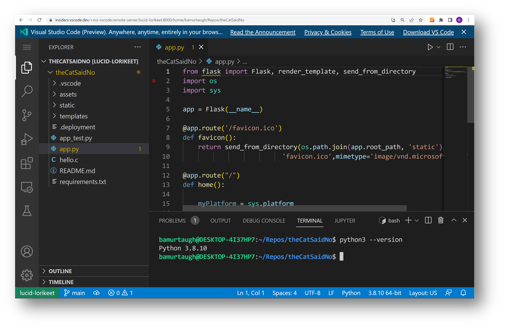
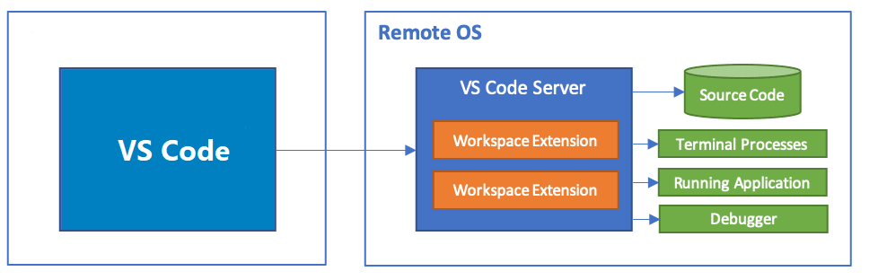
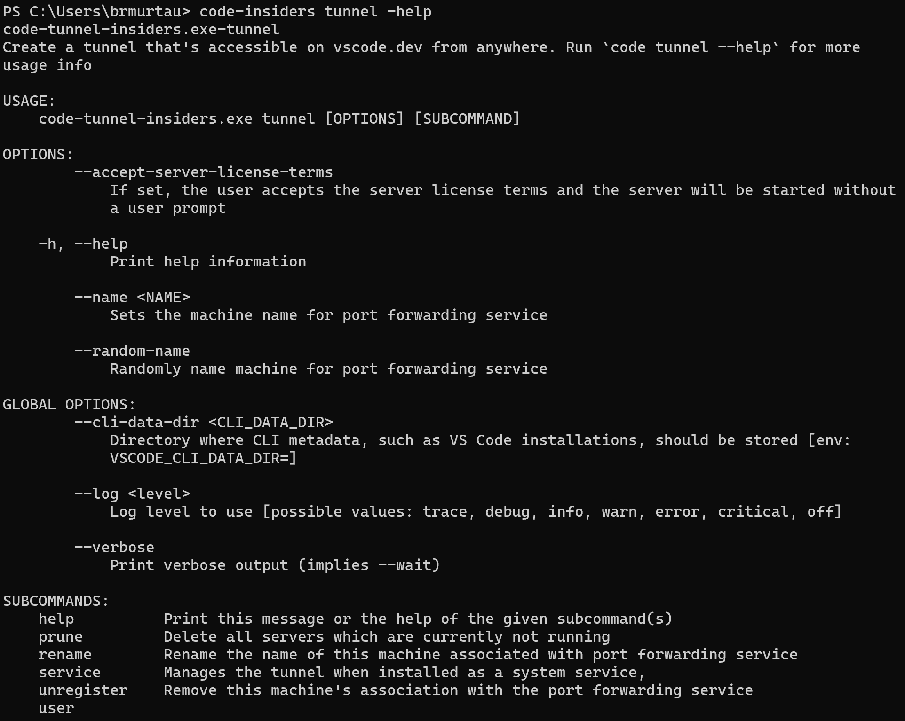

+++
title = "8.9 VS Code Server"
date = 2026-11-06T07:53:25+08:00
weight = 9
type = "docs"
description = ""
isCJKLanguage = true
draft = false
+++


> 原文链接: [https://code.visualstudio.com/docs/remote/vscode-server](https://code.visualstudio.com/docs/remote/vscode-server)

# 8.9 VS Code Server

　　Visual Studio Code Server 是一项可在远程开发计算机（例如台式电脑或虚拟机）上运行的服务。它允许你通过本地 VS Code 客户端从任何位置安全连接到该远程计算机，无需 SSH。

## 什么是 VS Code Server？ {#what-is-the-vs-code-server}

　　VS Code [8](./)允许你直接在 VS Code 中使用 Windows Subsystem for Linux（WSL）、通过 SSH 连接远程计算机以及开发容器。这些扩展会在远程环境上安装服务器，让本地 VS Code 能够与远程源代码和运行时顺畅交互。

　　现在我们还提供独立的 **VS Code Server**，它构建在远程扩展使用的同一底层服务器之上，并增加了交互式 CLI 以及促进与 vscode.dev 安全连接等额外功能。



## 体系结构 {#architecture}

　　无论你使用的是本地还是远程、桌面版还是浏览器，我们都希望提供统一的 VS Code 体验。VS Code Server 的访问已内置于现有的 [3.3.10 命令行界面](../../editor/3.3-ConfigureTheEditor/3.3.10-CommandLineInterface/#launching-from-command-line)中。

　　CLI 会在 VS Code 客户端和远程计算机之间建立隧道，从而在不同网络之间安全传输数据。



　　VS Code Server 体验包含几个组件：

* **VS Code Server**：使 VS Code 远程体验成为可能的后端服务器。
* [8.4 使用远程隧道开发](../8.4-Tunnels/)：自动加载到本地 VS Code 客户端，帮助连接到远程计算机。

## 场景 {#scenarios}

　　VS Code Server 允许你以新的方式使用 VS Code，例如：

* 在 SSH 支持有限或需要基于 Web 访问的远程计算机上开发。
* 在不支持安装 VS Code 桌面版的设备上开发，例如 iPad/平板电脑或 Chromebook。
* 体验客户端安全优势，所有代码都可以在浏览器沙盒中执行。

## 入门 {#getting-started}

* [8.4 使用远程隧道开发](../8.4-Tunnels/#using-the-code-cli)。
* [8.4 使用远程隧道开发](../8.4-Tunnels/#using-the-vs-code-ui)。

## 可以尝试的功能 {#things-to-try}

### 许可和其他命令 {#licensing-and-other-commands}

　　首次运行 VS Code Server 时，系统会提示你接受许可条款。可以[在此](https://aka.ms/vscode-server-license)查看 VS Code Server 许可证。

```bash
* Visual Studio Code Server
*
* 使用本软件即表示你同意
* Visual Studio Code Server 许可条款（https://aka.ms/vscode-server-license）以及
* Microsoft 隐私声明（https://privacy.microsoft.com/en-US/privacystatement）。
```

　　运行 `code -h` 可浏览 CLI 的其他命令，运行 `code tunnel -help` 可专门查看隧道命令：



### 扩展命令 {#extension-commands}

　　与 CLI 一样，VS Code Remote Tunnels 扩展还提供其他命令。在 VS Code 中打开命令面板（`F1`）并输入 **Remote Tunnels** 即可浏览。更多信息请参阅 [8.4 使用远程隧道开发](../8.4-Tunnels/)。

## 遥测 {#telemetry}

　　如果要禁用遥测，可以在启动 VS Code Server 时传入 `--disable-telemetry`：`code tunnel --disable-telemetry`。或者，如果要指定初始遥测级别（例如仅收集错误），可以传入 `--telemetry-level` 及级别（例如 `error`）。

　　如果未通过 CLI 禁用遥测，VS Code Server 会在成功连接后遵循客户端遥测设置（vscode.dev 或桌面版中的遥测设置）。

## 常见问题 {#common-questions}

### VS Code Server 是否设计为允许多个用户访问同一个远程实例？ {#is-the-vs-code-server-designed-for-multiple-users-to-access-the-same-remote-instance}

　　不是。服务器实例设计为仅供单个用户访问。

### 可以将 VS Code Server 作为服务托管吗？ {#can-i-host-the-vs-code-server-as-a-service}

　　不可以。根据 [VS Code Server 许可证](https://aka.ms/vscode-server-license)，不允许将其作为服务托管。

### 有 VS Code Server 使用的终结点列表吗？ {#is-there-a-list-of-endpoints-the-vs-code-server-uses}

　　如果在受限环境中工作，可能需要确保 VS Code Server 可以访问以下文章中的终结点：

* [9.6 网络连接](../../advanced-setup/9.6-Network/#common-hostnames)
* [8.2 使用 SSH 远程开发](../8.2-SSH/#what-are-the-connectivity-requirements-for-the-vs-code-server-when-it-is-running-on-a-remote-machine-vm)

### 还有其他扩展限制吗？ {#are-there-any-other-extension-limitations}

　　使用基于 Web 的 VS Code 实例时，不支持纯 UI 扩展。更多信息请参阅扩展作者的[远程开发](https://code.visualstudio.com/api/advanced-topics/remote-extensions#architecture-and-extension-kinds)指南。

### 有浏览器限制吗？ {#are-there-browser-limitations}

　　在浏览器中工作时，有一些限制和配置步骤。请参阅 [8.1 VS Code for the Web](../8.1-VSCodeForTheWeb/#additional-browser-setup) 文档。

### 如何让 VS Code Server 保持最新？ {#how-can-i-keep-the-vs-code-server-up-to-date}

　　连接到远程计算机时，如果有可用更新，VS Code 会显示通知，你可以直接通过通知进行更新。

### 我看到有关密钥环存储的错误，该怎么办？ {#i-see-an-error-about-keyring-storage-what-should-i-do}

　　设置同步需要针对设置同步服务器进行身份验证，相应的密钥保存在服务器上，这要求服务器上设置密钥环。如果未设置密钥环，VS Code Server 会回退到存储在服务器内存中的密钥；此时密钥仅在服务器生命周期内保留。[此问题](https://github.com/microsoft/vscode-remote-release/issues/8628)提供了更多背景和故障排除帮助。

### 在哪里提供反馈或报告问题？ {#where-can-i-provide-feedback-or-report-an-issue}

　　请在 [VS Code Remote GitHub 仓库](https://github.com/microsoft/vscode-remote-release/issues)中提交问题。提交时请包含详细日志，可以通过 `-v` 标志启动 VS Code Server 来启用：`code -v tunnel`。可以使用 [`code-server` 标签](https://github.com/microsoft/vscode-remote-release/issues?q=is%3Aissue+is%3Aopen+label%3Acode-server)筛选 VS Code Server 问题。
