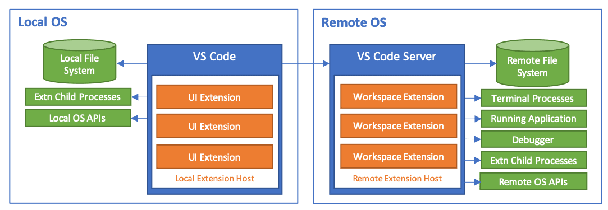

+++
title = "8 远程"
date = 2026-11-06T07:53:25+08:00
weight = 8
type = "docs"
description = ""
isCJKLanguage = true
draft = false
+++

> 原文链接: [https://code.visualstudio.com/docs/remote/remote-overview](https://code.visualstudio.com/docs/remote/remote-overview)

# 8 远程

　　**Visual Studio Code 远程开发**允许你将容器、远程计算机或 [Windows Subsystem for Linux](https://learn.microsoft.com/windows/wsl)（WSL）用作功能完备的开发环境。你可以：

- 在与部署目标**相同的操作系统**上开发，或使用**更大、更专用**的硬件。
- **隔离**开发环境，避免影响本地**计算机配置**。
- 让新贡献者轻松**上手**，并让所有人保持在**一致的环境**中。
- 使用本地操作系统**不可用**的工具或运行时，或管理它们的**多个版本**。
- 使用 **Windows Subsystem for Linux** 开发部署到 Linux 的应用程序。
- 从**多台计算机或位置**访问**现有**开发环境。
- 调试**在其他位置运行**的应用程序，例如客户现场或云中。

　　要获得这些优势，**源代码无需**位于本地计算机上。[远程开发扩展包](https://aka.ms/vscode-remote/download/extension)中的每个扩展都可以直接在容器、WSL 或远程计算机中运行命令和其他扩展，从而让一切像在本地运行一样。这些扩展会在远程操作系统上安装 VS Code Server，该服务器独立于远程操作系统上现有的任何 VS Code 安装。

## 入门 {#getting-started}

### 远程开发扩展包 {#remote-development-extension-pack}

　　[远程开发扩展包](https://aka.ms/vscode-remote/download/extension)包含四个扩展：

- [8.2 使用 SSH 远程开发](8.2-SSH/)：使用 SSH 打开远程计算机/虚拟机上的文件夹，连接到任何位置。
- [8.5 开发容器](8.5-DevContainers/)：在容器内部（或挂载到容器中）使用单独的工具链或基于容器的应用程序。
- [8.6 在 WSL 中开发](8.6-WSL/)：在 Windows Subsystem for Linux 中获得由 Linux 驱动的开发体验。
- [8.4 使用远程隧道开发](8.4-Tunnels/)：通过安全隧道连接到远程计算机，无需配置 SSH。

　　大多数 VS Code 扩展应该可以在远程环境中不加修改地工作。扩展作者可以在[支持远程开发](https://code.visualstudio.com/api/advanced-topics/remote-extensions)中了解更多信息。

## 远程教程 {#remote-tutorials}

| 教程 | 说明 |
| --- | --- |
| [8.3 SSH 远程开发教程](8.3-SSHTutorial/) | 使用 VS Code 通过 SSH 连接到远程和虚拟机。 |
| [8.7 WSL 远程开发教程](8.7-WSLTutorial/) | 在 Windows Subsystem for Linux 中运行 VS Code。 |
| [8.5 开发容器](8.5-DevContainers/) | 在 Docker 容器中运行 VS Code。 |
| [8.8 GitHub Codespaces](8.8-GitHubCodespaces/) | 使用 VS Code 连接到 codespace。 |

## GitHub Codespaces {#github-codespaces}

　　[8.8 GitHub Codespaces](8.8-GitHubCodespaces/) 提供为你管理的远程开发环境。你可以配置并创建托管在云端的开发环境，在需要时启动并使用它。

## 问题或反馈 {#questions-or-feedback}

- 请参阅[8.11 提示和技巧](8.11-TipsAndTricks/)或[8.12 常见问题](8.12-FAQ/)。
- 在 [Stack Overflow](https://stackoverflow.com/questions/tagged/vscode-remote) 上搜索。
- 添加[功能请求](https://aka.ms/vscode-remote/feature-requests)或[报告问题](https://aka.ms/vscode-remote/issues/new)。
