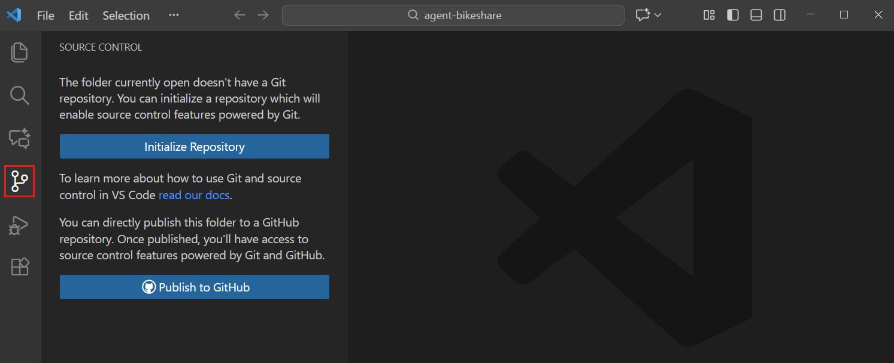

+++
title = "4.1 快速入门"
date = 2026-11-06T07:53:25+08:00
weight = 1
type = "docs"
description = ""
isCJKLanguage = true
draft = false
+++


> 原文链接: [https://code.visualstudio.com/docs/sourcecontrol/quickstart](https://code.visualstudio.com/docs/sourcecontrol/quickstart)

# 4.1 快速入门

　　创建一个练习用的小型仓库，将文件保存到 Git 历史记录中，并在 VS Code 中验证你的第一次提交。你不需要托管账户或现有项目。在线发布工作是可选的最后一步。

　　如果你想改为处理现有项目，请[4.2 仓库与远程](../4.2-ReposAndRemotes/#clone-repositories)，然后按照[4.3 暂存与提交](../4.3-StagingCommits/)操作。选择一个你可以推送的仓库，如果计划贡献更改，请先 [fork 它](https://docs.github.com/pull-requests/collaborating-with-pull-requests/working-with-forks/fork-a-repo)。

## 前提条件 {#prerequisites}

1. 安装 [Visual Studio Code](https://code.visualstudio.com/download) 和 [Git](https://git-scm.com/downloads)。

2. 在 VS Code 中，选择 **终端** > **新建终端**，然后检查 Git 是否可用：

    ```bash
    git --version
    ```

    你应该会看到 Git 版本号。如果找不到命令，请在安装 Git 后重新启动 VS Code。如果仍然失败，请参阅[4.8 故障排除](../4.8-Troubleshooting/)。

3. 为提交配置作者姓名和电子邮件。将占位符替换为你的详细信息：

    ```bash
    git config --global user.name "<your-name>"
    git config --global user.email "<your-email>"
    ```

    如果已经配置了身份，请跳过此步骤。这些值用于在 Git 历史记录中标识作者，而不是登录凭据。`--global` 选项为你的仓库设置默认值。如果你发布提交，作者信息也会共享。

## 第 1 步：打开项目 {#step-1-open-a-project}

1. 在现有 Git 仓库之外创建一个名为 `git-practice` 的空文件夹。

2. 使用 **文件** > **打开文件夹...** 在 VS Code 中打开该文件夹。

    如果出现提示，请确认你信任自己创建的此文件夹。只有在你了解来源时才信任其他项目。了解[3.2.8.3 WorkspaceTrust](../../editor/3.2-WriteCode/3.2.8-Workspaces/3.2.8.3-WorkspaceTrust/)。

3. 打开 **源代码管理** 视图（`Ctrl + Shift + G`），选择 **初始化仓库**。

    

    如果看不到该按钮，请打开命令面板（`Ctrl + Shift + P`），运行 **Git: Initialize Repository**。

　　你的文件夹现在是本地 Git 仓库。它还没有提交，也没有上传任何内容。

## 第 2 步：进行更改并审查 {#step-2-make-changes-and-review}

1. 在资源管理器视图（`Ctrl + Shift + E`）中，创建一个名为 `README.md` 的文件。

2. 添加以下内容并保存文件（`Ctrl + S`）：

    ```markdown
    # Git practice

    My first Git repository.
    ```

3. 打开 **源代码管理** 视图。`README.md` 出现在 **更改** 下，并标记为 **U**（未跟踪）。Git 可以看到新文件，但它不属于任何提交。

4. 在 **更改** 下选择 `README.md` 审查其内容。

    对于新文件，其所有内容都是新增的。对于 Git 已跟踪的文件，此视图会显示尚未暂存的编辑。

　　保存会将文件写入磁盘，但不会创建 Git 提交。

## 第 3 步：暂存并提交 {#step-3-stage-and-commit}

　　暂存会选择要包含在下一次提交中的文件版本。提交会将这些暂存的更改记录到本地 Git 历史记录中。

1. 将鼠标悬停在 **更改** 中的 `README.md` 上，选择 **+**（**暂存更改**）。

    文件会移到 **暂存的更改**。在此处选择它，审查将要提交的内容。

2. 在源代码管理视图顶部的提交消息输入框中输入 `Add practice README`。

3. 选择 **提交**。

    `README.md` 不再列为已更改。其内容仍在你的文件夹中，现在已记录在 Git 历史记录中。

4. 展开源代码管理视图中的 **源代码管理图**，找到 `Add practice README` 提交。

    选择该提交，检查其中包含的文件。这确认你的第一次提交已成功。

> **注意**：要在不丢失编辑的情况下将文件从暂存区移除，请选择 **暂存的更改** 中文件旁的 **-**（**取消暂存更改**）。这与删除编辑的 **放弃更改** 不同。在移除工作之前，请参阅[4.3 暂存与提交](../4.3-StagingCommits/#undo-or-discard-changes)。

　　你可以在此停止，继续在本地使用 Git。要再次练习，请向 `README.md` 添加一行，保存它，审查 **M**（已修改）条目，然后暂存并提交更改。

## 第 4 步：与服务器同步 {#step-4-sync-with-the-server}

　　此步骤是可选的，需要一个 GitHub 账户。发布会在你的账户中创建一个仓库，并上传本地提交。

1. 打开命令面板（`Ctrl + Shift + P`），运行 **Publish to GitHub**。

2. 在提示时登录，然后返回 VS Code。

3. 输入一个可用的仓库名称，例如 `git-practice`，并为本次练习选择 **私有** 仓库。

4. 发布完成后，在 GitHub 上打开该仓库。确认其中包含 `README.md` 和你的提交。

　　发布后，未来的提交在推送之前仍然是本地的。在源代码管理视图中，选择 **更多操作**（**...**）> **推送** 上传提交。**同步更改** 会做更多事情：它在推送提交之前先拉取远程更改。

　　如果推送失败，不要反复同步或强制推送。请使用[4.8 故障排除](../4.8-Troubleshooting/)找出原因。

## 后续步骤 {#next-steps}

* [4.3 暂存与提交](../4.3-StagingCommits/#stage-specific-lines-or-code-blocks)，创建专注的提交。
* [4.5 分支与工作树](../4.5-BranchesWorktrees/#create-new-branches)，开展独立的功能工作。
* 与他人协作时[4.2 仓库与远程](../4.2-ReposAndRemotes/#push-pull-and-sync)。
