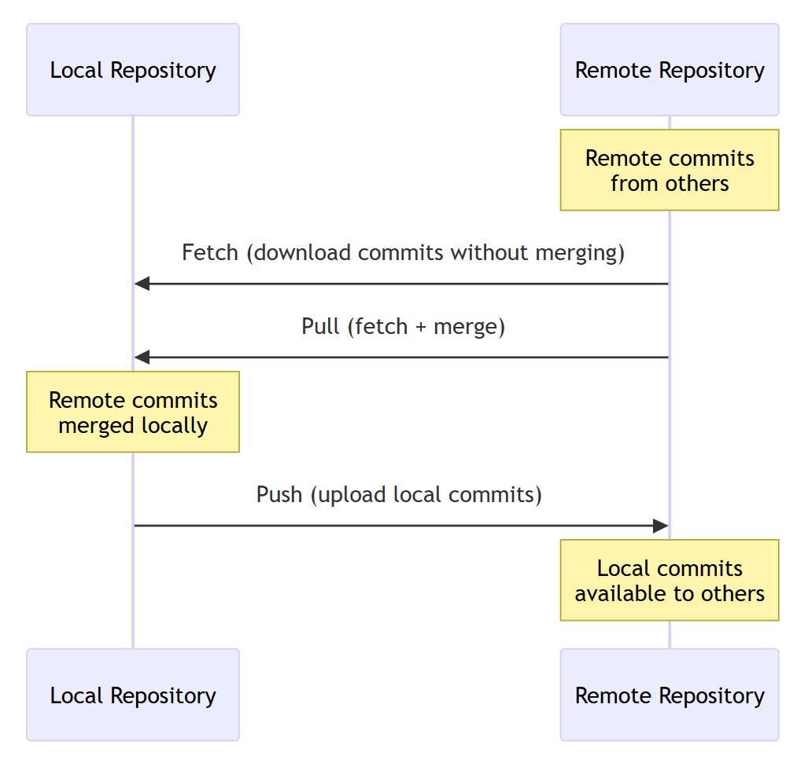
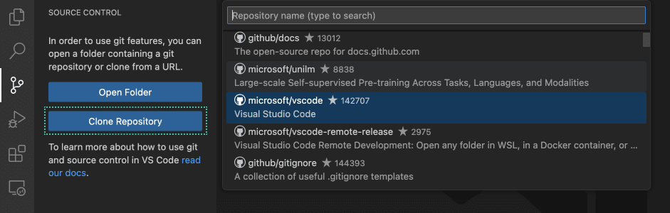
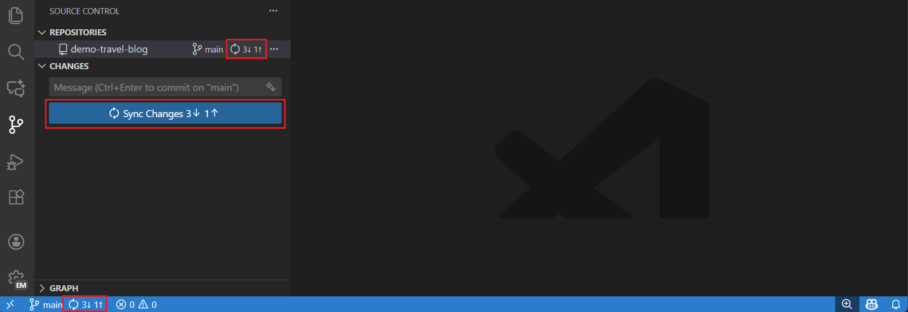
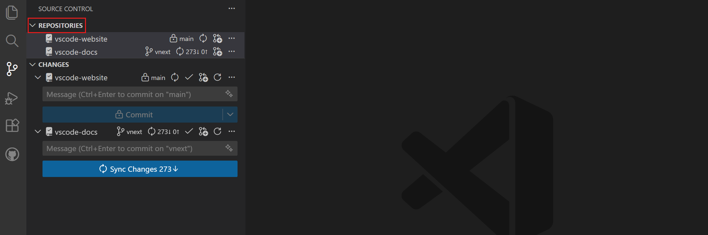

+++
title = "4.2 仓库与远程"
date = 2026-11-06T07:53:25+08:00
weight = 2
type = "docs"
description = ""
isCJKLanguage = true
draft = false
+++

> 原文链接: [https://code.visualstudio.com/docs/sourcecontrol/repos-remotes](https://code.visualstudio.com/docs/sourcecontrol/repos-remotes)

# 4.2 仓库与远程

　　使用 VS Code 将本地 Git 仓库连接到远程仓库，审查传入提交并共享工作。根据你的仓库情况选择任务：

| 任务 | 从这里开始 |
|------|------------|
| 获取现有远程仓库的本地副本 | [克隆仓库](#clone-repositories) |
| 为本地项目创建 GitHub 仓库 | [发布到 GitHub](#publish-to-github) |
| 将本地仓库连接到现有远程仓库 | [添加远程仓库](#add-a-remote) |
| 下载或上传提交 | [在获取、拉取、推送和同步之间选择](#push-pull-and-sync) |
| 选择操作应用于哪个仓库 | [使用仓库](#working-with-repositories) |

　　如果尚未设置 Git，请先阅读[4.1 快速入门](../4.1-Quickstart/)。如果操作失败，请参阅[4.8 故障排除](../4.8-Troubleshooting/)。

## 了解远程仓库 {#understanding-remotes}

　　远程仓库是指向另一个 Git 仓库的命名连接，通常托管在 GitHub、Azure DevOps 或 GitLab 等服务上。它确定从何处获取或共享提交。

　　克隆仓库时，Git 会自动创建一个名为 `origin` 的远程仓库，指向原始仓库。如果需要与不同的服务器或仓库交互，可以使用多个远程仓库。

　　使用远程仓库涉及三个主要操作：

* **获取（Fetch）**：从远程下载提交，但不更改工作文件。这样可以查看其他人的工作，而不将其更改合并到你的工作中。

* **拉取（Pull）**：获取远程提交并将其整合到当前分支。Git 可以快进、合并或变基，具体取决于历史记录和 Git 配置。拉取可能会更改工作文件并要求解决冲突。

* **推送（Push）**：将本地提交上传到远程，以便其他人访问你的更改。它不会上传未提交的更改，也不会拉取远程提交。

　　图中演示的是会执行合并的拉取。如果拉取配置为变基，则会通过重放本地提交来整合获取的提交。

　　上游分支将本地分支与远程分支关联。VS Code 使用此关联进行拉取、推送和同步，并显示传入和传出的提交数。如果分支没有上游，推送时会提示你发布该分支。发布分支会推送其提交并设置上游。

## 添加远程仓库 {#add-a-remote}

1. 在源代码管理视图（`Ctrl + Shift + G`）中，选择 **更多操作**（**...**）> **远程** > **添加远程仓库**。也可以从命令面板（`Ctrl + Shift + P`，macOS：`Cmd + Shift + P`）运行 **Git: Add Remote** 命令。

2. 输入远程 URL。

3. 输入远程仓库的名称（例如第一个远程仓库用 `origin`，fork 的原始仓库用 `upstream`）。

　　现在仓库有了可用于获取或推送的远程仓库。添加远程仓库不会上传提交，也不会设置上游分支。准备好共享时，使用[推送](#push-commits)发布本地分支。

　　使用 **Git: Remove Remote** 移除本地仓库中的连接。移除远程仓库不会删除托管仓库或本地提交。

## 克隆仓库 {#clone-repositories}

　　克隆会在计算机上创建远程仓库的本地副本，包含远程的所有分支、提交和历史记录。默认情况下，Git 会配置一个名为 `origin` 的远程仓库，指向你克隆的 URL。

　　从命令面板（`Ctrl + Shift + P`，macOS：`Cmd + Shift + P`）运行 **Git: Clone** 命令，或在源代码管理视图中选择 **克隆仓库**。输入仓库 URL。要浏览 GitHub 上的仓库，请选择 **从 GitHub 克隆**，在提示时登录，然后从列表中选择仓库。通过 URL 克隆公共仓库通常不需要登录。

　　克隆时，VS Code 会要求你选择一个本地文件夹来存储仓库。克隆后，你可以选择在新窗口中打开克隆的仓库。

　　克隆不会授予写入权限。要推送更改，请使用你有写入权限的仓库，或[创建 fork](https://docs.github.com/pull-requests/collaborating-with-pull-requests/working-with-forks/fork-a-repo)。在信任来自其他来源的代码之前，请查看[3.2.8.3 WorkspaceTrust](../../editor/3.2-WriteCode/3.2.8-Workspaces/3.2.8.3-WorkspaceTrust/)提示。

　　[GitHub Pull Requests and Issues](https://marketplace.visualstudio.com/items?itemName=GitHub.vscode-pull-request-github) 扩展通过拉取请求和议题管理增强 GitHub 集成。详细了解[4.7 在 GitHub 上协作](../4.7-CollaborateOnGitHub/)。

## 发布到 GitHub {#publish-to-github}

　　如果本地仓库未连接到远程仓库，可以直接从 VS Code 将其发布到 GitHub。

1. 打开命令面板（`Ctrl + Shift + P`，macOS：`Cmd + Shift + P`），运行 **Publish to GitHub**。

2. 如果出现提示，请登录 GitHub。

3. 输入可用的仓库名称，并选择创建公共或私有仓库。

4. 如果出现提示，请选择初始提交中包含的文件。

　　VS Code 会在 GitHub 上创建新仓库，将其添加为远程仓库，并推送你的提交。

> **注意**：**Publish to GitHub** 会创建新的托管仓库。**发布分支**会将分支上传到现有远程仓库，并设置其上游。如果托管仓库已存在，请[将其添加为远程仓库](#add-a-remote)，而不是再创建一个。

## 推送、拉取和同步 {#push-pull-and-sync}

　　根据你是要检查、整合还是共享提交来选择操作：

| 目标 | 操作 | 效果 |
|------|-----------|--------|
| 检查远程发生了哪些更改 | [获取](#fetch-commits) | 更新远程跟踪分支，不更改当前分支或工作文件。 |
| 将远程提交带入当前分支 | [拉取](#pull-commits) | 在本地获取并整合提交，不上传你的提交。 |
| 共享本地提交 | [推送](#push-commits) | 更新远程分支，不拉取或整合远程更改。 |
| 整合远程提交，然后共享本地提交 | [同步](#sync-changes) | 先拉取，再推送。可能同时更改本地分支和远程分支。 |

　　如果打开了多个仓库，请先选择目标仓库，再运行操作。

### 推送提交 {#push-commits}

1. [4.3 暂存与提交](../4.3-StagingCommits/#commit-your-changes)。

2. 在源代码管理视图中选择 **更多操作**（**...**）> **推送**。要选择特定的远程仓库，请从命令面板运行 **Git: Push to...**。也可以使用源代码管理图视图工具栏中的推送图标。

3. 如果出现提示，请登录以完成远程身份验证。

　　提交会上传到远程分支，团队成员现在可以拉取你的更改。如果推送因远程有你本地没有的提交而被拒绝，请按照[4.8 故障排除](../4.8-Troubleshooting/#push-is-rejected-because-the-remote-has-new-commits)的步骤操作。不要强制推送来绕过拒绝。

> **注意**：如果分支未配置上游，VS Code 会提示你先发布分支。

### 拉取提交 {#pull-commits}

　　拉取会获取远程提交并将其整合到当前分支。拉取前请提交更改，或[4.5 分支与工作树](../4.5-BranchesWorktrees/#manage-stashes)，以免 Git 因本地更改会被覆盖而停止。

　　在源代码管理视图中选择 **更多操作**（**...**）> **拉取**。要选择特定的远程仓库和分支，请从命令面板运行 **Git: Pull from...**。也可以使用源代码管理图工具栏中的拉取图标。

　　除非 Git 配置指定变基或其他拉取策略，否则 Git 会快进或合并传入提交。如果 Git 要求你选择如何协调分歧的分支，请使用团队的合并或[变基](#pull-with-rebase)工作流。

　　成功拉取后，分支将包含传入提交。如果冲突导致操作停止，请[4.6 解决合并冲突](../4.6-MergeConflicts/)并[4.6 解决合并冲突](../4.6-MergeConflicts/#complete-the-merge-operation)。拉取不会推送你的本地提交。

### 使用变基拉取 {#pull-with-rebase}

　　当团队期望线性历史记录且本地提交尚未共享时，请使用变基：

* 从命令面板运行 **Git: Pull (Rebase)**。

　　Git 会获取远程提交，然后在它们之上重放你的本地提交。如果冲突导致变基停止，请[4.6 解决合并冲突](../4.6-MergeConflicts/#complete-the-merge-operation)。

> **警告**：变基会重写提交历史记录。除非已经商定如何更新共享分支，否则避免对其他人已在使用的提交执行变基。

　　详细了解 [Git 变基](https://git-scm.com/docs/git-rebase)。

### 同步更改 {#sync-changes}

　　同步会先从上游分支拉取更改，然后推送传出的提交。只有在你确实需要同时执行这两项操作时才使用同步。使用**推送**可只上传，使用**拉取**可只整合，使用**获取**可只检查传入更改而不更改工作文件。

　　如果冲突导致拉取停止，同步不会继续执行推送。[4.6 解决合并冲突](../4.6-MergeConflicts/#complete-the-merge-operation)后，在准备好共享结果时再推送。

* 在源代码管理视图中选择 **同步更改**。
* 选择状态栏中的同步图标。

　　状态栏同步指示器显示相对于上游分支的传出（↑）和传入（↓）提交。例如，`↑2 ↓1` 表示两个传出提交和一个传入提交。这些计数反映最后一次已知的远程状态。请获取以检查更新的远程提交。

> **提示**：配置 `git.confirmSync` 设置，控制 VS Code 在同步前是否要求确认。

### 获取提交 {#fetch-commits}

　　获取会从远程仓库下载提交，但不会将其合并到本地分支。这样可以在整合前审查传入更改。

　　在源代码管理视图中选择 **更多操作**（**...**）> **获取**。其他获取选项：

* 运行 **Git: Fetch From All Remotes**，从所有配置的远程仓库获取。
* 运行 **Git: Fetch (Prune)**，同时移除远程已删除分支的本地远程跟踪引用。这不会删除本地分支。要在获取时始终修剪，请使用 `git.pruneOnFetch` 设置。

　　获取后，在[源代码管理图中审查传入提交](#review-incoming-and-outgoing-history)，再使用**拉取**整合它们。

　　要自动在后台获取提交，请使用 `git.autofetch` 设置。它在编辑器窗口中默认关闭，在智能体窗口中默认开启。要配置获取间隔，请使用 `git.autofetchPeriod` 设置（默认 180 秒）。自动获取不会拉取或推送。

## 状态栏同步操作 {#status-bar-sync-actions}

　　状态栏提供对常见仓库和远程操作的快速访问，无需打开源代码管理视图。

### 分支指示器 {#branch-indicator}

　　左下角包含分支指示器以及单独的同步或发布操作：

* **当前分支名称**：选择以切换分支。
* **同步状态**：显示传入（↓）和传出（↑）计数。选择同步操作以拉取，然后推送。
* **发布状态**：当前分支没有上游时显示 **发布分支**。选择以发布分支。

　　同步图标（旋转箭头）会执行这两项操作。如果只需推送或拉取，请改用源代码管理视图或命令面板。

## 配置源代码管理操作 {#configure-source-control-actions}

　　以下设置影响源代码管理视图和通知，而不影响状态栏指示器：

* `git.showActionButton`：控制源代码管理视图中是否显示提交、发布和同步操作按钮。
* `git.showCommitInput`：显示或隐藏源代码管理视图中的提交消息输入框。
* `git.showPushSuccessNotification`：推送成功后显示通知。

## 审查传入和传出历史 {#review-incoming-and-outgoing-history}

　　源代码管理图显示当前分支与上游分支的差异。使用它可以在拉取前检查传入提交，在推送前检查传出提交。详细了解[4.4 查看历史](../4.4-History/#view-branch-and-commit-history)。

## 使用仓库 {#working-with-repositories}

　　“仓库”视图允许你在一个工作区中管理多个 Git 仓库。当项目跨越多个仓库时，这很有用。“仓库”视图还显示与仓库关联的 [4.5 分支与工作树](../4.5-BranchesWorktrees/)。

　　要显示“仓库”视图，请从命令面板运行 **Source Control: Focus on Repositories View** 命令。配置 `scm.alwaysShowRepositories` 设置，以始终在源代码管理视图中显示“仓库”视图。

　　对于每个仓库，你可以查看活动分支、同步状态，并访问获取、拉取、推送等操作。打开包含仓库的工作区时，检测到的仓库会显示在“仓库”视图中。暂存、提交或同步之前，请检查仓库名称和分支，确保操作应用于预期的检出。

### 仓库选择模式 {#repository-selection-modes}

　　如果你希望一次只关注一个仓库或工作树，可以切换到单仓库模式。在该模式下，你只能看到所选仓库的更改和图。在多仓库模式下，源代码管理视图显示所有仓库的更改。使用 `scm.repositories.selectionMode` 设置在多仓库和单仓库模式之间切换。

## 凭据助手 {#credential-helpers}

　　凭据助手会安全地存储身份验证凭据，这样每次推送或拉取时就不必重新输入。建议[设置凭据助手](https://docs.github.com/get-started/getting-started-with-git/caching-your-github-credentials-in-git)，避免 VS Code 每次与远程仓库交互时都要求提供凭据。

## 后续步骤 {#next-steps}

* [4.5 分支与工作树](../4.5-BranchesWorktrees/#create-new-branches)，将下一项更改与其他工作分开。
* [4.7 在 GitHub 上协作](../4.7-CollaborateOnGitHub/#creating-pull-requests)，就已发布的分支获取反馈。
* 如果远程操作失败或停滞，请[4.8 故障排除](../4.8-Troubleshooting/)。
