+++
title = "4.3 暂存与提交"
date = 2026-11-06T07:53:25+08:00
weight = 3
type = "docs"
description = ""
isCJKLanguage = true
draft = false
+++


> 原文链接: [https://code.visualstudio.com/docs/sourcecontrol/staging-commits](https://code.visualstudio.com/docs/sourcecontrol/staging-commits)

# 4.3 暂存与提交

　　使用 VS Code 的源代码管理视图，精确选择要包含在提交中的更改。本指南涵盖审查文件、暂存单个更改、提交以及选择撤销操作。

　　如果你不熟悉 Git，请按照[4.1 快速入门](../4.1-Quickstart/)设置练习仓库并配置提交身份。

## Git 工作流 {#git-workflow}

　　保存文件、暂存、提交和推送是相互独立的操作：

| 操作 | 结果 |
|--------|--------|
| 保存 | 将编辑写入磁盘上的工作文件。 |
| 暂存 | 将选定的更改复制到暂存区（也称为索引）。 |
| 提交 | 将暂存快照记录到本地 Git 历史记录中。 |
| 推送 | 将本地提交上传到远程仓库。 |

　　暂存会在那一刻捕获所选内容。如果再次编辑文件，后续编辑不会包含在暂存快照中，除非你也暂存它们。

## 查看更改 {#view-changes}

　　源代码管理视图（`Ctrl + Shift + G`）是管理 Git 仓库更改的中心。更改按暂存状态分为两个部分：

* **更改**：列出所有尚未暂存以进行提交的已修改、已添加或已删除文件。
* **暂存的更改**：列出已暂存并准备提交的文件。

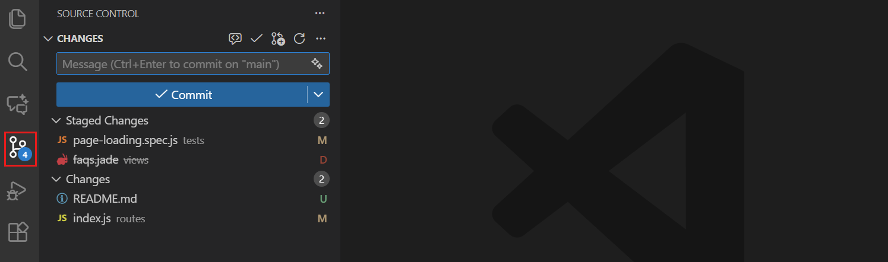

　　更改的文件会显示“U”（未跟踪）、“M”（已修改）或“D”（已删除）图标，指示更改类型。资源管理器视图和已修改文件的编辑器选项卡标题中也会显示此指示器。

　　活动栏中的源代码管理图标还会显示一个徽章，其中包含受影响文件的数量，方便快速了解未提交的更改。

> **提示**：可以通过源代码管理视图工具栏中的 **更多操作**（**...**）> **查看和排序** > **以树/列表方式查看**，在平面或树形结构之间切换更改列表。

### 文件为何同时出现在两个列表中 {#why-a-file-appears-in-both-lists}

　　文件可以同时包含已暂存和未暂存的更改。例如：

1. 编辑已跟踪文件并暂存。
2. 再次编辑同一文件并保存，但不暂存。

　　此时文件会同时出现在两个列表中。在 **暂存的更改** 中选择它，可看到准备提交的第一次编辑；在 **更改** 中选择它，可看到未包含在该提交中的后续编辑。

　　再次暂存文件可包含两次编辑，或者提交已暂存版本，将后续编辑留到另一次提交。取消暂存会保留工作文件中的两次编辑。

## 暂存更改 {#staging-changes}

　　暂存会为下一次提交准备更改。你可以暂存整个文件，或暂存特定的行和代码块，以便更精细地控制。

　　要暂存单个文件，请将鼠标悬停在 **更改** 列表中的文件上，选择 **+** 图标，或右键单击文件并选择 **暂存更改**。也可以将文件从 **更改** 拖到 **暂存的更改**。

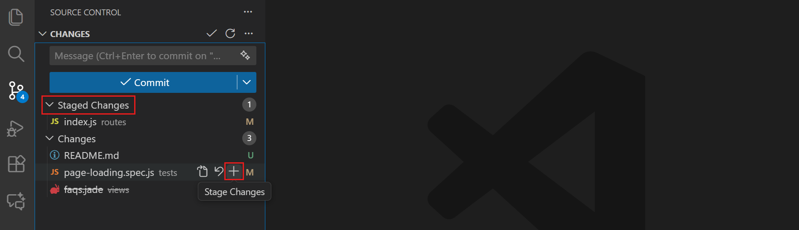

　　使用树视图时，可以通过暂存文件夹来暂存整个文件夹。要一次暂存所有已修改文件，请将鼠标悬停在 **更改** 标题上并选择 **+**。

　　命令面板（`Ctrl + Shift + P`）中还有更专门的暂存操作。输入“Git: Stage”可查看暂存文件选项。

### 暂存特定行或代码块 {#stage-specific-lines-or-code-blocks}

　　除了暂存整个文件，还可以暂存文件的特定部分。部分暂存可帮助你创建专注的提交。例如，如果同一文件中既有格式更改又有错误修复，可以分别提交并编写适当的提交消息。

　　可以在差异编辑器中执行部分暂存：

1. 在 **更改** 列表中选择文件，打开[差异编辑器](#review-changes-with-the-diff-editor)。

2. 选择要暂存的行。

3. 使用差异编辑器边距中选区旁的 **暂存** 按钮，仅暂存这些行。

    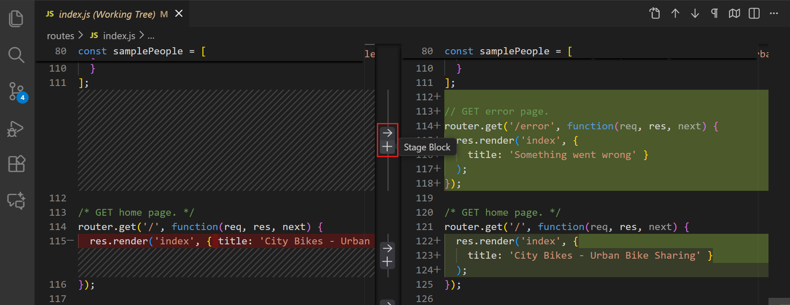

    也可以右键单击选区，选择 **暂存所选范围**，或从命令面板运行 **Git: Stage Selected Ranges**。

### 取消暂存更改 {#unstage-changes}

　　要将文件从暂存区移除，请将鼠标悬停在 **暂存的更改** 列表中的文件上，选择 **-** 图标，或右键单击并选择 **取消暂存更改**。文件会移回 **更改** 部分，修改不会丢失。

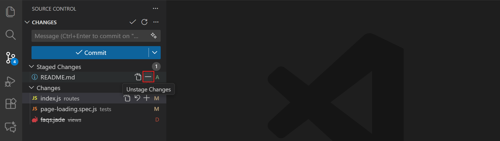

　　同样，也可以使用差异编辑器边距中选区旁的 **取消暂存** 按钮，取消暂存特定行或代码块。

## 提交更改 {#commit-your-changes}

1. 在 **暂存的更改** 中选择每个文件，审查将要提交的内容。

2. 在提交消息输入框中输入描述更改的消息，例如 `Fix validation for empty names`。

3. 选择 **提交**。

　　已提交的更改会从 **暂存的更改** 中消失，并出现在[4.4 查看历史](../4.4-History/#view-branch-and-commit-history)中。未暂存的编辑仍保留在 **更改** 中。在[4.2 仓库与远程](../4.2-ReposAndRemotes/#push-commits)之前，提交仅在本地。

　　如果 Git 要求你配置姓名或电子邮件，请按照[4.1 快速入门](../4.1-Quickstart/#prerequisites)操作。

### 编写提交消息 {#write-commit-messages}

　　提交消息帮助其他人理解更改了什么以及为什么。第一行使用简短摘要。如需更长的说明，请[使用编辑器编写提交消息](#use-the-editor-for-commit-messages)。

> **提示**：在提交消息输入框中聚焦时，按 `Alt + ↑` 和 `Alt + ↓` 可循环浏览之前的提交消息。

### 提交更改 {#commit-changes}

　　**提交** 按钮使用已暂存的更改。如果没有暂存任何内容，行为取决于 Git 设置，VS Code 可能会提示你暂存更改。如果你想控制提交内容，请显式暂存。

　　要一次提交所有更改，请选择 **更多操作**（**...**）> **提交** > **全部提交**。使用此操作前请审查所有待处理文件。

## 撤销或放弃更改 {#undo-or-discard-changes}

　　根据工作状态选择操作。取消暂存、撤销提交和放弃编辑的效果不同。

| 目标 | 操作 | 效果 |
|------|--------|--------|
| 保留编辑，但从下一次提交中移除 | [取消暂存](#unstage-changes) | 保留工作文件。 |
| 修正最近一次未推送的提交 | [修改](#amend-the-previous-commit) | 用新提交替换该提交。 |
| 移除最近一次未推送的提交但保留更改 | [撤销上次提交](#undo-the-last-commit) | 更改本地历史并保留编辑。 |
| 反向应用已共享的提交 | [还原提交](#undo-a-pushed-commit) | 添加新提交，不重写共享历史。 |
| 移除未提交的编辑 | [放弃](#discard-changes) | 移除工作，无法保证恢复。 |

### 修改上一次提交 {#amend-the-previous-commit}

　　如果需要修改最近一次提交，可以修改它，而不是创建新提交。这适合补充忘记的更改或更正提交消息。

　　要修改提交，请选择 **提交** 按钮下拉列表中的 **提交（修改）**，或使用 **更多操作**（**...**）菜单中的 **提交已暂存更改（修改）**。

> **警告**：只修改尚未推送到共享仓库的提交。修改已推送的提交会重写历史记录，可能给其他协作者带来问题。

### 撤销上一次提交 {#undo-the-last-commit}

　　对于尚未推送的提交，请在源代码管理视图中选择 **更多操作**（**...**）> **提交** > **撤销上次提交**。

　　提交会从本地分支历史记录中移除，其更改保持暂存状态，以便你编辑或再次提交。如果撤销仓库的第一次提交，其文件会变为未跟踪。

　　不要使用此操作撤销共享历史记录。请改为[还原已推送的提交](#undo-a-pushed-commit)。

### 撤销已推送的提交 {#undo-a-pushed-commit}

　　还原会创建一个新提交，反向应用较早的提交。它保留共享历史记录，不需要强制推送。

　　对于常规的非合并提交：

1. 打开包含该提交的分支。继续之前，提交或[4.5 分支与工作树](../4.5-BranchesWorktrees/#manage-stashes)所有待处理更改。

2. 在[4.4 查看历史](../4.4-History/#view-branch-and-commit-history)中找到提交哈希，或在集成终端中运行 `git log --oneline`。

3. 在仓库终端中运行以下命令，将 `<commit-hash>` 替换为该哈希：

    ```bash
    git revert --no-edit <commit-hash>
    ```

    如果成功，Git 会创建一个带有自动生成还原消息的新提交。如果出现冲突，请解决并暂存文件，然后运行 `git revert --continue`。要取消正在进行的还原，请运行 `git revert --abort`。

4. 在图中审查新提交，测试结果，然后[4.2 仓库与远程](../4.2-ReposAndRemotes/#push-commits)。

　　还原合并提交需要选择保留哪个父提交。请咨询你的团队，并在还原合并之前查阅 [Git revert 文档](https://git-scm.com/docs/git-revert)。

### 放弃更改 {#discard-changes}

> **警告**：放弃会移除未提交的工作。放弃之前，请提交、储藏或复制你可能需要的更改。如果只想从下一次提交中移除更改，请改为取消暂存。

　　右键单击 **更改** 中的文件，选择 **放弃更改**，并在继续前审查确认。

* 对于**已跟踪文件**，放弃会恢复到已暂存版本。如果没有已暂存的编辑，则恢复到当前提交中的版本。已暂存的更改会保留。
* 对于**未跟踪文件**，放弃会删除该文件。

　　已跟踪文件中放弃的编辑不会移到回收站。当 `git.discardUntrackedChangesToTrash` 开启且环境支持时，未跟踪文件可以移到回收站。远程环境和其他限制可能导致永久删除。

　　如果已经放弃了工作，请检查[4.4 查看历史](../4.4-History/#view-file-history-with-the-timeline-view)中的本地历史记录条目；对于删除的未跟踪文件，请检查回收站。两者都不是可靠的备份。

## 使用差异编辑器审查更改 {#review-changes-with-the-diff-editor}

　　差异编辑器通过比较原始版本和修改版本，显示文件中的更改。它可以并排或行内显示更改。

　　在源代码管理视图中选择文件以打开其差异。对于已跟踪文件，比较内容取决于列表：

| 列表 | 比较 | 回答的问题 |
|------|------------|---------------------|
| **更改** | 已暂存版本（索引）与工作文件 | 我还没有暂存哪些编辑？ |
| **暂存的更改** | 当前提交（`HEAD`）与已暂存版本 | 下一次提交将包含什么？ |

　　如果文件没有已暂存的编辑，其暂存版本与当前提交一致。新的未跟踪文件没有较早的已跟踪版本。请参阅[文件为何会同时出现在两个列表中](#why-a-file-appears-in-both-lists)。

> **提示**：对于大文件，可以通过选择差异编辑器工具栏中的 **折叠未更改区域** 按钮来折叠未更改部分。也可以使用 **下一处更改** 和 **上一处更改** 按钮快速导航。

### 选择差异布局 {#choose-a-diff-layout}

　　默认情况下，差异编辑器使用 **自动** 布局：空间足够时显示并排比较，编辑器较窄时切换为行内。

　　要选择布局，请选择 **更多操作**（**...**）> **差异视图**，然后选择：**行内**、**并排** 或 **自动**。

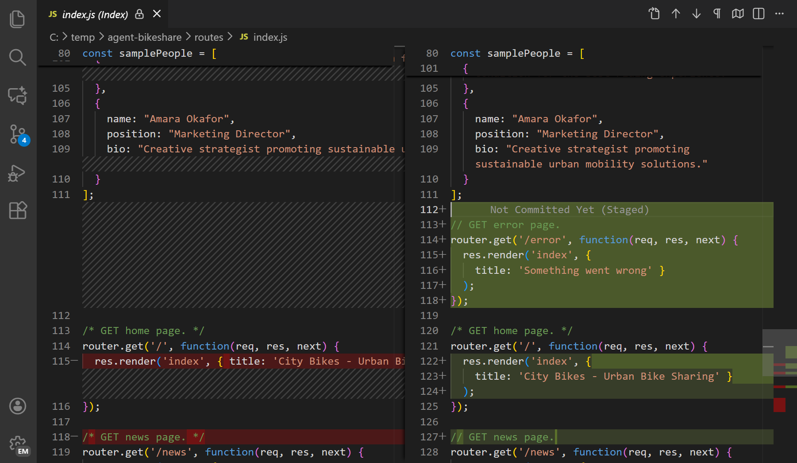

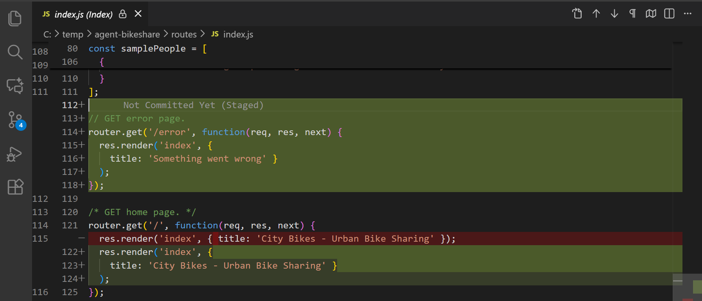

　　**自动**布局的默认宽度阈值为 900 像素。可以使用 `diffEditor.renderSideBySideInlineBreakpoint` 配置。也可以通过 `diffEditor.renderSideBySide` 和 `diffEditor.useInlineViewWhenSpaceIsLimited` 直接配置布局行为。

### 从差异编辑器暂存和还原 {#stage-and-revert-from-the-diff-editor}

　　差异编辑器边距中每个更改旁都有 **暂存** 和 **还原** 按钮。你可以：

* 直接从差异视图暂存单个代码块或行。
* 还原特定更改而不影响其他修改。

　　如果在差异编辑器中选择特定行，按钮仅对选区生效。可以使用 `diffEditor.renderGutterMenu` 设置隐藏差异编辑器边距。

> **警告**：**还原** 会移除所选工作更改，与取消暂存不同。请参阅[放弃更改](#discard-changes)。

### 编辑器边距指示器 {#editor-gutter-indicators}

　　编辑器在行号旁显示边距指示器以标识更改：绿色表示添加的行，蓝色表示修改的行，红色三角形表示删除的行。选择指示器可打开行内差异预览。

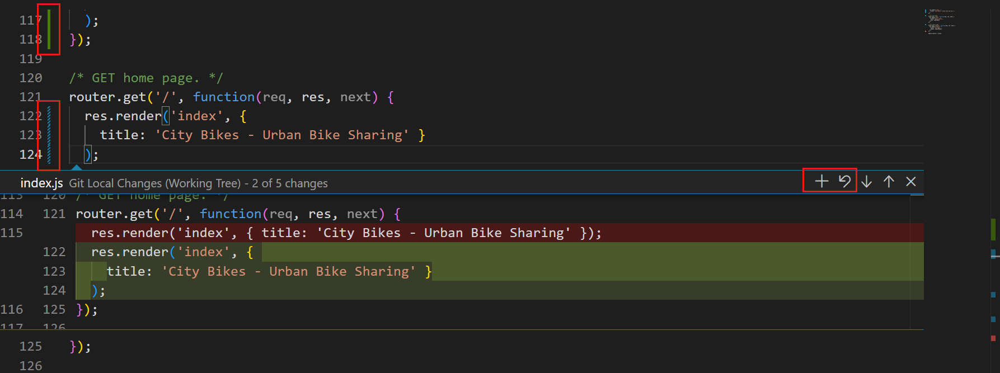

　　可以使用以下设置自定义指示器：

* `scm.diffDecorations`：选择差异装饰的显示位置。
* `scm.diffDecorationsGutterAction`：控制选择边距指示器时的行为。
* `scm.diffDecorationsGutterPattern`：自定义装饰图案。
* `scm.diffDecorationsGutterVisibility`：始终显示装饰，或仅在悬停时显示。
* `scm.diffDecorationsGutterWidth`：设置指示器宽度。
* `scm.diffDecorationsIgnoreTrimWhitespace`：在装饰中忽略仅空白差异。

### 可访问差异查看器 {#accessible-diff-viewer}

　　对于屏幕阅读器用户，VS Code 提供可访问差异查看器，以统一补丁格式呈现更改。要打开它，请使用差异编辑器工具栏中的 **更多操作**（**...**）菜单，选择 **打开可访问差异查看器**，或使用 `Alt + F2` 快捷键。

　　使用 **转到下一处差异** 和 **转到上一处差异** 命令在更改之间导航。

## 使用编辑器编写提交消息 {#use-the-editor-for-commit-messages}

　　对于较长的提交消息，请使用完整的编辑器选项卡，而不是输入框。确保 `git.useEditorAsCommitInput` 已开启。

1. 在源代码管理视图中，不输入消息直接选择 **提交**。这会打开名为 `COMMIT_EDITMSG` 的编辑器选项卡。

    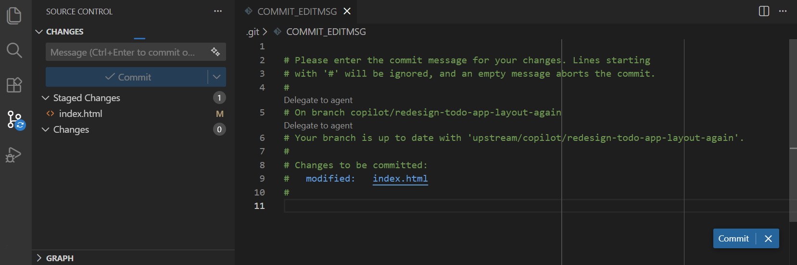

2. 编写消息。要完成提交，请关闭编辑器选项卡或选择编辑器中的 **提交**。

    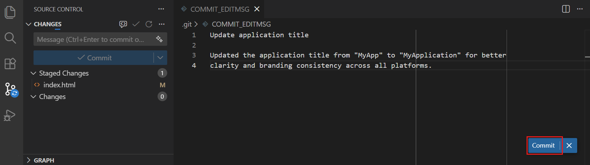

　　要取消，请选择编辑器中的 **取消**，或清除消息并关闭选项卡。

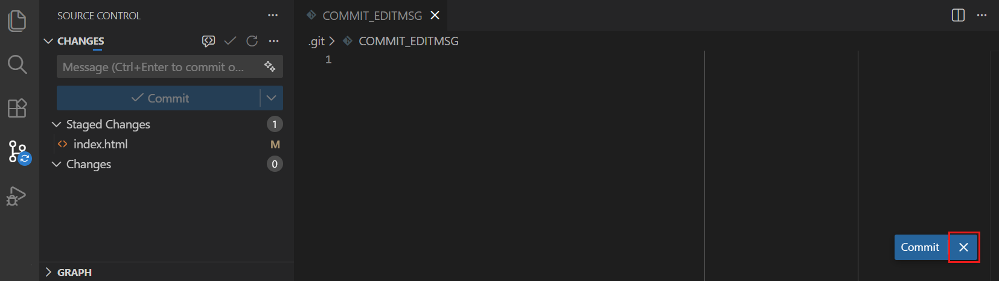

　　要改用输入提示，请关闭 `git.useEditorAsCommitInput` 并重新启动 VS Code。要让终端中的 `git commit` 命令也使用编辑器，请开启 `git.terminalGitEditor` 并重新启动终端。

## 使用 AI 审查代码更改 {#review-code-changes-with-ai}

　　[9.1 设置 GitHub Copilot](../../advanced-setup/9.1-GitHubCopilotSetup/)后，可以使用 AI 审查未提交的更改。这种可选审查是对亲自检查差异的补充。

1. 选择源代码管理视图中的 **代码审查** 按钮。

    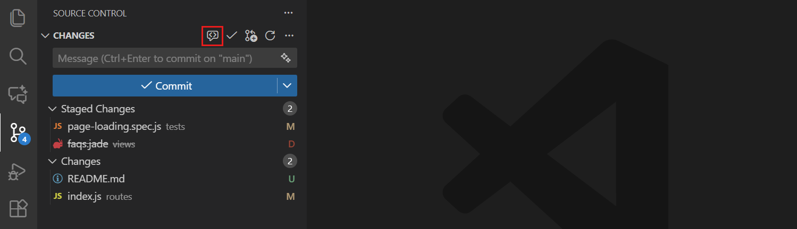

2. 审查生成的评论和建议，它们会以覆盖评论的形式显示在编辑器中。

    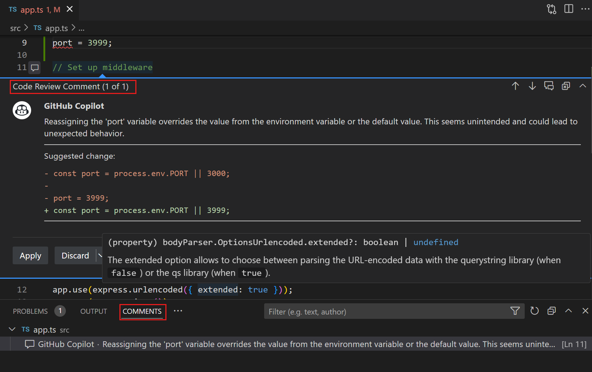

### 使用 AI 生成提交消息 {#generate-commit-messages-with-ai}

　　选择提交消息输入框中的闪光图标生成消息。提交前请审查并编辑它。

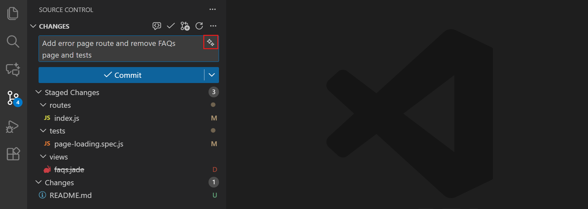

　　提交消息生成使用由 `chat.utilitySmallModel` 配置的实用模型，而不是为聊天或智能体会话选择的模型。请参阅[2.3.1 选择和配置模型](../../ai-in-vs-code/choose-models-and-agents/2.3.1-ChooseAndConfigureModels/#change-the-model-for-utility-tasks)，包括在没有 GitHub Copilot 账户的情况下进行设置。你也可以[2.8.1.6 自定义指令参考](../../ai-in-vs-code/reference-and-help/reference/2.8.1.6-CustomInstructionsReference/#generated-content-settings)。

### AI 共同作者归属 {#ai-co-author-attribution}

　　VS Code 可以在包含 AI 生成代码的提交后追加 `Co-authored-by:` Git 尾注。配置 `git.addAICoAuthor`：

* `off`（默认）：不添加 AI 共同作者尾注。
* `chatAndAgent`：为通过聊天或智能体模式生成的代码添加尾注。
* `all`：为 AI 生成的代码添加尾注，包括内联补全。

　　此设置适用于通过 VS Code Git 集成创建的提交，不适用于外部 Git 客户端或终端命令。共同作者尾注也会显示在 [4.4 查看历史](../4.4-History/#view-git-blame-information)中。

## 检查源代码管理历史 {#inspect-source-control-history}

　　创建提交后，使用源代码管理图、Git 追溯信息和时间线视图了解代码何时以及为何更改。详细了解[4.4 查看历史](../4.4-History/)。

## 后续步骤 {#next-steps}

* [4.2 仓库与远程](../4.2-ReposAndRemotes/#push-commits)，与他人共享。
* 在切换任务之前[4.5 分支与工作树](../4.5-BranchesWorktrees/#manage-stashes)。
* 操作失败时[4.8 故障排除](../4.8-Troubleshooting/)。
