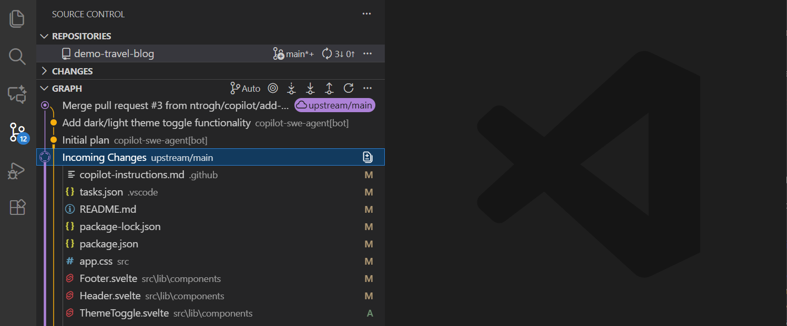
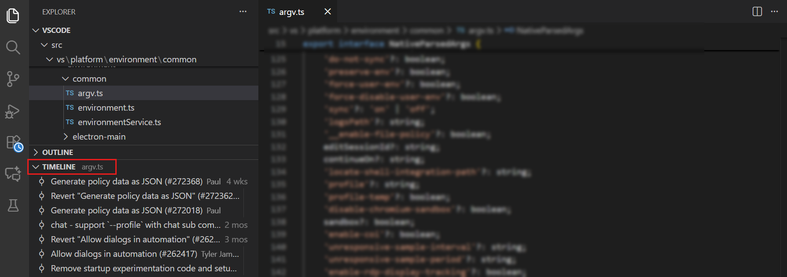

+++
title = "4.4 查看历史"
date = 2026-11-06T07:53:25+08:00
weight = 4
type = "docs"
description = ""
isCJKLanguage = true
draft = false
+++


> 原文链接: [https://code.visualstudio.com/docs/sourcecontrol/history](https://code.visualstudio.com/docs/sourcecontrol/history)

# 4.4 查看历史

　　源代码管理历史记录可帮助你了解代码库如何变化、哪些提交影响了某个文件，以及谁最后修改了某一行。VS Code 提供用于查看仓库历史的源代码管理图、用于查看文件历史的时间线视图，以及用于单个行的 Git 追溯信息。

* 在源代码管理图中[检查或比较提交](#view-branch-and-commit-history)。
* 在时间线视图中[审查文件的修订版本](#view-file-history-with-the-timeline-view)。
* 使用 Git 追溯[查找最后修改某一行的人](#view-git-blame-information)。

## 查看分支和提交历史 {#view-branch-and-commit-history}

　　源代码管理视图（`Ctrl + Shift + G`）中的源代码管理图显示提交历史和分支关系。当你的分支有上游分支时，图还会标识传入和传出的提交。



### 检查提交 {#inspect-a-commit}

1. 在源代码管理图中，选择一个提交以展开其更改文件列表。

2. 选择一个更改的文件，打开其差异。

　　要在多文件差异中一起审查提交的更改，请右键单击该提交并选择 **打开更改**。选择提交进行检查不会检出它，也不会更改你的工作文件。

　　更改的二进制文件（例如图像）会保留在多文件差异中，并显示 **二进制文件已更改**，而不是文本差异。当两个文件版本都可用时，选择 **打开差异** 可在普通差异编辑器中打开文件，例如图像差异或适用的自定义编辑器。

### 将提交与分支或标签比较 {#compare-a-commit-with-a-branch-or-tag}

1. 在源代码管理图中，右键单击要比较的提交。

2. 选择 **比较方式...**。

3. 在引用选择器中，选择本地分支、远程分支或标签。

　　比较会在多文件差异中打开。所选引用位于左侧，提交位于右侧。

　　当当前分支具有相应引用时，提交的上下文菜单还提供以下快捷操作：

* **与远程比较**：将提交与当前分支的上游引用进行比较。
* **与合并基比较**：将提交与 VS Code 为当前分支标识的基础分支进行比较。

　　这些操作比较已提交的修订版本，不会切换你检出的分支。

### 应用或检出提交 {#apply-or-check-out-a-commit}

* 要将提交的更改应用到当前分支，请右键单击源代码管理图中的提交，选择 **拣选**。
* 要检出确切的修订版本，请右键单击该提交，选择 **检出（分离）**。

> **警告**：**检出（分离）** 会更新你的工作文件，并使 `HEAD` 与任何分支分离。在创建你希望保留的提交之前，请先[4.5 分支与工作树](../4.5-BranchesWorktrees/#create-new-branches)。

### 了解传入和传出的提交 {#understand-incoming-and-outgoing-commits}

　　图会标识当前分支与其上游分支之间的不同提交：

* **传入提交**存在于远程仓库，尚未被拉取。
* **传出提交**存在于本地，尚未被推送。

　　选择 **传入更改** 或 **传出更改** 条目可检查其文件，或右键单击单个提交，选择 **打开更改**。使用图工具栏获取、拉取、推送或同步更改。

## 使用时间线视图查看文件历史 {#view-file-history-with-the-timeline-view}

　　时间线视图显示编辑器中活动文件的事件。这些事件可以包括 Git 提交和本地文件保存。

1. 在编辑器中打开一个文件。

2. 在资源管理器视图（`Ctrl + Shift + E`，macOS：`Cmd + Shift + E`）中，展开 **时间线** 视图。

3. 选择一个事件，检查相应的文件更改。



　　使用时间线筛选器可以只显示 Git 提交，或包含其他时间线提供程序的事件。详细了解[3.1.2 用户界面](../../editor/3.1-GettingStarted/3.1.2-UserInterface/#timeline-view)。

　　要比较同一文件的两个已提交版本：

1. 在时间线视图中，右键单击一个 Git 提交，选择 **选择以进行比较**。

2. 右键单击该文件的另一个 Git 提交，选择 **与所选内容比较**。

　　差异会将第一个选定的修订版本显示在左侧，第二个显示在右侧。这比较的是文件修订版本，而不是这些提交中的所有文件。要确定谁最后修改了当前文件中的某一行，请使用 [Git 追溯](#view-git-blame-information)。

## 查看 Git 追溯信息 {#view-git-blame-information}

　　Git 追溯信息标识最后更改某一行的提交和作者。VS Code 可以在编辑器和状态栏中显示此信息。

<video src="https://code.visualstudio.com/assets/docs/sourcecontrol/staging-commits/git-blame.mp4" title="显示状态栏和编辑器中 Git 追溯信息的视频。" autoplay muted loop controls></video>

1. 打开一个已跟踪的文件，将光标放在要检查的行上。

2. 如果行内追溯被隐藏，请从命令面板（`Ctrl + Shift + P`，macOS：`Cmd + Shift + P`）运行 **Git: Toggle Git Blame Editor Decoration**。使用 **Git: Toggle Git Blame Status Bar Item** 显示或隐藏状态栏版本。

3. 将鼠标悬停在追溯装饰上，查看提交详情。

　　悬停信息包含共同作者尾注。如果 VS Code 为提交添加了 [4.3 暂存与提交](../4.3-StagingCommits/#ai-co-author-attribution)，追溯悬停信息会包含该归属。

## 配置历史视图 {#configure-history-views}

### 配置源代码管理图 {#configure-the-source-control-graph}

　　使用 `scm.graph.showIncomingChanges` 和 `scm.graph.showOutgoingChanges` 设置控制是否显示传入和传出提交。使用 `scm.graph.pageSize` 设置配置图最初以及每次加载更多时加载的提交数量。

### 自定义追溯信息 {#customize-blame-information}

* `git.blame.statusBarItem.enabled`：在状态栏中显示追溯信息。
* `git.blame.editorDecoration.enabled`：在编辑器中以行内方式显示追溯信息。
* `git.blame.editorDecoration.disableHover`：隐藏编辑器中的追溯悬停信息。
* `git.blame.ignoreWhitespace`：当 Git 确定行作者时忽略空白更改。

　　使用 `git.blame.editorDecoration.template` 和 `git.blame.statusBarItem.template` 设置选择显示哪些提交详情。

　　例如，以下模板显示提交主题、作者姓名和相对作者日期：

```json
{
  "git.blame.editorDecoration.template": "${subject}, ${authorName} (${authorDateAgo})"
}
```

　　使用 `git.blame.editorDecorationForeground` 主题颜色更改行内追溯信息的颜色。

## 后续步骤 {#next-steps}

* [4.5 分支与工作树](../4.5-BranchesWorktrees/)。
* [4.3 暂存与提交](../4.3-StagingCommits/)。
* [4.2 仓库与远程](../4.2-ReposAndRemotes/)。
