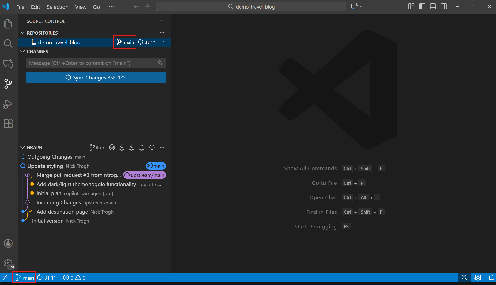
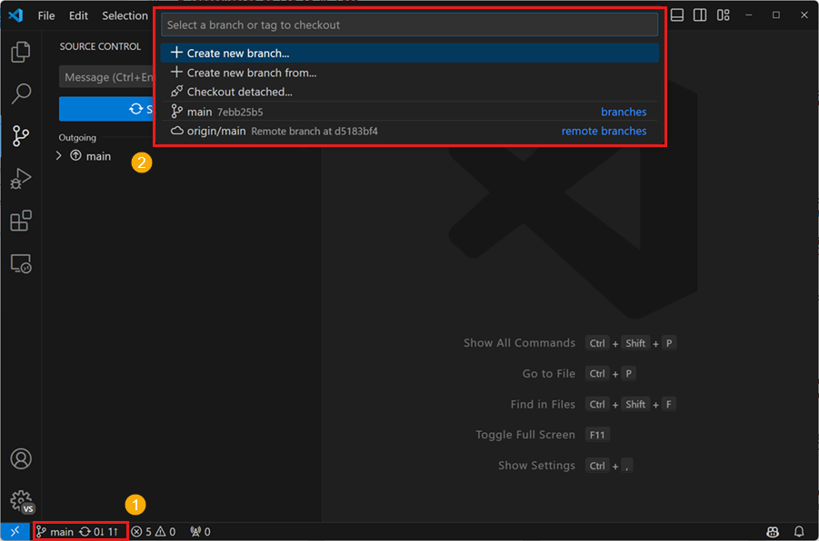
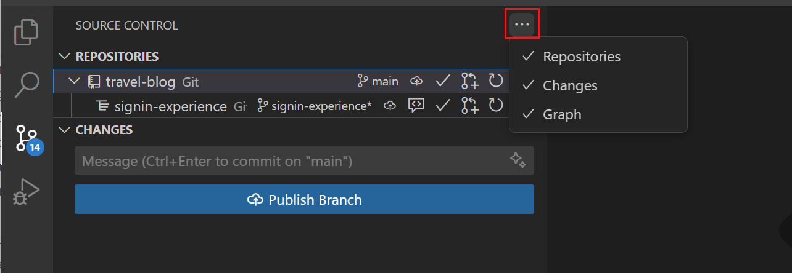
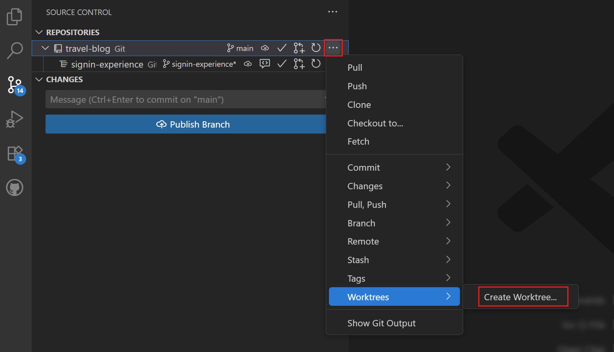
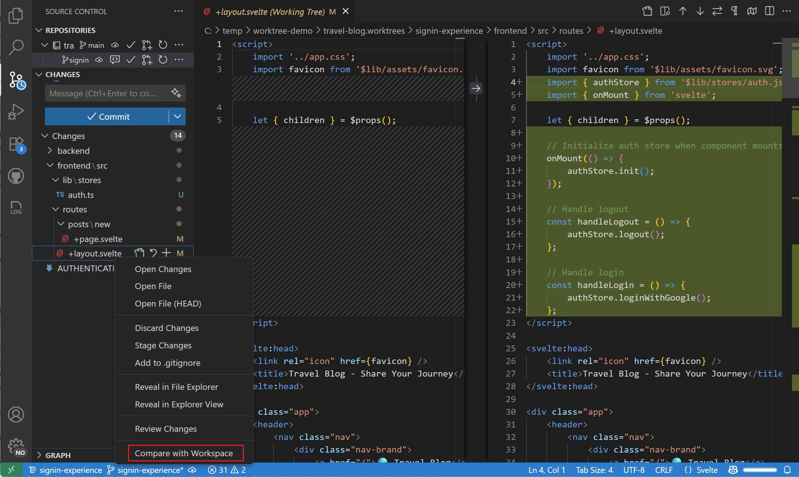

+++
title = "4.5 分支与工作树"
date = 2026-11-06T07:53:25+08:00
weight = 5
type = "docs"
description = ""
isCJKLanguage = true
draft = false
+++


> 原文链接: [https://code.visualstudio.com/docs/sourcecontrol/branches-worktrees](https://code.visualstudio.com/docs/sourcecontrol/branches-worktrees)

# 4.5 分支与工作树

　　使用 VS Code 中的 Git 工具创建和切换分支、搁置未完成的更改，并在单独的文件夹中处理多个分支。

* 使用[分支](#working-with-branches)维护独立的开发线，并在一个文件夹中切换。
* 使用[储藏](#manage-stashes)搁置未提交的更改，而无需创建提交。
* 使用[工作树](#working-with-git-worktrees)在多个文件夹中同时检出多个分支。

## 使用分支 {#working-with-branches}

　　分支是指向 Git 历史记录中特定提交的轻量、可移动指针。创建分支以独立开发功能，工作准备好后再合并到目标分支。

### 查看当前分支 {#view-current-branch}

　　当前分支会显示在多个位置：**状态栏**显示分支名称并提供快速切换；**仓库视图**在仓库标题中显示当前分支；**源代码管理图**以可视化方式展示分支关系和历史记录。



### 在分支之间切换 {#switch-between-branches}

　　切换分支在 Git 术语中称为“检出”分支。检出分支时，Git 会更新工作目录以匹配该分支的状态。

1. 在状态栏中选择分支名称，或从命令面板（`Ctrl + Shift + P`）运行 **Git: Checkout to** 命令。

2. 从可用分支列表中选择：
   * **本地分支**：本地计算机上存在的分支。
   * **远程分支**：可以检出到本地的远程仓库分支。
   * **最近分支**：最近使用过的分支。

> **提示**：如果切换分支时有未提交的更改，Git 可能会阻止切换以避免丢失工作。请考虑先提交更改或使用[储藏](#manage-stashes)。

### 创建新分支 {#create-new-branches}

　　要从当前提交（`HEAD`）创建分支：

1. 从命令面板运行 **Git: Create Branch...**。
2. 输入新分支的名称，例如 `feature/user-authentication` 或 `bugfix/login-error`。

　　要从其他分支或标签开始：

1. 从命令面板运行 **Git: Create Branch From...**。
2. 选择源分支或标签，例如 `main` 或 `origin/main`。
3. 输入新分支名称。

　　这两个命令都会在创建后切换到新分支。也可以选择状态栏中的分支名称，然后选择 **创建新分支...** 或 **从...创建新分支...**。



　　VS Code 可以生成随机分支名称，使用 `git.branchRandomName.enable` 和 `git.branchRandomName.dictionary` 设置进行配置。

> **提示**：如果使用 GitHub Pull Requests and Issues 扩展，可以直接从 GitHub 议题创建分支，从而在新本地分支中开始工作，并自动预填写拉取请求。

### 重命名和删除分支 {#rename-and-delete-branches}

　　要重命名当前分支，请从命令面板运行 **Git: Rename Branch**，或从 **更多操作**（...）菜单中选择，然后输入新名称。

　　删除分支时，请先切换到其他分支（不能删除当前活动分支），运行 **Git: Delete Branch**，然后从列表中选择要删除的分支。也可以使用相应的 **删除远程分支** 操作删除远程分支。

> **警告**：删除分支会将其从本地仓库中永久移除。请确保分支已合并，或你不再需要其中的更改。

### 合并和发布分支 {#merge-and-publish-branches}

　　功能完成后，将其合并回主分支：

1. 切换到目标分支（通常是 `main` 或 `develop`）。
2. 从命令面板运行 **Git: Merge...**。
3. 选择要合并的分支。

　　要将分支发布到远程仓库，请使用 **发布分支** 操作。

　　VS Code 会在源代码管理视图中显示合并结果。如果存在冲突，VS Code 会突出显示并提供解决工具。详细了解[4.6 解决合并冲突](../4.6-MergeConflicts/)。

## 管理储藏 {#manage-stashes}

　　Git 储藏可以临时存储选定的未提交更改。当你需要切换分支或处理其他任务，又不想为未完成的工作创建提交时，可以使用储藏。

　　可以从命令面板或源代码管理视图的 **更多操作**（...）菜单调用储藏命令。

### 创建储藏 {#create-a-stash}

1. 打开命令面板（`Ctrl + Shift + P`）。

2. 运行以下命令之一：

    * **Git: Stash**：存储已跟踪的更改。
    * **Git: Stash (Include Untracked)**：同时存储新的未跟踪文件。
    * **Git: Stash Staged**：仅存储 **暂存的更改** 部分中的更改。此命令需要 Git 2.35 或更高版本。

3. 输入描述储藏工作的可选消息。

　　Git 会存储所选更改并将其从工作目录中移除。所选范围之外的更改会保留：例如，**Git: Stash** 会保留未跟踪文件，**Git: Stash Staged** 会保留未暂存的更改。

### 查看和恢复储藏 {#view-and-restore-stashed-changes}

　　从命令面板运行 **Git: View Stash**，在恢复前检查储藏中的文件。要恢复储藏，请从命令面板或 **更多操作**（...）菜单中选择：

* **Git: Apply Stash...**：恢复选定的储藏，并将其保留在储藏列表中。
* **Git: Pop Stash...**：恢复选定的储藏，并将其从列表中移除。
* **Git: Apply Latest Stash** 或 **Git: Pop Latest Stash**：对最近的储藏执行相应操作。

　　如果储藏中的更改与工作目录中的更改冲突，请先解决冲突。详细了解[4.6 解决合并冲突](../4.6-MergeConflicts/)。

### 删除储藏 {#delete-stashes}

　　运行 **Git: Drop Stash...** 永久删除选定的储藏，或运行 **Git: Drop All Stashes...** 删除仓库中的所有储藏。

> **警告**：删除储藏后很难撤销。删除前请确认不再需要其中的更改。

## 使用 Git 工作树 {#working-with-git-worktrees}

　　使用 [Git 工作树](https://git-scm.com/docs/git-worktree)可以在不更改当前文件夹中的文件或未完成工作的情况下处理另一个分支。

### 了解工作树 {#understanding-worktrees}

　　Git 仓库通常有一个工作目录，称为主工作树。链接工作树是同一仓库的另一个工作目录。每个工作树在自己的文件夹中检出一个分支，因此你可以同时处理多个分支，而无需切换主工作树中的文件。

| 概念 | 代表的含义 |
|---------|--------------------|
| 仓库 | 共享的 Git 历史记录、分支、标签和远程仓库。 |
| 分支 | 指向仓库历史记录中某个提交的可移动指针。 |
| 工作树 | 具有自己的检出文件、暂存区和未提交更改的工作目录。 |

　　工作树共享仓库历史记录，但不共享工作文件或未提交的更改。Git 还会阻止同一个本地分支同时在多个工作树中检出。工作树特别适合在单独的文件夹中开发多个功能、并排运行不同版本、比较不同分支的实现，或隔离并行[2.7.6 智能体运行框架](../../ai-in-vs-code/concepts/2.7.6-AgentHarnesses/#relate-execution-environments-and-code-isolation)中的更改。

### 创建工作树 {#create-a-worktree}

1. 从源代码管理视图打开 **源代码管理仓库** 视图。

    

2. 选择仓库，打开 **更多操作（...）** 菜单，选择 **工作树** > **创建工作树**。

    

3. 按照提示选择分支和新工作树的位置。

　　VS Code 会在指定位置创建新文件夹，并将所选分支检出到该文件夹。新工作树会作为单独的条目出现在 **源代码管理仓库** 视图中。

### 在工作树之间切换 {#switch-between-worktrees}

　　VS Code 可以同时显示多个仓库（包括工作树）。每个工作树在 **源代码管理仓库** 视图中显示为单独的仓库。你可以打开多个 VS Code 窗口，每个窗口指向不同的工作树；也可以通过 **文件** > **最近打开** 在目录之间快速切换。

### 打开工作树 {#open-a-worktree}

　　可以直接在 VS Code 中打开工作树关联的文件夹，VS Code 会自动检测到它是现有仓库的工作树。也可以在源代码管理仓库视图中右键单击工作树，选择 **在新窗口中打开工作树** 或 **在当前窗口中打开工作树**。

### 比较和迁移工作树中的更改 {#compare-and-migrate-changes-from-a-worktree}

　　使用 **与工作区比较** 将更改的工作树文件与主工作树比较。使用 **Git: Migrate Worktree Changes...** 将未提交的更改（包括未跟踪文件）移动到主工作树。迁移不会合并提交；要引入已提交的更改，请改为[合并工作树的分支](#merge-and-publish-branches)。

1. 在打开主仓库的窗口中，确保主仓库和工作树都显示在 **源代码管理仓库** 视图中。如有必要，[开启工作树检测](#automatically-detect-worktrees)。

2. 选择工作树，然后在源代码管理视图中右键单击更改的文件，选择 **与工作区比较**。

    

3. 从命令面板运行 **Git: Migrate Worktree Changes...**。如果出现提示，请选择主仓库作为目标，并选择要从中迁移的工作树。

4. 审查确认内容并选择 **继续**。成功迁移后，更改会位于主工作树中，并从源工作树中移除。

　　如果迁移报告本地更改重叠，请先在目标中提交或储藏这些更改，然后重试。如果出现合并冲突，请在提交前解决它们。

### 移除工作树 {#remove-a-worktree}

1. 在源代码管理视图中审查工作树的更改。提交、储藏或复制出任何要保留的更改和本地文件。

2. 在 VS Code 中打开主仓库的文件夹，而不是要移除的工作树。

3. 从命令面板运行 **Git: Delete Worktree...**。如果出现提示，选择仓库，然后选择要删除的工作树。选择前请检查显示的文件夹路径。

　　删除工作树会移除其工作目录，而不会删除分支。该分支上的提交仍保留在共享仓库历史记录中。删除分支是[单独的操作](#rename-and-delete-branches)。

> **警告**：移除工作树还会删除其文件夹中被忽略的文件，即使 Git 报告没有更改。如果工作树包含已修改或未跟踪的文件，VS Code 会提供 **强制删除**。除非你打算丢弃这些文件，否则请取消并保留它们。**强制删除** 会移除工作树及其未提交的更改。

### 创建工作树时包含文件 {#include-files-when-creating-a-worktree}

　　创建工作树时，Git 不会复制被 `.gitignore` 排除的文件，例如本地配置文件、环境文件或已安装的依赖项。VS Code 为智能体会话创建工作树时也是如此。

　　使用 `git.worktreeIncludeFiles` 设置（实验性）配置要复制到新工作树的文件和文件夹的 [glob 模式](https://aka.ms/vscode-glob-patterns)。只有当文件匹配其中一个模式并且也列在 `.gitignore` 中时，才会被复制。

　　一个常见用法是将 `node_modules` 文件夹复制到每个新工作树，这样无需重新安装依赖项即可开始工作。例如，配置以下设置还可以复制本地 `.env` 文件：

```json
"git.worktreeIncludeFiles": [
    ".env",
    "node_modules/**"
]
```

　　对于智能体工作树，只应包含智能体可以安全访问的文件。

### 创建工作树时为忽略的文件夹创建符号链接 {#symlink-ignored-folders-when-creating-a-worktree}

　　要在不将大型忽略文件夹复制到每个工作树的情况下复用它，请使用 `git.worktreeSymlinkFolders` 设置（实验性）。为 Git 在当前检出中忽略的文件夹配置 `.gitignore` 风格的模式。当 VS Code 创建新工作树（包括为智能体会话创建）时，它会为不包含已跟踪文件的匹配文件夹创建符号链接：

```json
"git.worktreeSymlinkFolders": [
    "node_modules/"
]
```

　　与将文件复制到每个工作树的 `git.worktreeIncludeFiles` 不同，符号链接共享原始文件夹。通过符号链接所做的更改（包括安装或移除依赖项）会影响当前检出中的文件夹以及链接到它的其他工作树。如果每个工作树需要自己的内容，请改为复制文件夹。对于智能体工作树，只应为智能体可以安全访问和更改的文件夹创建符号链接。

### 自动检测工作树 {#automatically-detect-worktrees}

　　默认情况下，VS Code 会列出你从 **源代码管理仓库** 视图创建的工作树。要自动检测仓库中已存在的工作树，请启用 `git.detectWorktrees` 设置。启用后，VS Code 会扫描仓库中的工作树并显示它们。

　　为避免扫描大量工作树，VS Code 会限制检测到的工作树数量。使用 `git.detectWorktreesLimit` 设置更改此限制，默认值为 50。

## 后续步骤 {#next-steps}

* [4.4 查看历史](../4.4-History/)。
* [4.3 暂存与提交](../4.3-StagingCommits/)。
* [4.2 仓库与远程](../4.2-ReposAndRemotes/)。
