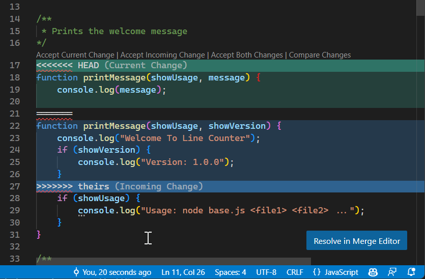
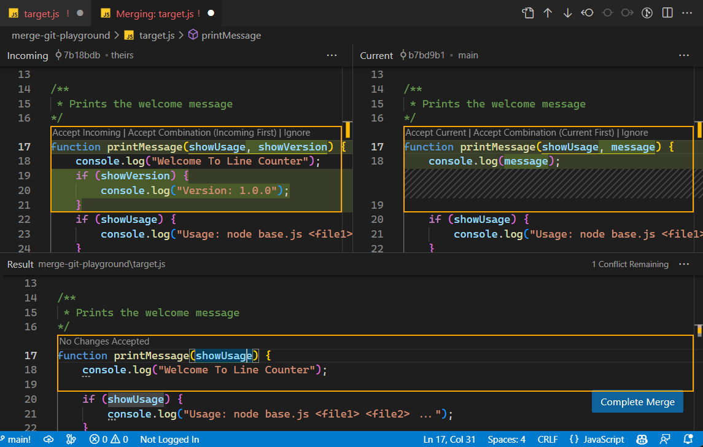
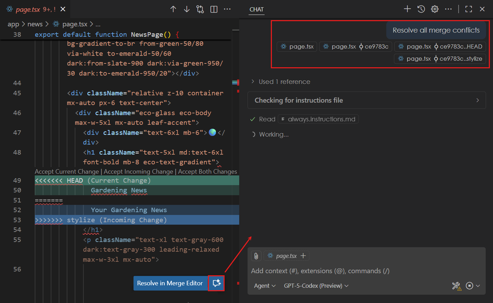

+++
title = "4.6 解决合并冲突"
date = 2026-11-06T07:53:25+08:00
weight = 6
type = "docs"
description = ""
isCJKLanguage = true
draft = false
+++


> 原文链接: [https://code.visualstudio.com/docs/sourcecontrol/merge-conflicts](https://code.visualstudio.com/docs/sourcecontrol/merge-conflicts)

# 4.6 解决合并冲突

　　当 Git 因无法自动合并更改而停止时，请使用 VS Code 解决冲突文件、审查结果并完成操作。对于较小的冲突，使用[内联操作](#resolve-conflicts-with-inline-actions)；对于复杂冲突，使用[三方合并编辑器](#use-the-3-way-merge-editor)比较两侧内容。

## 了解合并冲突 {#understanding-merge-conflicts}

　　当 Git 遇到无法自动解决的竞争更改时，会发生合并冲突。常见场景包括：两个分支修改文件中的同一行；一个分支删除另一个分支修改的文件；两个分支在同一位置添加不同内容。

　　冲突可能发生在合并、拉取、变基、拣选或储藏恢复期间。文件解决工具类似，但每一侧的含义以及完成步骤取决于具体操作。

> **提示**：详细了解[4.5 分支与工作树](../4.5-BranchesWorktrees/)，以组织开发工作并尽量减少合并冲突。

## 在 VS Code 中识别冲突 {#recognize-conflicts-in-vs-code}

　　发生合并冲突时，VS Code 会提供多种可视化指示。冲突文件会显示在源代码管理视图的 **合并更改** 部分。

### 编辑器冲突标记 {#editor-conflict-markers}

　　打开有冲突的文件时，VS Code 会使用以下标记突出显示冲突部分：

* `<<<<<<< HEAD`（或其他标签）：标记**当前**侧的开始。
* `=======`：分隔两个冲突版本。
* `>>>>>>> branch-name`（或提交标识符）：标记**传入**侧的结束。



### 了解当前和传入更改 {#understand-current-and-incoming-changes}

　　在接受任一侧之前，请阅读标签并比较内容。“当前”并不总是意味着你原来的功能分支。

| 操作 | 当前 | 传入 |
|-----------|---------|----------|
| 合并，包括执行合并的拉取 | 检出的目标分支。 | 正在合并到其中的分支。 |
| 变基，包括 **Pull (Rebase)** | 新的基础以及已经重放的提交。 | Git 当前正在重放的你分支中的提交。 |
| 拣选 | 检出的分支。 | 正在应用的提交。 |
| 恢复储藏 | 你正在恢复到的当前工作状态。 | 储藏中的更改。 |

> **重要**：在变基期间，Git 的“ours”和“theirs”角色与通常预期相反：“ours”是新的基础，“theirs”是你重放的工作。请检查更改，而不是按名称选择一侧。

### CodeLens 操作 {#codelens-actions}

　　在每个冲突上方，VS Code 会显示 CodeLens 操作：

* **接受当前更改**：仅保留此冲突的当前侧。
* **接受传入更改**：仅保留传入侧。
* **接受双方更改**：保留两个版本，依次排列。
* **比较更改**：打开差异视图比较版本。

　　接受双方并不保证代码有效，可能仍需要移除重复内容或手动合并逻辑。

## 使用内联操作解决冲突 {#resolve-conflicts-with-inline-actions}

1. 在源代码管理视图（`Ctrl + Shift + G`）中打开 **合并更改** 下的文件。

2. 审查冲突部分，确定每一侧代表的内容。

3. 选择冲突上方的 CodeLens 操作：**接受当前更改**、**接受传入更改** 或 **接受双方更改**。

4. 对每个冲突重复操作，然后检查整个文件是否有缺失或重复的代码。

5. 保存文件，并在源代码管理视图中使用 **+**（**暂存更改**）暂存它。

　　文件会从 **合并更改** 移到 **暂存的更改**。解决所有文件后，[完成操作](#complete-the-merge-operation)。

> **提示**：对于更复杂的冲突，可以手动编辑文件。删除冲突标记（`<<<<<<<`、`=======`、`>>>>>>>`），编辑内容以获得所需结果。

## 使用三方合并编辑器 {#use-the-3-way-merge-editor}

　　对于复杂冲突或需要并排查看所有更改时，请使用三方合并编辑器。该编辑器提供三个面板：**传入**（左侧）、**当前**（右侧）和 **结果**（底部，将要保存的已解决文件）。侧边标签取决于[正在进行的操作](#understand-current-and-incoming-changes)。

### 打开合并编辑器 {#open-the-merge-editor}

1. 在源代码管理视图中右键单击 **合并更改** 下的文件。

2. 选择 **在合并编辑器中打开**。或者打开文件，在出现按钮时选择 **在合并编辑器中解决**。

    

### 在合并编辑器中接受更改 {#accept-changes-in-the-merge-editor}

1. 审查 **传入** 和 **当前** 面板中的更改。

2. 接受任一侧的更改或合并双方。如果两种选择都无法得到预期代码，请[手动编辑结果](#manual-edits-in-the-merge-editor)。

3. 每次选择后检查 **结果** 面板。使用未解决冲突计数查找仍需处理的冲突。

4. 解决所有冲突后，审查生成的文件，选择 **完成合并**。

　　**完成合并** 会暂存该文件并关闭合并编辑器，但不会完成整个仓库操作。解决剩余文件，然后[完成操作](#complete-the-merge-operation)。

### 在合并编辑器中手动编辑 {#manual-edits-in-the-merge-editor}

1. 在 **结果** 面板中任意位置单击以放置光标。

2. 根据需要编辑内容，合并双方的元素或编写新代码。

　　即使未解决冲突计数为零，也要审查最终代码。解决文本冲突并不代表代码可以工作。

### 其他布局 {#alternative-layouts}

　　在合并编辑器中选择 **更多操作**（**...**）以切换布局或显示基础视图。基础版本是 Git 用来比较两侧的共同版本。**传入**、**当前** 和 **结果** 旁边的菜单提供各种选项，例如与基础版本比较或重置结果。

## 完成合并操作 {#complete-the-merge-operation}

　　首先解决并保存每个冲突文件，然后暂存解决方案。检查已暂存的差异并运行相关测试，然后再继续。

| 操作 | 完成方式 |
|-----------|---------------|
| 合并，包括执行合并的拉取 | 在源代码管理视图中输入合并提交消息，然后选择 **提交**。 |
| 变基，包括 **Pull (Rebase)** | 在仓库的集成终端中运行 `git rebase --continue`。Git 可能会在另一个冲突提交处停止，解决后再次继续，直到变基完成。 |
| 拣选 | 在仓库的集成终端中运行 `git cherry-pick --continue`。如果一系列提交遇到更多冲突，请重复此操作。 |
| 恢复储藏 | 审查恢复的文件，准备好后提交。储藏冲突不需要合并提交。 |

　　VS Code 的提交操作也会在暂存解决方案后继续正在进行的变基。如果不确定哪个操作处于活动状态，请在仓库终端中运行 `git status` 查看 Git 的当前状态和下一步操作。

　　合并、变基或拣选完成后，检查 `git status` 是否不再报告该操作正在进行。在[4.4 查看历史](../4.4-History/#view-branch-and-commit-history)中审查生成的历史记录。

## 取消操作 {#cancel-an-operation}

　　要放弃操作而不是解决冲突，请打开命令面板（`Ctrl + Shift + P`），选择匹配的命令：

* **Git: Abort Merge**：取消合并。
* **Git: Abort Rebase**：取消变基。
* **Git: Abort Cherry Pick**：取消拣选。

> **警告**：中止会移除该操作的冲突解决工作。请先复制要保留的编辑。Git 会尝试恢复到操作前状态，但可能无法重建操作前存在的未提交更改。

　　这些中止命令不会撤销储藏恢复。对于储藏中的更改，请在使用[4.3 暂存与提交](../4.3-StagingCommits/#undo-or-discard-changes)前检查工作文件和储藏列表。

## 使用 AI 解决冲突（实验性） {#resolve-conflicts-with-ai-experimental}

> **注意**：AI 辅助冲突解决是实验性功能，需要 GitHub Copilot 访问权限。使用前请[9.1 设置 GitHub Copilot](../../advanced-setup/9.1-GitHubCopilotSetup/)。

1. 在编辑器中打开有冲突的文件。

2. 选择编辑器顶部的 **使用 AI 解决合并冲突** 按钮。

    

3. 在聊天视图和编辑器中审查智能体的分析和建议编辑。

4. 接受解决方案或手动调整，然后测试结果。

5. 暂存已解决的文件并[完成操作](#complete-the-merge-operation)。

　　AI 会考虑合并基础（两个分支的共同祖先）以及每个分支的更改，生成尽量保留双方意图的解决方案。

## 将 VS Code 配置为默认合并工具 {#configure-vs-code-as-default-merge-tool}

　　要从终端工作流解决冲突，请配置 Git 使用 VS Code 三方合并编辑器。首先确保 [3.3.10 CommandLineInterface](../../editor/3.3-ConfigureTheEditor/3.3.10-CommandLineInterface/)。

　　在兼容 Bash 的终端中运行：

```bash
git config --global merge.tool vscode
git config --global mergetool.vscode.cmd 'code --wait --merge "$REMOTE" "$LOCAL" "$BASE" "$MERGED"'
```

　　Git 操作报告冲突后，运行 `git mergetool` 启动编辑器。Git 不会在冲突发生时自动启动它。

　　要在同一终端中配置差异工具，请运行：

```bash
git config --global diff.tool vscode
git config --global difftool.vscode.cmd 'code --wait --diff "$LOCAL" "$REMOTE"'
```

　　运行 `git difftool`，使用此工具比较更改。

## 后续步骤 {#next-steps}

* 共享更改前[4.4 查看历史](../4.4-History/)。
* 审查并测试结果后[4.2 仓库与远程](../4.2-ReposAndRemotes/#push-commits)。
* 如果操作仍无法完成，请[4.8 故障排除](../4.8-Troubleshooting/)。
