+++
title = "4.7 在 GitHub 上协作"
date = 2026-11-06T07:53:25+08:00
weight = 7
type = "docs"
description = ""
isCJKLanguage = true
draft = false
+++


> 原文链接: [https://code.visualstudio.com/docs/sourcecontrol/github](https://code.visualstudio.com/docs/sourcecontrol/github)

# 4.7 在 GitHub 上协作

　　Visual Studio Code 提供多种在 [GitHub](https://github.com) 上处理仓库、拉取请求和议题的方式。基本的 GitHub 身份验证和 Git 操作内置于 VS Code。扩展增加了拉取请求、议题和虚拟仓库工作流。

> **提示**：如果你不熟悉编辑器中的 Git，请先完成[4.1 快速入门](../4.1-Quickstart/)，再开始协作工作流。

## 选择 GitHub 工作流 {#choose-a-github-workflow}

| 目标 | 能力 | 要求 |
|------|------------|-------------|
| [4.2 仓库与远程](../4.2-ReposAndRemotes/) | 内置 Git 支持 | 安装 [Git](https://git-scm.com/download)，并在提示时登录。 |
| [创建和审查拉取请求](#pull-requests)或[管理议题](#issues) | [GitHub Pull Requests and Issues](https://marketplace.visualstudio.com/items?itemName=GitHub.vscode-pull-request-github) 扩展 | 安装扩展并登录。 |
| [不克隆直接浏览和编辑](#github-repositories-extension) | [GitHub Repositories](https://marketplace.visualstudio.com/items?itemName=github.remotehub) 扩展 | 安装扩展并登录。终端、构建和调试工作流需要不同的环境。 |

　　GitHub Pull Requests and Issues 与 GitHub Repositories 是两个独立的扩展。只安装支持你的工作流的扩展。

## 前提条件 {#prerequisites}

　　对于本地检出，请安装 [Git](https://git-scm.com/download) 并[4.1 快速入门](../4.1-Quickstart/#prerequisites)。要发布更改、创建拉取请求或管理议题，还需要一个[托管账户](https://docs.github.com/get-started/signing-up-for-github/signing-up-for-a-new-github-account)。

　　登录不会获得每个仓库的写入权限。如果你无法推送到项目，请[创建 fork](https://docs.github.com/pull-requests/collaborating-with-pull-requests/working-with-forks/fork-a-repo)，在 fork 中工作，并向原项目发起拉取请求。

## 登录 GitHub 以执行 Git 操作 {#sign-in-to-github-for-git-operations}

　　使用 GitHub 进行 Git 操作的身份验证不需要扩展。克隆私有仓库或推送到 GitHub 仓库时，VS Code 会提示你登录。按照浏览器提示操作，然后返回 VS Code。

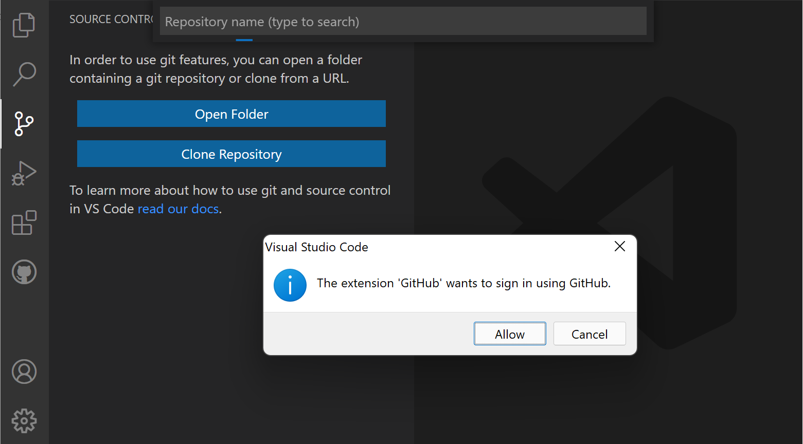

　　GitHub Enterprise Server 支持个人访问令牌身份验证。要使用个人访问令牌，请取消浏览器登录提示，直到 VS Code 要求提供令牌。有关其他身份验证选项，请参阅 [GitHub 身份验证方法](https://docs.github.com/authentication/keeping-your-account-and-data-secure/about-authentication-to-github)。

## 开始使用 GitHub Pull Requests and Issues {#get-started-with-github-pull-requests-and-issues}

　　安装 GitHub Pull Requests and Issues 扩展后，登录即可使用拉取请求和议题功能。

1. 在活动栏中选择 GitHub 图标。

2. 选择 **登录**，并按照浏览器提示操作。

    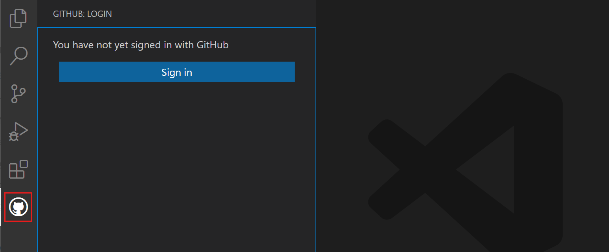

3. 身份验证完成后返回 VS Code。

　　如果没有重定向回 VS Code，可以手动添加授权令牌：在浏览器窗口中复制授权令牌；在 VS Code 中选择状态栏中的 **正在登录 github.com...**；粘贴令牌并按 `Enter`。

## 设置仓库 {#setting-up-a-repository}

### 克隆仓库 {#cloning-a-repository}

　　可以通过命令面板（`Ctrl + Shift + P`，macOS：`Cmd + Shift + P`）中的 **Git: Clone** 命令，或源代码管理视图中的 **克隆仓库** 按钮（未打开文件夹时可用），搜索并克隆 GitHub 仓库。在 GitHub 仓库下拉列表中可以筛选并选择要克隆到本地的仓库。

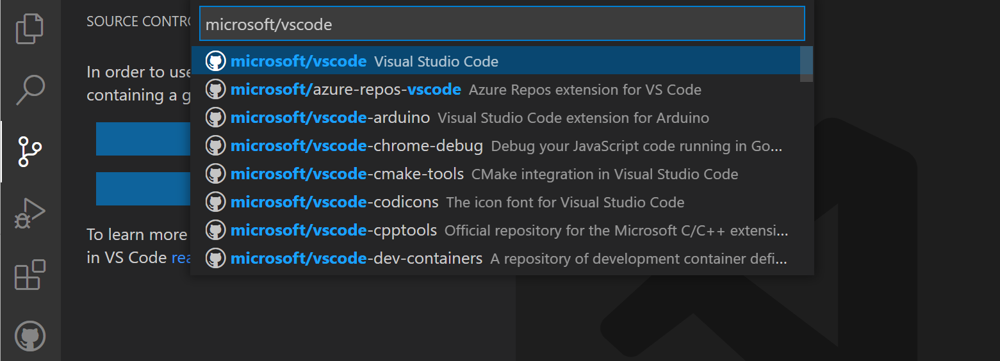

　　详细了解[4.2 仓库与远程](../4.2-ReposAndRemotes/#clone-repositories)。

> **注意**：如果不想将仓库内容克隆到本地，可以安装 [GitHub Repositories](https://marketplace.visualstudio.com/items?itemName=github.remotehub) 扩展，直接在 GitHub 上浏览和编辑。详细了解 [GitHub Repositories 扩展](#github-repositories-extension)。

## 拉取请求 {#pull-requests}

　　使用 GitHub Pull Requests and Issues 扩展的 **拉取请求** 视图创建或审查提议的更改。

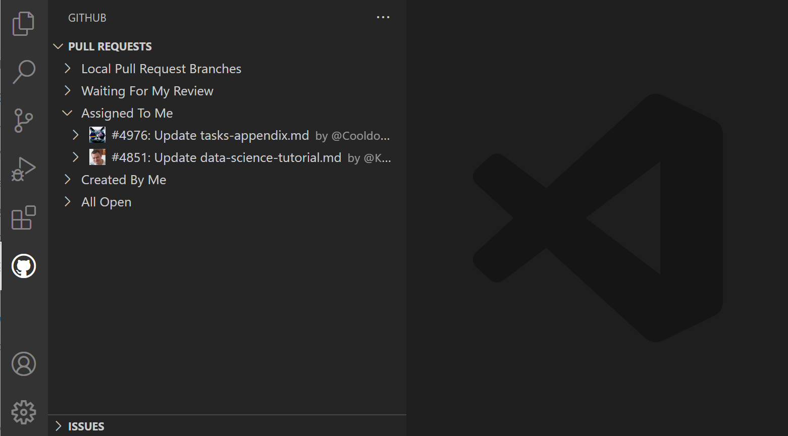

### 创建拉取请求 {#creating-pull-requests}

1. 打开本地仓库，[4.5 分支与工作树](../4.5-BranchesWorktrees/#create-new-branches)，并[4.3 暂存与提交](../4.3-StagingCommits/#commit-your-changes)。

2. 从命令面板运行 **GitHub Pull Requests: Create Pull Request**，或在 **拉取请求** 视图中选择 **创建拉取请求**。

3. 在 **创建** 视图中，选择应接收更改的基础仓库和分支，输入标题和描述。如果仓库有拉取请求模板，扩展会填充该模板。

    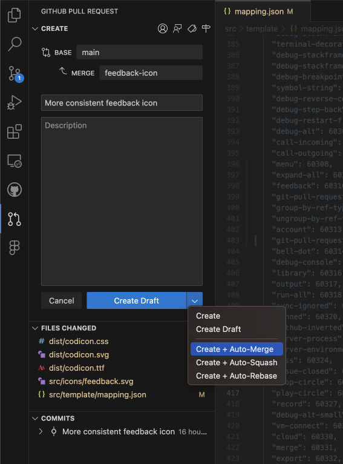

4. 选择 **创建**。如果分支尚未发布，请在提示时选择一个你可以推送的远程仓库，例如你的 fork。

　　扩展会在**审查模式**下打开拉取请求。请求审查前，请确认目标分支和更改的文件。

　　使用操作栏添加 **受理人**、**审查者**、**标签** 或 **里程碑**。对于未完成的工作，请使用 **创建** 按钮菜单中的 **创建草稿**。其他选项（例如**自动合并**）取决于仓库支持和你的权限。

### 审查拉取请求 {#reviewing}

1. 在 **拉取请求** 视图中选择一个拉取请求，打开其**说明**。

    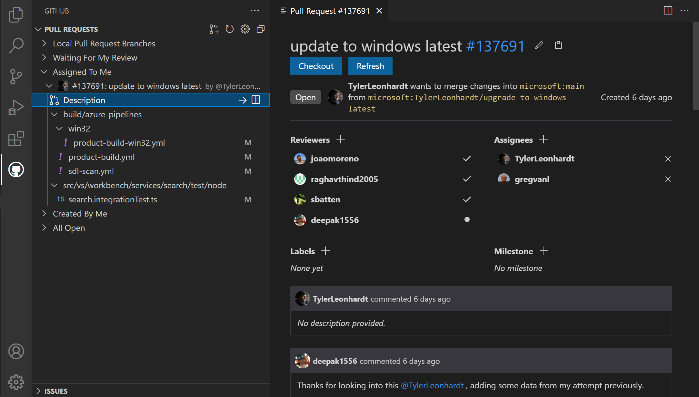

2. 要在本地检查和测试代码，请先提交或[4.5 分支与工作树](../4.5-BranchesWorktrees/#manage-stashes)，然后选择 **检出**。扩展会检出拉取请求分支并进入**审查模式**。**拉取请求中的更改** 视图会列出更改的文件和提交。

    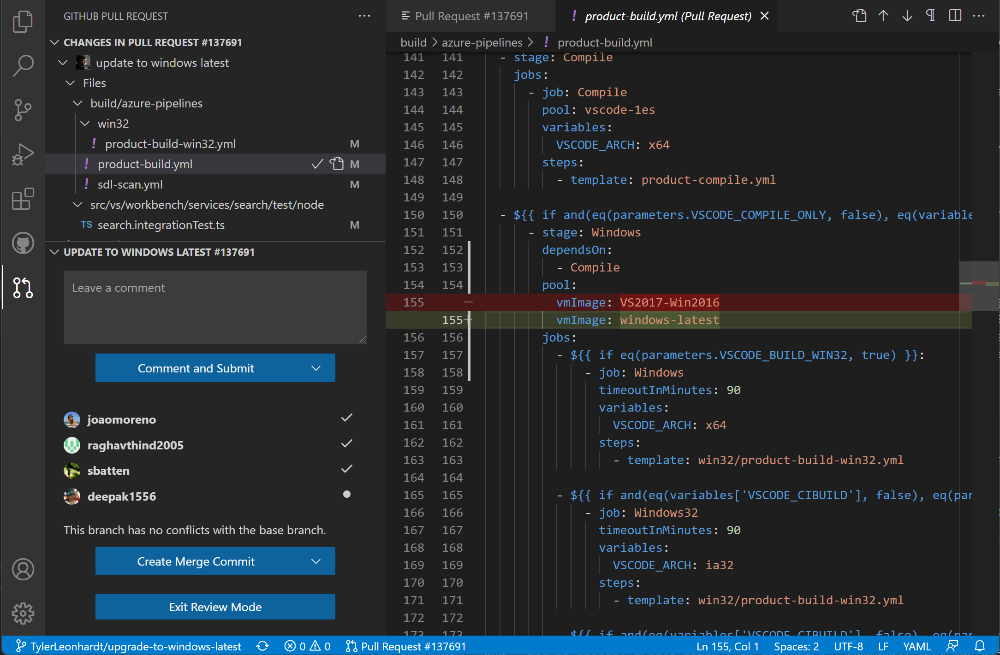

3. 选择文件以检查其差异并添加评论。使用 **打开文件** 打开工作文件。在此检出工作流中，可以使用本地导航、IntelliSense 和编辑功能。

4. 从拉取请求**说明**中提交评论或审查。批准和合并操作取决于你的权限和仓库规则。

5. 完成后，选择 **退出审查模式** 返回之前的分支。切换前请保留任何本地编辑。

### 自定义拉取请求列表 {#customize-the-pull-request-list}

　　配置 `githubPullRequests.queries`，选择视图显示哪些拉取请求。查询使用 [GitHub 搜索语法](https://docs.github.com/search-github/getting-started-with-searching-on-github/understanding-the-search-syntax)。例如，将以下设置添加到 [3.3.4 设置](../../editor/3.3-ConfigureTheEditor/3.3.4-Settings/#settings-json-file)：

```json
{
  "githubPullRequests.queries": [
    {
      "label": "Assigned To Me",
      "query": "is:open assignee:${user}"
    }
  ]
}
```

### 使用 AI 协助处理拉取请求 {#use-ai-assistance-for-pull-requests}

　　AI 协助是可选的。要生成拉取请求标题和描述，请选择标题字段旁的闪光图标，然后审查生成的文本。此操作使用由 `chat.utilitySmallModel` 配置的实用模型，而不是为聊天或智能体会话选择的模型。请参阅[2.3.1 选择和配置模型](../../ai-in-vs-code/choose-models-and-agents/2.3.1-ChooseAndConfigureModels/#change-the-model-for-utility-tasks)。

　　也可以在创建拉取请求之前[使用 AI 审查提议的更改](https://docs.github.com/en/copilot/using-github-copilot/code-review/using-copilot-code-review?tool=vscode)。在该指南中查看功能要求，并在 GitHub Pull Request 视图中选择 **代码审查**。

## 议题 {#issues}

### 创建议题 {#creating-issues}

　　可以通过 **议题** 视图中的 **+** 按钮，以及 **GitHub Issues: Create Issue from Selection** 和 **GitHub Issues: Create Issue from Clipboard** 命令创建议题。还可以使用针对“TODO”注释的代码操作创建。创建议题时，可以采用默认描述，或选择右上角的 **编辑描述** 铅笔图标，打开议题正文编辑器。

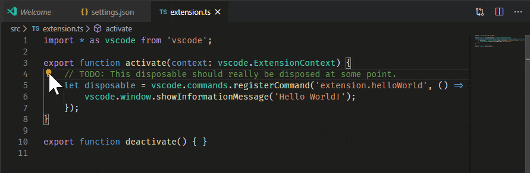

　　可以使用 **GitHub Issues: Create Issue Triggers**（`githubIssues.createIssueTriggers`）设置配置代码操作的触发条件。默认触发词为：

```json
"githubIssues.createIssueTriggers": [
  "TODO",
  "todo",
  "BUG",
  "FIXME",
  "ISSUE",
  "HACK"
]
```

### 处理议题 {#working-on-issues}

　　在 **议题** 视图中，可以查看并处理你的议题。默认情况下，开始处理议题时（**Start Working on Issue** 上下文菜单项），会为你创建一个分支，如下方图片的状态栏所示。

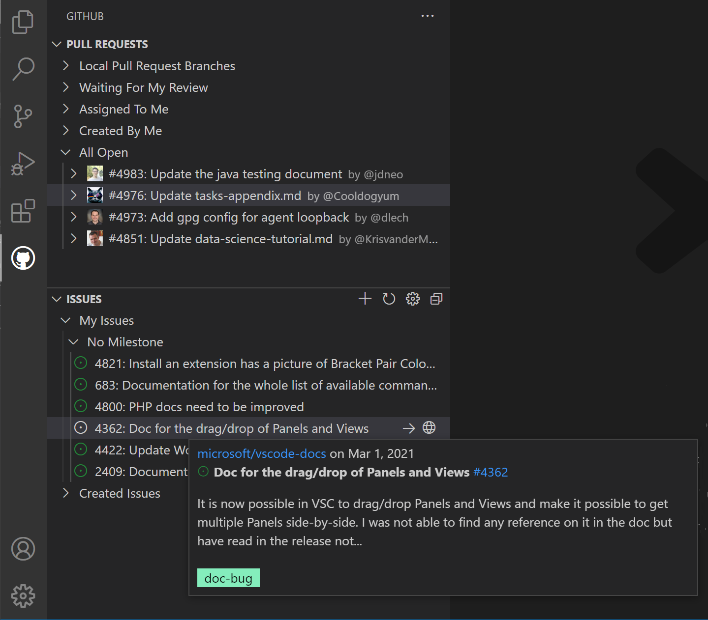

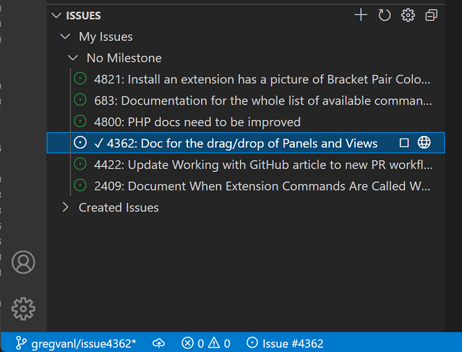

　　状态栏还会显示活动议题，选择该项可查看议题操作列表，例如在 GitHub 网站上打开议题或创建拉取请求。

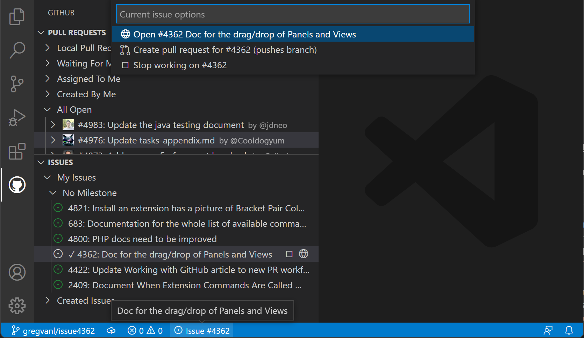

　　可以使用 **GitHub Issues: Issue Branch Title**（`githubIssues.issueBranchTitle`）设置配置分支名称。如果你的工作流不涉及创建分支，或希望每次都提示输入分支名称，请关闭 **GitHub Issues: Use Branch For Issues**（`githubIssues.useBranchForIssues`）设置。

　　处理完议题并要提交更改时，**源代码管理** 视图中的提交消息输入框会填入消息，可通过 **GitHub Issues: Working Issue Format SCM**（`githubIssues.workingIssueFormatScm`）配置。

## 编辑器集成 {#editor-integration}

　　GitHub Pull Requests and Issues 扩展还会在编辑时提供用户和议题信息。

### 悬停信息 {#hovers}

　　将鼠标悬停在 `@` 提及的用户名上可查看用户详情，或悬停在议题引用上查看其详情。

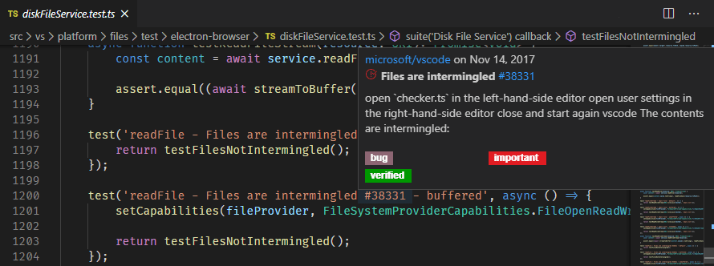

### 建议 {#suggestions}

　　在编辑器或提交消息输入框中输入 `@` 获取用户建议，或输入 `#` 获取议题建议。

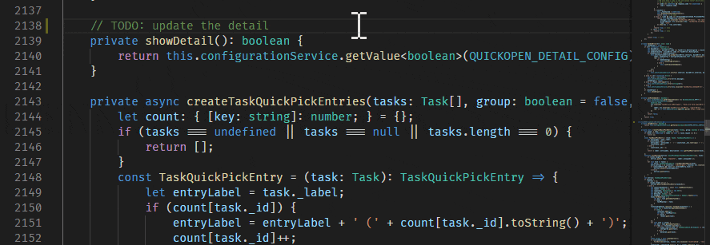

　　使用 `githubIssues.queries` 选择显示哪些议题。查询使用 [GitHub 搜索语法](https://docs.github.com/search-github/getting-started-with-searching-on-github/understanding-the-search-syntax)。要从这些建议中排除某些语言，请为议题配置 `githubIssues.ignoreCompletionTrigger`，或为用户配置 `githubIssues.ignoreUserCompletionTrigger`。两者都接受[语言标识符](https://code.visualstudio.com/docs/languages/identifiers)。例如：

```json
{
  "githubIssues.ignoreCompletionTrigger": [
    "python"
  ]
}
```

## GitHub Repositories 扩展 {#github-repositories-extension}

　　[GitHub Repositories](https://marketplace.visualstudio.com/items?itemName=github.remotehub) 扩展让你无需在本地克隆即可浏览、搜索、编辑远程 GitHub 仓库并提交。此工作流适合审查源代码或对文件做小更改。它是虚拟工作区，不是本地检出。要运行终端命令、构建或调试项目，请[继续在本地克隆或其他开发环境中工作](#continue-working-on)。

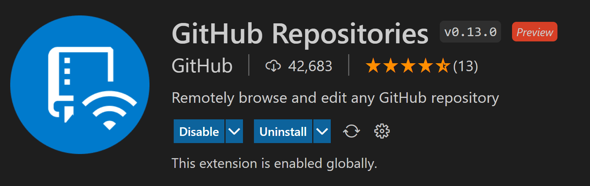

### 打开仓库 {#opening-a-repository}

　　安装 GitHub Repositories 扩展后，通过命令面板（`Ctrl + Shift + P`，macOS：`Cmd + Shift + P`）中的 **GitHub Repositories: Open Repository...** 命令，或选择状态栏左下角的远程指示器，打开仓库。


　　运行 **Open Repository** 命令后，可以选择从 GitHub 打开仓库、从 GitHub 打开拉取请求，或重新打开之前连接过的仓库。如果之前没有在 VS Code 中登录 GitHub，系统会提示你使用 GitHub 账户进行身份验证。

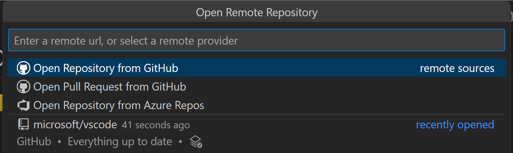

　　可以直接提供仓库 URL，或在文本框中输入内容搜索 GitHub。选择仓库或拉取请求后，VS Code 会重新加载窗口，并在资源管理器视图中显示仓库内容。你可以打开具有语法高亮和括号匹配的文件，编辑并提交更改，就像在本地克隆中一样。

　　与本地仓库的一个区别是，使用 GitHub Repository 扩展提交更改时，更改会直接推送到远程仓库，类似于在 GitHub Web 界面中工作。每次打开仓库或分支时，都会获得 GitHub 上的最新源代码，无需像本地仓库那样记住拉取刷新。

　　该扩展支持查看甚至提交 LFS 跟踪的文件，而无需在本地安装 Git LFS。将要由 LFS 跟踪的文件类型添加到 [`.gitattributes` 文件](https://git-lfs.com)，然后使用源代码管理视图直接提交到 GitHub。

### 切换分支 {#switching-branches}

　　选择状态栏中的分支指示器以切换分支。无需先储藏未提交的更改，因为扩展会记住你的更改，并在你返回分支时重新应用它们。

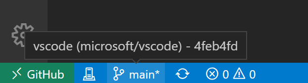

### 远程资源管理器 {#remote-explorer}

　　可以通过活动栏中的远程资源管理器快速重新打开远程仓库。此视图显示之前打开的仓库和分支。

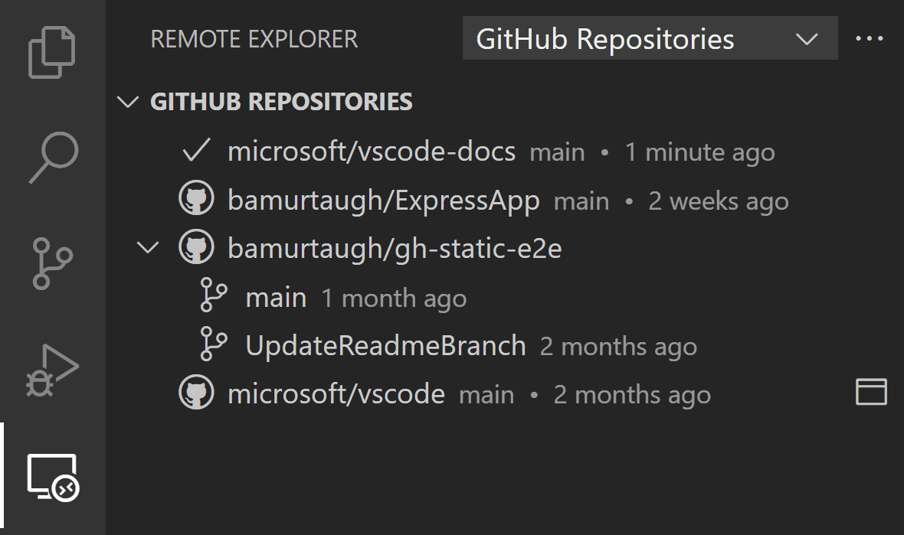

### 创建拉取请求 {#create-pull-requests}

　　如果你的工作流使用拉取请求，而不是直接提交到仓库，可以从源代码管理视图创建新 PR。系统会提示你提供标题并创建新分支。

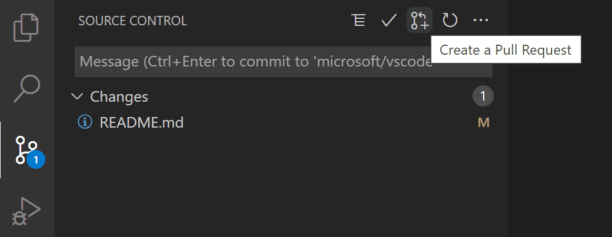

　　创建拉取请求后，可以使用 GitHub Pull Request and Issues 扩展审查、编辑和合并 PR。

### 虚拟文件系统 {#virtual-file-system}

　　由于仓库文件不在本地计算机上，GitHub Repositories 扩展会在内存中创建虚拟文件系统，以便查看文件内容并进行编辑。使用虚拟文件系统意味着某些假定本地文件存在的操作和扩展将无法启用或功能受限。任务、调试和集成终端等功能不会启用。可以通过远程指示器悬停信息中的“功能不可用”链接了解虚拟文件系统的支持级别。

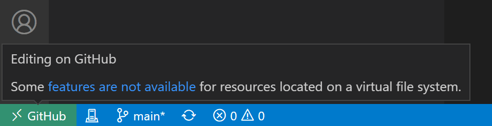

### 继续工作 {#continue-working-on}

　　有时你会希望切换到支持本地文件系统以及完整语言和开发工具的开发环境。GitHub Repositories 扩展可以让你：

* 创建 GitHub codespace（如果安装了 [GitHub Codespaces 扩展](https://marketplace.visualstudio.com/items?itemName=GitHub.codespaces)）。
* 将仓库克隆到本地。
* 将仓库克隆到 Docker 容器中（如果安装了 [Docker](https://docker.com/) 和 Microsoft [Container Tools 扩展](https://marketplace.visualstudio.com/items?itemName=ms-azuretools.vscode-containers)）。

　　要切换开发环境，请使用命令面板中的 **Continue Working On** 命令，或选择状态栏中的远程指示器。

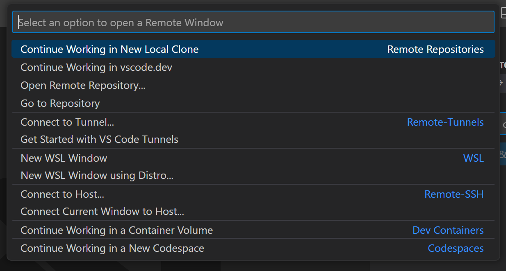

　　如果使用[8.8 GitHubCodespaces](../../remote/8.8-GitHubCodespaces/#browser-based-editor)，**Continue Working On** 命令可以选择在本地打开仓库，或在 [GitHub Codespaces](https://github.com/features/codespaces) 的云托管环境中打开。

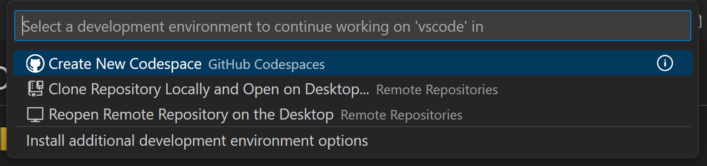

　　首次在有未提交更改时使用 **Continue Working On**，可以选择使用 **云端更改** 将编辑带到所选开发环境。云端更改会将待处理更改存储在与设置同步相同的 VS Code 服务中。应用到目标开发环境后，这些更改会从服务中删除。如果选择不带未提交更改继续，可以稍后通过配置 `"workbench.cloudChanges.continueOn": "prompt"` 更改此偏好。如果待处理更改未自动应用，可以使用 **Cloud Changes: Show Cloud Changes** 命令查看、管理和删除存储的更改。

## 后续步骤 {#next-steps}

* 当分支包含竞争更改时[4.6 解决合并冲突](../4.6-MergeConflicts/)。
* 远程操作失败时[4.8 故障排除](../4.8-Troubleshooting/)。
* [4.5 分支与工作树](../4.5-BranchesWorktrees/)，以便并行处理拉取请求。
