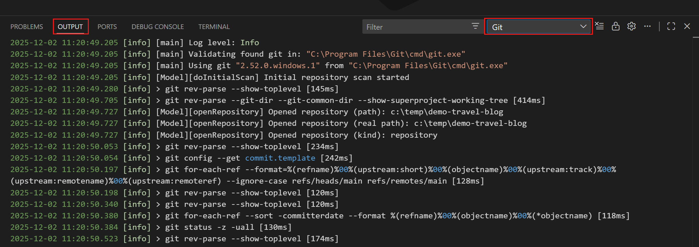
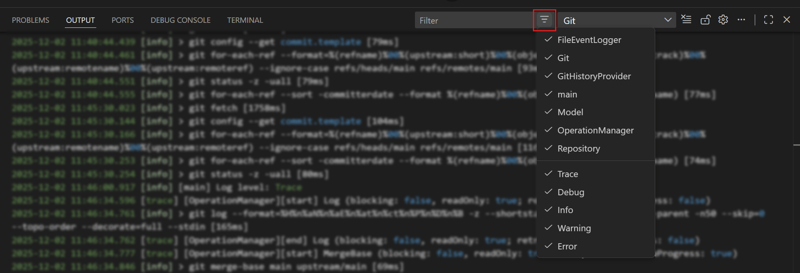
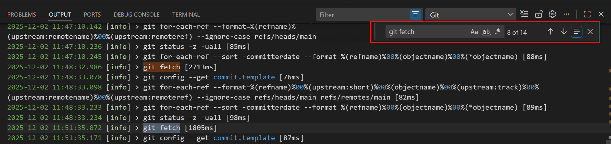
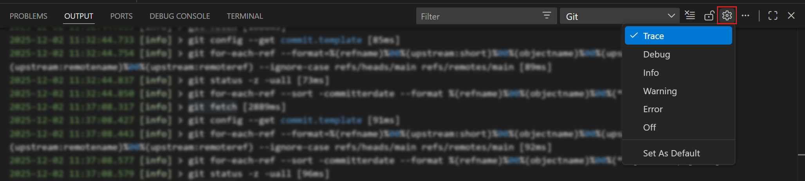

+++
title = "4.8 故障排除"
date = 2026-11-06T07:53:25+08:00
weight = 8
type = "docs"
description = ""
isCJKLanguage = true
draft = false
+++


> 原文链接: [https://code.visualstudio.com/docs/sourcecontrol/troubleshooting](https://code.visualstudio.com/docs/sourcecontrol/troubleshooting)

# 4.8 故障排除

　　使用本文解决 VS Code 中常见的 Git 问题。请先根据症状找到对应部分，如果建议的修复方法无法解决问题，再使用 Git 输出窗口收集更多信息。

## 找不到 Git {#git-not-found}

　　如果 VS Code 报告“找不到 Git”，说明它无法在打开仓库的环境中定位 Git 可执行文件。

1. 在该环境的终端中运行 `git --version`。对于远程工作区，请检查远程环境，而不仅仅是本地计算机。

2. 如果找不到命令，请按照 [4.1 快速入门](../4.1-Quickstart/#prerequisites)操作，然后重新启动 VS Code。

3. 如果 Git 在终端中可用但在 VS Code 中不可用，请检查 [Git 输出窗口](#open-the-git-output-window)中它尝试过的可执行文件路径。如有必要，将 `git.path` 设置为 Git 可执行文件的完整路径，然后重新启动 VS Code。

　　检测成功后，Git 输出窗口会显示 Git 可执行文件和版本，源代码管理视图可以打开你的仓库。

## 提交因缺少 user.name 或 user.email 而失败 {#a-commit-fails-because-username-or-useremail-is-missing}

　　错误“请确保在 git 中配置了 user.name 和 user.email”表示 Git 没有创建提交所需的作者身份。登录 Git 托管服务不会配置此身份。

1. 在仓库文件夹中打开的终端里检查有效值：

    ```bash
    git config --get user.name
    git config --get user.email
    ```

2. 为此仓库设置缺失或不正确的值：

    ```bash
    git config user.name "<your-name>"
    git config user.email "<your-email>"
    ```

    这些命令仅影响当前仓库。要在所有仓库中使用同一身份，请按照[4.1 快速入门](../4.1-Quickstart/#prerequisites)操作。

3. 重试提交。新提交会使用配置的姓名和电子邮件，但不会更改现有提交。

## 被忽略的文件仍出现在源代码管理中 {#ignored-files-still-appear-in-source-control}

　　Git 忽略规则适用于未跟踪文件。将文件添加到 `.gitignore` 不会阻止 Git 跟踪已经提交或暂存的文件。

1. 在仓库文件夹中打开的终端里检查文件是否在 Git 索引中：

    ```bash
    git ls-files -- "<file>"
    ```

2. 如果命令列出该文件，说明 Git 正在跟踪它。如果你只是暂存了新文件，请[4.3 暂存与提交](../4.3-StagingCommits/#unstage-changes)并添加忽略规则。如果文件已经提交，请保持跟踪，或使用以下过程停止跟踪。

3. 如果命令没有列出文件，请检查适用的忽略规则：

    ```bash
    git check-ignore -v -- "<file>"
    ```

    修正 `.gitignore` 中缺失或否定的模式。以 `!` 开头的模式会使匹配的文件重新可被包含。模式语法请参阅 [Git ignore 模式参考](https://git-scm.com/docs/gitignore)。应用匹配的忽略规则后，未跟踪文件不再显示为更改。

　　`files.exclude` 设置会在资源管理器中隐藏文件，但不会更改 Git 跟踪或忽略规则。

### 停止跟踪文件而不删除本地副本 {#stop-tracking-a-file-without-deleting-the-local-copy}

　　仅当已提交的文件不应再属于仓库时，才使用此过程。

> **警告**：从 Git 索引中移除已跟踪文件会暂存一次仓库删除，而不是从工作文件夹中删除。提交并推送它会改变所有人的跟踪状态。协作者拉取该提交时，Git 可能会删除他们的已跟踪副本。在共享此更改之前请先协调。文件仍保留在较早的提交中。

1. 将文件的忽略规则添加到 `.gitignore`。

2. 从 Git 索引中移除文件，但保留工作副本：

    ```bash
    git rm --cached -- "<file>"
    ```

3. 准备好共享跟踪更改时，审查并提交 `.gitignore` 和已暂存的删除。

　　提交后，本地文件仍保留在磁盘上并被忽略。如果只想在资源管理器中隐藏文件而不更改仓库跟踪，请改用 `files.exclude`。

## 推送因远程有新提交而被拒绝 {#push-is-rejected-because-the-remote-has-new-commits}

　　包含 `non-fast-forward` 或 `fetch first` 的拒绝表示远程分支有你本地分支没有的提交。Git 拒绝推送以避免覆盖远程历史记录。

1. [4.2 仓库与远程](../4.2-ReposAndRemotes/#fetch-commits)并[4.2 仓库与远程](../4.2-ReposAndRemotes/#review-incoming-and-outgoing-history)。确认你在预期的分支和远程仓库上工作。

2. 在整合传入提交之前，提交本地更改或[4.5 分支与工作树](../4.5-BranchesWorktrees/#manage-stashes)。

3. 使用团队的合并或变基工作流[4.2 仓库与远程](../4.2-ReposAndRemotes/#pull-commits)。如果发生冲突，请[4.6 解决合并冲突](../4.6-MergeConflicts/)并[4.6 解决合并冲突](../4.6-MergeConflicts/#complete-the-merge-operation)。

4. [4.2 仓库与远程](../4.2-ReposAndRemotes/#push-commits)。当分支包含远程历史记录且你有权限更新它时，推送就可以成功。

> **警告**：不要强制推送来绕过此拒绝。强制推送可能会覆盖其他人依赖的提交。如果你有意重写了共享历史记录，请先与协作者商定恢复计划。

　　如果错误改为提到权限或分支保护，请使用下一节，而不是反复拉取。

## 权限被拒绝、只读仓库或受保护分支 {#permission-denied-read-only-repository-or-protected-branch}

　　这些错误的成因不同。请检查 [Git 输出窗口](#open-the-git-output-window)中的失败命令和完整错误。在仓库文件夹中运行 `git remote -v`，确认获取和推送 URL 指向预期仓库。

| 症状 | 诊断和操作 |
|---------|----------------------|
| `Authentication failed` 或 `Permission denied (publickey)` | Git 无法进行身份验证。对于 HTTPS，请检查[4.2 仓库与远程](../4.2-ReposAndRemotes/#credential-helpers)存储的账户和凭据。对于 SSH，请使用 [4.9 常见问题](../4.9-FAQ/#authentication)检查密钥和代理。修正凭据后重试。 |
| 远程报告你没有推送权限 | 你的账户可能只有读取权限而没有写入权限，或者 Git 使用了错误账户的凭据。更新存储的凭据、向维护者申请写入权限，或将分支推送到你拥有的 fork。 |
| 远程拒绝更新受保护分支或报告违反仓库规则 | 身份验证成功，但托管服务的策略阻止了更新。将工作推送到允许的功能分支并打开拉取请求，或按照仓库要求的检查操作。更改凭据或强制推送无法绕过这些规则。 |
| 本地路径报告 `Permission denied` 或 `Read-only file system` | Git 无法写入工作文件夹或 `.git` 目录。检查文件系统权限、所有权，以及驱动器是否以只读方式挂载。恢复账户的写入权限后重试。 |

　　修正原因后重试失败的操作。成功的身份验证不会授予仓库写入权限，也不会覆盖分支保护。

## 推送、拉取或同步无法完成 {#push-pull-or-sync-doesnt-finish}

　　Git 操作无法完成通常表示 Git 正在等待身份验证，但凭据提示不可见。

1. 打开 Git 输出窗口，检查最近一次命令是否有身份验证错误。

2. 为你的操作系统配置 [Git 凭据助手](https://docs.github.com/get-started/getting-started-with-git/caching-your-github-credentials-in-git)。

3. 再次运行操作，并完成任何登录提示。

　　[Git Credential Manager](https://github.com/GitCredentialManager/git-credential-manager) 是 Windows、macOS 和 Linux 上推荐的凭据助手。Git for Windows 包含它。

## Git 身份验证提示反复出现 {#git-authentication-prompts-appear-repeatedly}

　　如果启用了 `git.autofetch`，即使你没有选择 Git 操作，后台获取也可能触发反复的身份验证提示。自动获取在编辑器窗口中默认关闭，在智能体窗口中默认开启。

　　检查 Git 输出窗口，了解哪个命令触发了提示。配置 [Git 凭据助手](https://docs.github.com/get-started/getting-started-with-git/caching-your-github-credentials-in-git)，为远程仓库存储有效凭据。如果不希望后台获取，请关闭 `git.autofetch`。这会停止这些获取，但不会修复手动获取、拉取或推送所需的凭据。

## 初始化仓库后 Git 操作不可用 {#git-actions-are-unavailable-after-initializing-a-repository}

　　推送、拉取和同步需要远程仓库。初始化本地仓库不会创建远程仓库。要连接到现有的托管仓库，请[4.2 仓库与远程](../4.2-ReposAndRemotes/#add-a-remote)。要创建新的 GitHub 仓库，请使用[4.2 仓库与远程](../4.2-ReposAndRemotes/#publish-to-github)。

　　添加远程仓库后，[4.2 仓库与远程](../4.2-ReposAndRemotes/#push-commits)；如果没有上游，请接受发布提示。之后分支就有了用于同步的上游。暂存和提交等本地操作不需要远程仓库。

## VS Code 报告仓库可能不安全 {#vs-code-reports-that-a-repository-is-potentially-unsafe}

　　Git 会阻止在不同操作系统用户拥有的仓库中执行操作，以防止运行不受信任仓库中的 Git 配置或钩子。

　　在源代码管理视图或通知中选择 **管理不安全的仓库**。在将仓库标记为安全之前，请审查仓库位置。将仓库标记为安全会将其位置添加到 Git 的 [`safe.directory` 配置](https://git-scm.com/docs/git-config#Documentation/git-config.txt-safedirectory)中。

　　在 Windows 上，如果从以管理员身份运行的应用程序克隆仓库，然后从非管理员应用程序打开它，就可能发生此情况。

## VS Code 未检测到父文件夹中的仓库 {#vs-code-doesnt-detect-a-repository-in-a-parent-folder}

　　VS Code 不会自动打开父文件夹中的 Git 仓库，因为这可能会暴露你预期工作文件夹之外的更改。

　　当 VS Code 检测到父文件夹中的仓库时，请使用通知或源代码管理欢迎视图打开它。要始终打开父文件夹中的仓库，请将 `git.openRepositoryInParentFolders` 设置为 `always`。

## 打开 Git 输出窗口 {#open-the-git-output-window}

　　VS Code 使用计算机上的 Git 安装执行源代码管理操作。Git 输出窗口记录 Git 可执行文件、命令、错误、时间戳和命令持续时间。

* 在源代码管理视图中选择 **更多操作**（**...**）> **显示 Git 输出**。
* 从命令面板（`Ctrl + Shift + P`）运行 **Git: Show Git Output**。
* 打开输出面板（`Ctrl + Shift + U`），从通道列表中选择 **Git**。



　　审查最近的命令和错误消息。命令后的第一个错误通常比由此产生的后续错误更有用。

> **提示**：默认情况下，Git 输出窗口仅在命令失败时显示标准输出。使用 `git.commandsToLog` 设置选择应始终记录标准输出的命令。

## 筛选和搜索 Git 日志 {#filter-and-search-git-logs}

　　使用输出面板筛选器减少日志信息：

* 选择日志级别，例如 `trace`、`debug`、`info`、`warning` 或 `error`。默认级别为 `info`。
* 选择类别，例如 `git` 或 `repository`。选择 `git` 可专注于 Git 执行的命令。



　　使用搜索框（`Ctrl + F`）查找命令、仓库路径或错误。搜索框支持正则表达式。



## 收集跟踪日志 {#collect-trace-logs}

　　当常规 Git 输出信息不足时，启用跟踪日志记录：

1. 打开 Git 输出窗口。
2. 选择输出面板标题中的齿轮图标。
3. 选择 **跟踪**。

    

4. 重现问题并审查新的日志条目。

　　跟踪日志可能包含仓库路径、远程 URL、分支名称和其他开发信息。共享前请审查输出并移除敏感信息。

## 后续步骤 {#next-steps}

* [4.2 仓库与远程](../4.2-ReposAndRemotes/#push-pull-and-sync)，在不进行意外同步的情况下获取、拉取或推送。
* [4.9 常见问题](../4.9-FAQ/)回答产品支持和兼容性问题。
* [Git 文档](https://git-scm.com/doc)提供 Git 命令和配置的参考详情。
