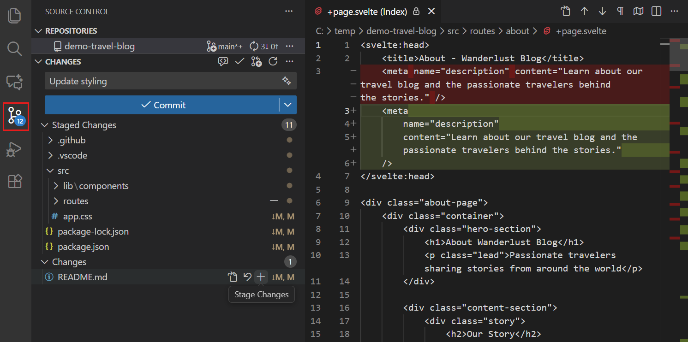

+++
title = "4 源代码管理"
date = 2026-11-06T07:53:25+08:00
weight = 4
type = "docs"
description = ""
isCJKLanguage = true
draft = false
+++


> 原文链接: [https://code.visualstudio.com/docs/sourcecontrol/overview](https://code.visualstudio.com/docs/sourcecontrol/overview)

# 4 源代码管理

　　Visual Studio Code 内置 Git 支持，让你无需离开编辑器即可审查更改、创建提交并协作处理代码。本页可帮助你选择起点，或找到特定任务的指南。

　　Git 在仓库中跟踪文件版本。GitHub 是一项托管 Git 仓库的服务，并增加了拉取请求等协作工具。在本地使用 Git 不需要托管账户。

| 你想做什么？ | 从这里开始 |
|------------------------|------------|
| 在编辑器中学习 Git 并完成第一次提交 | [4.1 快速入门](4.1-Quickstart/) |
| 处理现有项目 | [4.2 仓库与远程](4.2-ReposAndRemotes/#clone-repositories) |
| 选择要保存到 Git 历史记录中的更改 | [4.3 暂存与提交](4.3-StagingCommits/) |
| 与团队共享本地提交 | [4.2 仓库与远程](4.2-ReposAndRemotes/#push-pull-and-sync) |
| 撤销或恢复工作 | [4.3 暂存与提交](4.3-StagingCommits/#undo-or-discard-changes) |
| 解决错误或意外行为 | [4.8 故障排除](4.8-Troubleshooting/) |

　　编辑器和命令行 Git 使用同一个仓库。你可以在任一界面中工作，无需在两者之间导入或同步更改。

## 前提条件 {#prerequisites}

　　要在 VS Code 中使用 Git 功能，你需要：

* 在计算机上[安装 Git](https://git-scm.com/download)。VS Code 使用此安装执行 Git 操作。

* 配置提交中记录的名称和电子邮件。这些值标识作者，而不是你的登录凭据：

    ```bash
    git config --global user.name "<your-name>"
    git config --global user.email "<your-email>"
    ```

　　将占位符替换为你的姓名和电子邮件。[4.1 快速入门](4.1-Quickstart/#prerequisites)将引导你完成此设置。有关 Git 概念的背景信息，请参阅 [Git 文档](https://git-scm.com/doc)。

## 开始使用仓库 {#get-started-with-a-repository}

　　通过 **文件** > **打开文件夹...** 打开仓库文件夹，即可在 VS Code 中使用其 Git 历史记录。如果你还没有本地仓库，请选择以下路径之一：

* **在本地开始**：在练习文件夹中[4.1 快速入门](4.1-Quickstart/)。

* **处理现有项目**：从 Git 托管服务[4.2 仓库与远程](4.2-ReposAndRemotes/#clone-repositories)。

* **不克隆直接浏览**：使用 [4.7 在 GitHub 上协作](4.7-CollaborateOnGitHub/#github-repositories-extension)创建虚拟工作区。此工作流与本地检出的功能不同。

　　要共享现有的本地仓库，请[4.2 仓库与远程](4.2-ReposAndRemotes/#publish-to-github)或[4.2 仓库与远程](4.2-ReposAndRemotes/#add-a-remote)。

## 源代码管理界面 {#source-control-interface}

　　打开 **源代码管理** 视图（`Ctrl + Shift + G`）以审查和提交更改。



| 界面 | 用途 |
|-----------|-----------|
| **源代码管理**视图 | 审查更改的文件，选择要暂存的更改并提交。 |
| **差异编辑器** | 比较文件版本并单独暂存更改。 |
| **源代码管理图** | 检查提交、分支以及传入或传出的工作。 |
| 资源管理器中的**时间线**视图 | 检查某个文件的 Git 提交和本地保存记录。 |
| **状态栏** | 查看活动分支并访问同步操作。 |

## 常见工作流 {#common-workflows}

### 提交前审查更改 {#review-changes-before-committing}

　　在 **更改** 中选择文件可审查未暂存的编辑，在 **暂存的更改** 中选择文件可审查下一次提交将包含的内容。了解如何[4.3 暂存与提交](4.3-StagingCommits/#review-changes-with-the-diff-editor)，包括部分暂存的文件。

### 暂存和提交更改 {#stage-and-commit-changes}

　　暂存会选择下一次提交的更改。提交会将快照记录到本地 Git 历史记录中，但不会上传到服务器。了解如何[4.3 暂存与提交](4.3-StagingCommits/)。

### 与远程仓库同步 {#sync-with-remotes}

　　推送会上传你的提交，拉取会整合远程提交，同步会先拉取再推送。了解如何[4.2 仓库与远程](4.2-ReposAndRemotes/#push-pull-and-sync)，并在整合前检查传入的工作。

### 解决合并冲突 {#resolve-merge-conflicts}

　　当 Git 无法自动合并更改时，请使用内联操作或三方合并编辑器解决冲突。按照[4.6 解决合并冲突](4.6-MergeConflicts/)审查结果，并完成或取消操作。

### 使用分支、工作树和储藏 {#work-with-branches-worktrees-and-stashes}

　　使用**分支**开发独立的工作线，使用**储藏**暂存未提交的更改，或使用**工作树**在单独的文件夹中检出另一个分支。了解如何[4.5 分支与工作树](4.5-BranchesWorktrees/)。

### 查看提交历史 {#view-commit-history}

　　使用图查看仓库历史，使用时间线查看文件历史，使用 Git 追溯（blame）确定最后修改某一行的人。了解如何[4.4 查看历史](4.4-History/)。

## 使用 GitHub 拉取请求和议题 {#working-with-github-pull-requests-and-issues}

　　克隆并推送到 GitHub 使用内置 Git 支持。要创建或审查拉取请求并管理议题，请安装 GitHub Pull Requests and Issues 扩展。请参阅[4.7 在 GitHub 上协作](4.7-CollaborateOnGitHub/#choose-a-github-workflow)。

## 其他源代码管理提供程序 {#other-source-control-providers}

　　Git 支持是内置的，但你可以为 Subversion 或 Mercurial 等其他版本控制系统[安装扩展](https://marketplace.visualstudio.com/search?target=VSCode&category=SCM%20Providers&sortBy=Installs)。托管在 Azure DevOps 上的 Git 仓库使用内置 Git 集成。

　　在扩展视图（`Ctrl + Shift + X`，macOS：`Cmd + Shift + X`）中搜索 `@category:"scm providers"`，浏览可用的 SCM 提供程序扩展。

## 后续步骤 {#next-steps}

* 在引导式练习项目中[4.1 快速入门](4.1-Quickstart/)。
* [观看 Git 介绍](https://code.visualstudio.com/docs/introvideos/versioncontrol)，获得直观演示。
* 查看[4.9 常见问题](4.9-FAQ/)，了解 Git 客户端、身份验证和其他提供程序。
