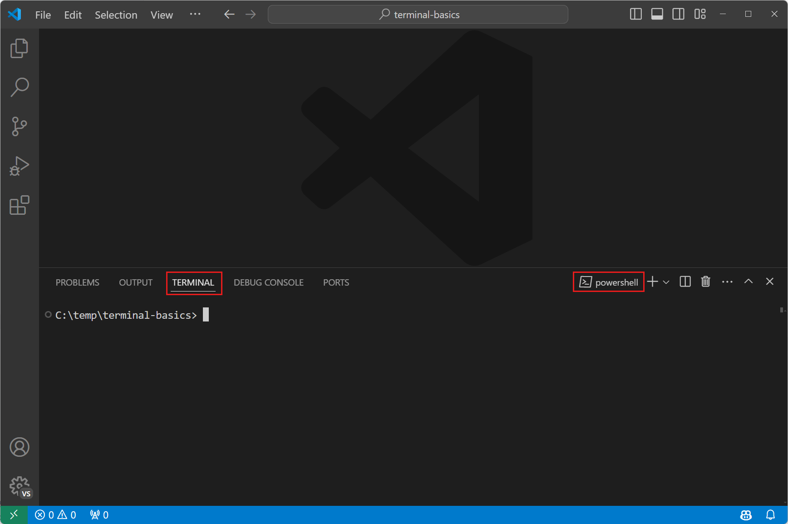
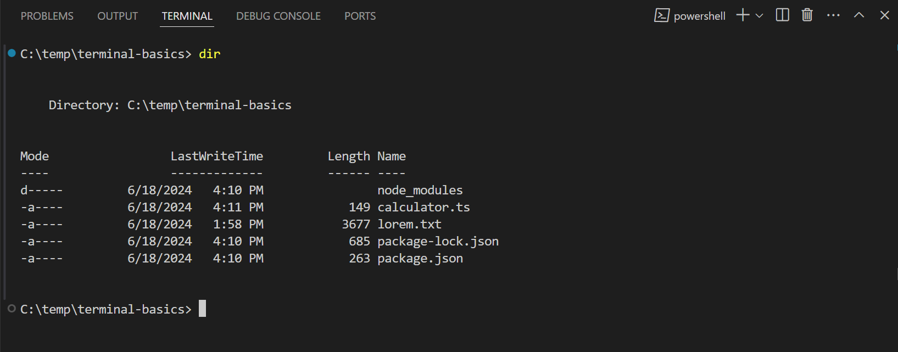
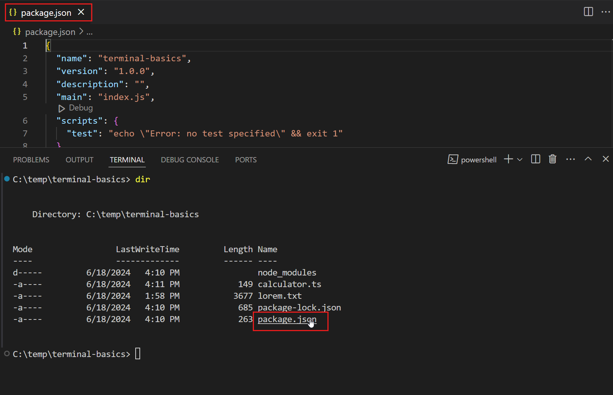
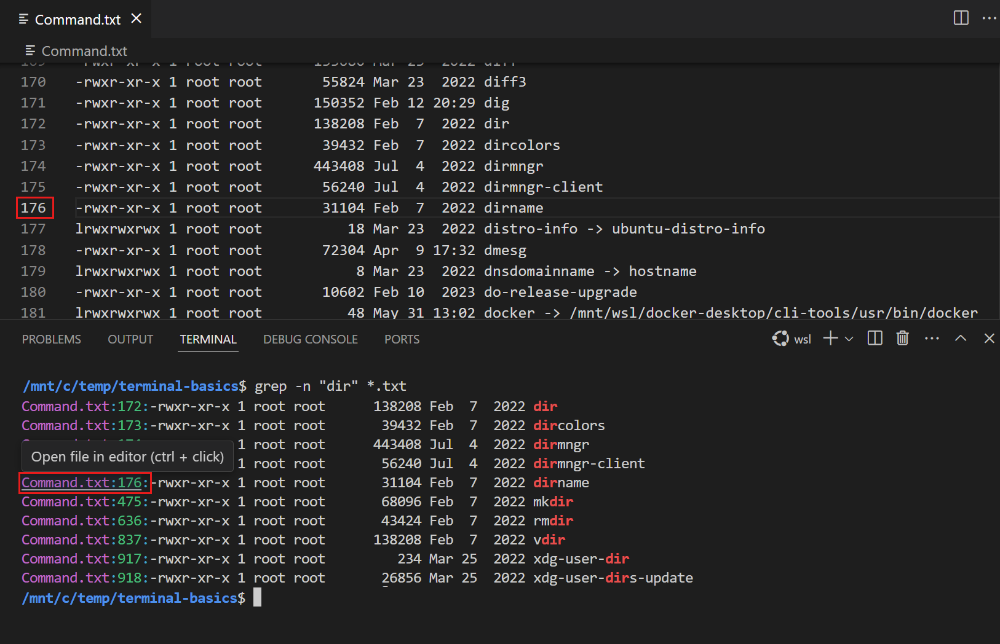
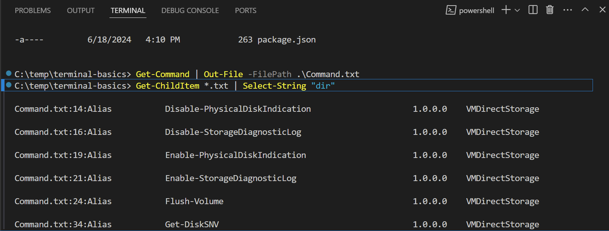
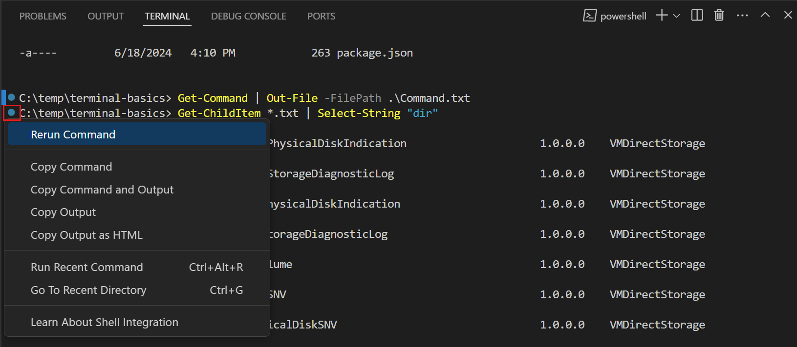
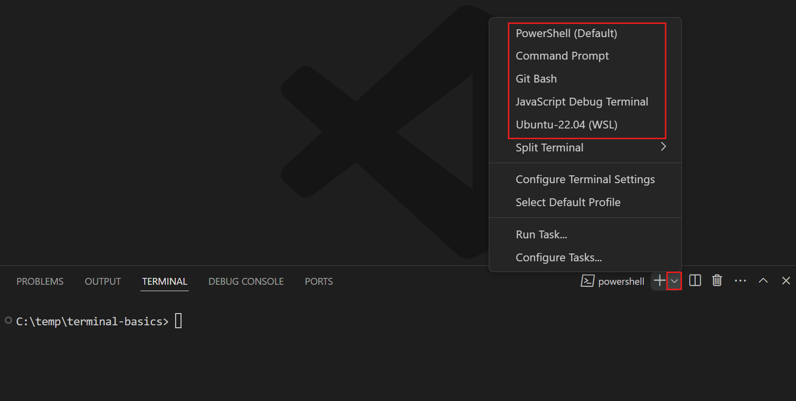
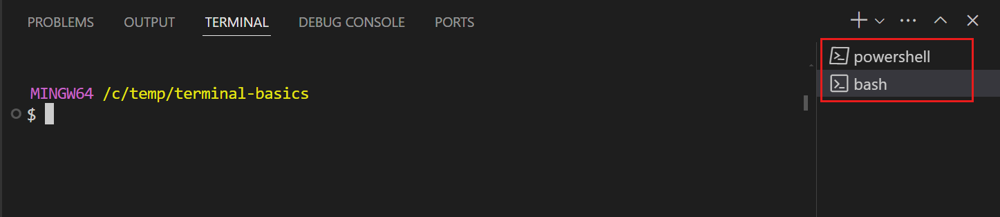
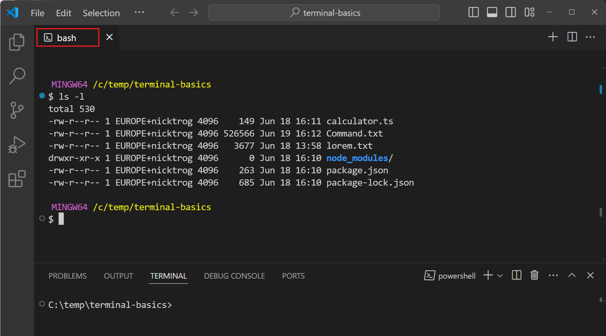
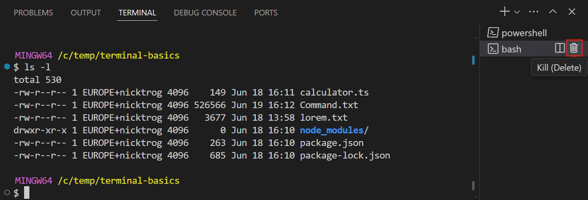

+++
title = "5.1 终端入门"
date = 2026-11-06T07:42:25+08:00
weight = 1
type = "docs"
description = ""
isCJKLanguage = true
draft = false
+++


> 原文链接: [https://code.visualstudio.com/docs/terminal/getting-started](https://code.visualstudio.com/docs/terminal/getting-started)

# 5.1 终端入门

　　Visual Studio Code 包含功能齐全的集成终端。你可以像使用独立终端一样，在其中运行 `echo`、`ls` 和 `git` 等命令。VS Code 中的终端还与编辑器集成，可提供指向工作区文件的链接、错误检测等功能。

　　终端可以使用你机器上安装的各种 shell。shell 是一种通过与操作系统交互来解释和执行命令的程序。常见的 shell 包括 Bash、Zsh 和 PowerShell。

　　本教程将带你了解在 Visual Studio Code 中使用终端的基础知识。

## 在终端中运行第一条命令 {#run-your-first-command-in-the-terminal}

　　在编写代码时，你可能需要运行 shell 命令来构建、测试或部署应用。VS Code 中的终端让你无需离开编辑器即可运行这些命令。

　　要开始使用终端：

1. 启动 VS Code，并打开一个文件夹或工作区。

2. 从菜单栏中选择 **视图** > **终端**，或按 `Ctrl + 反引号` 键盘快捷键来打开终端。

    终端会根据你的操作系统配置，使用 Bash、PowerShell 或 Zsh 等默认 shell 启动。shell 的工作目录从工作区文件夹的根目录开始。

    

3. 输入 `ls` 等基本命令，列出当前目录中的文件。

    终端会显示命令输出，效果与独立终端类似，只是你仍然停留在编辑器内。

    

    > **提示**：你可以拖动终端面板的边框来放大终端，或选择 `^` 图标将面板最大化。

## 与命令输出交互 {#interact-with-command-output}

　　VS Code 中的终端还提供与命令输出交互的功能。命令经常会输出你可能想要打开或导航到的文件路径或 URL。例如，编译器或 linter 可能返回包含文件路径和行号的错误消息。你无需搜索该文件，只需选择终端输出中的链接，即可直接在编辑器中打开它。

　　下面看看如何与终端中的命令输出进行交互：

1. 打开之前运行过 `ls` 命令的终端。

2. 在终端中，按住 `Ctrl`/`Cmd` 键，将鼠标悬停在文件名上，然后选择链接。

    请注意，当你将鼠标悬停在输出中的文本上时，它会变为链接。当你选择文件名时，VS Code 会在编辑器中打开所选文件。

    

    终端输出中的所有文本都可以点击。如果你选择终端中的超链接，它会在默认浏览器中打开该链接。对于其他文本，VS Code 会尝试在工作区中搜索包含该文本的文件。

3. 运行以下命令，创建一个包含可用 shell 命令列表的 `Command.txt` 文件。

    * PowerShell

        ```powershell
        Get-Command | Out-File -FilePath .\Command.txt
        ```

    * Bash / Zsh

        ```bash
        ls -l /usr/bin > Command.txt
        ```

4. 输入以下命令，在 `Command.txt` 文件中搜索命令。

    * PowerShell

        ```powershell
        Get-ChildItem *.txt | Select-String "dir"
        ```

    * Bash / Zsh

        ```bash
        grep -n "dir" *.txt
        ```

    请注意，命令输出包含搜索结果所在的文件名和行号。终端会将这段文本识别为链接。

5. 选择其中一个链接，在编辑器中打开该文件并定位到特定行。

    

　　了解有关[5.2 终端基础](../5.2-TerminalBasics/#links)的更多信息。

## 导航到之前的命令 {#navigate-to-previous-commands}

　　在终端中工作时，你可能需要查看之前的命令及其输出，或者想重新运行某条命令。你可以使用键盘快捷键快速导航到之前的命令。

　　要导航到之前的命令：

1. 打开你之前使用过的终端。

2. 按 `Ctrl + ↑`（macOS 上为 `Cmd + ↑`）键盘快捷键，滚动到终端历史记录中的上一条命令。

    注意，终端会滚动到上一条命令并高亮显示它。

    

    如果你多次按 `Ctrl + ↑`（macOS 上为 `Cmd + ↑`）快捷键，终端会继续在命令历史记录中向前滚动。你可以使用 `Ctrl + ↓`（macOS 上为 `Cmd + ↓`）快捷键向相反方向导航。

3. 你可能会看到之前运行的命令旁边有一个圆形图标。选择该圆形图标，然后选择 **重新运行命令** 以再次运行该命令。

    

　　了解有关[5.4 终端命令集成](../5.4-ShellIntegration/#command-navigation)的更多信息。

## 在其他命令行解释器中运行命令 {#run-commands-in-another-shell}

　　终端支持同时打开多个终端。例如，你可以指定一个终端运行 Git 命令，另一个终端运行构建脚本。你还可以根据偏好，在不同 shell 中运行命令。

　　要添加一个使用其他 shell 的新终端：

1. 选择终端面板中的 `˅` 图标打开终端下拉列表，然后从可用的 shell 中选择一个。

    > **注意**：可用的 shell 取决于你机器上安装的 shell。

    

    新终端会使用所选的 shell 打开，你可以像之前一样在其中输入命令。

    > **提示**：你也可以选择 `+` 图标为默认 shell 创建新终端，使用 `Ctrl + Shift + 反引号`（macOS 上为 `Cmd + Shift + 反引号`）快捷键，或从菜单栏中选择 **终端** > **新建终端**。

2. 你可以在终端面板的列表中查看已打开的终端。

    

    要切换到其他终端，请从终端列表中选择它。

    > **提示**：你可以右键单击终端列表中的终端并选择 **重命名**，为其重命名。

3. 将终端从终端列表拖放到编辑器区域。

    终端会移动到一个编辑器选项卡中，你可以像排列其他编辑器选项卡一样排列它。例如，你可以将终端选项卡拖出 VS Code 窗口，使其成为浮动窗口。了解有关[3.3.2 布局](../../editor/3.3-ConfigureTheEditor/3.3.2-Layout/#editor)的更多信息。

    

4. 将鼠标悬停在终端列表上时，选择垃圾桶图标以关闭已打开的终端。

    

　　了解有关[5.2 终端基础](../5.2-TerminalBasics/#managing-terminals)的更多信息。

## 后续步骤 {#next-steps}

　　在本教程中，你学习了如何开始使用 VS Code 中的终端。以下还有更多主题可供探索：

* 了解[5.2 终端基础](../5.2-TerminalBasics/)
* 了解如何[5.3 终端配置文件](../5.3-TerminalProfiles/)
* 探索[5.5 终端外观](../5.5-Appearance/)的各种方式
