+++
title = "5.2 终端基础"
date = 2026-11-06T07:53:25+08:00
weight = 2
type = "docs"
description = ""
isCJKLanguage = true
draft = false
+++


> 原文链接: [https://code.visualstudio.com/docs/terminal/basics](https://code.visualstudio.com/docs/terminal/basics)

# 5.2 终端基础

　　Visual Studio Code 包含功能齐全的集成终端，它从工作区根目录启动。终端与编辑器集成，支持[链接](#links)和[6.3 任务](../../debugging-and-testing/6.3-Tasks/)等功能。集成终端可以像独立终端一样运行 `mkdir` 和 `git` 等命令。

> **注意**：当工作区处于[3.2.8.3 工作区信任](../../editor/3.2-WriteCode/3.2.8-Workspaces/3.2.8.3-WorkspaceTrust/#terminal)时，打开终端会被阻止，以防止 shell 根据工作区内容自动执行代码。

　　你可以通过以下方式打开终端：

* 从菜单中使用 **终端** > **新建终端** 或 **视图** > **终端** 菜单命令。
* 从**命令面板**（`Ctrl + Shift + P`，macOS 上为 `Cmd + Shift + P`）使用 **View: Toggle Terminal** 命令。
* 在资源管理器中，使用 **在集成终端中打开** 上下文菜单命令，从文件夹打开一个新终端。
* 要切换终端面板，请使用 `Ctrl + 反引号`（macOS 上为 `Cmd + 反引号`）键盘快捷键。
* 要新建终端，请使用 `Ctrl + Shift + 反引号`（macOS 上为 `Cmd + Shift + 反引号`）键盘快捷键。

　　VS Code 的终端还具有称为“shell 集成”的附加功能。它会通过命令左侧和滚动条中的装饰标记，跟踪命令的运行位置：

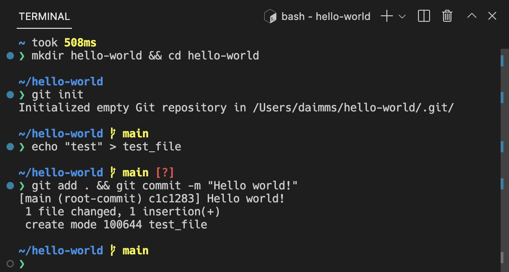

> **注意**：如果你更喜欢在 VS Code 之外工作，可以使用“打开新外部终端”命令打开外部终端。

## 终端 shell {#terminal-shells}

　　集成终端可以使用你机器上安装的各种 shell，默认 shell 从系统默认值中获取。终端会检测 shell，并将其显示在终端配置文件下拉列表中。

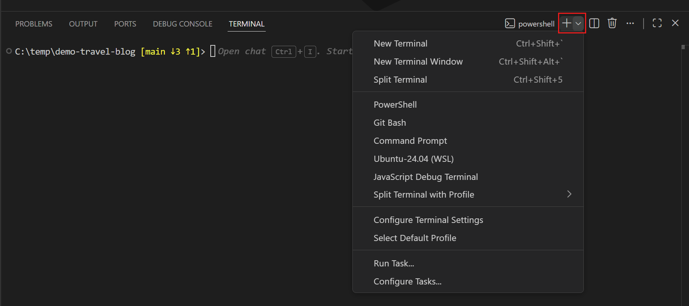

　　你可以在[5.3 终端配置文件](../5.3-TerminalProfiles/)一文中详细了解如何配置终端 shell。

## 管理终端 {#managing-terminals}

　　终端选项卡界面位于终端视图右侧。每个终端都有一个条目，显示其名称、图标、颜色和组装饰（如果有）。

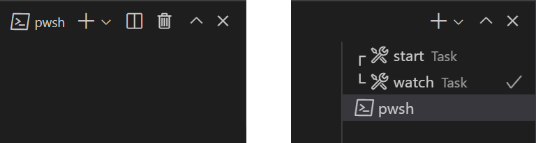

　　你可以通过选择 **终端** 面板右上角的 **+** 图标、从终端下拉列表中选择配置文件，或触发 `Ctrl + Shift + 反引号` 命令来添加终端实例。此操作会在该终端的选项卡列表中创建另一个条目。

　　要移除终端实例，请将鼠标悬停在选项卡上并选择**垃圾桶**按钮，选择选项卡项目并按 `Delete`，使用 **Terminal: Kill the Active Terminal Instance** 命令，或通过右键单击上下文菜单操作。

　　使用聚焦下一个和聚焦上一个终端的快捷键在终端组之间导航。

　　当终端状态发生变化时，选项卡标签上的终端标题右侧可能会出现图标。例如，铃声图标（macOS），以及任务在无错误时显示复选标记，否则显示 X。将鼠标悬停在图标上可读取状态信息，其中可能包含操作。

### 组（拆分窗格） {#groups-split-panes}

　　将多个终端并排放置，并通过拆分终端创建组：

* 将鼠标悬停在右侧终端列表中的条目上，然后选择行内拆分按钮。
* 右键单击上下文菜单，然后选择 **拆分** 菜单选项。
* 按住 `Alt` 并单击选项卡、**+** 按钮或终端面板上的单个选项卡。
* 触发 `Ctrl + Shift + 5` 拆分终端命令。

> **提示**：新终端的工作目录取决于 [3.3.4 设置](../../editor/3.3-ConfigureTheEditor/3.3.4-Settings/) [3.3.4 设置](../../editor/3.3-ConfigureTheEditor/3.3.4-Settings/)。

　　通过聚焦上一个窗格或下一个窗格，在组中的终端之间导航。

　　在列表中拖放选项卡可以重新排列它们。将选项卡拖到主终端区域，可以将终端从一个组移动到另一个组。

　　可以使用命令面板或右键单击上下文菜单中的 **Terminal: Unsplit Terminal** 命令，将终端移到它自己的组中。

## 编辑器区域中的终端 {#terminals-in-editor-area}

　　你可以使用 **Terminal: Create New Terminal in Editor Area** 命令、**Terminal: Create New Terminal in Editor Area to the Side** 命令，或将终端从终端视图拖到编辑器区域，在编辑器区域中打开终端（终端编辑器）。终端编辑器会像普通编辑器选项卡一样显示：

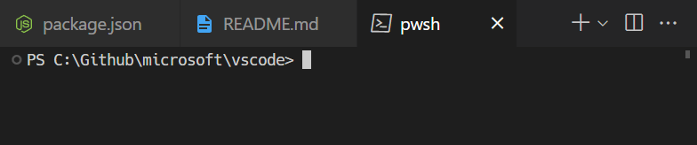

　　你可以将终端编辑器放在任意一侧，或使用编辑器组布局系统以多个维度排列它们。例如，将 PowerShell 和 WSL 终端堆叠在文件编辑器右侧：

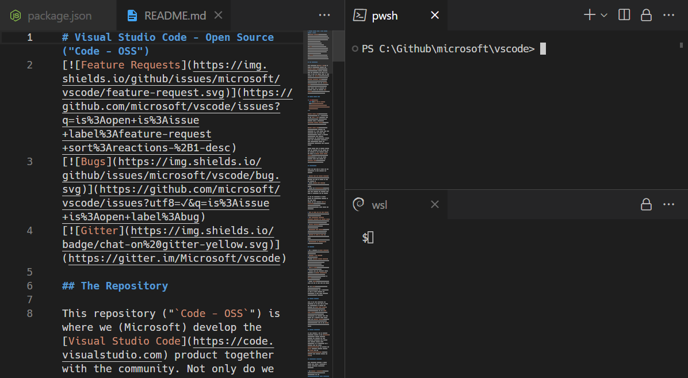

　　[3.3.4 设置](../../editor/3.3-ConfigureTheEditor/3.3.4-Settings/) 设置可以更改默认的 `view` 或 `editor` 终端位置。

## 新窗口中的终端 {#terminals-in-new-windows}

　　可以通过以下几种方式在新的 VS Code 窗口中打开终端：

* 使用“在新窗口中新建终端”命令。
* 如果有多个终端，请右键单击终端选项卡；如果只打开了一个终端，请左键单击该选项卡。然后选择 **将终端移动到新窗口**。
* 选择多个不同菜单中提供的 **新建终端窗口** 条目。

## 浏览缓冲区 {#navigating-the-buffer}

　　终端中的内容称为缓冲区，紧挨底部视口上方的部分称为“回滚”。保留的回滚量由 [3.3.4 设置](../../editor/3.3-ConfigureTheEditor/3.3.4-Settings/) [3.3.4 设置](../../editor/3.3-ConfigureTheEditor/3.3.4-Settings/)决定，默认值为 `1000` 行。

　　可以使用多种命令在终端缓冲区中导航：

* 向上滚动一行：`Ctrl + Alt + PageUp`（macOS 上为 `Cmd + Alt + PageUp`）
* 向下滚动一行：`Ctrl + Alt + PageDown`（macOS 上为 `Cmd + Alt + PageDown`）
* 向上滚动一页：`Shift + PageUp`
* 向下滚动一页：`Shift + PageDown`
* 滚动到顶部：`Ctrl + Home`（macOS 上为 `Cmd + Home`）
* 滚动到底部：`Ctrl + End`（macOS 上为 `Cmd + End`）

　　还可以进行**命令**导航（请参阅 [5.4 终端命令集成](../5.4-ShellIntegration/)）：

* 滚动到上一条命令：`Ctrl + ↑`（macOS 上为 `Cmd + ↑`）
* 滚动到下一条命令：`Ctrl + ↓`（macOS 上为 `Cmd + ↓`）

　　滚动会立即发生，但可以通过 `terminal.integrated.smoothScrolling` 设置将其配置为在短时间内播放动画。

## 链接 {#links}

　　终端具有完善的链接检测功能，并与编辑器集成，甚至可以由扩展提供链接处理程序。将鼠标悬停在链接上会显示下划线，然后按住 `Ctrl`/`Cmd` 键并单击。

　　以下内置链接处理程序按优先级顺序使用：

* URI/URL：看起来像 URI 的链接，例如 `https://code.visualstudio.com`、`vscode://path/to/file` 或 `file://path/to/file`，将使用协议的标准处理程序打开。例如，`https` 链接会在浏览器中打开。

  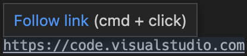

* 文件链接：指向经验证存在于系统上的文件的链接。这些链接会在新的编辑器选项卡中打开文件，并支持许多常见的行/列格式，例如 `file:1:2`、`file:line 1, column 2`。

  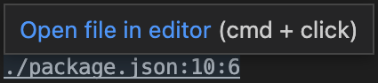

* 文件夹链接：文件夹链接与文件链接类似，但会在该文件夹处打开新的 VS Code 窗口。

  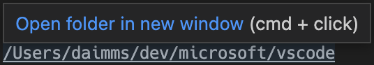

* 单词链接：后备链接类型，使用 `terminal.integrated.wordSeparators` 设置。该设置定义单词边界，使几乎所有文本都能成为单词。激活单词链接会在工作区中搜索该单词。如果只有一个结果，则打开该结果；否则显示搜索结果。单词链接被视为“低置信度”链接，除非按住 `Ctrl`/`Cmd` 键，否则不会显示下划线或工具提示。它们对行和列后缀的支持也有限。

  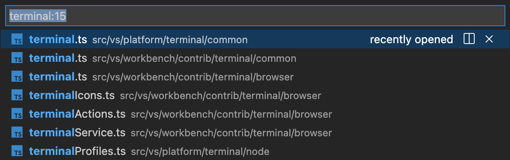

　　**打开检测到的链接** 命令（`Ctrl + Shift + O`，macOS 上为 `Cmd + Shift + O`）可用于通过键盘访问链接：

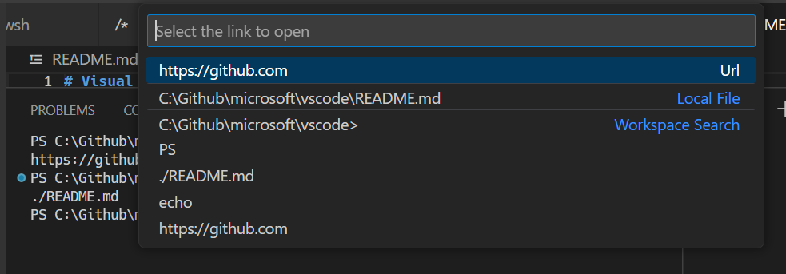

> **提示**：如果链接验证导致性能问题（例如在高延迟的远程环境中），请通过 [3.3.4 设置](../../editor/3.3-ConfigureTheEditor/3.3.4-Settings/) [3.3.4 设置](../../editor/3.3-ConfigureTheEditor/3.3.4-Settings/)将其禁用。

### 扩展处理链接 {#extensions-handling-links}

　　扩展可以提供**链接提供程序**，让扩展定义单击链接时发生的行为。例如，[GitLens](https://marketplace.visualstudio.com/items?itemName=eamodio.gitlens) 扩展可以检测 Git 分支链接。

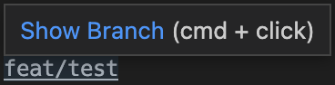

### 键盘可访问性 {#keyboard-accessibility}

　　链接可通过多个命令进行键盘访问，这些命令会根据链接类型打开链接。

* **Terminal: Open Last Local File Link**：打开最近的本机文件链接。没有默认键盘快捷键。
* **Terminal: Open Last URL link**：打开最近的 URI/URL 链接。没有默认键盘快捷键。
* **Terminal: Open Detected Link...**：打开一个可搜索的快速选择，其中包含所有检测到的链接，包括单词链接。默认键盘快捷键是 `Ctrl/Cmd + Shift + O`，与 **Go to Symbol in Editor** 快捷键相同。

## 复制和粘贴 {#copy-and-paste}

　　复制和粘贴的键盘快捷键遵循平台标准：

* Linux：`Ctrl + Shift + C` 和 `Ctrl + Shift + V`；使用 `Shift + Insert` 可以进行选择粘贴
* macOS：`Cmd + C` 和 `Cmd + V`
* Windows：`Ctrl + C` 和 `Ctrl + V`

　　启用 `terminal.integrated.copyOnSelection` 后，选中内容时会自动复制。

　　默认情况下，粘贴多行内容时会显示警告，可以通过 `terminal.integrated.enableMultiLinePasteWarning` 设置将其禁用。只有在 shell 不支持“括号粘贴模式”时才会执行此操作。启用该模式时，表示 shell 可以处理多行粘贴。

## 使用鼠标 {#using-the-mouse}

### 右键单击行为 {#right-click-behavior}

　　右键单击行为因平台而异：

* Linux：显示上下文菜单。
* macOS：选择光标下的单词并显示上下文菜单。
* Windows：如果有选定内容，则复制并取消选择；否则粘贴。

　　可以使用 `terminal.integrated.rightClickBehavior` 设置进行配置。选项包括：

* `default`：显示上下文菜单。
* `copyPaste`：有选定内容时复制，否则粘贴。
* `paste`：右键单击时粘贴。
* `selectWord`：选择光标下的单词并显示上下文菜单。
* `nothing`：不执行任何操作，并将事件传递给终端。

### 列选择 {#column-selection}

　　按住 `Alt` 并左键拖动，可以在终端中选择矩形文本，而不是常规的行选择。

### 使用 Alt 重新定位光标 {#reposition-the-cursor-with-alt}

　　`Alt` 加左键单击会将光标重新定位到鼠标下方。这是通过模拟箭头按键实现的，对某些 shell 或程序可能无法可靠工作。可以使用 `terminal.integrated.altClickMovesCursor` 设置禁用此功能。

### 鼠标事件模式 {#mouse-events-mode}

　　当终端中运行的应用开启鼠标事件模式（例如 Vim 鼠标模式）时，鼠标交互会发送给应用，而不是终端。这意味着单击和拖动将不再创建选择。在 Windows 和 Linux 上，按住 `Alt` 键可以强制进行终端选择；在 macOS 上也可以使用 `Option` 键，但需要先启用 `terminal.integrated.macOptionClickForcesSelection` 设置。

## 查找 {#find}

　　集成终端具有查找功能，可以通过 `Ctrl + F`（macOS 上为 `Cmd + F`）触发。

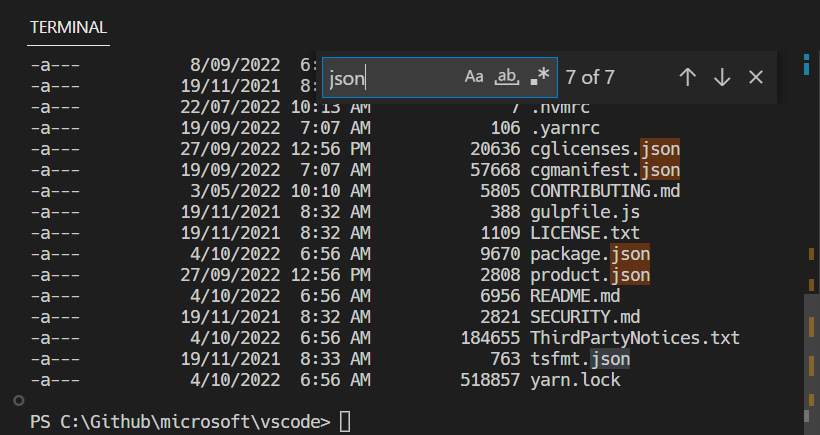

> **提示**：从[5.6 终端高级功能](../5.6-Advanced/#keyboard-shortcuts-and-the-shell)中移除 `workbench.action.terminal.focusFind` 命令，即可将 `Ctrl + F` 发送给 shell。

## 运行选定的文本 {#run-selected-text}

　　要使用 `runSelectedText` 命令，请在编辑器中选择文本，然后通过**命令面板**（`Ctrl + Shift + P`，macOS 上为 `Cmd + Shift + P`）运行 **Terminal: Run Selected Text in Active Terminal** 命令，终端将尝试运行选定的文本。如果活动编辑器中没有选定文本，则运行光标所在行的全部内容。

> **提示**：也可以使用 `workbench.action.terminal.runActiveFile` 命令运行当前活动文件。

## 最大化终端 {#maximizing-the-terminal}

　　单击带有向上尖括号图标的最大化面板按钮可以最大化终端视图。这会暂时隐藏编辑器并最大化面板，适合暂时专注于大量输出。一些开发者通过打开新窗口、最大化面板并隐藏侧边栏，将 VS Code 用作独立终端。

　　请注意，只有将面板的[3.3.2 布局](../../editor/3.3-ConfigureTheEditor/3.3.2-Layout/#panel-alignment)选项设置为 **居中** 时，才能最大化面板。

## 全选 {#select-all}

　　有一个 **Terminal: Select All** 命令，在 macOS 上绑定到 `Cmd + A`，但在 Windows 和 Linux 上没有默认键盘快捷键，因为它可能与 shell 热键冲突。要使用 `Ctrl + A` 全选，请添加以下自定义键盘快捷键：

```json
{
  "key": "ctrl+a",
  "command": "workbench.action.terminal.selectAll",
  "when": "terminalFocus && !isMac"
}
```

## 拖放文件路径 {#drag-and-drop-file-paths}

　　将文件拖到终端中会将路径输入终端，并按照活动 shell 的要求进行转义。

## 使用任务自动化终端 {#automating-terminals-with-tasks}

　　[6.3 任务](../../debugging-and-testing/6.3-Tasks/)功能可用于自动启动终端。例如，以下 `.vscode/tasks.json` 文件会在窗口启动时，在一个终端组中启动命令提示符和 PowerShell 终端：

```jsonc
{
  "version": "2.0.0",
  "presentation": {
    "echo": false,
    "reveal": "always",
    "focus": false,
    "panel": "dedicated",
    "showReuseMessage": true
  },
  "tasks": [
    {
      "label": "Create terminals",
      "dependsOn": [
        "First",
        "Second"
      ],
      // 标记为默认生成任务，以便 cmd/ctrl+shift+b 创建它们
      "group": {
        "kind": "build",
        "isDefault": true
      },
      // 尝试在文件夹打开时启动任务
      "runOptions": {
        "runOn": "folderOpen"
      }
    },
    {
      // 显示在终端选项卡中的名称
      "label": "First",
      // 该任务将启动一个 shell
      "type": "shell",
      "command": "",
      // 设置 shell 类型
      "options": {
        "shell": {
          "executable": "cmd.exe",
          "args": []
        }
      },
      // 标记为后台任务，以避免终端选项卡上出现加载动画
      "isBackground": true,
      "problemMatcher": [],
      // 在终端组中创建任务
      "presentation": {
        "group": "my-group"
      }
    },
    {
      "label": "Second",
      "type": "shell",
      "command": "",
      "options": {
        "shell": {
          "executable": "pwsh.exe",
          "args": []
        }
      },
      "isBackground": true,
      "problemMatcher": [],
      "presentation": {
        "group": "my-group"
      }
    }
  ]
}
```

　　可以将此文件提交到仓库，与其他开发者共享，也可以通过 `workbench.action.tasks.openUserTasks` 命令将其创建为用户任务。

## 工作目录 {#working-directory}

　　默认情况下，终端会在资源管理器中打开的文件夹处启动。`terminal.integrated.cwd` 设置允许指定要打开的自定义路径：

```json
{
    "terminal.integrated.cwd": "/home/user"
}
```

　　Windows 上的拆分终端将从父终端启动时的目录开始。在 macOS 和 Linux 上，拆分终端会继承父终端的当前工作目录。可以使用 `terminal.integrated.splitCwd` 设置更改此行为：

```json
{
    "terminal.integrated.splitCwd": "workspaceRoot"
}
```

　　还有一些扩展提供更多选项，例如 [Terminal Here](https://marketplace.visualstudio.com/items?itemName=Tyriar.vscode-terminal-here)。

## 固定尺寸终端 {#fixed-dimension-terminals}

　　**Terminal: Set Fixed Dimensions** 命令允许更改终端及其底层伪终端使用的列数和行数。必要时会添加滚动条，这可能导致不佳的用户体验，通常不建议这样做；但特别是在 Windows 上，当分页工具不可用时，读取日志或长行时经常需要这样做。

　　你也可以右键单击终端选项卡，选择 **Toggle Size to Content Width**，将终端列数调整为终端中换行后的最长行。

## 终端中的 GitHub Copilot {#github-copilot-in-the-terminal}

　　如果你有权访问 [9.1 设置 GitHub Copilot](../../advanced-setup/9.1-GitHubCopilotSetup/)，可以使用它为终端命令和 shell 脚本获取 AI 帮助。在终端中使用 Copilot 有几种方式：

### 终端内联聊天 {#terminal-inline-chat}

　　直接在终端中启动内联聊天，以获取 shell 命令帮助：

1. 打开终端（`Ctrl + 反引号`，macOS 上为 `Cmd + 反引号`）。
2. 按 `Ctrl + I`（macOS 上为 `Cmd + I`），或从命令面板运行 **Terminal Inline Chat** 命令。
3. 用自然语言输入问题或请求，例如：
   * “如何查找此目录中的最大文件？”
   * “告诉我如何撤销上一次 git 提交”
   * “创建一个分析日志文件的 bash 脚本”

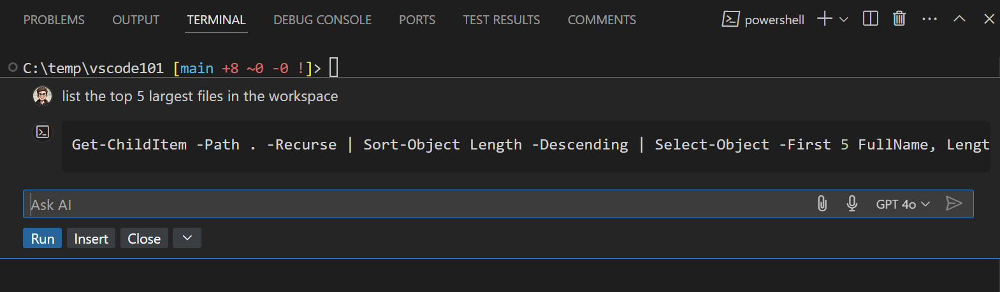

　　Copilot 提供响应后，你可以选择 **运行** 直接执行命令，或选择 **插入** 将其添加到终端以便进一步编辑。

　　有关在终端中使用 GitHub Copilot 的更多信息，请参阅[2.2.4 内联聊天和快速聊天](../../ai-in-vs-code/work-with-ai/2.2.4-InlineChatAndQuickChat/#use-terminal-inline-chat)。

### 询问终端命令 {#terminal-chat-participant}

　　直接向智能体询问 shell 命令，并附加相关终端输出。例如，询问“如何递归搜索某个模式？”或“解释此命令但不运行它”。

　　`@terminal` 聊天参与者已弃用，Copilot 运行框架不支持它。请参阅[2.4.11 迁移自定义项](../../ai-in-vs-code/customize-and-extend/2.4.11-MigrateExistingCustomizations/#replace-chat-participants)。

### 在聊天中引用终端上下文 {#reference-terminal-context-in-chat}

　　可以将终端信息作为上下文包含在聊天提示词中：

* 使用 `#terminalSelection` 将终端中选定的文本添加到聊天提示词。
* 使用 `#terminalLastCommand` 包含你在终端中运行的最后一个命令。

## 后续步骤 {#next-steps}

　　本文介绍了终端的基础知识。继续阅读以了解更多内容：

* [2.2.4 内联聊天和快速聊天](../../ai-in-vs-code/work-with-ai/2.2.4-InlineChatAndQuickChat/#use-terminal-inline-chat)：直接在终端中获取 AI 建议。
* [6.3 任务](../../debugging-and-testing/6.3-Tasks/)：任务让你与外部工具集成，并大量利用终端。
* [掌握 VS Code 终端](https://www.growingwiththeweb.com/2017/03/mastering-vscodes-terminal.html)：一个外部博客，提供了许多终端高级用户技巧。
* 在 VS Code 中浏览键盘快捷键（**首选项：打开键盘快捷方式**，然后搜索“terminal”），探索终端命令。

## 常见问题 {#common-questions}

### 启动终端时遇到问题 {#im-having-problems-launching-the-terminal}

　　针对这类问题，有一份[专门的故障排除指南](https://code.visualstudio.com/docs/supporting/troubleshoot-terminal-launch)。

### 如何创建管理员终端？ {#how-do-i-create-an-admin-terminal}

　　集成终端的 shell 以 VS Code 的权限运行。如果需要使用提升的（管理员）权限或其他权限运行 shell 命令，请在终端中使用 `runas.exe` 等平台工具。

　　你可以在[5.3 终端配置文件](../5.3-TerminalProfiles/#configuring-profiles)中详细了解如何通过终端配置文件自定义终端。

### 我可以为资源管理器的“在集成终端中打开”命令添加键盘快捷键吗？ {#can-i-add-a-keyboard-shortcut-for-the-explorers-open-in-integrated-terminal-command}

　　你可以通过资源管理器中的 **在集成终端中打开** 上下文菜单命令，为特定文件夹打开新终端。

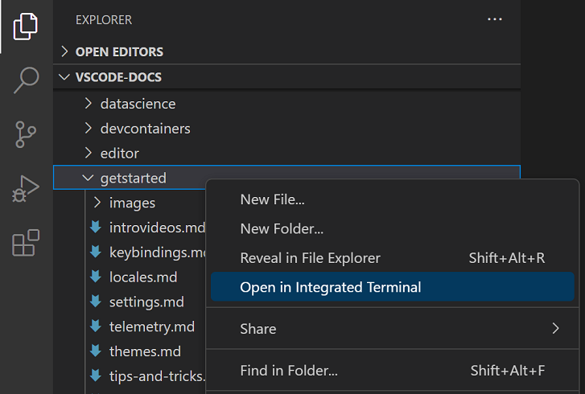

　　默认情况下，**在集成终端中打开** 没有关联的键盘快捷键，但你可以通过键盘快捷方式编辑器（`Ctrl + K Ctrl + S`，macOS 上为 `Cmd + K Cmd + S`）将自己的快捷键添加到 `keybindings.json`。

　　下面的 `keybindings.json` 示例为 `openInTerminal` 添加快捷键 `Ctrl + T`。

```json
{
  "key": "ctrl+t",
  "command": "openInTerminal",
  "when": "filesExplorerFocus"
}
```

### 启动集成终端时，为什么 nvm 会抱怨 prefix 选项？ {#why-is-nvm-complaining-about-a-prefix-option-when-the-integrated-terminal-is-launched}

　　nvm（Node 版本管理器）用户通常会在 VS Code 的集成终端中首次看到以下错误：

```bash
nvm is not compatible with the npm config "prefix" option: currently set to "/usr/local"
Run `npm config delete prefix` or `nvm use --delete-prefix v8.9.1 --silent` to unset it
```

　　这主要是 macOS 上的问题，在外部终端中不会发生。常见原因如下：

* `npm` 是使用另一个位于你的路径中的 `node` 实例（例如 `/usr/local/bin/npm`）全局安装的。
* 为了将开发工具加入 `$PATH`，VS Code 会在启动时启动一个 bash 登录 shell。这意味着你的 `~/.bash_profile` 已经运行过，而当集成终端启动时，它会运行**另一个**登录 shell，从而可能以意外方式重新排列 `$PATH`。

　　要解决此问题，你需要查明旧 `npm` 的安装位置，并删除它及其过时的 node_modules。找到 `nvm` 初始化脚本，并在其运行前执行 `which npm`，这应该会输出你启动新终端时的路径。

　　获得 npm 的路径后，通过解析符号链接找到旧的 node_modules，运行类似以下命令：

```bash
ls -la /usr/local/bin | grep "np[mx]"
```

　　这会在末尾给出解析后的路径：

```bash
... npm -> ../lib/node_modules/npm/bin/npm-cli.js
... npx -> ../lib/node_modules/npm/bin/npx-cli.js
```

　　然后，删除这些文件并重新启动 VS Code，应该可以解决问题：

```bash
rm /usr/local/bin/npm /usr/local/lib/node_modules/npm/bin/npm-cli.js
rm /usr/local/bin/npx /usr/local/lib/node_modules/npm/bin/npx-cli.js
```

### 为什么调整终端拆分窗格大小时 macOS 会发出叮声？ {#why-does-macos-make-a-ding-sound-when-i-resize-terminal-split-panes}

　　快捷键 ⌃⌘← 和 ⌃⌘→ 是调整终端中单个拆分窗格大小的默认快捷键。虽然它们可以正常工作，但由于 Chromium 中的问题，它们还会导致系统播放“无效键”声音。[推荐的变通方法](https://github.com/microsoft/vscode/issues/44070#issuecomment-799716362)是告诉 macOS 对这些快捷键不执行任何操作，具体方法是在终端中运行：

```bash
mkdir -p ~/Library/KeyBindings
cat > ~/Library/KeyBindings/DefaultKeyBinding.dict <<EOF
{
  "@^\UF700" = "noop:";
  "@^\UF701" = "noop:";
  "@^\UF702" = "noop:";
  "@^\UF703" = "noop:";
  "@~^\UF700" = "noop:";
  "@~^\UF701" = "noop:";
  "@~^\UF702" = "noop:";
  "@~^\UF703" = "noop:";
}
EOF
```

### 终端渲染有问题怎么办？ {#im-having-problems-with-the-terminal-rendering-what-can-i-do}

　　默认情况下，集成终端会在大多数机器上使用 GPU 加速进行渲染。通常，当出现渲染问题时，原因是硬件、操作系统或驱动程序与 GPU 渲染器不兼容。首先应尝试禁用 GPU 加速，以基于 DOM 的渲染取代渲染速度，后者更可靠：

```json
{
    "terminal.integrated.gpuAcceleration": "off"
}
```

　　有关更多信息，请参阅 [5.5 终端外观](../5.5-Appearance/#gpu-acceleration)部分。

### 粘贴内容时看到 `1~` 或 `[3.3.3 键盘快捷键](../../editor/3.3-ConfigureTheEditor/3.3.3-KeyboardShortcuts/)：

```json
{
  "key": "cmd+.",
  "command": "workbench.action.terminal.sendSequence",
  "when": "terminalFocus",
  "args": { "text": "\u0003" }
}
```

### 为什么终端中的颜色不正确？ {#why-are-the-colors-in-the-terminal-not-correct}

　　我们默认启用的一项辅助功能可确保前景文本至少满足 4.5 的对比度。此功能可确保文本无论使用哪种 shell 和主题都清晰可读，否则无法做到。要禁用此功能，可以设置：

```json
"terminal.integrated.minimumContrastRatio": 1
```

　　有关更多信息，请参阅[5.5 终端外观](../5.5-Appearance/#minimum-contrast-ratio)部分。
