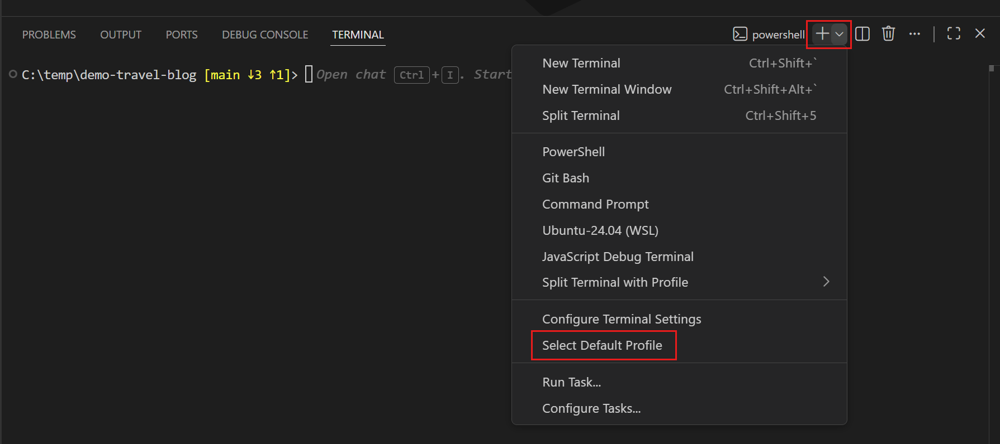
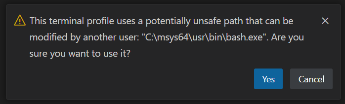

+++
title = "5.3 终端配置文件"
date = 2026-11-06T07:53:25+08:00
weight = 3
type = "docs"
description = ""
isCJKLanguage = true
draft = false
+++


> 原文链接: [https://code.visualstudio.com/docs/terminal/profiles](https://code.visualstudio.com/docs/terminal/profiles)

# 5.3 终端配置文件

　　终端配置文件是按平台区分的 shell 配置，由可执行文件路径、参数和其他自定义选项组成。默认情况下，VS Code 会自动检测多个配置文件，你可以对其进行自定义或添加新配置。

　　配置文件示例：

```jsonc
{
  "terminal.integrated.profiles.windows": {
    "Custom Init": {
      "path": "pwsh.exe",
      "args": [
         "-noexit",
         "-file",
         "${env:APPDATA}\\PowerShell\\custom-init.ps1"
      ]
    }
  },
  "terminal.integrated.defaultProfile.windows": "Custom Init"
}
```

　　你可以在终端配置文件中使用变量，如上例中的 `APPDATA` 环境变量所示。可用变量列表请参阅[3.4.3 变量替换](../../editor/3.4-Reference/3.4.3-SubstitutionVariables/)。

　　运行 **Terminal: Select Default Profile** 命令配置默认配置文件，也可以通过新建终端下拉列表访问该命令。



　　默认终端配置文件在 Linux 和 macOS 上使用 `$SHELL`，在 Windows 上使用 PowerShell。VS Code 会自动检测大多数标准 shell，你可以将它们配置为默认值。

## 配置配置文件 {#configuring-profiles}

　　要创建新配置文件，请运行 **Terminal: Select Default Profile** 命令，并激活要作为基础的 shell 右侧的配置按钮。这会在设置中添加一个新条目，你可以在 `settings.json` 文件中手动调整。

　　配置文件可以使用 `path` 或 `source` 以及一组可选参数创建。`source` 仅在 Windows 上可用，可用于让 VS Code 检测 `PowerShell` 或 `Git Bash` 的安装。或者，也可以使用直接指向 shell 可执行文件的 `path`。以下是一些配置文件配置示例：

```json
{
  "terminal.integrated.profiles.windows": {
    "PowerShell -NoProfile": {
      "source": "PowerShell",
      "args": ["-NoProfile"]
    }
  },
  "terminal.integrated.profiles.linux": {
    "zsh (login)": {
      "path": "zsh",
      "args": ["-l"]
    }
  }
}
```

　　配置文件中支持的其他参数包括：

* `overrideName`：一个布尔值，指示是否用静态配置文件名称替换检测正在运行程序的动态终端标题。
* `env`：定义环境变量及其值的映射。将变量设置为 `null` 可将其从环境中删除。可以使用 `terminal.integrated.env.<platform>` 设置为所有配置文件配置此项。
* `icon`：用于配置文件的图标 ID。
* `color`：用于设置图标样式的主题颜色 ID。

> **提示**：路径、参数和环境变量都支持[解析变量](https://code.visualstudio.com/docs/reference/variables-reference)。

　　可以使用 `terminal.integrated.defaultProfile.*` 设置手动定义**默认配置文件**。该设置应设为现有配置文件的名称：

```json
{
  "terminal.integrated.profiles.windows": {
    "my-pwsh": {
      "source": "PowerShell",
      "args": ["-NoProfile"]
    }
  },
  "terminal.integrated.defaultProfile.windows": "my-pwsh"
}
```

> **提示**：集成终端的 shell 以 VS Code 的权限运行。如果需要使用提升的（管理员）权限或其他权限运行 shell 命令，请在终端中使用 `runas.exe` 等平台工具。

## 移除内置配置文件 {#removing-built-in-profiles}

　　要移除内置配置文件并阻止其显示在新建终端下拉列表中，请将配置文件名称设置为 `null`。例如，要移除 Windows 上的 `Git Bash` 配置文件，请使用以下设置：

```json
{
  "terminal.integrated.profiles.windows": {
    "Git Bash": null
  }
}
```

## 配置任务/调试配置文件 {#configuring-the-taskdebug-profile}

　　默认情况下，任务/调试功能会使用默认配置文件。如果你的默认配置文件包含繁重的 PowerShell 启动脚本，或使用不符合 POSIX 的 shell，这可能并不理想。要配置仅用于调试/任务功能的配置文件，请使用 `terminal.integrated.automationProfile.<platform>` 设置：

```jsonc
{
  "terminal.integrated.defaultProfile.osx": "fish",
  // 使用完全兼容 POSIX 的 shell，避免为任务和调试运行复杂的
  // ~/.config/fish/config.fish
  "terminal.integrated.automationProfile.osx": {
    "path": "/bin/sh"
  }
}
```

## 特定配置文件的键盘快捷键 {#profile-specific-keyboard-shortcuts}

　　使用 `workbench.action.terminal.newWithProfile` 命令，可以通过[3.3.3 键盘快捷键](../../editor/3.3-ConfigureTheEditor/3.3.3-KeyboardShortcuts/#advanced-customization)启动使用特定配置文件的终端。该命令接收配置文件名称和可选的位置作为参数。例如，要将 `Ctrl + Shift + T` 绑定到使用 `zsh` 配置文件打开终端：

```json
{
  "key": "ctrl+shift+t",
  "command": "workbench.action.terminal.newWithProfile",
  "args": {
    "profileName": "zsh",
    "location": "editor"
  }
}
```

## 不安全配置文件检测 {#unsafe-profile-detection}

　　某些 shell 默认安装在不受信任的路径中，例如 Windows 环境中其他用户可写的路径。VS Code 仍会检测这些 shell，但在通过 **Terminal: Select Default Profile** 命令显式配置之前，不会将其作为正式配置文件公开。配置不安全的配置文件时，会在添加前显示警告：



## Cmder {#cmder}

　　Cmder 本身是一个终端，但你可以使用以下配置文件在 VS Code 中使用 [Cmder](https://cmder.app) shell：

```json
{
  "terminal.integrated.profiles.windows": {
    "cmder": {
      "path": "C:\\WINDOWS\\System32\\cmd.exe",
      "args": ["/K", "C:\\cmder\\vendor\\bin\\vscode_init.cmd"]
    }
  },
  "terminal.integrated.defaultProfile.windows": "cmder"
}
```

　　设置 `CMDER_ROOT` 环境变量后，应会自动选用此配置文件。如果安装在 `C:\cmder`，它也会被检测为[不安全配置文件](#unsafe-profile-detection)。更多信息请参阅 [Cmder 的 wiki](https://github.com/cmderdev/cmder/wiki/Seamless-VS-Code-Integration)。

## Cygwin {#cygwin}

　　Cygwin 本身是一个终端，但你可以使用以下配置文件在 VS Code 中使用 [Cygwin](https://www.cygwin.com/) shell：

```json
{
  "terminal.integrated.profiles.windows": {
    "Cygwin": {
      "path": "C:\\cygwin64\\bin\\bash.exe",
      "args": ["--login"]
    }
  },
  "terminal.integrated.defaultProfile.windows": "Cygwin"
}
```

　　如果安装在默认路径 `C:\cygwin` 或 `C:\cygwin64`，此配置文件应会自动检测为[不安全配置文件](#unsafe-profile-detection)。

## Git Bash {#git-bash}

　　当 VS Code 使用 bash.exe（shell）而不是 git-bash.exe（终端）时，Git Bash 存在[一个限制](https://github.com/microsoft/vscode/issues/85831#issuecomment-943403803)：历史记录无法跨 shell 会话保留。你可以将以下内容添加到 `~/.bashrc` 或 `~/.bash_profile` 文件来解决此问题：

```bash
export PROMPT_COMMAND='history -a'
```

　　这会导致 shell 在每次打印提示符时调用 `history -a`，从而将当前会话的命令刷新到后台历史记录文件中。

## MSYS2 {#msys2}

　　MSYS2 的 bash shell 可以使用以下配置文件进行配置：

```json
{
  "terminal.integrated.profiles.windows": {
    "bash (MSYS2)": {
      "path": "C:\\msys64\\usr\\bin\\bash.exe",
      "args": [
        "--login",
        "-i"
      ],
      "env": { "CHERE_INVOKING": "1" }
    }
  }
}
```

　　[`CHERE_INVOKING` 环境变量](https://www.msys2.org/wiki/Launchers/#the-idea)用于告诉登录初始化脚本保留工作目录，而不是在 `$HOME` 中打开。

　　如果安装在默认路径 `C:\\msys64`，此配置文件应会自动检测为[不安全配置文件](#unsafe-profile-detection)。

## Windows PowerShell {#windows-powershell}

　　安装 PowerShell 6+ 后，默认情况下配置文件中不会包含 Windows PowerShell。要将 Windows PowerShell 添加为配置文件，请在新建终端下拉列表中选择 **Select Default Profile** 选项，然后选择 Windows PowerShell 项。这会配置该配置文件并将其设为默认值。

## WSL {#wsl}

　　在本地计算机上运行 VS Code 时，应会自动检测 Windows Subsystem for Linux shell。根据你的设置，如果安装了许多发行版，这可能会很麻烦。要更精细地控制 WSL 配置文件，可以使用 `terminal.integrated.useWslProfiles` 设置禁用自动检测。以下是如何手动配置 WSL shell 的示例：

```jsonc
{
  "terminal.integrated.profiles.windows": {
    "Debian (WSL)": {
      "path": "C:\\WINDOWS\\System32\\wsl.exe",
      "args": [
        "-d",
        "Debian"
      ]
    }
  }
}
```

## 常见问题 {#common-questions}

### 为什么终端的 `$PATH` 环境变量中会出现重复路径，或者在 macOS 上顺序相反？ {#why-are-there-duplicate-paths-in-the-terminals-path-environment-variable-andor-why-are-they-reversed-on-macos}

　　这可能在 macOS 上发生，原因是终端使用 VS Code 的环境启动。VS Code 首次启动时，为了加载“开发环境”，会以**登录 shell** 的方式启动你配置的 shell，从而运行 `~/.profile`/`~/.bash_profile`/`~/.zprofile` 脚本。现在终端启动时也会作为登录 shell 运行，这会将标准路径放到前面（例如 `/usr/local/bin:/usr/bin:/bin:/usr/sbin:/sbin`），并重新初始化 shell 环境。

　　要更好地理解，可以在操作系统内置终端中启动一个内层登录 shell，模拟正在发生的情况：

```sh
# 将 /test 添加到 $PATH 的开头
export PATH=/test:$PATH
# 输出 $PATH，/test 应位于开头
echo $PATH
# 以登录 shell 运行 bash
bash -l
# 输出 $PATH，值的顺序应该已经混乱
echo $PATH
```

　　遗憾的是，与 Linux 不同，macOS 的独立终端默认都以登录 shell 运行，因为 macOS 在用户登录系统时不会运行登录 shell。这鼓励了“不良行为”，例如在配置文件脚本中初始化别名，而它们应该放在针对非登录 shell 运行的 `rc` 脚本中。

　　有两种直接修复方法。第一种是设置 `"terminal.integrated.inheritEnv": false`，这会从终端环境中移除大多数环境变量，但保留一些重要变量（如 `HOME`、`SHELL`、`TMPDIR` 等）。

　　另一种修复方法是创建终端配置文件并将其 `args` 设置为 `[]`，从而不再在终端中运行登录 shell。如果采用此修复方法，请确保将配置文件脚本中的任何别名移到 `~/.bashrc`/`~/.zshrc` 文件中，因为别名仅适用于设置它们的 shell。
