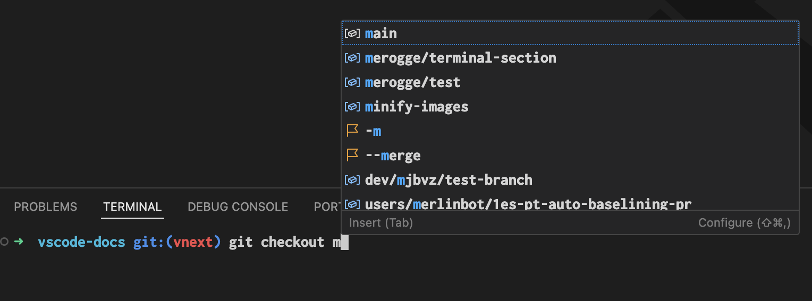
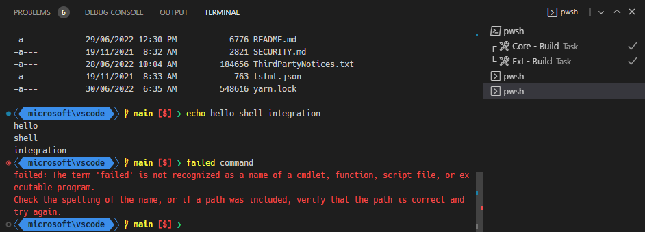
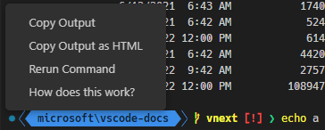
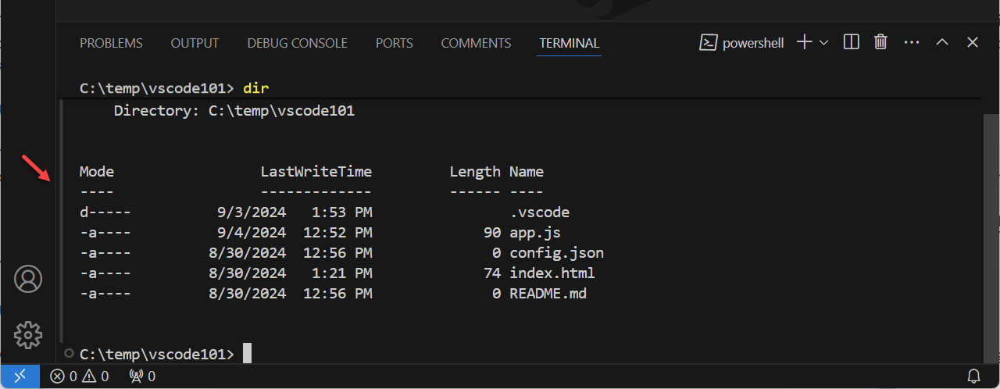
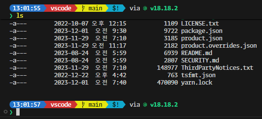
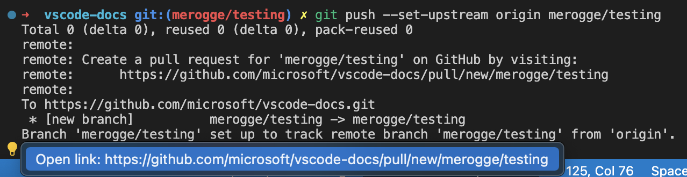
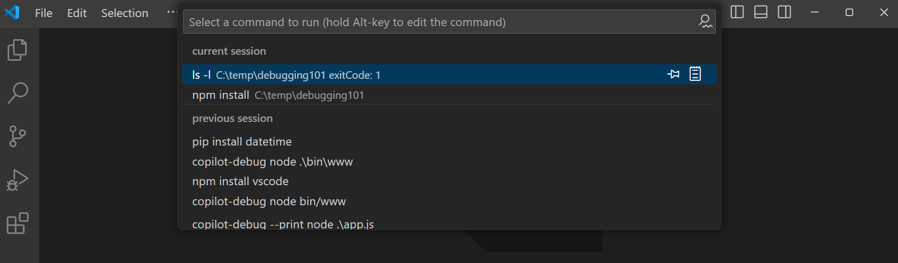
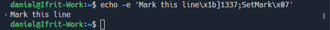

+++
title = "5.4 终端命令集成"
date = 2026-11-06T07:53:25+08:00
weight = 4
type = "docs"
description = ""
isCJKLanguage = true
draft = false
+++


> 原文链接: [https://code.visualstudio.com/docs/terminal/shell-integration](https://code.visualstudio.com/docs/terminal/shell-integration)

# 5.4 终端命令集成

　　Visual Studio Code 可以与常见 shell 集成，使终端能够更深入地了解 shell 内部实际发生的事情。这些附加信息支持一些有用的功能，例如[工作目录检测](#current-working-directory-detection)、命令检测、[装饰标记](#command-decorations-and-the-overview-ruler)和[导航](#command-navigation)。

　　支持的 shell：

- Linux/macOS：bash、fish、pwsh、zsh
- Windows：Git Bash、pwsh

## 安装 {#installation}

### 自动脚本注入 {#automatic-script-injection}

　　默认情况下，shell 集成脚本应会在从 VS Code 启动的受支持 shell 中自动激活。这是通过在 shell 会话启动时注入参数和/或环境变量实现的。可以通过将 `terminal.integrated.shellIntegration.enabled` 设置为 `false` 来禁用自动注入。

　　这种简单标准的方式不适用于某些高级用例，例如子 shell、普通 `ssh` 会话（未使用 [8.2 使用 SSH 远程开发](../../remote/8.2-SSH/)时）或某些复杂的 shell 设置。对于这些情况，建议[手动安装](#manual-installation) shell 集成。

> **注意**：自动注入可能无法在旧版 shell 上工作。例如，旧版 fish 不支持 `$XDG_DATA_DIRS` 环境变量，而注入依赖该变量。你仍然可以尝试手动安装。

> **Windows 注意**：VS Code 的 shell 集成需要[运行 PowerShell 脚本的权限](https://learn.microsoft.com/powershell/module/microsoft.powershell.core/about/about_execution_policies)。如果你独占使用计算机上的用户账户，可以考虑运行：
>
> ```powershell
> if ((Get-ExecutionPolicy -Scope LocalMachine) -eq 'Undefined' -and (Get-ExecutionPolicy -Scope CurrentUser) -eq 'Undefined') {
>     Set-ExecutionPolicy -ExecutionPolicy RemoteSigned -Scope CurrentUser
> }
> ```

### 手动安装 {#manual-installation}

　　要手动安装 shell 集成，VS Code shell 集成脚本需要在 shell 初始化期间运行。具体位置和方式取决于你使用的 shell 和操作系统。手动安装时，建议将 `terminal.integrated.shellIntegration.enabled` 设置为 `false`，但这不是必需的。

> **提示**：使用 [Insiders 版本](https://code.visualstudio.com/insiders)时，请将下方的 `code` 替换为 `code-insiders`。

**bash**

　　将以下内容添加到 `~/.bashrc` 文件。在 bash 中运行 `code ~/.bashrc`，可在 VS Code 中打开该文件。

```sh
[[ "$TERM_PROGRAM" == "vscode" ]] && . "$(code --locate-shell-integration-path bash)"
```

**fish**

　　将以下内容添加到你的 `config.fish`。在 fish 中运行 `code $__fish_config_dir/config.fish`，可在 VS Code 中打开该文件。

```sh
string match -q "$TERM_PROGRAM" "vscode"
and . (code --locate-shell-integration-path fish)
```

**pwsh**

　　将以下内容添加到你的 [PowerShell 配置文件](https://learn.microsoft.com/powershell/module/microsoft.powershell.core/about/about_profiles?view=powershell-7.2)。在 pwsh 中运行 `code $Profile`，可在 VS Code 中打开该文件。

```powershell
if ($env:TERM_PROGRAM -eq "vscode") { . "$(code --locate-shell-integration-path pwsh)" }
```

**zsh**

　　将以下内容添加到 `~/.zshrc` 文件。在 zsh 中运行 `code ~/.zshrc`，可在 VS Code 中打开该文件。

```sh
[[ "$TERM_PROGRAM" == "vscode" ]] && . "$(code --locate-shell-integration-path zsh)"
```

**Git Bash**

　　将以下内容添加到 `~/.bashrc` 文件。在 Git Bash 中运行 `code ~/.bashrc`，可在 VS Code 中打开该文件。

```sh
[[ "$TERM_PROGRAM" == "vscode" ]] && . "$(code --locate-shell-integration-path bash)"
```

#### 可移植性与性能 {#portability-versus-performance}

　　上述安装方式跨平台，只要 `code` 在 `$PATH` 中，就兼容任何安装类型。不过，这种推荐方式会启动 Node.js 来获取脚本路径，导致 shell 启动略有延迟。为减轻延迟，请提前解析路径，并直接内联到初始化脚本中。

```sh
# 先输出可执行文件的路径：
code --locate-shell-integration-path bash

# 将上面的结果添加到 source 语句中：
[[ "$TERM_PROGRAM" == "vscode" ]] && . "/path/to/shell/integration/script.sh"
```

## Shell 集成质量 {#shell-integration-quality}

　　使用 shell 集成时，它有一个表示其能力的“质量”级别。质量由 shell 集成脚本的行为决定。

- **无**：没有活动的 shell 集成。
- **丰富**：shell 集成已激活，命令检测以理想方式工作。
- **基本**：shell 集成已激活，但命令检测可能不支持所有功能。例如，可以检测命令运行位置，但无法检测其退出状态。

　　要查看 shell 集成质量，请将鼠标悬停在终端选项卡上。可以选择悬停提示中的 **显示详细信息** 查看更多信息。

## IntelliSense {#intellisense}

　　终端中的 IntelliSense 可为你提供文件、文件夹、命令、命令参数和选项的建议。可以使用 `terminal.integrated.suggest.enabled` 设置启用或禁用此功能。



　　输入时会显示建议列表。要手动触发建议，请使用 `Ctrl + Space` 键盘快捷键。

> **提示**：`Ctrl + Space` 可能是操作系统级别触发输入法编辑器（IME）的快捷键。如果是这样，你可以为 `workbench.action.terminal.triggerSuggest` 命令重新绑定[3.3.3 键盘快捷键](../../editor/3.3-ConfigureTheEditor/3.3.3-KeyboardShortcuts/#keyboard-shortcuts-editor)，或更改操作系统级快捷键。

　　默认情况下，`Tab` 插入建议。在列表中导航后，`Enter` 插入建议。可以使用 `terminal.integrated.suggest.selectionMode` 设置配置此行为。

　　有多种设置可用于配置终端 IntelliSense 的行为：

- `terminal.integrated.suggest.quickSuggestions`：根据命令行内容自动显示建议，而不是通过 `Ctrl + Space` 手动触发。
- `terminal.integrated.suggest.suggestOnTriggerCharacters`：在 `-` 或 `/` 等“触发字符”之后自动显示建议。
- `terminal.integrated.suggest.runOnEnter`：使用 `Enter`（而不是 `Tab`）时可选地运行命令。
- `terminal.integrated.suggest.windowsExecutableExtensions`：在 Windows 上视为可执行文件的扩展名列表。
- `terminal.integrated.suggest.providers`：禁用特定提供程序。例如，扩展可能提供你不需要的补全。
- `terminal.integrated.suggest.showStatusBar`：在 IntelliSense 弹出窗口底部显示状态栏。
- `terminal.integrated.suggest.cdPath`：启用 `$CDPATH` 集成。
- `terminal.integrated.suggest.inlineSuggestion`：与 shell 的“幽灵文本”集成，并控制其呈现方式。
- `terminal.integrated.suggest.upArrowNavigatesHistory`：将向上箭头发送给 shell，而不是浏览补全。这在 zsh 中特别有用，你可以先筛选，再按向上箭头使用该前缀进行历史搜索。
- `terminal.integrated.suggest.selectionMode`：IntelliSense 弹出窗口的聚焦方式，决定 `Enter` 和 `Tab` 的行为。
- `terminal.integrated.suggest.insertTrailingSpace`：接受建议后插入尾随空格并重新触发补全。

### 全局补全缓存 {#global-completion-caching}

　　为提高性能，VS Code 会积极缓存特定 shell 的全局补全项。如果你更改了 shell 启动逻辑并添加了命令，但这些命令没有被自动识别，请使用 **Terminal: Clear Suggest Cached Globals** 命令手动刷新缓存。

## 命令装饰和概览标尺 {#command-decorations-and-the-overview-ruler}

　　shell 集成带来的功能之一是获取终端中运行命令的退出代码。利用此信息，会在行左侧添加装饰标记，指示命令成功还是失败。这些标记也会像编辑器中一样，显示在滚动条中较新的概览标尺上。



　　可以与装饰标记交互，执行重新运行命令等上下文操作：



　　可以使用 `terminal.integrated.shellIntegration.decorationsEnabled` 设置配置命令和概览标尺装饰。

## 命令导航 {#command-navigation}

　　shell 集成检测到的命令会提供给命令导航功能（`Ctrl/Cmd + ↑`、`Ctrl/Cmd + ↓`），使其能够更可靠地定位命令。此功能允许在命令之间快速导航，并选择其输出。要选择从当前位置到命令之间的内容，可以按住 `Shift`，按 `Shift + Ctrl/Cmd + ↑` 和 `Shift + Ctrl/Cmd + ↓`。

## 命令参考线 {#command-guide}

　　命令参考线是悬停时显示在命令及其输出旁边的竖条。它有助于更快地识别命令，也可以用来验证 shell 集成是否正常工作。



　　可以使用颜色主题自定义命令参考线的颜色。要切换命令参考线，请配置 `terminal.integrated.shellIntegration.showCommandGuide` 设置。

## 粘性滚动 {#sticky-scroll}

　　粘性滚动功能会将终端顶部部分显示的命令“固定”住，让你更容易看出输出属于哪条命令。单击粘性滚动组件会滚动到该命令在终端缓冲区中的位置。



　　可以使用 `terminal.integrated.stickyScroll.enabled` 设置启用此功能。

## 快速修复 {#quick-fixes}

　　VS Code 会扫描命令输出，并显示快速修复，提供用户接下来很可能需要的操作。



　　以下是一些内置快速修复：

- 检测到端口已被监听时，建议终止进程并重新运行上一条命令。
- `git push` 因未设置上游而失败时，建议在设置上游后推送。
- `git` 子命令因类似命令错误而失败时，建议使用相似的命令。
- `git push` 提示创建 GitHub PR 时，建议打开链接。
- 当 `General` 或 `cmd-not-found` PowerShell 反馈提供程序触发时，建议其中的每个建议。

　　快速修复功能还支持[3.3.9.1 辅助功能](../../editor/3.3-ConfigureTheEditor/3.3.9-Accessibility/3.3.9.1-Accessibility/#accessibility-signals)，在快速修复可用时提供额外反馈。

## 运行最近的命令 {#run-recent-command}

　　**Terminal: Run Recent Command** 命令会在快速选择中显示来自各种来源的历史记录，功能类似于 shell 的反向搜索（`Ctrl + R`）。来源包括当前会话历史记录、此 shell 类型的上一会话历史记录以及通用 shell 历史记录文件。



　　该命令还有一些其他功能：

- 默认搜索模式为“连续搜索”，即搜索词必须精确匹配。搜索输入框右侧的按钮可切换到模糊搜索。
- 在当前会话部分，快速选择右侧有一个剪贴板图标，可在编辑器中打开命令输出。
- 快速选择右侧的固定操作可以将命令固定到列表顶部。
- 按住 `Alt` 可以将文本写入终端但不运行。
- 上一会话部分保存的历史记录数量由 `terminal.integrated.shellIntegration.history` 设置决定。

　　此命令的默认键盘快捷键是 `Ctrl + Alt + R`。但在辅助功能模式开启时，这些快捷键会反转：`Ctrl + R` 运行最近的命令，而 `Ctrl + Alt + R` 将 Ctrl+R 发送给 shell。

　　在辅助功能模式关闭时，可以使用以下键盘快捷键反转它们：

```jsonc
{
    "key": "ctrl+r",
    "command": "workbench.action.terminal.runRecentCommand",
    "when": "terminalFocus"
},
{
  "key": "ctrl+alt+r",
  "command": "workbench.action.terminal.sendSequence",
  "args": { "text": "\u0012"/*Ctrl+R*/ },
  "when": "terminalFocus"
}
```

## 转到最近的目录 {#go-to-recent-directory}

　　与运行最近的命令功能类似，**Terminal: Go to Recent Directory** 命令会跟踪访问过的目录，并允许快速筛选和导航（`cd`）到这些目录。按住 `Alt` 可以将文本写入终端但不运行。

　　此命令的默认键盘快捷键是 `Ctrl + G`（macOS：`Cmd + G`），因为它的行为类似于编辑器中的 **Go to Line/Column** 命令。可以使用 `Ctrl + Alt + G` 将 Ctrl+G 发送给 shell。

## 当前工作目录检测 {#current-working-directory-detection}

　　shell 集成会告诉 VS Code shell 的当前工作目录。在 Windows 上，如果不通过正则表达式检测提示符，就无法获取此信息；在 macOS 和 Linux 上则需要进行轮询，这会影响性能。

　　这带来的最大功能之一是增强终端链接解析。以链接 `package.json` 为例，当 shell 集成禁用时激活链接，如果工作区中有多个 `package.json` 文件，会打开以 `package.json` 为筛选条件的搜索快速选择。启用 shell 集成后，由于当前位置已知，会直接打开当前文件夹中的 `package.json` 文件。这使得例如 `ls` 的输出能够可靠地打开正确的文件。

　　当前工作目录还会用于在终端选项卡中显示目录、在运行最近命令快速选择中显示目录，以及用于 `"terminal.integrated.splitCwd": "inherited"` 功能。

## 扩展的 PowerShell 键盘快捷键 {#extended-powershell-keyboard-shortcuts}

　　Windows 控制台 API 允许比 Linux/macOS 终端更多的键盘快捷键。由于 VS Code 终端即使在 Windows 上也模拟后者，因此某些 PowerShell 键盘快捷键（例如 `Ctrl + Space`）因缺少 VT 编码而无法通过标准方式实现。shell 集成允许 VS Code 附加自定义键盘快捷键，向 PowerShell 发送特殊序列；该序列在 shell 集成脚本中处理，并转发给相应的按键处理程序。

　　启用 shell 集成后，以下键盘快捷键应可在 PowerShell 中工作：

- `Ctrl + Space`：仅在 Windows 上默认为 `MenuComplete`
- `Alt + Space`：在所有平台上默认为 `SetMark`
- `Shift + Enter`：在所有平台上默认为 `AddLine`
- `Shift + End`：在所有平台上默认为 `SelectLine`
- `Shift + Home`：在所有平台上默认为 `SelectBackwardsLine`

## 增强的辅助功能 {#enhanced-accessibility}

　　shell 集成提供给 VS Code 的信息用于改进[3.3.9.1 辅助功能](../../editor/3.3-ConfigureTheEditor/3.3.9-Accessibility/3.3.9.1-Accessibility/#terminal-accessibility)。增强功能的示例包括：

- 在可访问缓冲区中通过检测到的命令进行导航。
- 命令失败时播放[3.3.9.1 辅助功能](../../editor/3.3-ConfigureTheEditor/3.3.9-Accessibility/3.3.9.1-Accessibility/#accessibility-signals)。
- 底层文本框同步，使箭头键和退格键的行为更正确。

## 支持的转义序列 {#supported-escape-sequences}

　　VS Code 支持几种自定义转义序列：

### VS Code 自定义序列“OSC 633 ; ... ST” {#vs-code-custom-sequences-osc-633-st}

　　VS Code 有一组自定义转义序列，用于在 VS Code 终端中运行时启用 shell 集成。内置脚本会使用这些序列，任何能够向终端发送序列的应用程序也可以使用它们。例如，[Julia 扩展](https://marketplace.visualstudio.com/items?itemName=julialang.language-julia)使用这些序列在 Julia REPL 中支持 shell 集成。

　　这些序列应被其他终端忽略，但除非其他终端更广泛地采用这些序列，否则建议在写入前检查 `$TERM_PROGRAM` 是否为 `vscode`。

- `OSC 633 ; A ST`：标记提示符开始。
- `OSC 633 ; B ST`：标记提示符结束。
- `OSC 633 ; C ST`：标记执行前。
- `OSC 633 ; D [; <exitcode>] ST`：标记执行结束，可选带退出代码。
- `OSC 633 ; E ; <commandline> [; <nonce>] ST`：显式设置命令行，可选带 nonce。

  E 序列允许终端可靠地获取 shell 解释的准确命令行。如果未指定，终端可能会回退到使用 A、B 和 C 序列获取命令；如果不可靠，则完全禁用检测。

  可选的 nonce 可用于验证序列来自 shell 集成脚本，防止命令欺骗。成功验证 nonce 后，使用命令前的一些保护措施会被移除，以改善用户体验。

  命令行可以使用 `\xAB` 格式转义 ASCII 字符，其中 AB 是字符代码的十六进制表示（不区分大小写），并使用 `\\` 转义 `\` 字符。必须转义分号（`0x3b`）以及 0x20 及以下的字符，这对换行符和分号尤其重要。

  一些示例：

  ```text
  "\"  -> "\\"
  "\n" -> "\x0a"
  ";"  -> "\x3b"
  ```

- `OSC 633 ; P ; <Property>=<Value> ST`：在终端上设置属性，只处理已知属性。

  已知属性：

  - `Cwd`：向终端报告当前工作目录。
  - `IsWindows`：指示终端是否使用 winpty 或 conpty 等 Windows 后端。由于 shell 集成序列的位置不保证正确，这可能用于启用额外的启发式规则。有效值为 `True` 和 `False`。
  - `HasRichCommandDetection`：指示终端是否具有丰富的命令检测能力。当 shell 集成脚本完全按 VS Code 的预期工作时，此属性设置为 `True`，特别是序列应按 `A、B、E、C、D` 的顺序出现在预期位置。

### Final Term shell 集成 {#final-term-shell-integration}

　　VS Code 支持 Final Term 的 shell 集成序列，使非 VS Code 的 shell 集成脚本也能在 VS Code 中工作。由于它支持的功能不如 `OSC 633` 多，体验会有所下降。以下是支持的具体序列：

- `OSC 133 ; A ST`：标记提示符开始。
- `OSC 133 ; B ST`：标记提示符结束。
- `OSC 133 ; C ST`：标记执行前。
- `OSC 133 ; D [; <exitcode>] ST`：标记执行结束，可选带退出代码。

### iTerm2 shell 集成 {#iterm2-shell-integration}

　　支持以下由 iTerm2 首创的序列：

- `OSC 1337 ; CurrentDir=<Cwd> ST`：设置终端的当前工作目录，类似于 `OSC 633 ; P ; Cwd=<Cwd> ST`。
- `OSC 1337 ; SetMark ST`：在触发该序列的行左侧添加标记，并向滚动条添加注释：

    

    这些标记与命令导航集成，可通过 `Ctrl + ↑`（macOS 上为 `Cmd + ↑`）和 `Ctrl + ↓`（macOS 上为 `Cmd + ↓`）轻松导航到。

## 常见问题 {#common-questions}

### 自动注入什么时候不工作？ {#when-does-automatic-injection-not-work}

　　有几种情况下自动注入不工作，以下是一些常见情况：

- `$PROMPT_COMMAND` 使用不支持的格式。将其改为指向单个函数是一种简单的解决方法。例如：

  ```sh
  prompt() {
    printf "\033]0;%s@%s:%s\007" "${USER}" "${HOSTNAME%%.*}" "${PWD/#$HOME/\~}"
  }
  PROMPT_COMMAND=prompt
  ```

- 某些 shell 插件可能在初始化时取消设置 `$VSCODE_SHELL_INTEGRATION`，从而显式禁用 VS Code 的 shell 集成。

### 为什么禁用该功能后仍显示命令装饰？ {#why-are-command-decorations-showing-when-the-feature-is-disabled}

　　可能的原因是系统安装了其他终端的 shell 集成，而 [VS Code 能够理解](#final-term-shell-integration)它。如果你不需要任何装饰，可以使用以下设置隐藏它们：

```json
"terminal.integrated.shellIntegration.decorationsEnabled": "never"
```

　　或者，你可以从 shell 的 rc/启动脚本中移除 shell 集成脚本，但会失去对命令感知功能（例如[命令导航](#command-navigation)）的访问。

### 为什么在 Windows 上命令装饰会跳来跳去？ {#why-does-the-command-decoration-jump-around-on-windows}

　　Windows 使用名为 ConPTY 的模拟伪终端（pty）后端。它的工作方式与常规 pty 略有不同，因为需要保持与 Windows 控制台 API 的兼容性。影响之一是 pty 对渲染进行特殊处理，导致终端缓冲区中标识命令的 shell 集成序列可能位置不正确。当命令跳来跳去时，通常是在命令运行之后，VS Code 的启发式规则会介入以改善命令装饰的位置。
