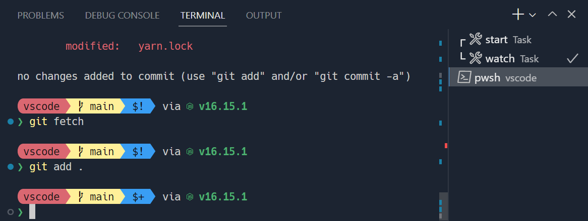
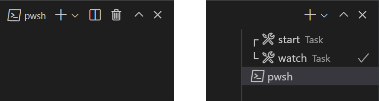
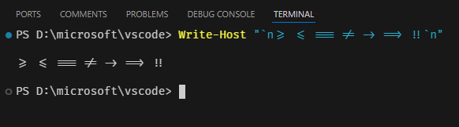
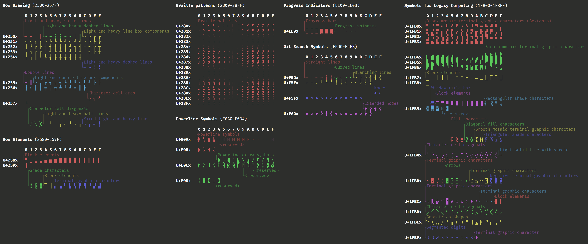
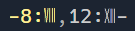
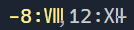

+++
title = "5.5 终端外观"
date = 2026-11-06T07:53:25+08:00
weight = 5
type = "docs"
description = ""
isCJKLanguage = true
draft = false
+++


> 原文链接: [https://code.visualstudio.com/docs/terminal/appearance](https://code.visualstudio.com/docs/terminal/appearance)

# 5.5 终端外观

　　Visual Studio Code 终端的外观可以进行大量自定义。



　　*[Sapphire](https://marketplace.visualstudio.com/items?itemName=tyriar.theme-sapphire) 主题，搭配使用 [Hack](https://sourcefoundry.org/hack/) 字体和 [Nerd Font](https://www.nerdfonts.com/) 符号的自定义 [Starship](https://starship.rs/) 提示符*

## 文本样式 {#text-style}

　　可以使用以下设置自定义终端中的文本：

- `terminal.integrated.fontFamily`：要使用的字体系列，采用 CSS 中 fontFamily 的字符串格式。例如，`"'Fira Code', monospace"` 会将 `Fira Code` 设为首选字体，并在缺少字形时使用 `monospace` 作为回退。
- `terminal.integrated.fontSize`：更改终端文本的字号。
- `terminal.integrated.letterSpacing`：配置字符之间的额外水平间距，单位为像素。
- `terminal.integrated.lineHeight`：以常规行高的倍数配置字符之间的额外垂直间距。例如，`1.1` 会增加 10% 的垂直空间。
- `terminal.integrated.fontWeight`：配置“普通”文本的字重。
- `terminal.integrated.fontWeightBold`：配置“粗体”文本的字重。
- `terminal.integrated.fontRendering`*（实验性）*：在 macOS 高 DPI 显示器上，将其设置为 `grayscale` 可使终端文本看起来更清晰。使用 `inherit` 保留系统字体渲染行为。
- `terminal.integrated.fontLigatures.*`：[配置连字](#ligatures)。

### Powerline 符号和 Nerd Font {#powerline-symbols-and-nerd-fonts}

　　[Powerline](https://powerline.readthedocs.io) 字体是经过特殊修补的字体，包含可在终端中使用的额外字符。VS Code 终端[无需配置字体即可渲染部分 Powerline 符号](#custom-glyphs)，但如果需要更多字形，请通过字体系列设置配置 Powerline 字体。Powerline 字体通常以 `" for Powerline"` 结尾。以下设置展示了如何配置经过修补的 DejaVu Sans Mono：

```json
"terminal.integrated.fontFamily": "'DejaVu Sans Mono for Powerline'"
```

　　Nerd Font 的工作方式相同，通常带有 `" NF"` 后缀。以下是配置 Hack 的 Nerd Font 变体的示例：

```json
"terminal.integrated.fontFamily": "'Hack NF'"
```

## 终端光标 {#terminal-cursor}

　　可以使用以下设置自定义终端光标样式以及是否闪烁：

- `terminal.integrated.cursorStyle`：定义光标形状，可以是块状、线形或下划线。
- `terminal.integrated.cursorWidth`：当光标样式设置为 `line` 时，光标的宽度（像素）。
- `terminal.integrated.cursorBlinking`：终端聚焦时光标是否闪烁。
- `terminal.integrated.cursorStyleInactive`：定义非活动光标的形状，可以是轮廓、块状、线形、下划线或无。

## 自定义选项卡 {#customizing-tabs}

　　默认情况下，当有两个或更多终端时，终端选项卡显示在终端视图右侧；当只有一个终端时，活动终端显示在视图标题中。



### 可见性 {#visibility}

　　默认可见性旨在节省水平空间，但可能并不理想。可以通过以下设置配置选项卡的呈现方式：

- `terminal.integrated.tabs.hideCondition`：何时隐藏右侧选项卡，设置为 `never` 可始终显示。
- `terminal.integrated.tabs.showActiveTerminal`：何时在终端视图标题中显示活动终端。
- `terminal.integrated.tabs.showActions`：何时在视图标题中显示活动终端的操作。
- `terminal.integrated.tabs.location`：选项卡显示在终端的左侧还是右侧。
- `terminal.integrated.tabs.enabled`：是否使用选项卡；禁用后将显示原来的下拉视图。

### 选项卡文本 {#tab-text}

　　每个选项卡上的文本由以下设置决定：

- `terminal.integrated.tabs.title`：选项卡标题。
- `terminal.integrated.tabs.description`：显示在标题右侧的文本。
- `terminal.integrated.tabs.separator`：标题与描述之间的分隔字符。

　　默认情况下，标题显示 shell 检测到的进程名称。

　　其他终端通常将 shell 发送的转义序列显示为标题，可以通过以下设置配置：

```json
"terminal.integrated.tabs.title": "${sequence}"
```

　　以下是所有可用变量：

- `${cwd}`：终端的当前工作目录。
- `${cwdFolder}`：终端的当前工作目录。对于多根工作区，或单根工作区中该值与初始工作目录不同时显示。在 Windows 上，只有在启用 shell 集成时才显示。
- `${workspaceFolder}`：启动终端所在的工作区。
- `${workspaceFolderName}`：启动终端所在工作区的名称。
- `${local}`：表示远程工作区中的本地终端。
- `${process}`：终端进程的名称。
- `${progress}`：由 OSC `9;4` 序列报告的进度状态。
- `${separator}`：条件分隔符（-），仅当两侧是带值的变量或静态文本时显示。
- `${sequence}`：进程提供给终端的名称。
- `${task}`：表示此终端与任务关联。
- `${shellType}`：检测到的 shell 类型。
- `${shellCommand}`：根据 shell 集成正在执行的命令。此变量要求检测到的命令行具有高置信度，在某些提示符框架中可能不起作用。
- `${shellPromptInput}`：根据 shell 集成得到的完整 shell 提示符输入。

### 图标 {#icons}

　　每个终端都有一个由其[5.3 终端配置文件](../5.3-TerminalProfiles/)确定的关联图标。默认图标及其颜色（未在配置文件中定义时使用）可以通过 `terminal.integrated.tabs.defaultIcon` 和 `terminal.integrated.tabs.defaultColor` 设置配置。

### 状态 {#status}

　　终端的“状态”（如果有）由选项卡右侧显示的图标表示。某些状态包含动画。如果动画分散注意力，可以通过以下设置禁用：

```json
"terminal.integrated.tabs.enableAnimation": false
```

### 视觉铃声 {#visual-bell}

　　终端的铃声触发时，会短暂显示一个黄色铃铛图标。可以通过 `terminal.integrated.enableBell` 禁用，并通过 `terminal.integrated.bellDuration` 配置持续时间。

## 终端颜色 {#terminal-colors}

　　虽然终端能够显示真彩色，但程序通常使用 8 种 ANSI 颜色（黑、红、绿、黄、蓝、品红、青和白色）以及每种颜色的亮色变体。这些 ANSI 颜色由活动的[3.3.7 主题](../../editor/3.3-ConfigureTheEditor/3.3.7-Themes/)决定，但也可以通过 [3.3.7 主题](../../editor/3.3-ConfigureTheEditor/3.3.7-Themes/#workbench-colors) 设置独立于主题进行配置。

　　可以通过 `terminal.integrated.drawBoldTextInBrightColors` 设置配置粗体文本使用普通 ANSI 颜色还是亮色变体。

### 最小对比度 {#minimum-contrast-ratio}

　　终端经常出现对比度问题，原因可能是明暗主题冲突、ANSI 颜色或正在运行的 shell/程序等。

　　最小对比度功能通过增加或降低文本前景色的亮度，直到达到 4.5:1 的对比度，从而解决此问题。

　　一个缺点是彩色文本有时会失去部分饱和度。可以通过以下设置配置或禁用此功能，以获得原始颜色：

```json
"terminal.integrated.minimumContrastRatio": 1
```

## 连字 {#ligatures}

　　终端[连字](https://en.wikipedia.org/wiki/Ligature_(writing))可将多个字符渲染为一个。只要终端字体系列（`terminal.integrated.fontFamily`）支持连字，就可以通过配置 `terminal.integrated.fontLigatures.enabled` 设置在终端中启用连字。



### 字体特性设置 {#font-feature-settings}

　　启用连字后，还可以按 [`font-feature-settings`](https://developer.mozilla.org/en-US/docs/Web/CSS/font-feature-settings) CSS 属性的格式设置详细的字体特性列表。这样可以更精细地控制连字的渲染方式。例如，禁用标准的 `calt` 连字并启用特定的字体变体，类似 `"calt" off, "ss03"`。字体支持的变体列表请查阅字体文档。

### 回退连字 {#fallback-ligatures}

　　当字体支持连字，但 VS Code 不支持解析该字体时，可以禁用 [GPU 加速](#gpu-acceleration)，或指定要手动连接以形成连字的字符序列列表。

　　默认情况下，回退连字是一组编码中常用的连字。可以通过配置 `terminal.integrated.fontLigatures.fallbackLigatures` 设置微调列表。例如：

```json
// 只对 `ff`、`fi` 和 `fl` 使用连字
"terminal.integrated.fontLigatures.fallbackLigatures": [
    "ff",
    "fi",
    "fl"
]
```

## GPU 加速 {#gpu-acceleration}

　　终端有两种不同的渲染器，各有不同的取舍：

- WebGL 渲染器：真正的 GPU 加速。
- DOM 渲染器：回退渲染器，速度慢得多，但兼容性很好。

　　由 WebGL 渲染器驱动的 GPU 加速默认在终端中启用。它通过显著减少 CPU 每帧渲染的时间，帮助终端更快运行并以高帧率显示。

　　`terminal.integrated.gpuAcceleration` 的默认值 `auto` 会尝试 WebGL 渲染器，如果失败则回退到 DOM 渲染器。在 Linux 虚拟机、不支持 WebGL 的浏览器或驱动程序过时的机器上，WebGL 可能无法正常工作。

### 自定义字形 {#custom-glyphs}

　　启用 [GPU 加速](#gpu-acceleration)后，自定义渲染（而不是字体）会改善某些字符在终端中的显示方式。支持以下 Unicode 范围：

- 制表符绘制（`U+2500`-`U+257F`）
- 方块元素（`U+2580`-`U+259F`）
- 盲文图案（`U+2800`-`U+28FF`）
- Powerline 符号（`U+E0A0`-`U+E0D4`，私用区）
- 进度指示器（`U+EE00`-`U+EE0B`，私用区）
- Git 分支符号（`U+F5D0`-`U+F60D`，私用区）
- 传统计算符号（`U+1FB00`-`U+1FBFF`）

　　这也意味着配置的字体不需要包含这些字符，而且它们会被绘制得像素级精确，并在适当情况下拉伸到整个单元格的大小。

　　下面是上述范围内约 800 个受支持字符的全部示例：



　　可以通过将 `terminal.integrated.customGlyphs` 设置为 `false` 禁用此功能。

### 重新缩放宽度不明确的字形 {#rescaling-ambiguous-width-glyphs}

　　某些 Unicode 字符的宽度不明确，终端后端和前端可能对其大小判断不一致。启用 [GPU 加速](#gpu-acceleration)且出现这种歧义时，字形会在水平方向重新缩放以适应单个单元格，防止重叠。

　　例如，下图中的罗马数字字符被压缩到单个单元格中：



　　可以通过将 `terminal.integrated.rescaleOverlappingGlyphs` 设置为 `false` 禁用此功能，此时会出现以下重叠渲染：



## 自定义提示符 {#customizing-your-prompt}

　　大多数 shell 允许对终端提示符进行大量自定义。这通常是在 VS Code 之外通过修改 `$PS1` 变量、设置 `$PROMPT_COMMAND` 或安装插件来配置 shell。

　　[Starship](https://starship.rs/) 和 [oh-my-posh](https://ohmyposh.dev/) 等提示符可以显示 Git 状态等内容，并适用于大多数 shell，是入门时的好选择。

## 常见问题 {#common-questions}

### 为什么终端显示彩色三角形或黑色矩形？ {#why-is-my-terminal-showing-a-multi-colored-triangle-or-a-black-rectangle}

　　在某些环境中，终端的 GPU 加速渲染可能会出现问题。例如，你可能看到大块彩色三角形而不是文本。这通常由驱动程序/虚拟机图形问题引起，Chromium 中也会发生。可以通过使用 `--disable-gpu` 标志启动 `code`，或将 `terminal.integrated.gpuAcceleration` 设置为 `off` 以避免在终端中使用画布。更多信息请参阅 [GPU 加速](#gpu-acceleration)部分。

### 为什么终端中的颜色不正确？ {#why-are-the-colors-in-the-terminal-not-correct}

　　[最小对比度功能](#minimum-contrast-ratio)可能导致颜色无法按预期显示。可以通过以下设置禁用：

```json
"terminal.integrated.minimumContrastRatio": 1
```

　　关于为什么默认启用的背景说明，请参阅 [vscode#146406](https://github.com/microsoft/vscode/issues/146406#issuecomment-1084825473)。
