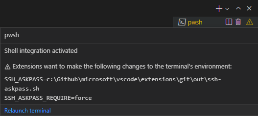

+++
title = "5.6 终端高级功能"
date = 2026-11-06T07:53:25+08:00
weight = 6
type = "docs"
description = ""
isCJKLanguage = true
draft = false
+++


> 原文链接: [https://code.visualstudio.com/docs/terminal/advanced](https://code.visualstudio.com/docs/terminal/advanced)

# 5.6 终端高级功能

　　Visual Studio Code 的集成终端具有许多高级功能和设置，例如 Unicode 和表情符号支持、自定义键盘快捷键以及自动回复。本主题将详细介绍这些高级功能。如果你是 VS Code 或集成终端的新手，建议先阅读[5.2 终端基础](../5.2-TerminalBasics/)主题。

## 持久会话 {#persistent-sessions}

　　终端支持两种不同类型的持久会话：

* 进程重新连接：重新加载窗口时（例如安装扩展后），**重新连接**到之前的进程并恢复其内容。
* 进程恢复：重新启动 VS Code 时，恢复终端内容，并使用其原始环境**重新启动**进程。

　　可以通过将 `terminal.integrated.enablePersistentSessions` 设置为 `false` 来禁用这两种持久会话，恢复的回滚量由 `terminal.integrated.persistentSessionScrollback` 设置控制。进程恢复可以通过 `terminal.integrated.persistentSessionReviveProcess` 单独配置。

### 在窗口之间移动终端 {#moving-terminals-between-windows}

　　终端选项卡可以在 VS Code 窗口之间拖放。也可以通过命令面板中的 **Terminal: Detach Session** 和 **Terminal: Attach to Session** 命令手动完成。

### 配置终端可见性 {#configure-terminal-visibility}

　　打开窗口时，如果终端视图可见，它会通过持久会话重新连接到终端，或创建新的 shell。可以使用 `terminal.integrated.hideOnStartup` 设置微调此行为。

* `never`（默认）：启动时从不隐藏终端视图。
* `whenEmpty`：仅当没有恢复持久会话时隐藏终端。
* `always`：始终隐藏终端，即使恢复了持久会话。

　　还可以使用 `terminal.integrated.hideOnLastClosed` 设置覆盖最后一个终端关闭时关闭终端视图的默认行为。

## 键盘快捷键和 shell {#keyboard-shortcuts-and-the-shell}

　　作为嵌入式应用程序，集成终端应拦截在 VS Code 中分发的一些（但不是全部）键盘快捷键。

　　可配置的 `terminal.integrated.commandsToSkipShell` 设置决定哪些命令的键盘快捷键应始终“跳过 shell”，而由 VS Code 的键盘快捷键系统处理。默认情况下，它包含一个硬编码的命令列表，这些命令对 VS Code 体验不可或缺，但你可以添加或删除特定命令：

```jsonc
{
  "terminal.integrated.commandsToSkipShell": [
    // 确保切换侧边栏可见性快捷键跳过 shell
    "workbench.action.toggleSidebarVisibility",
    // 将快速打开快捷键发送给 shell
    "-workbench.action.quickOpen",
  ]
}
```

　　查看 `terminal.integrated.commandsToSkipShell` 设置详情，了解默认命令的完整列表。

> **提示**：可以将 `terminal.integrated.sendKeybindingsToShell` 配置为覆盖 `terminal.integrated.commandsToSkipShell`，并将大多数键盘快捷键发送到 shell。但请注意，这会禁用 `Ctrl + F` 等打开[5.2 终端基础](../5.2-TerminalBasics/#find)的键盘快捷键。

### 组合键 {#chords}

　　组合键快捷键由两个键盘快捷键组成，例如先按 `Ctrl + K`，再按 `Ctrl + C` 将行更改为注释。组合键默认始终跳过 shell，但可以通过 `terminal.integrated.allowChords` 禁用。

### macOS 清屏 {#macos-clear-screen}

　　在 macOS 上，`Cmd + K` 是终端中常用的清屏快捷键，因此 VS Code 也会遵循这一点，这意味着 `Cmd + K` 组合键将无法使用。可以通过[3.3.3 键盘快捷键](../../editor/3.3-ConfigureTheEditor/3.3.3-KeyboardShortcuts/#removing-a-keyboard-shortcut)来启用 `Cmd + K` 组合键：

```json
{
    "key": "cmd+k",
    "command": "-workbench.action.terminal.clear"
}
```

　　此外，如果有任何扩展提供了 `Cmd + K` 快捷键，由于快捷键优先级的工作方式，此快捷键会被自动覆盖。在这种情况下，要重新启用 `Cmd + K` 清屏快捷键，可以在用户快捷键中重新定义它，因为用户快捷键的优先级高于扩展快捷键：

```json
{
    "key": "cmd+k",
    "command": "workbench.action.terminal.clear",
    "when": "terminalFocus && terminalHasBeenCreated || terminalFocus && terminalProcessSupported"
}
```

### 助记键 {#mnemonics}

　　默认情况下，终端中禁用了使用助记键访问 VS Code 菜单的功能（例如用 `Alt + F` 打开文件菜单），因为这些按键事件通常是 shell 中的重要热键。设置 `terminal.integrated.allowMnemonics` 可以启用助记键，但请注意，这将不允许任何 `Alt` 按键事件发送到 shell。此设置在 macOS 上不起作用。

### 自定义序列快捷键 {#custom-sequence-keyboard-shortcuts}

　　`workbench.action.terminal.sendSequence` 命令可用于向终端发送特定的文本序列，包括由 shell 特殊解释的转义序列。该命令允许你发送方向键、`Enter`、光标移动等。你可以通过命令面板运行此命令以进行手动输入，但它最有用的情况是分配带参数的自定义键盘快捷键。

　　例如，以下序列会跳过光标左侧的单词（`Ctrl + ←`），然后按 `Backspace`：

```jsonc
{
  "key": "ctrl+u",
  "command": "workbench.action.terminal.sendSequence",
  "args": {
    "text": "\u001b[3.4.3 变量替换](../../editor/3.4-Reference/3.4.3-SubstitutionVariables/)。

　　`sendSequence` 命令仅支持使用 `\u0000` 格式通过字符代码使用字符（不支持 `\x00`）。有关这些十六进制代码和终端序列的更多信息，请参阅以下资源：

* [XTerm 控制序列](https://invisible-island.net/xterm/ctlseqs/ctlseqs.html)
* [C0 和 C1 控制代码列表](https://github.com/xtermjs/xterm.js/blob/0e45909c7e79c83452493d2cd46d99c0a0bb585f/src/common/data/EscapeSequences.ts)

## 发送自定义信号 {#send-a-custom-signal}

　　`workbench.action.terminal.sendSignal` 命令可用于向活动终端中的前台进程发送任意信号。

　　例如，以下键绑定会发送 `SIGTERM`，使进程正常终止。

```jsonc
{
  "key": "ctrl+shift+/",
  "command": "workbench.action.terminal.sendSignal",
  "args": {
    "signal": "SIGTERM"
  }
}
```

## 确认对话框 {#confirmation-dialogs}

　　为避免不必要的输出和用户提示，终端在进程退出时不显示警告对话框。如果需要警告，可以使用以下设置进行配置：

* `terminal.integrated.confirmOnExit`：控制窗口关闭时如果有活动调试会话是否进行确认。
* `terminal.integrated.confirmOnKill`：控制当终端有子进程时，终止终端是否进行确认。
* `terminal.integrated.showExitAlert`：控制当退出代码非零时是否显示“终端进程已终止，退出代码为”警报。

## 自动回复 {#auto-replies}

　　如果终端收到精确的输出序列，可以自动向 shell 提供可配置的输入响应。最常见的用例是：在询问用户是否要终止批处理作业的批处理脚本中按 `Ctrl + C` 时自动回复提示。要自动关闭此消息，请添加以下设置：

```json
{
  "terminal.integrated.autoReplies": {
    "Terminate batch job (Y/N)": "Y\r"
  }
}
```

　　请注意，此处使用的 `\r` 字符表示 `Enter`，与[自定义序列快捷键](#custom-sequence-keyboard-shortcuts)类似，此功能支持向 shell 发送转义序列。

　　默认情况下不配置任何自动回复，因为提供 shell 输入应该是用户的显式操作或配置。

## 更改制表位宽度 {#change-tab-stop-width}

　　`terminal.integrated.tabStopWidth` 设置允许配置终端中运行的程序输出 `\t` 时的制表位宽度。通常不需要此设置，因为程序通常会将光标移动，而不是使用 `Tab` 字符，但在某些情况下可能有用。

## Unicode 和表情符号支持 {#unicode-and-emoji-support}

　　终端支持 Unicode 和表情符号。在终端中使用这些字符时，支持方面有一些注意事项：

* 某些 Unicode 符号的宽度不明确，可能在不同 Unicode 版本之间变化。目前支持 Unicode 6 和 11 的宽度，可以通过 `terminal.integrated.unicodeVersion` 设置配置。指定的版本应与 shell/操作系统使用的 Unicode 版本匹配，否则可能出现渲染问题。请注意，shell/操作系统的 Unicode 版本可能与字体的实际宽度不匹配。
* 某些由多个字符组成的表情符号可能无法正确渲染，例如肤色修饰符。
* Windows 上的表情符号支持有限。

## 图像支持 {#image-support}

　　终端中的图像支持 Sixel 或 iTerm 内联图像协议。此功能默认禁用，可以通过 `terminal.integrated.enableImages` 设置启用。

　　当前限制：

* 序列化不工作，因此重新加载终端不会保留任何图像（[jerch/xterm-addon-image#47](https://github.com/jerch/xterm-addon-image/issues/47)）。
* 将选择内容复制为 HTML 时不会包含所选图像（[jerch/xterm-addon-image#50](https://github.com/jerch/xterm-addon-image/issues/50)）。
* 动画 GIF 不工作（[jerch/xterm-addon-image#51](https://github.com/jerch/xterm-addon-image/issues/51)）。
* 高度小于一个单元格的图像无法正常工作，这是[序列的设计缺陷，在 XTerm 中也会发生](https://github.com/microsoft/vscode/issues/183840#issuecomment-1569345048)。

## 进程环境 {#process-environment}

　　终端中运行的应用程序的进程环境受各种设置和扩展影响，可能导致 VS Code 终端中的输出与其他终端不同。

### 环境继承 {#environment-inheritance}

　　打开 VS Code 时，它会启动登录 shell 环境以加载 shell 环境。这是因为开发工具通常会添加到 `~/.bash_profile` 等 shell 启动脚本中的 `$PATH`。默认情况下，终端会继承此环境，具体取决于你的[5.3 终端配置文件](../5.3-TerminalProfiles/#configuring-profiles)，这意味着可能已经运行了多个配置文件脚本，从而导致意外行为。

　　在 macOS 和 Linux 上，可以通过 `terminal.integrated.inheritEnv` 设置禁用此环境继承。

### VS Code 实例之间的环境变量 {#environment-variables-between-vs-code-instances}

　　启动多个 VS Code 实例时，环境变量会在它们之间共享：

* 第一个 VS Code 实例从父进程（例如启动 VS Code 的 shell 或应用程序）继承环境变量。
* 后续 VS Code 实例从第一个正在运行的 VS Code 实例继承环境变量，而不是从父进程继承。

　　要在 VS Code 实例之间隔离环境变量，请使用 [3.3.10 命令行界面](../../editor/3.3-ConfigureTheEditor/3.3.10-CommandLineInterface/#isolating-vs-code-instances)为每个实例使用单独的用户数据目录。这可确保每个实例维护自己的环境、设置和扩展。

### 与 `$LANG` 的交互 {#interaction-with-lang}

　　`$LANG` 环境变量有一些特殊交互，它决定终端中字符的呈现方式。此功能通过 `terminal.integrated.detectLocale` 设置配置：

| 值 | 行为 |
|------------------|---|
| `on` | 始终将 `$LANG` 设置为最常用的期望值。所选值基于操作系统区域设置（回退到 `en-US`），并使用 UTF-8 编码。 |
| `auto`（默认） | 如果 `$LANG` 配置不正确（未设置为 UTF 或 EUC 编码），则按类似 `on` 的行为设置 `$LANG`。 |
| `off` | 不修改 `$LANG`。 |

### 扩展对环境变量的贡献 {#extension-environment-contributions}

　　扩展可以[向终端环境提供内容](https://code.visualstudio.com/api/references/vscode-api#ExtensionContext.environmentVariableCollection)，从而与终端集成。例如，内置 Git 扩展会注入 `GIT_ASKPASS` 环境变量，让 VS Code 处理 Git 远程身份验证。

　　如果扩展更改了终端环境，现有终端会在安全的情况下重新启动，否则会在终端状态中显示警告。将鼠标悬停在警告上可查看更改详情，其中还包含重新启动按钮。



## Windows 和 ConPTY {#windows-and-conpty}

　　VS Code 的终端构建在 [xterm.js](https://github.com/xtermjs/xterm.js) 项目之上，实现 Unix 风格的终端，将所有数据序列化为字符串并通过“伪终端”传输。历史上，Windows 上的终端并非如此工作，而是使用[控制台 API](https://learn.microsoft.com/windows/console/console-functions)实现名为“conhost”的控制台。

　　一个名为 [winpty](https://github.com/rprichard/winpty) 的开源项目试图通过在 Unix 风格终端和 Windows 控制台之间提供模拟/转换层来解决此问题。VS Code 终端最初仅使用 winpty 实现。这在当时很好，但在 2018 年，Windows 10 获得了 [ConPTY API](https://devblogs.microsoft.com/commandline/windows-command-line-introducing-the-windows-pseudo-console-conpty/)，它将 winpty 首创的想法集成到 Windows 中，为在 Windows 上使用 Unix 风格终端和应用提供了更可靠、受支持的系统。

　　VS Code 在 Windows 10+（版本号 18309 及更高）上默认使用 ConPTY，并为较旧版本的 Windows 回退到 winpty 作为旧版选项。可以通过 `terminal.integrated.windowsEnableConpty` 设置显式禁用 ConPTY，但通常应避免这样做。

　　由于 ConPTY 是模拟层，它确实有一些怪癖。最常见的是 ConPTY 认为自己是视口的所有者，因此有时会重新打印屏幕。这种重新打印可能导致意外行为，例如运行 **Terminal: Clear** 命令后仍显示旧内容。

## 远程开发 {#remote-development}

　　本节介绍使用 VS Code [8 远程](../../remote/)扩展连接到远程机器时特有的主题。

### 远程窗口中的本地终端 {#local-terminals-in-remote-windows}

　　可以通过命令面板中的 **Terminal: Create New Integrated Terminal (Local)** 命令，在远程窗口中启动默认的*本地*终端配置文件。目前，无法从远程窗口启动非默认配置文件。

### 减少远程输入延迟（预览） {#reducing-remote-input-latency-preview}

　　本地回显功能有助于减轻远程窗口中的输入延迟。它会在远程确认结果之前，以暗色在终端中显示键入的字符。默认情况下，当检测到延迟高于 30 毫秒时，该功能会启动，可以通过 `terminal.integrated.localEchoLatencyThreshold` 配置时间。未确认字符的颜色由 `terminal.integrated.localEchoStyle` 定义。

　　本地回显会根据终端中的活动程序动态禁用自身。这由 `terminal.integrated.localEchoExcludePrograms` 控制，默认值为 `['vim', 'vi', 'nano', 'tmux']`。建议为在输入时高度动态和/或频繁重新打印屏幕的应用程序或 shell 禁用此功能。

　　要完全禁用该功能，请使用：

```json
{
  "terminal.integrated.localEchoEnabled": false
}
```
